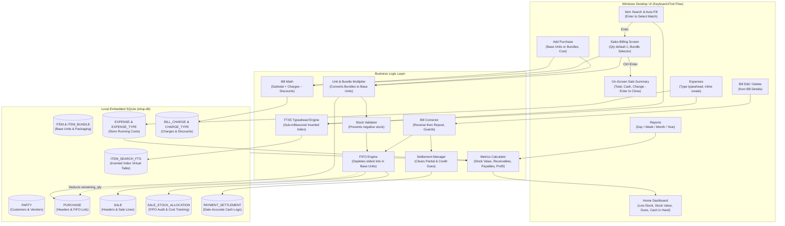

# High-Level Design (HLD) Document: Book Keeper
**System:** Offline-First Retail Accounting & Inventory Management Desktop Application  
**Target Environment:** Windows Laptop (Single-Node, Embedded Database)  
**Currency:** Indian Rupees (₹)  
**Status:** Approved Requirements & Entity Design Baseline (rev. 2026-11-22 — v1.1 feature set added: FR-05 rev., FR-08 rev., FR-14 rev., FR-18 – FR-23, NFR-03 rev.; see §10 for delivery plan and [Design Decisions](DESIGN_DECISIONS.md) DD-35 – DD-46)  
**Source of truth:** This HLD is the single source for requirements, assumptions, scope and entity design. LLDs refine it and must not contradict it.  
**UI/UX Companion Document:** [UI/UX Specification](book_keeper_UI_UX_Specification.md)  

---

## 1. Executive Summary & Note
**Book Keeper** is a lightweight, offline-first desktop accounting and inventory management application designed for a small retail shop. It replaces complex, bloated enterprise billing software with a streamlined, fast, and reliable workflow focused on core operational realities: tracking inward stock purchases, outward sales, customer/vendor credit dues, bill-level partial payments, inventory valuation using **FIFO (First-In, First-Out)**, and instant low-stock visibility.

The system runs locally on a Windows laptop without requiring any standalone database servers or continuous internet connectivity. It uses an embedded relational database (SQLite) ensuring data portability, zero maintenance, simple file-copy backups, and standard schema evolution.

---

## 2. Requirements Specification

### 2.1. Functional Requirements (FR)

* **FR-01: Inward Stock & Purchase Management**
  * The user can record purchases of items into stock with item name, quantity, unit cost (₹), purchase date, and optional vendor details.
  * The user can specify the payment status: **Cash** (`PAID`), **Credit** (`UNPAID`), or **Partial** (`PARTIAL`) with an upfront `paid_amount` and remaining `balance_due`.
  * The stated status must agree with `paid_amount` (`PAID` ⇒ paid = total; `PARTIAL` ⇒ 0 < paid < total; `UNPAID` ⇒ paid = 0); paying more than the total is rejected. A vendor is required unless `PAID`.
  * A purchase bill may carry bill-level **charges** (e.g. transport, carrier fee) and **discounts** (FR-19). `total_amount` (the payable) = items subtotal + charges − discounts. Lot `unit_cost` stays at the item rate; charges are booked as Operating Expenses and discounts as Other Income (DD-38).
* **FR-02: Outward Sales Management**
  * The user can record sales of items with quantity, selling price (₹), sale date, and optional customer details.
  * The user can record multi-item sales under a single transaction (cart-style billing).
  * The user can specify the payment status: **Cash** (`PAID`), **Credit** (`UNPAID`), or **Partial** (`PARTIAL`) with an upfront `paid_amount` and remaining `balance_due`.
  * The stated status must agree with `paid_amount` (`PAID` ⇒ paid ≥ total, excess is change and is not stored; `PARTIAL` ⇒ 0 < paid < total; `UNPAID` ⇒ paid = 0). A customer is required unless `PAID`.
  * A sale bill may carry bill-level **charges** (e.g. delivery) and **discounts** (FR-19). `total_amount` (the receivable) = items subtotal + charges − discounts, and must be ≥ 0.
* **FR-03: Strict FIFO Stock Depletion**
  * When an item is sold, the system automatically depletes inventory from the **oldest available stock lot** (First-In, First-Out). "Oldest" is entry order (lowest lot id); back-dated entries are treated as newest and never re-cost past sales.
  * When inventory for an item spans multiple batches with different purchase costs, the system splits depletion across batches and calculates the exact Cost of Goods Sold (COGS).
* **FR-04: Negative Stock Prevention**
  * The system strictly validates available stock across all active batches before committing a sale. Sales that exceed total available stock are blocked.
  * Validation sums the required base quantity per item across all cart lines (the same item on several lines is checked in aggregate). The same guard applies to negative adjustments, vendor returns, and replacement issues.
* **FR-05: Real-Time Low Stock Monitoring**
  * *(rev. 2026-11-22)* Each item has its own **low stock level** (`ITEM.low_stock_threshold`, base units, default **5**, ≥ 0). The system flags an item as "Low Stock" when its total aggregated stock across all batches drops below that level (`current_stock < low_stock_threshold`). A level of `0` means the item is never flagged.
  * The level is set per item: in the Item details drawer (Edit button, FR-50; the inline Item List column of v1.1 was removed 2026-11-26) and in the Item edit drawer. Changing it recomputes `is_low_stock` immediately.
  * Low stock items are surfaced on the Home / Dashboard screen, each with its own level.
  * Applies only to `PHYSICAL` items (FR-21).
* **FR-06: Symmetrical Credit & Dues Management**
  * **Customer Receivables**: The user can view total outstanding dues owed by customers (sum of `balance_due` on unpaid and partial sales).
  * **Vendor Payables**: The user can view total outstanding dues owed by the shop to suppliers (sum of `balance_due` on unpaid and partial purchases).
  * **Due Settlement**: The user can record subsequent payments against a specific bill (from Sales/Purchase History) or against a party's oldest open bills first (FIFO, from Credit & Dues). Each settlement decreases `balance_due`, can never exceed the outstanding amount, and logs the exact settlement date for daily cash register balancing.
  * **Single payment ledger**: every money event (upfront payment, settlement, return credit, cash refund in/out) is one `PAYMENT_SETTLEMENT` row; bill `paid_amount` / `balance_due` / `payment_status` are cached values derived from it (see Assumption 8).
* **FR-07: Returns & Replacements**
  * **Customer Sales Return**: Returning sold items. When items are marked **Restockable**, the system restores `remaining_quantity` on the original lots (traced via `SALE_STOCK_ALLOCATION`, latest-depleted first), re-entering inventory at their original cost. `DAMAGED_SCRAP` items are not restocked.
    * **Linked return** (against a sale line): returned qty ≤ sold − already returned; same item; refund rate ≤ the line's **net** rate (FR-19; defaults to it). Repeated partial returns never over-restore lots.
    * **Unlinked return** (no receipt): allowed; a Restockable unit re-enters stock as a new `RETURN`-source lot at the item's latest lot cost (user enters cost if the item never had a lot).
  * **Refund settlement (both directions)**: a **linked (tracked) return** reduces only its own bill's `balance_due` (capped at that balance); any remainder is paid out (customer) / received (vendor) as cash — it never moves to other bills. An **unlinked (untracked) return** with a known party is applied to that party's oldest open bills first, remainder in cash; walk-in returns are pure cash refunds.
  * **Replacement / Exchange (no-money swap)**: against a bill, one or more sold units come back — Restockable (e.g. a colour/size swap; goes back to its original lot) or Scrap (defective) — and one or more units of **any** item are issued from stock (FIFO). No money moves and revenue is not reversed; a value difference is shown as a warning only (use a refund + new sale when prices must be settled). Returned units are reversed exactly as in a refund return; issued units' cost becomes replacement COGS on the return date. The original sale is not altered.
  * **Vendor Purchase Return**: Returning stock to suppliers from a specific lot (qty ≤ lot remaining) or FIFO across the item's lots; settled per the refund rule above (payables first, then cash received).
* **FR-08: Standalone Stock Adjustments with FIFO Depletion**
  * The user can adjust stock quantities directly via item search (name or barcode) without referencing a sale or invoice ID, with an adjustment date and a reason: `DAMAGED`, `EXPIRED`, `THEFT_LOST`, `COUNT_CORRECTION`, or `UNRECORDED_STOCK` (positive only; see the unrecorded stock bullet below).
  * **FIFO Depletion Linkage**: When an adjustment is negative (e.g. -5 damaged units), the system automatically triggers the FIFO allocation engine to deduct `remaining_quantity` from the oldest available lots, preventing phantom inventory lots and logging inventory write-off losses accurately.
  * **Positive adjustments** (found stock) create a new `ADJUSTMENT`-source lot at the item's most recent lot cost; if the item has never had a lot, the user must enter the unit cost. The selling price is never used as cost.
  * **Unrecorded / ad-hoc stock entry** *(added 2026-11-22, DD-40)*: an existing shop holds stock that has no purchase history. From the Item List / Item edit drawer, the user can **set the stock on hand** directly (enter the counted quantity) or add a quantity, without a purchase bill:
    * A **positive delta** is recorded as a stock adjustment with reason `UNRECORDED_STOCK`. It creates an `ADJUSTMENT`-source lot at a **user-entered unit cost** (prefilled with the item's most recent lot cost, editable; required if the item never had a lot). The lot adds to stock valuation (FR-09) at that cost. It is not a purchase: it never appears in purchase lists, totals, payables or cash flow, and it is not income in the P&L.
    * A **negative delta** (counted less than the system shows) is a `COUNT_CORRECTION` negative adjustment (FIFO depletion, inventory loss).
    * A delta of 0 changes nothing.
* **FR-09: Financial Aggregations & Reports**
  * Periodic totals (Day, Week, Month, Year presets or a custom range) for:
    * Total Sales (Gross Revenue), Sales Returns, and Net Sales
    * Total Purchases (net of vendor returns; excludes adjustment/opening/return lots)
    * Cash Flow (actual cash in vs. cash out, from the payment ledger)
    * Total Stock Valuation: Sum of (Remaining Lot Qty × Lot Unit Cost) across all active lots
    * Profit statement *(rev. 2026-11-22, DD-39)*:
      * Gross Sales (Σ sale items subtotals) − Sales Discounts − Sales Returns = **Net Sales**
      * Net Sales − COGS (net of returned units, plus replacement units issued) = **Gross Profit**
      * Gross Profit + **Other Income** (sale charges collected + purchase discounts received) − **Inventory Losses** (write-offs, scrap returns) − **Operating Expenses** (FR-18 expenses + purchase charges paid) = **Net Profit**
    * Total Expenses for the period, broken down by expense type.
  * *(v1.3)* The dashboard shows grouped cards and no longer shows today's net profit (FR-32). Cash in hand is all-time (FR-33). Bill-level and line-level profit are in Sales History (FR-34).
* **FR-10: Lists & Operational Views**
  * Complete, filterable lists of all Sales, all Purchases, all Expenses, Pending Customer Dues (Receivables), and Pending Vendor Dues (Payables).
  * *(added 2026-11-22, DD-43)* Every list with a header row keeps the **column headers fixed (sticky)** while the rows scroll, so the user always sees what each column means. This is implemented once in the shared table component, so every list gets it.
* **FR-11: Data Portability & Local Backup** *(v1 scope)*
  * Import items with opening stock from CSV / Excel (`.xlsx`): a dry-run validation report (row-level errors, duplicates) precedes execution with a conflict strategy (`SKIP`, `OVERWRITE`, `ADD_STOCK`); opening stock creates `OPENING`-source lots at the row's purchase cost. All-or-nothing.
  * One-click local database backup to a user-selected folder or external USB drive, plus a database integrity check.
  * *Deferred to v2:* all exports, parties import, opening dues, VedBill migration, restore from backup.
* **FR-12: Future Invoicing Foundation**
  * *(v1.2, 2026-11-23)* Printing is now in scope: see FR-27.
  * Transactions are stored with unique sequential transaction codes, customer/vendor relationships, line-item breakdowns, and shop profile headers, allowing instant printable bill generation without schema changes.
* **FR-13: Item Packaging & Bundles (Multi-UOM)**
  * The system supports pre-defined packaging bundles for an item (e.g., a "Box of 10 Pencils", a "Dozen of 12", a "Carton of 500 Sheets").
  * **Base Unit Integrity**: Inventory stock is always tracked and depleted via FIFO at the smallest base unit level (`base_unit`, e.g., Piece). Selling or purchasing in bundles automatically converts to base units via the bundle's multiplier (`quantity = bundle_quantity * units_per_bundle`).
  * **Dual Entry Points for Bundle Creation**:
    1. *Dedicated Item Master Screen*: Configured during initial item creation or editing (cold start). Bundles can be edited (including the multiplier) or deleted at any time. `units_per_bundle` must be > 1.
  * **Bundles are a data-entry convenience only**: bills record base units sold/bought and the price per base unit, plus a display-only snapshot of the pack used (`pack_label`, `pack_quantity`). Bill lines hold no reference to `ITEM_BUNDLE`, so changing or deleting a bundle never affects history.
    2. *Inline on the Fly*: An inline `[+ New Bundle]` option / shortcut (`Alt + B`) in the billing/purchase unit dropdown opens a quick modal dialog to define a new bundle name, multiplier, and default price without leaving the screen. *(v1.3, FR-29: it is an option inside the dropdown, with no separate button; the Item List rows also get an Add bundle action.)*
  * **Dynamic, Self-Learning Presets (Zero UI Hardcoding)**:
    * The system dynamically queries distinct `(bundle_name, units_per_bundle)` combinations from `ITEM_BUNDLE` ordered by usage frequency.
    * When creating a bundle for any item, typing or focusing the bundle field displays contextual suggestions showing both the name and historical size (e.g., `Box (10 units)`, `Box (20 units)`, `Dozen (12 units)`). Selecting a suggestion auto-fills both the label and multiplier while still allowing full custom typing.
    * As new packaging types are introduced by the shopkeeper, they immediately become available as presets for all items without requiring UI code changes.
* **FR-14: High-Speed Typeahead Search (SQLite FTS5)**
  * Instant auto-fill suggestions powered by an inverted index via SQLite FTS5 matching across item name, category, and barcode.
  * Sub-millisecond query responses supporting prefix typing (`pen*`) and tokenized multi-word search (`blue gel`).
  * *(rev. 2026-11-22, DD-36)* **Every search field is live and index-backed.** Results update as the user types (short debounce), with no Search button and no Enter needed. This covers the Item List page and all other search boxes (parties, history lists, pickers).
    * Master-data lookups use an FTS5 prefix index per entity: items (`ITEM_SEARCH_FTS`), parties (`PARTY_SEARCH_FTS`: name, phone), expense types (`EXPENSE_TYPE_SEARCH_FTS`), and charge/discount types (`CHARGE_TYPE_SEARCH_FTS`). All are kept in sync by application code after commit (DD-24).
    * History lists (sales, purchases, expenses, returns) search on code / party name / type name with the same live behaviour; they may use indexed `LIKE` instead of FTS because they are paginated SQL lists.
    * One shared frontend search hook and typeahead component are used everywhere, so behaviour is identical across screens.
* **FR-15: Rapid Keyboard-First Checkout Flow (Enter-Key Navigation)**
  * High-speed, heads-down counter workflow operating entirely via keyboard without mouse interaction:
    1. Focus in Item Search → Type 2-3 characters or scan barcode.
    2. Press `Enter` → Selects top match; item details and price auto-populate; focus jumps to Quantity.
    3. Quantity field defaults to `1` → Press `Enter` to accept or type quantity and press `Enter`.
    4. Focus jumps to Unit / Bundle selector → Defaults to Base Unit (or last used); Arrow keys switch to Box/Bundle if needed; `Alt + B` defines a new bundle → Press `Enter`.
    5. Focus jumps to Rate (pre-filled with the default base or bundle price, editable) → Press `Enter`. *(v1.3, FR-31: the info line shows the open lots' purchase prices and the FIFO draw for the quantity.)*
    6. Line item commits to the bill → Focus loops back immediately to Item Search for the next item.
  * **Completing the Sale**: Pressing `Enter` on an empty search field (or pressing `Ctrl + Enter`) opens the **Payment dialog before anything is saved**:
    * Grand Total (₹)
    * Payment Status (`PAID` default, `PARTIAL`, `UNPAID`; the latter two require a customer)
    * Cash Received (auto-focused) & live Change to Return
  * Pressing `Enter` in the Payment dialog commits the sale (`paid_amount` = cash received for PAID/PARTIAL, 0 for UNPAID) and shows the result (bill code, balance due, change). Pressing `Enter` again resets the screen to a fresh, blank bill. `Escape` in the Payment dialog returns to the cart without saving.
  * *Note*: This is strictly an on-screen dialog; physical receipt printing and PDF/image export are deferred to future versions.
  * *(v1.2)* The result screen offers **Print bill (P)** (FR-27). Receipt/thermal printing stays out of scope.
* **FR-16: Optional Maximum Retail Price (MRP)**
  * The system supports recording an optional Maximum Retail Price (MRP in ₹) on items and bundles. This serves as a printed reference price distinct from the shop's actual selling price (`default_sale_price`), allowing price-to-MRP comparisons.
* **FR-17: Soft-Deletion & Archival Integrity** *(deferred to v2; superseded in v1.5 by FR-45 items and FR-46 parties)*
  * v1: Items and Parties cannot be deleted or archived at all. The `is_active` column is kept (always `1` in v1) and read paths already filter on it, so v2 can add archiving without schema changes.
  * v2 intent: Deletion acts as a soft archive (`is_active = 0`), hiding records from active search and selection lists while maintaining referential integrity for past bills, audit trails, and financial reports.
* **FR-18: Store Expenses** *(added 2026-11-22, DD-35)*
  * The user can record running expenses of the store: printer ink, electricity bill, rent, tea, cleaning supplies, and so on. Each expense has a date, an **expense type**, an amount (₹, > 0) and optional notes.
  * **Expense types behave like items in search:** the type field is a live FTS typeahead over existing types. If the typed name does not exist, the user can create the new type inline from the same field (`[+ Create "<name>"]` / Enter on no match), without leaving the form. Types are unique by name (case-insensitive) and are master data.
  * An expense is always paid in cash from the drawer on its date (credit or unpaid expenses are out of scope).
  * **Cash in hand:** expenses are cash out. The live cash drawer becomes *today's ledger cash in − today's ledger cash out − today's expenses* (DD-37). Cash Flow reports show expenses as their own outflow line.
  * **Profit:** expenses are Operating Expenses in the P&L and reduce Net Profit (FR-09).
  * Expenses can be edited and deleted (they are manual entries; FR-20 applies). Expense codes follow the same no-reuse rule (code high-water marks, DD-47).
  * Expense type create is **idempotent**: a name that already exists (case-insensitive, after whitespace cleanup) returns the existing type, it is not an error. Types can be renamed (`update_expense_type`; a clash is a validation error; expense rows keep their snapshot name) and listed (`list_expense_types`).
  * An Expenses screen lists expenses with date range, type filter and live search, plus the period total.
* **FR-19: Bill Charges & Discounts** *(added 2026-11-22, DD-38)*
  * Both sale and purchase bills can carry any number of bill-level **charge lines** (an extra amount: transport, carrier fee, delivery, packing) and **discount lines** (an amount off: cash discount, round-off, scheme).
  * **Reusable charge types:** each line references a `CHARGE_TYPE` master row with a name, an **effect** (`CHARGE` adds to the bill, `DISCOUNT` reduces it), where it applies (`SALE`, `PURCHASE` or `BOTH`), and an optional default amount. The user picks a type with live FTS search or creates a new one inline (like expense types), so they never retype common charges. The amount defaults to the type's default and is editable per bill.
  * Amounts are fixed ₹ values entered per bill (percentage discounts and per-line discounts are out of scope).
  * **Bill math:** `items_subtotal = Σ line totals`; `charges_total = Σ CHARGE lines`; `discounts_total = Σ DISCOUNT lines`; `total_amount = items_subtotal + charges_total − discounts_total` (rounded to 2 decimals, must be ≥ 0). Payment status, dues, settlement and the ledger work on `total_amount` exactly as before.
  * **Accounting** (DD-39):
    * Sale discounts reduce Net Sales ("Sales Discounts"). Sale charges are Other Income.
    * Purchase charges are Operating Expenses on the bill date. Purchase discounts are Other Income. Lot unit costs are **not** changed (no landed-cost allocation).
    * Purchases report shows the items subtotal; charges and discounts are shown separately.
  * **Returns on a discounted sale:** a linked return's refund rate is capped at the line's **net rate** = `unit_price × (1 − discounts_total / items_subtotal)`, so a refund never exceeds what the customer effectively paid. Charges are never auto-refunded.
  * Charge and discount lines are shown in the Payment dialog before commit, in bill details, and are edited together with the bill (FR-20).
  * *(v1.2 clarification, DD-54)* Discounts are **bill-level only**: they reduce `total_amount` and are never written onto `SALE_ITEM` rows. The only per-line figure is the derived `net_unit_price` (refund cap above).
* **FR-20: Bill Correction — Edit & Delete** *(added 2026-11-22, DD-41; replaces the v1 immutability rule NFR-03)*
  * Manual entry causes mistakes, and the app must reflect the real store. The owner can **edit** or **delete** any sale or purchase bill: date, party, lines (item, quantity, pack, rate), charges/discounts, notes, and the upfront paid amount. A bill may end up very different from what was first entered; that is accepted.
  * An edit keeps the bill's id and code. It is applied atomically as **reverse-then-repost**: all stock, allocation and ledger effects of the old version are reversed, and the new version is validated and posted through the normal create rules (stock check, FIFO, status cross-check, party rules). Either the whole edit succeeds or nothing changes.
  * **Guards** (the edit/delete is rejected with `BillLocked { code, message }`; DD-48 has the reasons):
    * **Linked returns.** A bill with any linked return (`original_transaction_id` = bill and a matching `return_type`) cannot be edited or deleted. The user deletes the return(s) first.
    * **Return credits from unlinked returns.** A bill carrying `RETURN_CREDIT` rows from an *unlinked* return cannot be deleted and its party cannot change. Other edits are allowed and keep those credits; they count toward the total floor.
    * **Referenced lots.** A purchase lot is *referenced* when any sale allocation, outflow allocation (adjustment, replacement, vendor return) or return line points at it. A referenced lot's line cannot change item or be removed, and a purchase with any referenced lot cannot be deleted.
    * **Lot quantity floor.** A lot's new base quantity must be at least `quantity - remaining_quantity` (what already left it).
    * **Cost change on a referenced lot** is allowed: the new cost flows into `SALE_STOCK_ALLOCATION.unit_cost` and `STOCK_OUTFLOW_ALLOCATION.unit_cost` (adjustment, replacement), so past COGS and losses are re-costed, and the stored `RETURN_ITEM.cost_amount` of linked customer lines and replacement lines is recomputed. It is **rejected** when the lot has a `VENDOR_RETURN` outflow (that money was already settled at the old cost): delete the vendor return first.
    * **Source.** Only `source = PURCHASE` headers can be edited or deleted. `ADJ-`, `OPN-` and `RTL-` headers cannot.
    * **Sale stock check** runs against stock *after* the old version is reversed.
    * **Total floor.** The new `total_amount` must be at least the money already applied to the bill (`Σ SETTLEMENT + Σ RETURN_CREDIT`).
  * **Payment in edit mode.** `payment_status` and `paid_amount` describe the new *upfront* payment against `open = new_total - applied`, where `applied` is the later settlements and credits that stay:
    * `PAID`: sale paid >= open (the excess is change); purchase paid = open. `PARTIAL`: 0 < paid < open. `UNPAID`: paid = 0 and open > 0. If `open = 0` only `PAID` with paid 0 is accepted.
    * The stored status is recomputed from the ledger (DD-01).
    * The party is required unless the status is `PAID`, and also whenever `applied > 0` (later payments came from that party, so it cannot become walk-in).
  * **Payments:** the edit replaces the bill's `UPFRONT` row (re-created on the new `transaction_date`). Later `SETTLEMENT` rows are kept; if the party changed they are re-pointed to the new party, including the bill's share of an earlier lump-sum payment. Delete removes all the bill's ledger rows, so recorded cash for that bill leaves the cash drawer and reports; the confirm dialog states the amount.
  * **Returns** can be deleted (not edited). Returns on the same original bill are deleted **newest first** (the cost replay depends on it). Deleting a return reverses its stock and ledger effects. It is rejected if units it restocked into a lot are no longer there (lot `remaining` < the units to remove), or if its `RETURN` lot has any allocation or `remaining < quantity`. Deleting a vendor return puts its units back on their lots.
  * **Expenses** can be edited and deleted freely.
  * No revision history is kept in v1; headers record `updated_at`. Codes of deleted records are not reused (`code_sequences` high-water mark, schema v6; no new table in v8).
  * Entry points: Edit / Delete actions in the bill detail drawer (Sales History, Purchase History, party ledger). Edit turns the drawer itself into a form (header fields, lines with add / remove / unit / quantity / price, charges, payment); no navigation (DD-57).
* **FR-21: Item Type — Physical vs Service** *(added 2026-11-22, DD-42; entity only in v1.1)*
  * Every item has an `item_type`: `PHYSICAL` (stocked goods, the default) or `SERVICE` (e.g. photo printing, lamination).
  * A `SERVICE` item has a price but no stock: no lots, no FIFO, no stock check, no low-stock flag, excluded from stock valuation.
  * **v1.1 scope:** the column, entity, DTOs and validation only. All items are created as `PHYSICAL`; the backend rejects `SERVICE` on create/update until service billing is designed. Service billing (including services that consume stock items, such as photo printing using paper) is a separate, later design. *(v1.4: designed in FR-36 / FR-37; the backend accepts `SERVICE` from schema v12.)*
* **FR-22: Explicit Submit on Quick-Create Forms** *(added 2026-11-22, DD-44)*
  * Every quick-create form (new customer / vendor, new bundle, new expense type, new charge type) shows a visible **Save** (primary) and **Cancel** button, in addition to Enter-to-submit and Escape-to-cancel. The user should never have to guess that Enter commits.

* **FR-23: Inventory Keyboard Navigation & Item Details / History** *(added 2026-11-23, v1.2, DD-49)*
  * The Item List is fully keyboard-navigable: **Up/Down** move the highlighted row (kept in view), **Enter** (or a click) opens the **Item details** drawer, **Right/Left** expand/collapse the lots row, **PageUp/PageDown** change page, **Home/End** jump to the first/last row, **Down** from the search box enters the list and **Up** on the first row returns to it, **E** opens Edit and **S** opens Set stock (physical items). Keys typed inside inputs, selects and buttons are ignored.
  * **Item details** drawer: summary (stock, status, MRP, Sale Price, Low Stock Level, Edit), the item's **lots** (date, code, source, vendor, quantity, remaining, **Purchase Price**), and two tabs, **Sales** and **Purchases**, each listing the bills that contain the item, **10 per page**, newest first (bill date, then id): code, date, customer/vendor ("Walk-in" when none) and a **View** button that opens the bill details drawer. A bill appears once even if the item is on several of its lines. The Purchases tab lists only supplier bills (`source = PURCHASE`).
  * **Performance:** each page is served from an index on `(item_id, transaction_date DESC, bill id DESC)` over the line tables (bill date denormalized onto the lines, schema v9), so the cost of a page does not grow with the item's history.
* **FR-24: Inline Item Creation from Billing; Simplified Item Form** *(added 2026-11-23, v1.2, DD-50)*
  * On New Sale and New Purchase, when the item search has no match, the user creates the item without leaving the screen: the `+ Create "<name>"` row, Enter on no match, or **Alt+N** opens a quick-create form (FR-22 Save/Cancel): Name (prefilled), Base Unit, MRP (optional), Sale Price.
  * On **New Sale** the form also requires **Stock on hand** (> 0) and **Purchase Price per base unit** (> 0), because an item with no stock cannot be sold; the stock is recorded as an opening-stock lot (`OPN-`). On **New Purchase** these fields are hidden (the purchase line brings the stock).
  * After Save the new item is placed in the entry row with focus on Quantity.
  * **Category and barcode** are removed from the item UI (Item List column and category filter, item edit drawer, quick-create form). The backend and import keep both fields: editing an item sends its existing values unchanged, the import template still accepts them, and FTS still indexes them (a scanned barcode still finds the item).
* **FR-25: Lot Purchase Price Correction** *(added 2026-11-23, v1.2, DD-51; uses FR-20 guards)*
  * **Terminology:** *Purchase Price* is the lot's `PURCHASE_ITEM.unit_cost` (an item has no purchase price of its own; lots bought at different times have different prices). *Sale Price* is the item's `default_sale_price`, only a suggestion that prefills the sale rate; lots do not record a sale price. UI labels use these two names.
  * From the Item details lots table the user can edit a lot's Purchase Price (per pack when the lot was entered in a pack, else per base unit; `total = round2(pack_quantity × price)`, `unit_cost = total / quantity`, as on create).
  * **Purchase-bill lots** (`source = PURCHASE`): the line total, the bill's `items_subtotal` and `total_amount` change (charges/discounts and the other lines are untouched; totals are recomputed from stored line totals). Payment, with `applied = Σ SETTLEMENT + Σ RETURN_CREDIT` and `open = new_total − applied`:
    * `open < 0` is rejected (`BillLocked TOTAL_BELOW_APPLIED`): money already settled on the bill would exceed it. The screen lists those settlements, each with Edit (FR-26), so the user corrects them first.
    * A bill **paid entirely upfront** (balance 0, nothing applied later) stays `PAID`; its upfront payment follows the new total (recorded cash out changes).
    * Otherwise the upfront amount is kept, capped at `open`; status is recomputed (`PAID` if it covers `open`, `PARTIAL` if > 0, else `UNPAID`). A bill paid later by settlements never gets an invented upfront payment.
    * The FR-20 guards apply: linked returns lock the bill; a lot with a vendor-return outflow cannot change cost; `updated_at` is set.
  * **Opening and adjustment lots** (`OPN-`, `ADJ-`) can be re-costed (no bill changes; the adjustment's stored `unit_cost` is updated). Lots created by customer returns (`RTL-`) are read-only.
  * **Sold units:** the new cost flows into `SALE_STOCK_ALLOCATION.unit_cost` and outflow allocations (FR-20 re-cost), so COGS, losses and profit update. **Sale bills never change** (the customer paid what was billed).
  * A preview before Save shows old → new bill total, paid, balance and status.
* **FR-26: Batch Settlement & Settlement Correction** *(added 2026-11-23, v1.2, DD-52; FR-06 rev.)*
  * **Settle bills (batch):** from Credit & Dues the user enters an amount; the party's open bills are listed with the oldest-first allocation pre-applied (the same FIFO rule as before, now visible). The table is editable: tick/untick bills and edit each amount (≤ its balance). Typing the amount re-runs the oldest-first fill; editing rows updates the amount. Save records all rows in **one atomic operation** (all or nothing), one `SETTLEMENT` row per bill.
  * One backend path serves every settlement: a single-bill settlement is a batch of one; the legacy lump-sum call computes the FIFO allocation server-side and uses the same path.
  * **Settle from any bill view:** the shared bill details drawer (Sales/Purchase History, Dashboard recent transactions, party ledger) shows **Settle** whenever the bill has a balance due and a party.
  * **Settlement correction:** a recorded `SETTLEMENT` row can be **edited** (amount, date, mode, notes; new amount > 0 and ≤ the bill's balance + the row's old amount) or **deleted** (danger confirm). The bill's cached money fields, the cash drawer and reports follow. Upfront payments change only via bill edit (FR-20); return credits only via return delete. A lump-sum payment is one row per bill, so each bill's share is corrected separately.
* **FR-27: Bill Printing** *(added 2026-11-23, v1.2, DD-53)*
  * Sale and purchase bills can be printed on **A4** from the bill details drawer (**Print**, Ctrl+P) and right after a sale from the result screen (**Print bill**, P). The app renders a print view and opens the system print dialog (printer or Save as PDF).
  * **Header:** the Shop Profile (shop name, address, phone, GSTIN; empty fields omitted), edited in Settings. **Body:** bill title (Bill / Purchase Bill), code, date, customer/vendor name and phone (Walk-in when none), supplier invoice ref (purchase), lines `# · Item · Qty (pack) · Rate (per pack) · Amount`, then items subtotal, each charge (+) and discount (−) by name, Grand Total, Paid, Balance due (when > 0), status and notes.
  * Kept simple on purpose; customization (logo, footer text, templates, thermal receipts) follows user feedback.

* **FR-28: No Future-Dated Entries** *(added 2026-11-25, v1.3, DD-58)*
  * No user-entered business date may be after **today** (the shop computer's local date). This covers the sale and purchase date (create and edit), expense date, settlement date (single, batch and settlement edit), customer / vendor return date, stock adjustment and set-stock date, and the party opening-balance date (FR-35).
  * The **backend** enforces it: the command, and the preview that dry-runs it, rejects the date with a `ValidationError` on that field ("Date cannot be in the future"). The UI date pickers also set `max = today` so a future day cannot be picked; this is input help only, the rule lives in the backend (DD-56).
  * Filter and report date ranges are not entry dates and stay unrestricted. Existing rows are not changed; editing a bill that already has a future date requires moving it to today or earlier.
* **FR-29: Inline Bundle Creation from the Unit Dropdown and the Item List** *(added 2026-11-25, v1.3, DD-59; FR-13 rev.)*
  * On New Sale and New Purchase (and the in-drawer bill edit forms), the Unit dropdown of the entry row ends with a **"+ New bundle…"** option. Choosing it (or `Alt+B`) opens the existing bundle quick-create modal for the selected item. After Save the new bundle is selected in the dropdown and its default rate is filled in. Cancel restores the previous unit. The separate **Bundle** / **New Bundle** buttons are removed from the entry rows.
  * The option appears only when an item is selected (a bundle belongs to an item).
  * In the Inventory Item List each row has an **Add bundle** icon action (with tooltip) next to Edit / Adjust / Set stock. It opens the same modal for that item, and the row's bundles refresh after Save.
* **FR-30: Billing Entry Layout** *(added 2026-11-25, v1.3, DD-59)*
  * **Purchase entry row:** every input (Item, Unit, Quantity, Purchase Price) sits on one horizontal line with the same top and bottom edge. Each label is a fixed one-line height above its field ("Purchase Price / Box *" fits on one line; any overflow is truncated with the full text as a tooltip). Helper text (the selected item name, "2 Box × 10 = 20 PCS") sits in a reserved line under the inputs, so it never moves them. The Add Line button lines up with the inputs. The search placeholder reads "Search item by name or barcode…" (category left the item UI in FR-24).
  * **New Sale header:** the customer selector is on the **left** (where the eye already is while adding items) and the invoice number and date are on the **right**.
  * **New Sale footer:** the totals (Items Subtotal, and when charges exist Charges (+), Discounts (−), Grand Total) are stacked right-aligned **directly above the Complete Sale button**, under the line amounts of the cart. Item / unit counts and Notes move to the left of the footer.
* **FR-31: Lot Purchase Prices on the Sale Entry Row** *(added 2026-11-25, v1.3, DD-60)*
  * When an item is picked on the sale entry row, the info line under the row shows the item's **open lots in FIFO order** with their **Purchase Price** and remaining quantity (e.g. `Purchase price: ₹40.00 × 5 · ₹42.50 × 20 PCS`). It replaces the old "Rate: ₹x" echo, which only repeated the Rate input. The MRP and Available figures stay.
  * The lots that the entered quantity would use (after the units of the same item already on the bill) are highlighted, with the FIFO cost of the entered quantity. This draw comes from a backend dry run (DD-56), never from TS logic. When the quantity exceeds stock the line says so.
  * Display only: it does not change the sale rate or what is stored. The sale rate stays labelled "Rate".
* **FR-32: Dashboard Summary Cards** *(added 2026-11-25, v1.3, DD-61; FR-09 rev.)*
  * The eight separate KPI tiles are replaced by **three grouped cards**. Each card has a title and rows of `label … amount` with a short caption:
    1. **Today:** Sales (amount, "n bills") and Purchases (amount, "n batches").
    2. **Dues:** Receivables ("customers owe you") and Payables ("you owe vendors").
    3. **Cash & Stock:** **Cash in hand** (FR-33, the most prominent figure), Today's expenses, and Inventory valuation.
  * **Today's Net Profit is removed** from the dashboard (it stays in Reports → P&L).
  * Each row is a link to where the figure comes from (Sales / Purchase History filtered to today, Credit & Dues, Expenses, Reports valuation), with a hover state and a keyboard focus ring. Amounts use tabular figures, right-aligned. Each card loads and fails on its own (a placeholder while loading, Retry on error). The three cards sit side by side on a normal screen and stack on a narrow one. Light and dark themes are both supported.
* **FR-33: Cash in Hand** *(added 2026-11-25, v1.3, DD-62; Assumption 8 rev.)*
  * **Cash in hand** is a running total that starts when the shop starts using the app and **never resets** (it is not a daily drawer total). Cash in hand = **opening cash** + all cash in (sale upfront and settlements, vendor refunds) − all cash out (purchase upfront and settlements, customer refunds, expenses), for every date up to today.
  * It is **not editable** on any screen. It changes only through the events above (and their edits / deletes). Party opening balances (FR-35) do not change it, because no cash moved.
  * **Opening cash** is a one-time setup value in Settings ("Cash already in the drawer when you started", ₹, ≥ 0, default 0).
  * Shown in the header pill ("Cash in hand") and on the dashboard. Reports → Cash Flow for a period is unchanged (it is the movement within the period).
* **FR-34: Sales / Purchase History Layout, Icon Actions and Bill Profit** *(added 2026-11-25, v1.3, DD-63)*
  * **Compact columns** (shared Sales and Purchase history view): code and date sit close together; the Items column is narrow and centred; **Chg / Disc** shows `+₹x` and `−₹y` each on its own unbroken line (the sign never wraps away from its amount); Total / Paid / Balance Due are tight right-aligned columns; the status badge is smaller (less padding); the Actions header is centred over its icons.
  * **Icon actions** (as on the Inventory list: icon buttons with a tooltip and an accessible name): **View** (opens the bill drawer), **Edit** (opens the drawer directly in edit mode; when the FR-20 guard blocks editing the drawer opens in view mode and shows the reason), **Settle** (only when there is a balance due and a party), **Return** (opens Returns for that bill).
  * **Profit column (sales only):** hidden by default. A small column menu in the table header holds a **"Show profit"** checkbox. When it is ticked, a Profit column appears with each bill's profit, coloured green or red. The choice lasts for the session; every app start begins hidden.
  * **Bill profit** = bill total (items subtotal + charges − discounts) − the FIFO cost of the units sold. Linked returns and replacements recorded against the bill adjust it: the refund value comes off the revenue, restocked units give their cost back, and scrapped and issued replacement units add cost. Summed over bills, this agrees with the P&L lines for those bills (returns are dated on their own day in the P&L).
  * **Item-level profit:** while "Show profit" is on, the sale bill drawer's lines table adds **Cost** and **Profit** per line. Line revenue = line total less its share of the bill discount (the same net-rate rule as returns, FR-19). Line cost = its FIFO allocations net of returned units. A footer reconciles the lines with the bill: Σ line profit + charges − return / replacement effects = bill profit.
  * All profit figures come from the backend (DD-56). Opening-balance bills (FR-35) have no profit.
* **FR-35: Party Opening Balance** *(added 2026-11-25, v1.3, DD-64; FR-11 "opening dues" brought forward)*
  * When adding (or editing) a customer or vendor in the Party dialog, the user may enter an **Opening balance**: "Customer owes you (₹)" for a customer and "You owe this vendor (₹)" for a vendor, plus an **As of** date (default today; FR-28).
  * Saving with an amount > 0 creates **one opening-balance bill** for that party: code `OB-####`, no lines, `total_amount` = the amount, `UNPAID`, no upfront payment. A customer's opening bill is on the sale side and a vendor's is on the purchase side, so dues, Credit & Dues, the party ledger, batch / single settlement and the oldest-first fill treat it like any open bill. It is labelled "Opening balance" wherever it appears.
  * Opening bills are **not** sales or purchases. They are excluded from the Sales / Purchase history lists, the dashboard Today figures and trend, P&L, bill profit, item history, return pickers, printing and cash. Only their later settlements move cash.
  * **Correction:** in the Party dialog the amount and date can be changed. The new amount must be ≥ what is already settled against it, or it is rejected with the settled amount named. Setting it to 0 removes the bill when nothing is settled. Opening bills cannot be edited through bill edit (FR-20). Their drawer is read-only with Settle.
  * At most one opening bill per party.

* **FR-36: Service Items with Components** *(added 2026-11-25, v1.4, DD-65/DD-66; FR-21 rev.)*
  * In Inventory, **Add item** has a **Type** choice: *Physical* (today's form) or *Service*. Choosing Service opens the **Service** dialog: Name, Unit (e.g. PRINT), **Sale Price** per unit, **Service cost** per unit (optional, ≥ 0) and a **Components** table. Each component row is an active *physical* item plus the **quantity used per one unit** of the service, in that item's base unit (> 0). Example: "Photo print 4×6" uses 1 SHEET of "Photo paper 4×6".
  * A service may have no components (pure labour, e.g. lamination charge). A component appears once per service and can't be the service itself.
  * The dialog shows a backend preview (DD-56) of the components' current FIFO cost for one unit and, when a Service cost is entered, the **misc. cost** it implies (Service cost − components' cost, never below 0).
  * A service has no stock: no lots, opening stock, bundles, purchase lines, stock adjustment, set stock or low-stock flag. It is excluded from stock valuation. The Item List shows a *Service* badge. The stock column shows **"Can make N"**, the smallest of ⌊component stock ÷ quantity per unit⌋ (backend). A service with no components shows "—".
  * The type is fixed once the item is created. Components, Sale Price and Service cost are edited from the item's Edit drawer, and changes apply only to sales saved after the edit. Inline item creation on New Sale / New Purchase (FR-24) still creates physical items only.
* **FR-37: Selling Services** *(added 2026-11-25, v1.4, DD-66/DD-67)*
  * Services appear in the sale item search and the bill edit form. Quantity is in service units (base unit, no bundles).
  * Saving a sale line for a service consumes `quantity × quantity per unit` of each component from its lots by FIFO, in the same transaction, and records the draw as allocations of that sale line. If any component lacks stock, the sale is rejected and the error names the component (no negative stock, §3.2-6). The same lots serve the bill's physical lines and its service lines in line order.
  * **Line cost** = components' FIFO cost **C** + **misc. cost**, where misc. cost = `max(0, round2(service_cost × quantity) − C)`. If no Service cost is set, or the components cost more, the line cost is just C. So the service's cost is never below what it really took from stock. Misc. cost is a costing figure only: it moves no cash and no stock.
  * The sale entry info line (FR-31) shows, for a service, each component's draw, the components' cost, the misc. cost and the line cost from the backend dry run, counting earlier cart lines that use the same items.
  * **Services are not returnable.** The Returns screen doesn't offer service lines, and the backend rejects a return line or replacement issue for a service. A wrong service sale is corrected by bill edit or delete (FR-20), which put the components back on their lots. A repost costs the line again at the FIFO and Service cost in force at edit time (Assumption 19).
  * Bill profit and line profit (FR-34) and the P&L count misc. cost. The P&L shows it as its own line, *Less: Service misc. costs*, under COGS.
  * Printing (FR-27) shows a service line like any other line.
* **FR-38: Item-wise Profit Report** *(added 2026-11-25, v1.4, DD-68)*
  * Reports has an **Item profit** panel for the selected period. For every item sold in it (physical and service), one row shows: quantity sold (net of returns), net revenue, cost, profit and margin %. The list is sortable by each column and searchable by name, has a totals row and is paged. A row opens Item details.
  * Basis: sale lines of sale bills dated in the period (opening bills excluded). Revenue = line total less its share of bill discounts (FR-34 rule), less the refund value of linked returns of that line. Cost = net FIFO allocation cost (restocked units give their cost back, scrapped units keep it) + misc. cost. Units consumed as service components count toward the service, never toward the component.
  * The footer reconciles with bill profit (FR-34) for the same bills: Σ item profit + bill charges − replacement issue cost = Σ bill profit. All figures come from one backend query (DD-56).
* **FR-39: Inventory Speed (Fast / Slow Movers)** *(added 2026-11-25, v1.4, DD-68)*
  * Reports has an **Inventory speed** panel for a selected period (default last 30 days). For each physical item it shows: **units out** (units sold net of customer returns, plus units consumed by services), **units per day** (units out ÷ days in the period), **stock now**, and **days of cover** (stock ÷ units per day; "—" when nothing moved).
  * **Class:** among items with units out > 0, ranked by units out, the top 20% (at least one item) are **Fast** and the bottom 20% are **Slow**. The rest are **Normal**. Items with no units out but stock on hand are **Dead stock**. Items with neither are not listed.
  * Tabs All / Fast / Slow / Dead, sortable columns, search, paging. A row opens Item details.
  * Computed on request from the existing tables (no analytics table; DD-68).
* **FR-40: Dashboard Layout and Item Lookup** *(added 2026-11-25, v1.4, DD-69; FR-32 rev.)*
  * The **Cash & Stock** card becomes a full-width row at the top (Cash in hand, Today's expenses, Inventory value side by side; all three figures the same size, 16pt/21px, owner 2026-11-25). Below it, **Today** and **Dues** sit side by side in the left two-thirds with Recent transactions under them, and **Low stock** moves up into the right column next to them.
  * **Inventory value** (renamed from "Inventory valuation") links to Inventory (not Reports). Cash in hand → Reports (cash flow) and Today's expenses → Expenses are unchanged.
  * Low-stock rows show `stock / level unit` without the hidden category ("Uncategorized", FR-24).
  * **Sales vs Purchases trend** (Reports): a real time-series chart. **Time on the x axis** (day / week / month buckets of the chosen period, oldest on the left) and **money (₹) on the y axis** from 0. Two 2px lines with markers: Sales (blue) and Purchases (orange), colours checked for colour-blind separation in light and dark themes. A legend, a hover crosshair with a tooltip listing both amounts for that date, and a "Table" toggle that shows the same numbers as rows. It replaces the horizontal bar list.
  * **Item lookup** (F4, header search): a larger dialog. The search field is fixed at the top and never scrolls away. The suggestions fill the dialog below it in their own scrolling list, so the dialog body itself doesn't scroll. Picking an item shows its stock, rate and MRP under the field. Keyboard navigation is unchanged.
* **FR-41: Imports — Parties, Expenses, Services** *(added 2026-11-25, v1.4, DD-70; FR-11 rev.)*
  * Every import uses the existing flow: download a template (CSV or Excel), pick a file, get a **dry-run** report (row errors and warnings, nothing written), then **Import**, which is all-or-nothing per file.
  * **Items** (Inventory → Import): the template gains `item_type` (`PHYSICAL` default, or `SERVICE`) and `service_cost`. Service rows can't carry opening stock or bundles. Components come from a **Components** sheet in the Excel template (`service_name, component_name, quantity_per_unit`) or a separate **Service components** CSV import. Names match existing items or items in the same file. On *update*, a service's component list is replaced.
  * **Parties** (Parties → Import): `name, type (CUSTOMER/VENDOR), phone, notes, opening_balance, as_of_date`. A duplicate is the same name and type, ignoring case; the strategy is *skip* or *update*. An opening balance creates or updates the `OB-` bill under FR-35's rules, and an amount below what is already settled is a row error.
  * **Expenses** (Expenses → Import): `date, expense_type, amount, notes`. A missing expense type is created (case-insensitive match). Rows only insert. A row identical to another in the file or the database (date, type, amount, notes) is a warning, not an error.
  * Dates follow FR-28 (no future dates). Sale / purchase history import stays out of scope (§3.2).
* **FR-42: Settlement History Tab** *(added 2026-11-25, v1.4, DD-72; FR-26 rev.)*
  * Credit & Dues gets a third tab, **Settlement History**, beside Customer Receivables and Vendor Payables. It lists every later due payment (`SETTLEMENT` ledger rows) across all parties, newest first.
  * **Filters** (one row above the table): date range (default: this month), side (*All* / *Received from customers* / *Paid to vendors*), party search (live search, FR-14). **Columns:** Date · Party · Bill (code, "Opening balance" for `OB-` bills; opens the bill drawer) · Side · Amount · Notes · Actions. Paged and sorted in the backend. A summary above the table shows total received, total paid and the row count for the filter.
  * **Actions on each row** (icon buttons with tooltips): **Edit** opens the existing settlement edit form (FR-26: amount, date, notes; same limits and backend checks), and **Delete** asks for a danger confirm that names the amount and bill. After either, the list, the tab's totals, the dues tabs and the header cash refresh.
  * Upfront payments, return credits and refunds are not listed: they change only through bill edit (FR-20) or return delete. The party ledger and bill drawer keep their own Edit / Delete.
  * Keyboard: the tab is reachable like the other two; Up/Down move the highlighted row, Enter opens the bill, E edits, Delete deletes (with confirm).
* **FR-43: Bill Print Layout** *(added 2026-11-25, v1.4, DD-73; FR-27 rev.)*
  * **Header:** the shop name, large and centred. Below it, centred and smaller: the address, then phone (and GSTIN when set). Empty fields are omitted, and a thin rule follows.
  * **Party / date row:** the customer name (vendor on a purchase bill), with phone when known, at the **top left** ("Walk-in" when none). The **date** (`DD-MM-YYYY`) and the bill code ("Bill No. SAL-1001"; supplier invoice ref on a purchase) at the **top right**.
  * **Items table:** columns **Sl. No** (1, 2, 3…), **Item** (name, with the pack as text when sold in a bundle, e.g. "Pencil HB — Box of 10"), **Qty** (in that pack), **Price** (per pack) and **Amount** (right-aligned).
  * **Charges and discounts sit inside the items area, at its bottom.** The items area stretches to fill the page, and a clear gap separates the last item from the totals block. The block opens with an **Items subtotal** row (the stored `items_subtotal`) under a light rule. Each charge or discount shows its name in the Item column (discounts as "Less: <name>") and its amount in the Amount column (discounts with "−"). A rule follows, then **Total** in bold with the grand total in the Amount column. Paid, Balance due (when > 0) and notes follow below the total in smaller type.
  * When the items run past one page, the table header repeats on each page, and the charges and total follow the last item.
  * **Look:** A4 portrait, about 15 mm margins, one clean font, light horizontal rules (no heavy grid), tabular figures, ₹ amounts right-aligned, and black on white only (prints well on mono printers). Sale and purchase bills share the layout.

* **FR-44: Lots and Purchase Price in the Item Edit Screen** *(added 2026-11-25, v1.5, DD-78; FR-25 rev.)*
  * Editing a **physical** item shows a **Lots & Purchase Price** section below the item fields: every lot of the item (open lots first in FIFO order, then used-up lots, greyed out) with Date, Source / bill code, Qty, Remaining, **Purchase Price** and an Edit action.
  * Clicking a row's Edit opens the existing FR-25 lot price editor. It shows the backend preview of the effect on the bill (new total, paid, balance) before Save. All FR-25 rules and locks apply unchanged (customer-return lots read-only, vendor-returned lots locked, linked returns lock the bill, total below applied money rejected).
  * Each lot is edited on its own. After a save, the lots list, the item's stock line and any open lists refresh. The item form's own fields are not affected and keep any unsaved edits.
  * Services have no lots, so the section is not shown for them.
* **FR-45: Delete and Restore Items (soft delete)** *(added 2026-11-25, v1.5, DD-74..DD-76; FR-17 rev.)*
  * **Delete** (Item edit screen, danger action with confirm): sets `items.is_active = 0`. Nothing is physically removed. Past sales, purchases, returns, adjustments, reports, item profit and printed bills keep showing the item by name, because they reference it by id.
  * The confirm dialog shows a backend preview: current stock and its value ("12 PCS worth ₹840 will leave Inventory value"). Deleting an item **with stock is allowed**. Its lots are left untouched, so a restore brings the same stock and value back.
  * **A deleted item is hidden from:** live search and every typeahead (billing, purchases, returns, adjustments, service components, header item lookup), the Item List, categories, low stock, Inventory value (dashboard and stock valuation by category) and the Dead-stock class of Inventory speed. History-based reports (item profit, P&L, sales history) still include its past lines.
  * **Blocked:** deleting a physical item that is a component of an active (not deleted) service. The error names those services, so the user edits or deletes them first.
  * **Old bills:** editing an existing sale or purchase bill may keep lines of a deleted item as they are (quantity and price may change, like any line). A deleted item can't be added as a new line. Deleting an old bill restores its stock to the deleted item's lots as usual.
  * **Returns:** a new customer or vendor return, or replacement, of a deleted item is rejected with "'<name>' is deleted. Restore the item first." Deleting an existing return is allowed.
  * **Deleted items** button on the Inventory page opens a list of deleted items (name search, paged in the backend): Name, Type, Category, Stock, Stock value, Deleted on, **Restore**. Restore sets `is_active = 1` and puts the item back in search. A service can be restored only when all its components are active; otherwise the error names them.
  * **Names stay unique, including deleted items.** Creating or importing an item whose name matches a deleted item is rejected with "'<name>' is in Deleted items. Restore it instead." The create form offers a **Restore** action from that error; the import report shows it as a row error.
  * A deleted item can't be edited (fields, bundles, low-stock level, set stock, adjustments); restore it first. Its details drawer opens read-only from past bills and reports, with a "Deleted" badge and Restore.
  * **Never-used items are removed permanently** *(amendment A1, DD-79)*. Delete stays one action and the backend chooses the mode. An item that appears in no sale, return, adjustment or non-opening purchase line, whose opening stock was never consumed, and that is not a component of any service, is removed for good (its opening lot, bundles and own component rows go with it; the name can be reused). Any other item is soft-deleted as above. The confirm says which: "'<name>' was never used. It will be removed permanently" or "Used in past records, so it is moved to Deleted items."
* **FR-46: Delete and Restore Parties (soft delete; hard delete only when unreferenced)** *(added 2026-11-25, v1.5, DD-74, DD-75, DD-77, DD-80; FR-17 rev.; owner amendments 2026-11-25 / 2026-11-26)*
  * **Delete** (Party edit screen, one danger action with confirm): the backend picks the mode (DD-56). A party with any history (a sale, purchase of any source, return or settlement row carrying its `party_id`) is **soft-deleted**: `parties.is_active = 0`; past bills, returns, settlements and the party ledger keep showing it. A party that **nothing references** (typically a bad import row) is **removed permanently** together with its search rows (DD-80). An imported opening balance counts as a reference through its `OB-` bill; setting the opening balance to 0 removes the unsettled `OB-` bill (FR-35), after which the party is unreferenced.
  * **Blocked while the party has dues:** any of its bills (including an `OB-` opening bill) with `balance_due > 0`. The error and the confirm preview show the amount and the number of open bills, so the user settles them first.
  * **A deleted party is hidden from:** party live search and every party picker (new sale, new purchase, returns, quick-create), and the Parties list.
  * **Old bills:** editing an existing bill keeps its deleted party (as today). A deleted party can't be chosen on a new bill or moved onto another bill. A new return against a bill of a deleted party is rejected with "'<name>' is deleted. Restore the party first." Every other write to a deleted party (edit, opening balance) is rejected with "'<name>' is deleted. Restore it first."
  * **Safety net for dues:** if a later bill edit leaves a due on a deleted party, Credit & Dues still lists that party, with a "Deleted" badge, and settling it works as normal. Dues lists never filter on `is_active`.
  * **Restore lives in one place:** the **Deleted parties** button on the Parties page opens one list with customers and vendors together: Name, Type, Phone, Deleted on, **Restore** (name/phone search, paged in the backend). No other screen has a Restore action; screens that show a deleted party (bill drawer, ledger, dues rows) show at most a small "Deleted" badge.
  * Party names are not unique, so creating a party with a deleted party's name is allowed. The parties import matches only active parties for *skip* / *update*.

* **FR-47: Edit the item total on the sale entry row** *(added 2026-11-26, v1.6, DD-82; rate rule replaces the withdrawn DD-81 charge / discount lines)*
  * The New Sale entry row has a **Total** box after Rate. It is prefilled with the backend line total (`round2(qty × rate)`, from `preview_sale_line`), follows qty / unit / rate until the cashier types in it, and resets to the computed total if qty, unit, rate or the item change after that. Enter in Rate moves to Total; Enter in Total adds the line.
  * A typed total sets **this line's rate**: `rate = total ÷ qty`, worked out by the backend (`preview_sale_line`) and kept at full precision so the saved line total equals the typed total. The row shows "Rate becomes ₹x" before Add. The line is added with that rate; nothing else is stored (no charge or discount lines).
  * Only this bill changes; the item's default sale price is not touched. The cart line is an ordinary line at the new rate (editable as usual). Purchases are unchanged.
* **FR-48: Clearer entry rows on New Sale and New Purchase** *(added 2026-11-26, v1.6)*
  * The picked item's name **stays in the search box** (the details stay below). Editing the text un-picks the item (qty / unit / rate disabled until a new pick); Enter picks the new top match. Enter on the unchanged name moves to Qty. After Add the box clears.
  * New Sale shows the open lots' purchase prices **one row per lot** (lot code, price, remaining, "uses N" when the entered quantity draws from it; first 5, then "+N more"), from `preview_lot_draw`.
* **FR-49: Vendor dues in red, customer dues in green** *(added 2026-11-26, v1.6; widened 2026-11-26)*
  * Money the shop owes (a positive vendor balance / payable) shows **red**; money customers owe (a positive customer balance / receivable) shows **green**.
  * Applies everywhere a due is shown: Parties page, party ledger, Dues page (tab total, party rows, open bills), the settle dialogs, bill history Balance Due, bill detail and bill edit balance, and the Dashboard Dues card (Receivables green, Payables red).
* **FR-50: Low Stock Level edited in the item details panel, not the Item List** *(added 2026-11-26, v1.6, DD-83; amends FR-05 rev.)*
  * The Item List no longer has a **Low Stock Level** column (it was too easy to change by accident). The Status badge and the "Show Only Low Stock" toggle stay.
  * The **Item details** drawer shows the level with a small **Edit** button. Edit turns it into an input (text selected) with **Save** / **Cancel**; Enter saves, Esc cancels. Empty, negative or non-numeric input shows an inline error and is not sent; an unchanged value just closes the editor. Saving calls `update_item_low_stock_threshold` and the Status badge updates from the server row.
  * Not editable for services or deleted items (shown read-only). The Item edit drawer keeps its Low Stock Level field.
* **FR-51: Edit the opening quantity of an item directly** *(added 2026-11-26, v1.6, DD-84)*
  * In the item edit drawer, **Lots & Purchase Price**, an **Opening** lot has an **Edit quantity** action. The dialog shows the opening quantity, how much is already used (the minimum allowed), the resulting stock and stock value, and "Not recorded as a loss or adjustment".
  * The quantity cannot go below what was already sold, adjusted or returned from that lot (`LOT_BELOW_CONSUMED`). 0 is allowed only when none of it is used, and then the lot is removed. The unit cost is kept. Only Opening lots can be edited here.
  * It writes no stock adjustment, so Inventory Losses on the Profit & Loss report do not change. Set stock (count correction) stays the tool for real shrinkage; its dialog points to this action when the item has an Opening lot.
* **FR-52: Undo a stock adjustment** *(added 2026-11-26, v1.6, DD-85)*
  * Each row of Adjustments history has an **Undo** action. Its confirmation shows the effect (for a reduction: units put back into stock and the amount removed from Inventory Losses; for an increase: units removed) or the reason it cannot be undone, with Undo disabled.
  * Undoing a reduction (count correction, damaged, expired ...) gives the units back to the lots they were taken from and removes the loss from the Profit & Loss report. Undoing an increase (unrecorded stock ...) removes the stock lot it created; this is refused once any of that stock was sold or used ("Delete those sales first"). A deleted item must be restored first.
  * The adjustment record is removed (no audit trail), like a deleted bill. No money is involved, so cash is unaffected.

### 2.2. Non-Functional Requirements (NFR)

* **NFR-01: Zero External Server Overhead**
  * Must run on a standard Windows laptop without requiring background database services (e.g., PostgreSQL, MySQL, Docker).
  * Database engine: Embedded **SQLite** (`shop.db` in the OS app-data directory; overridable via `BOOK_KEEPER_DB_PATH`).
* **NFR-02: Fast Query & Dashboard Latency**
  * Instant load times (< 100ms) for the Home Screen and Low Stock widget by maintaining cached stock counts (`current_stock`) and a boolean flag (`is_low_stock`) on the item record.
* **NFR-03: Correctable Transactions with Consistent Derived State** *(rev. 2026-11-22, DD-41)*
  * ~~Transactions cannot be deleted or overwritten once committed.~~ Superseded: bills, returns and expenses may be corrected through the controlled edit/delete operations of FR-20.
  * Every correction runs in one `BEGIN IMMEDIATE` transaction and leaves all derived state consistent: lot `remaining_quantity`, allocations, `current_stock` / `is_low_stock`, ledger rows and bill cached values. No code path edits a committed row outside these operations.
  * Returns, settlements and stock adjustments remain the normal way to record real-world reversals (a customer bringing goods back is a return, not a bill edit).
* **NFR-04: Clean Schema Evolution**
  * Future schema enhancements are introduced via explicit, typed migrations (`ALTER TABLE ADD COLUMN`) rather than untyped JSON blobs, preserving clean 1-to-1 Excel/CSV mappings.
  * Changing a CHECK constraint uses a table rebuild (create new, copy rows with ids, carry `sqlite_sequence`, drop, rename, recreate indexes) with foreign keys off, inside the migration's transaction (DD-29).
* **NFR-05: Modularity & Pluggable Stock Strategy**
  * The inventory allocation engine is decoupled such that the depletion strategy (currently FIFO) can be swapped for LIFO or Weighted Average without database restructuring.
* **NFR-06: Heads-Down Keyboard Ergonomics**
  * The entire core retail counter billing workflow operates with zero mouse clicks. Predictable Tab/Enter focus ordering and a fixed hotkey map: `F1` Dashboard, `F2` Sale, `F3` Purchase, `F4`/`Ctrl+F` item lookup, `F5` Credit & Dues, `F6` Inventory, `F7` Expenses (new expense), `Alt+B` new bundle, `Alt+C` / `Alt+V` new customer / vendor, `Alt+X` add charge/discount line on a bill, `Ctrl+B` backup, `Ctrl+Enter` complete bill, `Escape` close/back.
  * Keyboard support never replaces visible controls: every form also has clickable Save / Cancel buttons (FR-22).

---

## 3. Scope Definition

### 3.1. In Scope (v1 Baseline)
1. **Item Master Management**: Items with Name, Unit, Category, Barcode/SKU, Default Sale Price, Cached Stock, and Low Stock Flag.
2. **Item Packaging & Bundles**: Multi-unit packaging (`ITEM_BUNDLE` e.g., Box, Dozen, Rim, Carton) with multiplier and default bundle price.
3. **Inline & Master Bundle Definition**: Ability to define bundles in the Item Master (cold start) or inline via `[+ New Bundle]` modal during billing/purchase.
4. **High-Speed Typeahead (SQLite FTS5)**: Inverted index virtual table for instant item suggestions across name, category, and barcode.
5. **Rapid Keyboard-First Checkout**: 100% keyboard-driven billing flow (Enter-key navigation, default Qty = 1, auto-fill).
6. **On-Screen Sale Summary Dialog**: Instant popup showing Grand Total, Payment Mode, Cash Received, and Change to Return.
7. **Party Management**: Directory for Customers and Vendors (Name, Phone, Notes); completely optional for walk-in transactions.
8. **Purchases (Inward Batches)**: Multi-item purchase entry in base units or bundles, tracking remaining quantities per line for FIFO stock lots.
9. **Sales (Outward Billing)**: Multi-item sales entry in base units or bundles, auto-depleting oldest purchase lots, preventing negative stock.
10. **Bill-Level Partial Payments**: Support for Cash, Credit, or Partial payments with upfront `paid_amount` and tracked `balance_due`.
11. **Due Settlements**: Dedicated `PaymentSettlement` records capturing date-accurate cash inflows and outflows as credit is cleared over time.
12. **Returns & Swaps**: Customer returns (linked or unlinked), defective swaps, and vendor returns.
13. **Physical Stock Adjustments**: Fast item lookup for damaged/expired write-offs and found stock.
14. **Reports & Dashboard**: Low-stock widget (below each item's low stock level), Total Stock Value, Customer Dues, Vendor Dues, Period-based Sales & Purchases (Day/Week/Month/Year), Profit statement, Cash Flow.
15. **Import**: CSV/Excel import of Items with opening stock (dry-run + conflict strategy).
16. **Local Backup**: Direct database snapshot copy to local or removable drive, with integrity check.
17. **Shop Profile**: 1-row configuration table storing shop details for future invoice printing.

### 3.1a. In Scope — v1.1 additions (2026-11-22)
18. **Store Expenses (FR-18)**: Expense entry with searchable, inline-creatable expense types; expenses reduce cash in hand and Net Profit; Expenses list screen.
19. **Bill Charges & Discounts (FR-19)**: Bill-level charge and discount lines on sales and purchases, from a reusable searchable `CHARGE_TYPE` master.
20. **Bill Correction (FR-20)**: Edit and delete of sales and purchases (guarded, atomic reverse-then-repost); delete of returns; edit/delete of expenses.
21. **Per-Item Low Stock Level (FR-05 rev.)**: `low_stock_threshold` per item, editable inline in the Item List.
22. **Unrecorded Stock Entry (FR-08 rev.)**: Set or add stock on hand without a purchase, at a user-entered cost.
23. **Live Indexed Search Everywhere (FR-14 rev.)**: Debounced live search on every search field; FTS5 indexes for items, parties, expense types and charge types.
24. **Sticky Table Headers (FR-10 rev.)**: Fixed headers in the shared table component.
25. **Explicit Save buttons on quick-create forms (FR-22).**
26. **Item Type entity field (FR-21)**: `PHYSICAL` / `SERVICE` column, `PHYSICAL` only in v1.1.

### 3.1b. In Scope — v1.2 additions (2026-11-23)
27. **Inventory keyboard navigation and Item details with sale/purchase history (FR-23)**, schema v9.
28. **Inline item creation from sale/purchase screens; category and barcode hidden in the item UI (FR-24).**
29. **Lot purchase price correction flowing into the purchase bill and COGS (FR-25).**
30. **Batch settlement with an editable oldest-first split, Settle from any bill view, settlement edit/delete (FR-26).**
31. **A4 bill printing for sales and purchases (FR-27).**

### 3.1c. In Scope — v1.3 additions (2026-11-25)
32. **No future-dated entries, enforced in the backend (FR-28).**
33. **"+ New bundle…" in the Unit dropdown and an Add bundle action in the Item List (FR-29).**
34. **Billing entry layout: one-line purchase row, customer on the left of the sale header, totals above Complete Sale (FR-30).**
35. **Lot purchase prices and the FIFO draw on the sale entry row (FR-31).**
36. **Dashboard grouped cards; Today's Net Profit removed (FR-32).**
37. **All-time cash in hand with a one-time opening cash setting (FR-33)**, schema v10.
38. **Compact history columns, icon actions, optional bill Profit column and item-level profit (FR-34).**
39. **Party opening balance as an `OB-` opening bill (FR-35)**, schema v11.

### 3.1d. In Scope — v1.4 additions (2026-11-25)
40. **Service items with components, a Service cost and "Can make N" (FR-36)**, schema v12.
41. **Selling services: component FIFO draw, misc. cost, not returnable (FR-37).**
42. **Item-wise profit report (FR-38).**
43. **Inventory speed: fast, slow and dead stock (FR-39).**
44. **Dashboard: Cash & Stock row on top, low stock moved up, valuation → Inventory, larger item lookup (FR-40).**
45. **Imports of parties (with opening balance), expenses, and services with components (FR-41).**
46. **Settlement History tab on Credit & Dues with direct Edit / Delete (FR-42).**
47. **Bill print layout: shop header, party left / date right, Sl. No table, charges at the bottom of the items area, total under a rule (FR-43).**

### 3.1e. In Scope — v1.5 additions (2026-11-25)
48. **Lots with an editable Purchase Price in the Item edit screen (FR-44).**
49. **Delete (soft) and restore items, with a Deleted items list (FR-45).**
50. **Delete (soft) and restore parties, with a Deleted parties list (FR-46).**

### 3.1f. In Scope — v1.6 additions (2026-11-26)
51. **Editable item total on the sale entry row; a typed total sets that line's rate (FR-47).**
52. **Picked item name stays in the search box; one row per lot on New Sale (FR-48).**
53. **Vendor dues in red, customer dues in green, everywhere a due is shown (FR-49).**
54. **Low Stock Level moves from the Item List to the item details panel (FR-50).**
55. **Edit an item's opening quantity directly, not as a loss (FR-51).**
56. **Undo a stock adjustment from Adjustments history (FR-52).**

### 3.2. Out of Scope (Deferred to v2 / Future Versions)
1. **Physical Printing & PDF/Image Generation**: Thermal receipt printing, paper printouts, and PDF/image export of invoices or summaries are strictly out of scope for v1 (the Sale Summary Dialog is strictly an on-screen modal).
   *(v1.2: A4 printing of sale and purchase bills via the system print dialog is in scope, FR-27. Still out: thermal receipts, logos/footers/templates, direct PDF export, printing returns.)*
2. **Cloud Backups & Remote Synchronization**: Cloud sync (Google Drive, AWS S3, or remote API) is deferred; v1 is strictly local-first.
3. **Item-Level Partial Payments**: Partial payments are handled strictly at the bill/transaction level; mapping partial money to individual line items is out of scope.
4. **Complex Multi-Tier Tax Engine**: Comprehensive Indian GST slabs (CGST, SGST, IGST), HSN-based automated tax reports, and e-way bill generation.
5. **Pricing Tiers**: Wholesale, distributor, and customer-specific price rules.
6. **Back-Ordering & Negative Stock**: Sales when physical or entered stock is <= 0.
7. ~~**Transaction Deletion**~~ — *moved into scope by FR-20 (2026-11-22).* Still out of scope: revision history / audit log of bill edits, undo of a delete, and editing a return (delete and re-enter instead).
8. **Multi-Store / Multi-Branch**: Centralized inventory across multiple physical locations.
9. **Multi-User Role-Based Access Control (RBAC)**: User roles, permissions, and shift-management logins.
10. **Exports**: CSV/Excel exports of catalog, registers, daybook, P&L.
11. **Restore from backup; import of sale / purchase history.** *(Opening dues entered per party moved into scope in v1.3, FR-35. Parties and expenses import moved into scope in v1.4, FR-41. VedBill inventory migration exists.)*
12. ~~**Archiving / soft-deletion of Items and Parties (FR-17)**~~ — *moved into scope by FR-45 / FR-46 (v1.5).* Still out: hard (physical) delete, bulk delete, auto-purge of deleted records, and deleting expense types or charge types.
13. ~~**Service billing (FR-21)**~~ — *moved into scope by FR-36/FR-37 (v1.4).* Still out: bundles of a service, returns of a service, services as components of other services, and a component's item history listing the service bills that consumed it.
14. **Expense extras**: Expenses on credit / unpaid expense bills, expense vendors and payables, recurring expenses, expense attachments, and archiving expense types.
15. **Charge/discount extras**: Percentage discounts, per-line (item-level) discounts, tax-as-a-charge, landed-cost allocation of purchase charges into lot costs, and archiving charge types.
16. **Bulk low-stock level editing** (set one level for many items or a category at once) and a global default other than 5.
17. **Hardened two-step delete** (impact screen + typed confirmation for every money-record delete). Today bill deletes need the typed bill code and settlement/expense deletes a danger confirm; the two-step flow is added only if accidental deletions are seen (DD-54).
18. **Integer paise money model** (DD-55): store all money as integer paise (`INTEGER`, Rust `Paise(i64)` newtype, IPC in paise, string parsing on input); totals are primary and rates derived (`rate = total / qty`, display only); proration uses cumulative allocation `cost(n) = round(total × n / qty)` and the slice `cost(b) − cost(a)`, so a fully consumed lot always sums to its exact total and no "extra paisa" unit is tracked. One migration rebuilds money columns (`CAST(ROUND(x*100) AS INTEGER)`) with sum checks. A separate feature after v1.2; v1.2 keeps f64 + `round2` + `MONEY_EPS`.
19. **Lump-sum grouping id** on settlement rows (one receipt shown as one ledger entry) and settlement-level receipts.

---

## 4. Key Assumptions & Decisions

1. **Currency**: All monetary values are strictly denominated in **Indian Rupees (₹)**.
2. **Base Unit Inventory & Packaging Multipliers**: All stock tracking, FIFO lot storage, and low-stock alerts operate strictly in the item's smallest **Base Unit** (`base_unit`, e.g., Piece). Bundles are multipliers (e.g., 1 Box = 10 Pieces). When a sale or purchase occurs in a bundle, the system automatically multiplies to base units for inventory depletion.
3. **Bill-Level Partial Payments**: A transaction has `payment_status` as `PAID` (`balance_due = 0`), `PARTIAL` (something paid or credited, balance remains), or `UNPAID` (nothing paid or credited). Subsequent settlements and return credits reduce `balance_due` until 0. Money is fungible; partial payments apply to the total bill, never to specific individual items. Money is rounded to 2 decimals at line and bill level.
4. **Manual Delayed Entry**: The shopkeeper may make physical cash/credit sales first and enter records into the system at the end of the day or when convenient.
5. **Stock Valuation Formula**: Total Stock Value = Sum of (Remaining Quantity × Batch Unit Cost) across all active lots.
6. **Per-Item Low Stock Level** *(rev. 2026-11-22)*: An item is considered running low when its total physical stock across all available batches is strictly less than its own `low_stock_threshold` (default **5** base units; `0` = never low). `is_low_stock` is recomputed whenever stock or the threshold changes. `SERVICE` items are never low.
7. **Optional Parties**: Retail cash customers or petty-cash supplier runs do not require customer/vendor profile creation; `party_id` is nullable.
8. **Single Payment Ledger**: Every money event is exactly one `PAYMENT_SETTLEMENT` row with a `kind`: `UPFRONT` (paid at billing), `SETTLEMENT` (later due payment), `RETURN_CREDIT` (non-cash due reduction from a return), `REFUND_OUT` (cash paid back to a customer), `REFUND_IN` (cash received back from a vendor). Bill headers are created with `paid_amount = 0, balance_due = total` and then updated only through the ledger: `paid_amount = Σ(UPFRONT + SETTLEMENT)`, `balance_due = total − paid_amount − Σ RETURN_CREDIT`. Cash in = sale UPFRONT/SETTLEMENT + purchase REFUND_IN; cash out = purchase UPFRONT/SETTLEMENT + sale REFUND_OUT. Daily cash drawer totals are ledger sums by `settlement_date`. *(v1.3, FR-33)* **Cash in hand** = opening cash (Settings) + all ledger cash in − all ledger cash out − all expenses, up to today; it never resets.
9. **Deferred Payment Mode (Null in v1 UI)**: The UI minimizes counter friction by not asking for payment instruments (UPI, Card, Net Banking). All upfront cash collections and cash settlements flow directly into the daily cash drawer register. The database retains `payment_mode` as `NULLABLE` for future version extensibility.
10. **Linked Return Reversal**: When a customer returns units from a sale line, the system walks that line's `SALE_STOCK_ALLOCATION` rows in reverse depletion order, using `quantity_depleted − returned_quantity` as each row's capacity, increments `returned_quantity`, and records the reversed FIFO cost on `RETURN_ITEM.cost_amount`. For `RESTOCKABLE` units it also restores `remaining_quantity` on the original `PURCHASE_ITEM` lots, bringing the item back at its exact historical cost. This makes repeated partial returns safe and keeps COGS net of returns.
11. **Stock Outflow FIFO Depletion**: Negative adjustments, replacement issues, and vendor returns consume the oldest available lots via the allocation engine and log each lot consumed in `STOCK_OUTFLOW_ALLOCATION` (with `source_type` and `source_id`). This prevents phantom inventory lots and records inventory loss accurately.
12. **Optional MRP Tracking**: `mrp` is stored as an optional reference attribute on `ITEM` and `ITEM_BUNDLE`, representing printed pack pricing distinct from the shop's actual selling price.
13. **Soft-Delete** *(v1.5, FR-45 / FR-46)*: `ITEM` and `PARTY` rows with history are never physically deleted (a never-used item or an unreferenced party is removed permanently, DD-79 / DD-80). Delete sets `is_active = 0`, restore sets it back to `1`. Search indexes hold active rows only (DD-75). Every reference from history is by id and stays valid.
14. **Lot Sources**: Every stock lot is a `PURCHASE_ITEM` under a `PURCHASE_TRANSACTION` whose `source` is `PURCHASE` (real supplier bill), `ADJUSTMENT` (found stock), `OPENING` (import opening stock) or `RETURN` (unlinked restockable customer return). Non-`PURCHASE` headers carry `total_amount = 0`, no party, status `PAID`, and their own code prefix (`ADJ-`, `OPN-`, `RTL-`). All purchase lists, counts, totals, payables and vendor-return pickers include only `source = PURCHASE`.
15. **FIFO Order**: Lots are consumed in entry order (ascending `PURCHASE_ITEM.id`).
16. **Expenses are standalone cash-out events** *(2026-11-22)*: An `EXPENSE` row is itself the money event (always cash, paid on `expense_date`); it does not create `PAYMENT_SETTLEMENT` rows, because it has no bill, no party and no due. Assumption 8 still holds for every bill. Cash out for any period = ledger cash out + Σ `EXPENSE.amount` by `expense_date`.
17. **Bill totals include charges and discounts** *(2026-11-22)*: `total_amount = items_subtotal + charges_total − discounts_total`. Everything that used `total_amount` (status cross-check, dues, ledger caps, receivables/payables) keeps using it unchanged. Reports that need item revenue or item purchase cost use `items_subtotal`. Dashboard today's sales/purchases and the trend chart use `items_subtotal`.
18. **Purchase charges are expenses, not cost** *(2026-11-22)*: Purchase charges/discounts never change lot `unit_cost`, FIFO costs or stock valuation. They are P&L lines (Operating Expenses / Other Income) on the purchase's `transaction_date`.
19. **Edit = reverse then repost** *(2026-11-22)*: A bill edit reverses the old version's effects and posts the new version through the same service code used for creation, inside one transaction, keeping id and code. Back-dated or edited bills follow DD-09: FIFO order is entry order, so re-posted sale lines take the oldest lots available at edit time. Purchase edits update existing lots in place (ids kept, because allocations reference them); new lines create new lots, which are newest in FIFO; removed lines must be unreferenced. The `UPFRONT` row is re-created on the new `transaction_date`.
20. **Unrecorded stock is valued at entered cost** *(2026-11-22)*: `UNRECORDED_STOCK` adjustments create lots at a user-entered cost (prefilled from the latest lot), unlike other positive adjustments (DD-08), because this stock never had a purchase to take a cost from.
21. **Today is the shop computer's local date** *(2026-11-25, FR-28)*: the backend takes "today" from the local clock (injectable in tests). An entry dated after it is rejected.
22. **Opening bills are dues, not trade** *(2026-11-25, FR-35)*: an `OB-` bill carries a party balance that existed before the app. It takes part in dues, settlement and the ledger. It takes no part in sales, purchases, P&L, profit, stock or cash. Its settlements are ordinary cash events.
23. **A service sells stock it consumes** *(2026-11-25, FR-36/FR-37)*: a service line depletes its components by FIFO like a sale of those items, and its cost is `max(components' FIFO cost, service_cost × qty)`. The difference is a costing figure (misc. cost), not cash, so overheads already entered as Expenses would be counted twice if they are also in the Service cost; the owner chooses what goes into it.

---

## 5. System Architecture Overview

> **Rule: business logic lives only in the backend** *(2026-11-24, DD-56)*. The UI never computes money, payment-status, settlement, refund, FIFO or stock rules, and never copies them. It collects input, does format checks only (empty field, not a number), and shows what the backend returns. Anything the user must see **before** saving is a **preview**: a backend dry run of the *same* service code the real command uses. The command's work runs inside a transaction that is rolled back, and the result or validation error is returned. Tests assert that `preview == result of the real command` for the same input. Display-only work is allowed in the UI: formatting, sorting a page, and mapping stored rows into form rows.



*For comprehensive page-by-page screen layouts, button actions, and keyboard navigation flows, refer to the [UI/UX Specification Document](file:///c:/custom_apps/book_keeper/docs/book_keeper_UI_UX_Specification.md).*

---

## 6. Entity Design & Data Model

### 6.1. Entity-Relationship Diagram

```mermaid
erDiagram
    SHOP_SETTING {
        int id PK
        string shop_name
        string phone
        string address
        string tax_id
        string backup_directory "Optional backup folder"
        decimal opening_cash "Cash when the app started (v10)"
    }

    CODE_SEQUENCE {
        string prefix PK "SAL-, PUR-, OB-, EXP- ..."
        int last_value "High-water mark (v6)"
    }

    ITEM ||--o{ SERVICE_COMPONENT : "service uses"
    ITEM ||--o{ SERVICE_COMPONENT : "consumed as component"

    SERVICE_COMPONENT {
        int id PK
        int service_item_id FK "SERVICE item"
        int component_item_id FK "PHYSICAL item"
        decimal quantity_per_unit "Component base units per 1 service unit"
    }

    PARTY ||--o{ PURCHASE_TRANSACTION : "supplies"
    PARTY ||--o{ SALE_TRANSACTION : "places"
    PARTY ||--o{ RETURN_TRANSACTION : "involved_in"
    PARTY ||--o{ PAYMENT_SETTLEMENT : "settles_with"

    ITEM ||--o{ PURCHASE_ITEM : "stocked_as"
    ITEM ||--o{ SALE_ITEM : "sold_as"
    ITEM ||--o{ RETURN_ITEM : "returned_as"
    ITEM ||--o{ STOCK_ADJUSTMENT : "adjusted_via"
    ITEM ||--o{ ITEM_BUNDLE : "has_packaging"

    PURCHASE_TRANSACTION ||--|{ PURCHASE_ITEM : "has_lines"
    PURCHASE_TRANSACTION ||--o{ PAYMENT_SETTLEMENT : "settled_by"
    PURCHASE_TRANSACTION ||--o{ RETURN_TRANSACTION : "returned_via"

    SALE_TRANSACTION ||--|{ SALE_ITEM : "has_lines"
    SALE_TRANSACTION ||--o{ PAYMENT_SETTLEMENT : "settled_by"
    SALE_TRANSACTION ||--o{ RETURN_TRANSACTION : "returned_via"

    PURCHASE_ITEM ||--o{ SALE_STOCK_ALLOCATION : "depleted_by"
    SALE_ITEM ||--o{ SALE_STOCK_ALLOCATION : "allocates_from"
    PURCHASE_ITEM ||--o{ STOCK_OUTFLOW_ALLOCATION : "depleted_by"

    RETURN_TRANSACTION ||--|{ RETURN_ITEM : "has_lines"
    RETURN_TRANSACTION ||--o{ PAYMENT_SETTLEMENT : "settled_by"
    SALE_ITEM ||--o{ RETURN_ITEM : "returned_via"
    PURCHASE_ITEM ||--o{ RETURN_ITEM : "vendor_returned_via"

    EXPENSE_TYPE ||--o{ EXPENSE : "classifies"
    CHARGE_TYPE ||--o{ BILL_CHARGE : "classifies"
    SALE_TRANSACTION ||--o{ BILL_CHARGE : "has_charges"
    PURCHASE_TRANSACTION ||--o{ BILL_CHARGE : "has_charges"

    ITEM {
        int id PK
        string name "Item Name (Unique)"
        string item_type "PHYSICAL (default) or SERVICE"
        string category "Category"
        string barcode "Optional Barcode"
        string base_unit "Smallest unit: PCS, SHEET, KG"
        decimal mrp "Optional printed MRP"
        decimal default_sale_price "Default base rate"
        decimal service_cost "SERVICE only: cost per unit, optional (v12)"
        decimal current_stock "Cached total in base units"
        decimal low_stock_threshold "Per-item level, default 5"
        boolean is_low_stock "1 if stock under its threshold"
        boolean is_active "1 if active, 0 if archived"
        datetime created_at "Creation timestamp"
        datetime updated_at "Last edit"
    }

    EXPENSE_TYPE {
        int id PK
        string name "Unique (NOCASE), e.g. Printer Ink"
        boolean is_active "Reserved, always 1"
        datetime created_at "Creation timestamp"
    }

    EXPENSE {
        int id PK
        string expense_code "e.g. EXP-1001"
        date expense_date "Date paid (cash)"
        int expense_type_id FK
        string expense_type_name "Snapshot (DD-30)"
        decimal amount "Paid amount, > 0"
        string notes "Remarks"
        datetime created_at "Creation timestamp"
        datetime updated_at "Last edit"
    }

    CHARGE_TYPE {
        int id PK
        string name "Unique (NOCASE), e.g. Transport"
        string effect "CHARGE or DISCOUNT"
        string applies_to "SALE, PURCHASE or BOTH"
        decimal default_amount "Optional preset"
        boolean is_active "Reserved, always 1"
        datetime created_at "Creation timestamp"
    }

    BILL_CHARGE {
        int id PK
        string transaction_type "SALE or PURCHASE"
        int transaction_id FK "Sale or purchase header"
        int charge_type_id FK
        string charge_name "Snapshot (DD-30)"
        string effect "Snapshot: CHARGE or DISCOUNT"
        decimal amount "Always > 0"
    }

    ITEM_BUNDLE {
        int id PK
        int item_id FK
        string bundle_name "e.g. Box, Dozen, Rim, Carton"
        decimal units_per_bundle "Multiplier relative to base unit"
        decimal mrp "Optional bundle MRP"
        decimal default_bundle_price "Optional preset price"
        string barcode "Optional packaging barcode"
    }

    PARTY {
        int id PK
        string name "Customer or Vendor Name"
        string phone "Phone number"
        string party_type "CUSTOMER or VENDOR"
        string notes "Remarks"
        boolean is_active "1 if active, 0 if archived"
        datetime created_at "Creation timestamp"
        datetime updated_at "Last edit"
    }

    PURCHASE_TRANSACTION {
        int id PK
        string transaction_code "PUR-/ADJ-/OPN-/RTL- per source"
        string source "PURCHASE, ADJUSTMENT, OPENING, RETURN"
        string supplier_invoice_ref "Optional supplier bill no."
        date transaction_date "Date"
        int party_id FK "Optional Vendor"
        string party_name "Snapshot at write time (DD-30)"
        string payment_mode "Optional / NULL in v1"
        string payment_status "PAID, PARTIAL, UNPAID"
        decimal items_subtotal "Sum of line totals"
        decimal charges_total "Sum of CHARGE lines"
        decimal discounts_total "Sum of DISCOUNT lines"
        decimal total_amount "subtotal + charges - discounts"
        decimal paid_amount "Paid upfront"
        decimal balance_due "Remaining payable"
        boolean is_opening_balance "1 for an OB- opening bill (v11)"
        string notes "Remarks"
        datetime created_at "Creation timestamp"
        datetime updated_at "Last edit (FR-20)"
    }

    PURCHASE_ITEM {
        int id PK
        int purchase_transaction_id FK
        int item_id FK
        string item_name "Snapshot at write time (DD-30)"
        string pack_label "Snapshot e.g. Box of 10 (NULL if base unit)"
        decimal pack_quantity "Snapshot qty in that pack"
        decimal quantity "Base units for FIFO"
        decimal unit_cost "Cost per base unit"
        decimal total_amount "Total cost"
        decimal remaining_quantity "Base units left for FIFO"
        string transaction_date "Copy of header date (v9)"
    }

    SALE_TRANSACTION {
        int id PK
        string transaction_code "e.g. SAL-1001"
        date transaction_date "Date"
        int party_id FK "Optional Customer"
        string party_name "Snapshot at write time (DD-30)"
        string payment_mode "Optional / NULL in v1"
        string payment_status "PAID, PARTIAL, UNPAID"
        decimal items_subtotal "Sum of line totals"
        decimal charges_total "Sum of CHARGE lines"
        decimal discounts_total "Sum of DISCOUNT lines"
        decimal total_amount "subtotal + charges - discounts"
        decimal paid_amount "Paid upfront"
        decimal balance_due "Remaining due"
        boolean is_opening_balance "1 for an OB- opening bill (v11)"
        string notes "Remarks"
        datetime created_at "Creation timestamp"
        datetime updated_at "Last edit (FR-20)"
    }

    SALE_ITEM {
        int id PK
        int sale_transaction_id FK
        int item_id FK
        string item_name "Snapshot at write time (DD-30)"
        string pack_label "Snapshot e.g. Box of 10 (NULL if base unit)"
        decimal pack_quantity "Snapshot qty in that pack"
        decimal quantity "Base units depleted via FIFO"
        decimal unit_price "Effective price per base unit"
        decimal total_amount "Line total"
        decimal service_cost_total "SERVICE lines: service_cost x qty snapshot (v12)"
        string transaction_date "Copy of header date (v9)"
    }

    SALE_STOCK_ALLOCATION {
        int id PK
        int sale_item_id FK
        int purchase_item_id FK
        decimal quantity_depleted "Deducted qty"
        decimal returned_quantity "Units since returned (default 0)"
        decimal unit_cost "Purchase cost"
    }

    STOCK_OUTFLOW_ALLOCATION {
        int id PK
        string source_type "ADJUSTMENT, REPLACEMENT, VENDOR_RETURN"
        int source_id "Adjustment or Return id"
        int purchase_item_id FK
        decimal quantity_depleted "Deducted qty"
        decimal unit_cost "Lot cost"
    }

    RETURN_TRANSACTION {
        int id PK
        string return_code "e.g. RET-1001"
        date return_date "Date"
        string return_type "CUSTOMER or VENDOR"
        int party_id FK "Optional Party"
        string party_name "Snapshot (DD-30)"
        int original_transaction_id FK "Optional sale/purchase link"
        string settlement_type "REFUND or REPLACEMENT"
        decimal total_amount "Total value"
        string reason "Reason"
        string notes "Remarks"
        datetime created_at "Creation timestamp"
    }

    RETURN_ITEM {
        int id PK
        int return_transaction_id FK
        int item_id FK
        string item_name "Snapshot (DD-30)"
        int sale_item_id FK "Customer return link (optional)"
        int purchase_item_id FK "Vendor return lot (optional)"
        string line_type "RETURNED or REPLACEMENT_ISSUED"
        decimal quantity "Base units"
        decimal unit_price "Rate per base unit"
        decimal total_amount "Amount"
        decimal cost_amount "FIFO cost of reversed/issued units"
        string condition "RESTOCKABLE or DAMAGED_SCRAP"
    }

    PAYMENT_SETTLEMENT {
        int id PK
        date settlement_date "Date"
        int party_id FK "Optional Party"
        string kind "UPFRONT, SETTLEMENT, RETURN_CREDIT, REFUND_OUT, REFUND_IN"
        string transaction_type "SALE or PURCHASE"
        int transaction_id FK "Optional bill"
        int return_id FK "Optional return"
        decimal amount_paid "Always positive"
        string payment_mode "Optional / NULL in v1"
        string notes "Remarks"
        datetime created_at "Creation timestamp"
    }

    STOCK_ADJUSTMENT {
        int id PK
        date adjustment_date "Date"
        int item_id FK "Item lookup"
        decimal quantity "Positive or Negative"
        decimal unit_cost "Positive adj lot cost"
        string reason "DAMAGED, EXPIRED, THEFT_LOST, COUNT_CORRECTION, UNRECORDED_STOCK"
        string notes "Remarks"
        datetime created_at "Creation timestamp"
    }
```



---

### 6.2. Detailed Entity Dictionary

#### 1. `ITEM`
*Master table for all inventory products (tracked in smallest base unit).*
| Column | Type | Constraints | Description |
| :--- | :--- | :--- | :--- |
| `id` | INTEGER | PRIMARY KEY AUTOINCREMENT | Unique item identifier. |
| `name` | TEXT | NOT NULL, UNIQUE | Product name (e.g., "Apsara Platinum Pencil"). |
| `item_type` | TEXT | NOT NULL DEFAULT 'PHYSICAL', CHECK IN ('PHYSICAL','SERVICE') | *(v1.1, FR-21)* Stocked good or service. Only `PHYSICAL` accepted by services until v1.4 (FR-36). Fixed once the item is created. |
| `category` | TEXT | NULLABLE | Product category (e.g., "Stationery", "Snacks"). |
| `barcode` | TEXT | NULLABLE, INDEXED | Base unit barcode / SKU for instant scanner lookup. |
| `base_unit` | TEXT | NOT NULL DEFAULT 'PCS' | Smallest indivisible unit ('PCS', 'SHEET', 'KG', 'LTR'). |
| `mrp` | REAL | NULLABLE | Optional printed Maximum Retail Price in ₹. |
| `default_sale_price`| REAL | NOT NULL DEFAULT 0.0 | Suggested selling price per base unit in ₹. |
| `service_cost` | REAL | NULLABLE, CHECK (≥ 0) | *(v1.4, schema v12, FR-36)* `SERVICE` only (NULL for `PHYSICAL`): intended cost per service unit. The line cost is never below the components' FIFO cost (FR-37). |
| `current_stock` | REAL | NOT NULL DEFAULT 0.0 | Cached sum of all active batch quantities (in base units). |
| `low_stock_threshold` | REAL | NOT NULL DEFAULT 5, CHECK (≥ 0) | *(v1.1, FR-05)* Per-item low stock level in base units; `0` = never low. |
| `is_low_stock` | INTEGER | NOT NULL DEFAULT 0 | Fast-lookup flag: `1` if `item_type = 'PHYSICAL' AND current_stock < low_stock_threshold`, else `0`. |
| `is_active` | INTEGER | NOT NULL DEFAULT 1 | Soft-delete status: `1` active, `0` archived. |
| `created_at` | TEXT (ISO) | NOT NULL DEFAULT (CURRENT_TIMESTAMP) | Creation timestamp. |
| `updated_at` | TEXT (ISO) | NOT NULL DEFAULT (CURRENT_TIMESTAMP) | Last edit time. |

#### 2. `ITEM_BUNDLE`
*Packaging tiers and multi-UOM definitions for items (Box, Dozen, Rim, Carton).*
| Column | Type | Constraints | Description |
| :--- | :--- | :--- | :--- |
| `id` | INTEGER | PRIMARY KEY AUTOINCREMENT | Unique bundle identifier. |
| `item_id` | INTEGER | NOT NULL, FK -> `ITEM(id)` | Parent item. |
| `bundle_name` | TEXT | NOT NULL | Packaging label (e.g., "Box of 10", "Dozen", "Carton"). |
| `units_per_bundle` | REAL | NOT NULL | Multiplier: number of base units in this bundle (e.g., 10, 12, 100). |
| `mrp` | REAL | NULLABLE | Optional bundle MRP in ₹. |
| `default_bundle_price`| REAL | NULLABLE | Optional bundle selling price in ₹ (e.g., ₹90 instead of 10x₹10). |
| `barcode` | TEXT | NULLABLE, INDEXED | Optional outer box barcode. |

#### 3. `ITEM_SEARCH_FTS` (Virtual Table)
*SQLite FTS5 inverted index virtual table for instant typeahead search.*
* Indexed fields: `name`, `category`, `barcode` (plus one extra row per bundle barcode, pointing at the parent item).
* Kept in sync by the application's item service after each committed item/bundle change (no SQLite triggers).
* *(v1.1, FR-14 rev.)* Sibling FTS5 tables with the same sync rule: `PARTY_SEARCH_FTS` (name, phone), `EXPENSE_TYPE_SEARCH_FTS` (name) and `CHARGE_TYPE_SEARCH_FTS` (name). One generic indexer abstraction serves all four.

#### 4. `PARTY`
*Unified directory for customers and suppliers.*
| Column | Type | Constraints | Description |
| :--- | :--- | :--- | :--- |
| `id` | INTEGER | PRIMARY KEY AUTOINCREMENT | Unique party identifier. |
| `name` | TEXT | NOT NULL | Customer or Vendor business/personal name. |
| `phone` | TEXT | NULLABLE | Contact telephone number. |
| `party_type` | TEXT | CHECK IN ('CUSTOMER', 'VENDOR') | Role classification. |
| `notes` | TEXT | NULLABLE | Contact details, address, or credit remarks. |
| `is_active` | INTEGER | NOT NULL DEFAULT 1 | Soft-delete status: `1` active, `0` archived. |
| `created_at` | TEXT (ISO) | NOT NULL DEFAULT (CURRENT_TIMESTAMP) | Creation timestamp. |

#### 5. `PURCHASE_TRANSACTION`
*Header for inward stock purchase orders and bills.*
| Column | Type | Constraints | Description |
| :--- | :--- | :--- | :--- |
| `id` | INTEGER | PRIMARY KEY AUTOINCREMENT | Internal transaction ID. |
| `transaction_code` | TEXT | NOT NULL, UNIQUE | Human-readable code; prefix per source (`PUR-`, `ADJ-`, `OPN-`, `RTL-`), each with its own sequence. |
| `source` | TEXT | NOT NULL DEFAULT 'PURCHASE', CHECK IN ('PURCHASE','ADJUSTMENT','OPENING','RETURN') | Lot origin. Only `PURCHASE` rows are supplier bills; others have total 0, no party, status PAID. |
| `transaction_date` | TEXT (ISO) | NOT NULL | Date purchase was recorded. |
| `party_id` | INTEGER | NULLABLE, FK -> `PARTY(id)` | Supplier/vendor reference (null for walk-in). |
| `party_name` | TEXT | NULLABLE | Party name snapshot at write time (DD-30); bills display this, not the live name. |
| `payment_mode` | TEXT | NULLABLE | Upfront payment mode (deferred in v1 UI; defaults to cash drawer). |
| `payment_status` | TEXT | CHECK IN ('PAID', 'PARTIAL', 'UNPAID') | Settlement status. |
| `items_subtotal` | REAL | NOT NULL DEFAULT 0.0 | *(v1.1)* Σ purchase line totals in ₹. |
| `charges_total` | REAL | NOT NULL DEFAULT 0.0 | *(v1.1)* Σ `BILL_CHARGE` amounts with effect `CHARGE`. |
| `discounts_total` | REAL | NOT NULL DEFAULT 0.0 | *(v1.1)* Σ `BILL_CHARGE` amounts with effect `DISCOUNT`. |
| `total_amount` | REAL | NOT NULL | Payable: `items_subtotal + charges_total − discounts_total` in ₹ (≥ 0). |
| `paid_amount` | REAL | NOT NULL DEFAULT 0.0 | Amount paid upfront in ₹. |
| `balance_due` | REAL | NOT NULL DEFAULT 0.0 | Remaining payable in ₹ (`total_amount − paid_amount − Σ RETURN_CREDIT`, Assumption 8). |
| `is_opening_balance` | INTEGER | NOT NULL DEFAULT 0, CHECK IN (0,1); partial UNIQUE (`party_id`) WHERE 1 | *(v1.3, schema v11, FR-35)* `1` for an `OB-` opening bill (no lines, `source = PURCHASE`). |
| `updated_at` | TEXT (ISO) | NULLABLE | *(v1.1, FR-20)* Last edit time; NULL if never edited. |
| `supplier_invoice_ref` | TEXT | NULLABLE | Supplier's own invoice / DC number. |
| `notes` | TEXT | NULLABLE | Remarks. |
| `created_at` | TEXT (ISO) | NOT NULL DEFAULT (CURRENT_TIMESTAMP) | Creation timestamp. |

#### 6. `PURCHASE_ITEM` (The FIFO Stock Lot)
*Line item representing specific inward batches at specific costs.*
| Column | Type | Constraints | Description |
| :--- | :--- | :--- | :--- |
| `id` | INTEGER | PRIMARY KEY AUTOINCREMENT | Inward stock lot identifier. |
| `purchase_transaction_id` | INTEGER | NOT NULL, FK -> `PURCHASE_TRANSACTION(id)` | Parent transaction. |
| `item_id` | INTEGER | NOT NULL, FK -> `ITEM(id)` | Product purchased. |
| `item_name` | TEXT | NOT NULL | Item name snapshot at write time (DD-30). |
| `pack_label` | TEXT | NULLABLE | Display snapshot of the pack used at entry (e.g. "Box of 10"); NULL if entered in base units. No FK to `ITEM_BUNDLE`. |
| `pack_quantity` | REAL | NOT NULL | Display snapshot: quantity in that pack (equals `quantity` when base units). |
| `quantity` | REAL | NOT NULL | Base units (pack quantity × multiplier at entry time) for FIFO. |
| `unit_cost` | REAL | NOT NULL | Inward cost per base unit in ₹. |
| `total_amount` | REAL | NOT NULL | Total cost for this line item in ₹. |
| `remaining_quantity`| REAL | NOT NULL | Base units remaining in lot; decremented via FIFO sales. |
| `transaction_date` | TEXT (ISO) | NOT NULL DEFAULT '' | *(v1.2, schema v9, FR-23)* Copy of the header's `transaction_date`, always equal to it (written on insert, updated with the header). Index `idx_purchase_items_item_date (item_id, transaction_date DESC, purchase_transaction_id DESC)`. |

#### 7. `SALE_TRANSACTION`
*Header for outward sales bills.*
| Column | Type | Constraints | Description |
| :--- | :--- | :--- | :--- |
| `id` | INTEGER | PRIMARY KEY AUTOINCREMENT | Internal transaction ID. |
| `transaction_code` | TEXT | NOT NULL, UNIQUE | Bill/Invoice number (e.g., "SAL-1001"). |
| `transaction_date` | TEXT (ISO) | NOT NULL | Date sale was recorded. |
| `party_id` | INTEGER | NULLABLE, FK -> `PARTY(id)` | Customer reference (null for cash walk-in). |
| `party_name` | TEXT | NULLABLE | Party name snapshot at write time (DD-30). |
| `payment_mode` | TEXT | NULLABLE | Upfront payment mode (deferred in v1 UI; defaults to cash drawer). |
| `payment_status` | TEXT | CHECK IN ('PAID', 'PARTIAL', 'UNPAID') | Paid, Partial, or Due later. |
| `items_subtotal` | REAL | NOT NULL DEFAULT 0.0 | *(v1.1)* Σ sale line totals in ₹ (Gross Sales basis). |
| `charges_total` | REAL | NOT NULL DEFAULT 0.0 | *(v1.1)* Σ `BILL_CHARGE` amounts with effect `CHARGE`. |
| `discounts_total` | REAL | NOT NULL DEFAULT 0.0 | *(v1.1)* Σ `BILL_CHARGE` amounts with effect `DISCOUNT`. |
| `total_amount` | REAL | NOT NULL | Receivable: `items_subtotal + charges_total − discounts_total` in ₹ (≥ 0). |
| `paid_amount` | REAL | NOT NULL DEFAULT 0.0 | Amount received upfront in ₹. |
| `balance_due` | REAL | NOT NULL DEFAULT 0.0 | Remaining due in ₹ (`total_amount − paid_amount − Σ RETURN_CREDIT`, Assumption 8). |
| `is_opening_balance` | INTEGER | NOT NULL DEFAULT 0, CHECK IN (0,1); partial UNIQUE (`party_id`) WHERE 1 | *(v1.3, schema v11, FR-35)* `1` for an `OB-` opening bill (no lines). |
| `updated_at` | TEXT (ISO) | NULLABLE | *(v1.1, FR-20)* Last edit time; NULL if never edited. |
| `notes` | TEXT | NULLABLE | Customer or delivery notes. |
| `created_at` | TEXT (ISO) | NOT NULL DEFAULT (CURRENT_TIMESTAMP) | Creation timestamp. |

#### 8. `SALE_ITEM`
*Line item representing products sold in a transaction.*
| Column | Type | Constraints | Description |
| :--- | :--- | :--- | :--- |
| `id` | INTEGER | PRIMARY KEY AUTOINCREMENT | Sale line identifier. |
| `sale_transaction_id` | INTEGER | NOT NULL, FK -> `SALE_TRANSACTION(id)` | Parent transaction. |
| `item_id` | INTEGER | NOT NULL, FK -> `ITEM(id)` | Product sold. |
| `item_name` | TEXT | NOT NULL | Item name snapshot at write time (DD-30). |
| `pack_label` | TEXT | NULLABLE | Display snapshot of the pack used at entry (e.g. "Box of 10"); NULL if sold in base units. No FK to `ITEM_BUNDLE`. |
| `pack_quantity` | REAL | NOT NULL | Display snapshot: quantity in that pack (equals `quantity` when base units). |
| `quantity` | REAL | NOT NULL | Base units (pack quantity × multiplier at entry time) depleted via FIFO. |
| `unit_price` | REAL | NOT NULL | Effective selling rate per base unit in ₹. |
| `total_amount` | REAL | NOT NULL | Line total in ₹. |
| `service_cost_total` | REAL | NULLABLE, CHECK (≥ 0) | *(v1.4, schema v12, FR-37)* Service lines only: `round2(item.service_cost × quantity)` at save time; NULL for physical lines or when no Service cost is set. Misc. cost is derived, `max(0, service_cost_total − Σ net allocation cost)`, so a lot re-cost (FR-25) can never leave it stale. |
| `transaction_date` | TEXT (ISO) | NOT NULL DEFAULT '' | *(v1.2, schema v9, FR-23)* Copy of the header's `transaction_date`, always equal to it. Index `idx_sale_items_item_date (item_id, transaction_date DESC, sale_transaction_id DESC)`. *(v12 drops the older `idx_sale_items_item (item_id)`, a prefix duplicate of this index.)* |

*(v1.4)* A service line's `SALE_STOCK_ALLOCATION` rows point at its **components'** lots, so the lot's `item_id` differs from the line's. Line cost = Σ net allocation cost + misc. cost.

#### 9. `SALE_STOCK_ALLOCATION`
*FIFO audit bridge recording exact batch depletion and cost allocation.*
| Column | Type | Constraints | Description |
| :--- | :--- | :--- | :--- |
| `id` | INTEGER | PRIMARY KEY AUTOINCREMENT | Allocation record ID. |
| `sale_item_id` | INTEGER | NOT NULL, FK -> `SALE_ITEM(id)` | Outward sale line. |
| `purchase_item_id` | INTEGER | NOT NULL, FK -> `PURCHASE_ITEM(id)` | Inward batch depleted. |
| `quantity_depleted` | REAL | NOT NULL | Base units consumed from this inward batch. |
| `returned_quantity` | REAL | NOT NULL DEFAULT 0 | Base units of this allocation later reversed by customer returns (restockable or scrap). Invariant: `0 ≤ returned_quantity ≤ quantity_depleted`. |
| `unit_cost` | REAL | NOT NULL | Purchase cost of this batch per base unit in ₹ (for COGS). |

*COGS for a sale = Σ (`quantity_depleted − returned_quantity`) × `unit_cost`.*

#### 10. `RETURN_TRANSACTION` & `RETURN_ITEM`
*Handles Customer Returns, Defective Swaps, and Vendor Returns.*
* Both carry name snapshots (DD-30): `RETURN_TRANSACTION.party_name`, `RETURN_ITEM.item_name`.
* `RETURN_TRANSACTION`: Contains `return_code` (`RET-`), `return_date`, `return_type` (`CUSTOMER`, `VENDOR`), `settlement_type` (`REFUND`, `REPLACEMENT` — `REPLACEMENT` is customer-only), `total_amount` (value of `RETURNED` lines), and optional links to the party and original bill (`original_transaction_id` → sale for customer, purchase for vendor).
* `RETURN_ITEM`: `line_type` (`RETURNED` or `REPLACEMENT_ISSUED`), item, quantity (base units), unit price, total, `cost_amount` (FIFO cost of reversed or issued units), `condition` (`RESTOCKABLE` or `DAMAGED_SCRAP`, for `RETURNED` customer lines), optional `sale_item_id` (customer) or `purchase_item_id` (vendor lot; since v1.1 also the `RETURN` lot created by an unlinked restockable customer line).
  * **Customer reversal:** see Assumption 10. Linked lines are capped at sold − already returned. Unlinked `RESTOCKABLE` lines create a `RETURN`-source lot at the latest lot cost (or a user-entered cost).
  * **Replacement / exchange:** `RETURNED` lines must be linked and are reversed like refund lines (restocked or scrapped). `REPLACEMENT_ISSUED` lines (any active item, any qty, `unit_price` 0) are FIFO-depleted with `STOCK_OUTFLOW_ALLOCATION(source_type = REPLACEMENT)`; their cost is replacement COGS. Revenue is not reversed and no money moves.
  * **Vendor return:** depletes the named lot (qty ≤ its remaining) or FIFO across the item's lots, logging `STOCK_OUTFLOW_ALLOCATION(source_type = VENDOR_RETURN)`.
  * **Refund settlement (`REFUND`):** value is applied as `RETURN_CREDIT` to the linked bill (capped at its balance), else to the party's oldest open bills; any remainder becomes `REFUND_OUT` (customer) / `REFUND_IN` (vendor) cash.

#### 11. `PAYMENT_SETTLEMENT` (Payment Ledger)
*The single ledger of every money event (see Assumption 8).*
* Stores `settlement_date`, `party_id`, `kind` (`UPFRONT`, `SETTLEMENT`, `RETURN_CREDIT`, `REFUND_OUT`, `REFUND_IN`), `transaction_type` (`SALE`, `PURCHASE`), nullable `transaction_id`, nullable `return_id`, `amount_paid` (> 0), `payment_mode` (nullable), `notes`, and `created_at`.
* `UPFRONT`, `SETTLEMENT` and `RETURN_CREDIT` rows require a `transaction_id` and must not exceed that bill's `balance_due`; they update the bill's cached `paid_amount` / `balance_due` / `payment_status`. Refund rows never change a bill balance.

#### 12. `STOCK_ADJUSTMENT`
*Direct physical stock count corrections (in base units).*
* Stores `adjustment_date`, `item_id` (via direct search/barcode), `quantity` (+/- base units, non-zero), `unit_cost` (positive adjustments only), `reason` (`DAMAGED`, `EXPIRED`, `COUNT_CORRECTION`, `THEFT_LOST`, `UNRECORDED_STOCK`), `notes`, and `created_at`.
* *(v1.1)* `UNRECORDED_STOCK` is positive-only and always stores the user-entered `unit_cost` used for its lot (Assumption 20).
* Schema v5: CHECK `reason <> 'UNRECORDED_STOCK' OR (quantity > 0 AND unit_cost IS NOT NULL)`.
* **Negative:** FIFO depletion against the oldest lots, logged in `STOCK_OUTFLOW_ALLOCATION(source_type = ADJUSTMENT)`; the consumed cost is an inventory loss.
* **Positive (found stock):** creates an `ADJUSTMENT`-source lot at the item's most recent lot cost; if the item never had a lot, the user-supplied `unit_cost` is required.

#### 12a. `STOCK_OUTFLOW_ALLOCATION`
*FIFO audit for non-sale stock outflows.* `source_type` (`ADJUSTMENT`, `REPLACEMENT`, `VENDOR_RETURN`), `source_id`, `purchase_item_id`, `quantity_depleted`, `unit_cost`.

#### 13. `SHOP_SETTING`
*Single-row shop profile.*
* Stores `shop_name`, `phone`, `address`, and `tax_id` (optional GSTIN/PAN) to populate future bill headers.

#### 14. `EXPENSE_TYPE` *(v1.1, FR-18)*
*Master list of expense categories, searchable and created inline.*
| Column | Type | Constraints | Description |
| :--- | :--- | :--- | :--- |
| `id` | INTEGER | PRIMARY KEY AUTOINCREMENT | Type identifier. |
| `name` | TEXT | NOT NULL, UNIQUE COLLATE NOCASE | e.g. "Printer Ink", "Electricity Bill". Trimmed. |
| `is_active` | INTEGER | NOT NULL DEFAULT 1 | Reserved for archiving (out of scope; always 1). |
| `created_at` | TEXT (ISO) | NOT NULL DEFAULT (CURRENT_TIMESTAMP) | Creation timestamp. |

#### 15. `EXPENSE` *(v1.1, FR-18)*
*One store running-cost payment. Itself a cash-out event (Assumption 16).*
| Column | Type | Constraints | Description |
| :--- | :--- | :--- | :--- |
| `id` | INTEGER | PRIMARY KEY AUTOINCREMENT | Expense identifier. |
| `expense_code` | TEXT | NOT NULL, UNIQUE | `EXP-` sequence. |
| `expense_date` | TEXT (ISO) | NOT NULL, INDEXED | Date the cash was paid. |
| `expense_type_id` | INTEGER | NOT NULL, FK -> `EXPENSE_TYPE(id)` | Classification. |
| `expense_type_name` | TEXT | NOT NULL | Type name snapshot (DD-30). |
| `amount` | REAL | NOT NULL, CHECK (> 0) | ₹, rounded to 2 decimals. |
| `notes` | TEXT | NULLABLE | Remarks (e.g. "March bill", "HP 803 black"). |
| `created_at` | TEXT (ISO) | NOT NULL DEFAULT (CURRENT_TIMESTAMP) | Creation timestamp. |
| `updated_at` | TEXT (ISO) | NULLABLE | Last edit time. |

#### 16. `CHARGE_TYPE` *(v1.1, FR-19)*
*Reusable master of bill-level charges and discounts.*
| Column | Type | Constraints | Description |
| :--- | :--- | :--- | :--- |
| `id` | INTEGER | PRIMARY KEY AUTOINCREMENT | Type identifier. |
| `name` | TEXT | NOT NULL, UNIQUE COLLATE NOCASE | e.g. "Transport", "Carrier Fee", "Cash Discount". |
| `effect` | TEXT | NOT NULL, CHECK IN ('CHARGE','DISCOUNT') | `CHARGE` adds to the bill total; `DISCOUNT` reduces it. |
| `applies_to` | TEXT | NOT NULL DEFAULT 'BOTH', CHECK IN ('SALE','PURCHASE','BOTH') | Which bill screens offer it. |
| `default_amount` | REAL | NULLABLE, CHECK (> 0) | Prefilled amount, editable per bill. |
| `is_active` | INTEGER | NOT NULL DEFAULT 1 | Reserved for archiving (always 1). |
| `created_at` | TEXT (ISO) | NOT NULL DEFAULT (CURRENT_TIMESTAMP) | Creation timestamp. |

#### 17. `BILL_CHARGE` *(v1.1, FR-19)*
*A charge or discount line on one sale or purchase bill.*
| Column | Type | Constraints | Description |
| :--- | :--- | :--- | :--- |
| `id` | INTEGER | PRIMARY KEY AUTOINCREMENT | Line identifier. |
| `transaction_type` | TEXT | NOT NULL, CHECK IN ('SALE','PURCHASE') | Which header table `transaction_id` refers to. |
| `transaction_id` | INTEGER | NOT NULL, INDEXED with `transaction_type` | Sale or purchase header id (polymorphic, like `PAYMENT_SETTLEMENT`). Only `source = PURCHASE` purchases may carry charges. |
| `charge_type_id` | INTEGER | NOT NULL, FK -> `CHARGE_TYPE(id)` | Type used. |
| `charge_name` | TEXT | NOT NULL | Name snapshot (DD-30). |
| `effect` | TEXT | NOT NULL, CHECK IN ('CHARGE','DISCOUNT') | Effect snapshot, so editing a type never changes old bills. |
| `amount` | REAL | NOT NULL, CHECK (> 0) | ₹, rounded to 2 decimals. |

#### 18. `CODE_SEQUENCE` *(v1.1, schema v6, FR-20)*
*High-water mark per code prefix so a deleted record's code is never reissued.*
| Column | Type | Constraints | Description |
| :--- | :--- | :--- | :--- |
| `prefix` | TEXT | PRIMARY KEY | e.g. `SAL-`, `PUR-`, `RET-`, `EXP-`. |
| `last_value` | INTEGER | NOT NULL, CHECK (>= 0) | Highest number ever issued for the prefix. |

`next_code = max(MAX(code number in the table), last_value) + 1`, upserted inside the caller's write transaction, so deletes (FR-20) need no extra bookkeeping. DD-34's `Transactions` reset clears the transaction prefixes' rows.

#### 19. `SERVICE_COMPONENT` *(v1.4, schema v12, FR-36)*
*Bill of materials: the physical items one unit of a service consumes.*
| Column | Type | Constraints | Description |
| :--- | :--- | :--- | :--- |
| `id` | INTEGER | PRIMARY KEY AUTOINCREMENT | Row identifier. |
| `service_item_id` | INTEGER | NOT NULL, FK -> `ITEM(id)` | The service (`item_type = SERVICE`, checked by the service layer). |
| `component_item_id` | INTEGER | NOT NULL, FK -> `ITEM(id)`, INDEXED | A physical item it consumes (`item_type = PHYSICAL`). |
| `quantity_per_unit` | REAL | NOT NULL, CHECK (> 0) | Component base units used by one service unit. |

`UNIQUE (service_item_id, component_item_id)`, `CHECK (service_item_id <> component_item_id)`. Edits replace the service's rows. Past sales are not affected, because their draw is stored as allocations.

#### Derived, not stored *(v1.4 review, DD-71)*
* **Cash in hand** is never stored. It is `opening_cash + ledger cash in − ledger cash out − expenses` up to a date (FR-33), so its value on any past day can be recomputed. A stored running balance would break on every back-dated entry or edit.
* **Item profit, inventory speed and "Can make N"** are computed on request (DD-68). No analytics table.

---

## 7. Operational Query & Calculation Matrix

| Business Objective | Underlying SQL / Engine Logic |
| :--- | :--- |
| **Instant Low Stock List** | `SELECT * FROM ITEM WHERE is_active = 1 AND is_low_stock = 1 ORDER BY current_stock ASC;` (flag maintained as `item_type = 'PHYSICAL' AND current_stock < low_stock_threshold`) |
| **Typeahead Auto-Fill (FTS5)** | `SELECT item_id, name, category, barcode, mrp, default_sale_price FROM item_search_fts JOIN ITEM ON item_search_fts.item_id = ITEM.id WHERE ITEM.is_active = 1 AND item_search_fts MATCH ? LIMIT 8;` |
| **Bundle to Base Unit Conversion** (write time only) | `quantity = pack_quantity * units_per_bundle; unit_price = line_total / quantity;` then snapshot `pack_label`, `pack_quantity` on the line |
| **Total Stock Valuation** | `SELECT SUM(remaining_quantity * unit_cost) FROM PURCHASE_ITEM WHERE remaining_quantity > 0;` |
| **Customer Receivables (Dues)** | `SELECT SUM(balance_due) FROM SALE_TRANSACTION WHERE payment_status IN ('UNPAID', 'PARTIAL');` |
| **Vendor Payables (Dues)** | `SELECT SUM(balance_due) FROM PURCHASE_TRANSACTION WHERE source = 'PURCHASE' AND payment_status IN ('UNPAID', 'PARTIAL');` |
| **Period Sales (Gross Revenue)** *(rev. v1.1)* | `SELECT SUM(items_subtotal) FROM SALE_TRANSACTION WHERE transaction_date BETWEEN ? AND ?;` |
| **Period Sales Discounts / Sale Charges** *(v1.1)* | `SUM(discounts_total)` / `SUM(charges_total)` over `SALE_TRANSACTION` by `transaction_date` |
| **Period Purchase Charges / Discounts** *(v1.1)* | `SUM(charges_total)` / `SUM(discounts_total)` over `PURCHASE_TRANSACTION WHERE source = 'PURCHASE'` by `transaction_date` |
| **Period Expenses** *(v1.1)* | `SELECT expense_type_name, SUM(amount) FROM EXPENSE WHERE expense_date BETWEEN ? AND ? GROUP BY expense_type_id;` |
| **Other Income** *(v1.1)* | sale `charges_total` + purchase `discounts_total` in period |
| **Operating Expenses** *(v1.1)* | Σ `EXPENSE.amount` + purchase `charges_total` in period |
| **Period Sales Returns** | `SELECT SUM(total_amount) FROM RETURN_TRANSACTION WHERE return_type = 'CUSTOMER' AND settlement_type = 'REFUND' AND return_date BETWEEN ? AND ?;` |
| **Period Purchases (net)** | `SUM(items_subtotal) FROM PURCHASE_TRANSACTION WHERE source = 'PURCHASE' AND transaction_date BETWEEN ? AND ?` − `SUM(total_amount) FROM RETURN_TRANSACTION WHERE return_type = 'VENDOR' AND return_date BETWEEN ? AND ?` |
| **Period COGS** | `SELECT SUM((a.quantity_depleted - a.returned_quantity) * a.unit_cost) FROM SALE_STOCK_ALLOCATION a JOIN SALE_ITEM si ON a.sale_item_id = si.id JOIN SALE_TRANSACTION st ON si.sale_transaction_id = st.id WHERE st.transaction_date BETWEEN ? AND ?;` **+** `SUM(o.quantity_depleted * o.unit_cost)` over `STOCK_OUTFLOW_ALLOCATION` with `source_type = 'REPLACEMENT'` whose return is dated in range |
| **Period Inventory Losses** | `SUM(o.quantity_depleted * o.unit_cost)` over `STOCK_OUTFLOW_ALLOCATION` with `source_type = 'ADJUSTMENT'` dated by adjustment date, + `SUM(ri.cost_amount)` for customer `RETURNED` lines (REFUND or REPLACEMENT returns) with `condition = 'DAMAGED_SCRAP'`, by return date |
| **Period Profit** *(rev. v1.1, v1.4)* | Net Sales = Gross (items subtotal) − Sales Discounts − Returns; Gross Profit = Net Sales − COGS − Service misc. costs; Net Profit = Gross Profit + Other Income − Inventory Losses − Operating Expenses |
| **FIFO Depletion Query** | `SELECT id, remaining_quantity, unit_cost FROM PURCHASE_ITEM WHERE item_id = ? AND remaining_quantity > 0 ORDER BY id ASC;` |
| **Linked Return Reversal** | `SELECT * FROM SALE_STOCK_ALLOCATION WHERE sale_item_id = ? AND quantity_depleted > returned_quantity ORDER BY id DESC;` then per row `UPDATE ... SET returned_quantity = returned_quantity + ?` and, if restockable, `UPDATE PURCHASE_ITEM SET remaining_quantity = remaining_quantity + ? WHERE id = ?;` |
| **Stock Outflow Depletion** (neg. adjustment, replacement, vendor return) | FIFO depletion loop deducting from oldest `PURCHASE_ITEM.remaining_quantity`, inserting `STOCK_OUTFLOW_ALLOCATION` rows |
| **Dynamic Bundle Presets & Sizes** | `SELECT bundle_name, units_per_bundle, COUNT(*) as usage_count FROM ITEM_BUNDLE GROUP BY bundle_name, units_per_bundle ORDER BY usage_count DESC;` |
| **Cash Flow / Drawer (period)** | From `PAYMENT_SETTLEMENT` where `settlement_date BETWEEN ? AND ?`: cash in = Σ(SALE·UPFRONT + SALE·SETTLEMENT + PURCHASE·REFUND_IN); cash out = Σ(PURCHASE·UPFRONT + PURCHASE·SETTLEMENT + SALE·REFUND_OUT) **+ Σ EXPENSE.amount by `expense_date`** *(v1.1)*; `RETURN_CREDIT` excluded. *(rev. v1.3, FR-33)* **Cash in hand** = `opening_cash` + cash in − cash out over **every date up to today** (not today only). |
| **Service misc. cost** *(v1.4, FR-37)* | Per service line: `MAX(0, si.service_cost_total − Σ (a.quantity_depleted − a.returned_quantity) × a.unit_cost)`; period total over sale bills by `transaction_date`; P&L line under COGS |
| **Item profit** *(v1.4, FR-38)* | Group sale lines of non-opening sale bills in range by `si.item_id`: net revenue (line total − discount share − linked refund value), cost (net allocations + misc. cost), profit, margin. Served by `idx_sale_tx_date` → lines → `idx_sale_alloc_sale_item` |
| **Inventory speed** *(v1.4, FR-39)* | Units out per physical item = `SUM(a.quantity_depleted − a.returned_quantity)` over `SALE_STOCK_ALLOCATION a JOIN PURCHASE_ITEM pi ON a.purchase_item_id = pi.id JOIN SALE_ITEM si ON a.sale_item_id = si.id` with `si.transaction_date BETWEEN ? AND ?`, grouped by `pi.item_id` (one path covers direct sales and service consumption); left-joined to `ITEM.current_stock`; rank → Fast / Normal / Slow; units out 0 with stock > 0 → Dead |
| **Can make N** *(v1.4, FR-36)* | `MIN(FLOOR(c.current_stock / sc.quantity_per_unit))` over `SERVICE_COMPONENT sc JOIN ITEM c ON c.id = sc.component_item_id` per service |

---

## 8. Technology Stack Decision

* **Shell & Desktop Framework:** **Tauri v2**
* **Frontend UI:** **React (TypeScript, Vite, Tailwind CSS)**
* **Backend & Business Logic:** **Rust**
* **Database Engine:** **Embedded SQLite (`rusqlite` / `sqlx-sqlite`)**
* **Packaging & Distribution:** **Native Windows Executable & NSIS Installer (`.exe`)**

### Rationale for Selection
1. **Zero-Network In-Process IPC:** Communicates between React and Rust via native OS IPC (Windows WebView2 message bridge). No local HTTP servers, open ports, or firewall warnings.
2. **Minimal Resource Footprint:** Leverages the OS-provided Edge WebView2 engine instead of bundling Chromium. Results in a ~10–15 MB installer and ~40–60 MB idle RAM footprint.
3. **Turnkey Native Packaging:** Native generation of self-contained `.exe` installers via NSIS with desktop shortcuts and isolated `%APPDATA%` data persistence.
4. **Future-Proof Extensibility:** The Rust core (FIFO depletion engine, transaction validation) and React UI are cleanly decoupled. This allows future expansion to macOS/Linux, dedicated databases (e.g., PostgreSQL), or remote cloud web hosting with minimal architectural rework.

### 8.2. Dual Execution Strategy: Native Windows & WSL2 (Smart App Control Compatibility)
To support diverse Windows 11 security configurations (such as environments enforcing **Smart App Control (SAC)**), the architecture natively supports two distinct operational modes:

1. **Native Windows Execution (Primary Production & Development Target):**
   * Operates as a native Windows desktop app (`book_keeper.exe`) using WebView2.
   * For local native development on Windows, Smart App Control is disabled (the standard developer setup), allowing `cargo`, `rustc`, and development binaries to run without kernel-level code-signing blocks (`os error 4551`).
2. **WSL2 Execution Mode (For Environments with Smart App Control Kept ON):**
   * In environments where Smart App Control must remain active in Enforcement mode, users and contributors can run the application inside **WSL2 (Linux kernel)**.
   * Because Smart App Control enforces policies strictly on Windows PE binaries (`.exe`/`.dll`), Linux ELF binaries running inside the WSL2 Hyper-V container are completely exempt from SAC blocks.
   * Leveraging Windows 11 **WSLg (GUI forwarding)**, launching the app inside WSL2 seamlessly projects the graphical window directly onto the host Windows desktop with native window controls, animations, and taskbar integration.
3. **Architectural Enablers in the Codebase:**
   * **Decoupled Rust Core (`book_keeper_core`):** The accounting logic, FIFO lot allocator, and SQLite queries are maintained in a clean, platform-agnostic module (`src-tauri/src/core/`) isolated from Tauri IPC macros.
   * **Configurable Database Path (`BOOK_KEEPER_DB_PATH`):** Resolves by default to `%APPDATA%\book_keeper\shop.db` on Windows and `~/.local/share/book_keeper/shop.db` on Linux/WSL, but supports an environment variable override allowing a WSL instance to read/write directly to Windows folders (e.g., `/mnt/c/Users/<user>/AppData/...`).
   * **Zero Win32-Specific Coupling:** All foundational crates (`rusqlite`, `chrono`, `serde`) are strictly cross-platform.

---

## 9. Tauri v2 IPC Command API Contracts & Architecture

### 9.1. Architectural Overview
Communication between the React frontend and the Rust backend uses Tauri v2's native in-process IPC (`@tauri-apps/api/core` -> `invoke`). There is zero HTTP or loopback network overhead. All requests are deserialized into typed Rust structs via `serde` and return `Result<T, AppError>`.

### 9.2. Consolidated vs. Granular Payloads & Backend Concurrency
* **Embedded SQLite Characteristics:** SQLite operates in-process with a single-file store (`shop.db`) in WAL mode. Firing multiple concurrent IPC commands from the UI across 7-8 separate calls creates unnecessary serialization overhead, IPC message round-trips, and temporary reader contention.
* **Consolidated Dashboard Metrics:** The `get_dashboard_metrics` API returns all home screen KPI numbers (sales, purchases, profit, stock valuation, customer dues, vendor dues, cash in drawer) in a **single payload**. The Rust backend computes these metrics in a single coordinated query (or via internal parallel `rayon`/`tokio` tasks) in `< 2 milliseconds`, eliminating UI layout shifts and visual "pop-in".
* **Separation of Heavyweight Time-Series:** Computationally heavier multi-point queries (such as `get_sales_purchase_trend`) are kept in dedicated APIs to allow instant KPI rendering while charts load asynchronously.

---

### 9.3. IPC Command Catalog by Operational Domain

#### 1. Dashboard Domain (`dashboard_api`)

```typescript
// Command: get_dashboard_metrics
// Input: none
interface DashboardMetrics {
  today_sales_amount: number;
  today_sales_count: number;
  today_purchase_amount: number;
  today_purchase_count: number;
  today_net_profit: number;           // Same formula as PnLReport.net_profit for today
  total_stock_valuation: number;      // Sum of (remaining_qty * unit_cost)
  customer_receivables: number;       // Total outstanding customer dues
  vendor_payables: number;            // Total outstanding vendor dues
  live_cash_in_drawer: number;        // Today's ledger cash in − cash out − today's expenses (v1.1)
  today_expenses_amount: number;      // v1.1: Σ EXPENSE.amount for today
}
// today_purchase_* count/sum only source = 'PURCHASE'.

// Command: get_recent_transactions
// Input: { limit: number }  -> last N sales + PURCHASE-source purchases + returns, newest first
interface RecentTransaction {
  kind: "SALE" | "PURCHASE" | "RETURN";
  id: number;
  code: string;
  date: string;
  created_at: string;
  party_name: string | null;
  amount: number;
  payment_status: "PAID" | "PARTIAL" | "UNPAID" | null; // null for returns
}

// Command: get_low_stock_alerts
// Input: none
interface LowStockItem {
  id: number;
  name: string;
  category: string | null;
  base_unit: string;
  current_stock: number;              // strictly < low_stock_threshold
  low_stock_threshold: number;        // v1.1, per item (default 5)
  default_sale_price: number;
  mrp: number | null;
}

// Command: get_sales_purchase_trend
// Input: { period: "7d" | "30d" | "1y" }   (UI toggle: 7D / 30D / 1Y)
interface TrendDataPoint {
  date: string;                       // "YYYY-MM-DD"
  sales_amount: number;
  purchase_amount: number;
}
```

#### 2. Counter Billing & Sales Domain (`sale_api`)

```typescript
// Command: get_next_sale_code -> returns string (e.g. "SAL-1043")

// Command: create_sale
// Input: { payload: CreateSalePayload }
// Atomic transaction: Validates status/paid cross-check -> Validates stock per item (summed across lines) ->
// Inserts SALE_TRANSACTION (paid 0, balance = total) -> Inserts SALE_ITEM lines -> Executes FIFO depletion ->
// Inserts SALE_STOCK_ALLOCATION -> Updates ITEM cached stock -> Records UPFRONT ledger row (if paid > 0)
interface CreateSalePayload {
  transaction_date: string;           // "YYYY-MM-DD"
  party_id: number | null;            // null for walk-in; required unless PAID
  payment_status: "PAID" | "PARTIAL" | "UNPAID";
  paid_amount: number;                // cash received; PAID => >= total (excess = change, not stored)
  notes: string | null;
  items: Array<{
    item_id: number;
    bundle_id: number | null;         // write-time helper only: resolves multiplier + label, then snapshotted
    bundle_quantity: number;          // quantity in selected unit/bundle (stored as pack_quantity)
    unit_price: number;               // effective rate charged per bundle/unit
  }>;
}

// Returned response to immediately populate On-Screen Sale Summary Dialog:
interface SaleSummaryResponse {
  sale_id: number;
  transaction_code: string;
  total_amount: number;
  paid_amount: number;                // stored upfront (capped at total)
  balance_due: number;
  change_amount: number;              // max(0, cash received - total)
  payment_status: "PAID" | "PARTIAL" | "UNPAID";
}

// Command: get_sales_history
// Input: { filter: SalesHistoryFilter }  -> Paginated<SaleHistoryRow>
interface SalesHistoryFilter {
  start_date?: string;
  end_date?: string;
  payment_status?: "PAID" | "PARTIAL" | "UNPAID" | "ALL";
  party_id?: number;
  search_query?: string;              // matches transaction code or party name
  page: number;
  limit: number;
}
interface SaleHistoryRow {
  id: number; transaction_code: string; transaction_date: string; created_at: string;
  party_id: number | null; party_name: string | null; line_count: number;
  total_amount: number; paid_amount: number; balance_due: number;
  payment_status: "PAID" | "PARTIAL" | "UNPAID";
}

// Command: get_sale_details
// Input: { sale_id: number }
// Returns sale header, line items with bundle details (incl. per-line `net_unit_price`), per-line returned qty, FIFO depletion cost breakdown, `charges[]`,
// and the bill's ledger rows.
```

#### 3. Inward Purchases & FIFO Lots Domain (`purchase_api`)

```typescript
// Command: get_next_purchase_code -> returns string (e.g. "PUR-2015")

// Command: create_purchase
// Input: { payload: CreatePurchasePayload }
// Atomic transaction: Validates status/paid cross-check -> Inserts PURCHASE_TRANSACTION (source PURCHASE,
// paid 0, balance = total) -> Inserts PURCHASE_ITEM lots (remaining_quantity = normalized base quantity) ->
// Increments ITEM.current_stock & updates is_low_stock -> Records UPFRONT ledger row (if paid > 0)
interface CreatePurchasePayload {
  transaction_date: string;           // "YYYY-MM-DD"
  party_id: number | null;            // supplier reference; required unless PAID
  supplier_invoice_ref: string | null;
  payment_status: "PAID" | "PARTIAL" | "UNPAID";
  paid_amount: number;                // PAID => == total; never > total
  notes: string | null;
  items: Array<{
    item_id: number;
    bundle_id: number | null;         // write-time helper only (see create_sale)
    bundle_quantity: number;          // stored as pack_quantity
    unit_cost: number;                // inward cost per bundle or base unit
  }>;
}

// Command: get_purchases_history
// Input: { filter: PurchaseHistoryFilter }  (same shape as SalesHistoryFilter; only source = PURCHASE)
// -> Paginated<PurchaseHistoryRow> (SaleHistoryRow fields + supplier_invoice_ref)

// Command: get_purchase_details
// Input: { purchase_id: number }
// Returns header, lines, remaining FIFO units per line, and the bill's ledger rows.
```

#### 4. Inventory, Bundles & Typeahead Domain (`inventory_api`)

```typescript
// Command: search_items_fts
// Input: { query: string, limit?: number }
// High-speed inverted-index search across Name, Barcode, Category
interface ItemSearchResult {
  id: number;
  name: string;
  category: string | null;
  barcode: string | null;
  base_unit: string;
  mrp: number | null;
  default_sale_price: number;
  current_stock: number;
  is_low_stock: boolean;
  bundles: Array<{
    id: number;
    bundle_name: string;
    units_per_bundle: number;
    mrp: number | null;
    default_bundle_price: number | null;
  }>;
}

// Command: get_items_catalog
// Input: { category?: string, show_low_stock_only?: boolean, page: number, limit: number }

// Command: create_item
// Input: { payload: CreateItemPayload }
interface CreateItemPayload {
  name: string;
  category: string | null;
  barcode: string | null;
  base_unit: string;
  mrp: number | null;
  default_sale_price: number;
}

// Command: update_item
// Input: { item_id: number, payload: UpdateItemPayload }   (master fields only; never stock)

// (archive_item: deferred to v2 — FR-17)

// Command: get_item_lots
// Input: { item_id: number }  -> all lots (any source) with remaining > 0 first, newest last
interface ItemLot {
  purchase_item_id: number; purchase_transaction_id: number; transaction_code: string;
  source: "PURCHASE" | "ADJUSTMENT" | "OPENING" | "RETURN";
  transaction_date: string; vendor_name: string | null;
  quantity: number; remaining_quantity: number; unit_cost: number;
}

// Command: get_bundle_suggestions
// Input: none
// Returns dynamic, distinct packaging presets and multipliers derived from existing ITEM_BUNDLE data
interface BundleSuggestion {
  bundle_name: string;                // e.g. "Box", "Dozen", "Carton", "Strip"
  units_per_bundle: number;           // e.g. 10, 20, 12
  usage_count: number;                // frequency of use across inventory
}

// Command: create_bundle
// Input: { payload: CreateBundlePayload }
// Called from Item Master as well as inline billing shortcut [Alt + B]
interface CreateBundlePayload {
  item_id: number;
  bundle_name: string;                // e.g. "Box of 10", "Dozen"
  units_per_bundle: number;           // multiplier > 1
  mrp: number | null;
  default_bundle_price: number | null;
  barcode: string | null;
}

// Command: update_bundle
// Input: { bundle_id: number, payload: Omit<CreateBundlePayload, "item_id"> }
// Any field may change, including units_per_bundle; bills keep their own snapshot.

// Command: delete_bundle
// Input: { bundle_id: number }  -> always allowed (bill lines hold no reference)
```

#### 5. Credit & Dues Management Domain (`dues_api`)

```typescript
// Command: get_party_dues_summary
// Input: { party_type: "CUSTOMER" | "VENDOR" }
interface PartyDueSummary {
  party_id: number;
  party_name: string;
  phone: string | null;
  unsettled_bills_count: number;
  earliest_bill_date: string;
  total_invoiced: number;
  total_paid: number;
  balance_due: number;                // current net outstanding
}

// Command: settle_bill_payment
// Input: { payload: SettlePaymentPayload }
// Records SETTLEMENT ledger row(s). If transaction_id is provided, settles that specific bill
// (amount <= its balance_due); if null, applies to the party's oldest open bills first
// (ORDER BY transaction_date, id; amount <= party's total outstanding). Rejects otherwise.
// UI: per-bill "Settle" on every open bill; lump-sum "Receive/Pay on account" on Credit & Dues.
// Transitions payment_status to 'PAID' when balance_due reaches 0.
interface SettlePaymentPayload {
  party_id: number;
  transaction_type: "SALE" | "PURCHASE";
  transaction_id?: number | null;     // specific bill (or null for FIFO settlement)
  settlement_date: string;            // "YYYY-MM-DD"
  amount_paid: number;
  notes: string | null;
}

// Command: get_party_ledger
// Input: { party_id: number } -> open/closed bills + ledger rows + returns for the party, chronological

// Party directory commands: create_party, update_party, get_party,
// list_parties { party_type?, active_only }, search_parties { query, party_type? }
// List/search rows carry outstanding_balance and transaction_count. (archive_party deferred to v2.)
```

#### 6. Returns & Physical Adjustments Domain (`returns_adjustments_api`)

```typescript
// Command: create_customer_return
// Input: { payload: CustomerReturnPayload }  -> { return_id, return_code, credited_amount, cash_refunded }
// Atomic transaction (BEGIN IMMEDIATE):
//  1. Validate: linked lines -> sale_item belongs to original_sale_id, same item,
//     qty <= sold - already returned, unit_price <= line effective base price.
//     REPLACEMENT -> original_sale_id required, every RETURNED line linked, replacement_items non-empty
//     (any active item, any qty > 0), stock available (aggregated per item). No value check.
//  2. Insert RETURN_TRANSACTION & RETURN_ITEM lines.
//  3. Linked lines: reverse allocations (returned_quantity), restore lots if RESTOCKABLE, set cost_amount.
//     Unlinked RESTOCKABLE: create RETURN-source lot (latest cost, else line.unit_cost_override required).
//  4. REFUND: RETURN_CREDIT to original sale (capped at balance) / else party's oldest open sales;
//     remainder -> REFUND_OUT (linked return: own bill only; unlinked: party's oldest bills).
//     REPLACEMENT: FIFO-issue replacement units (STOCK_OUTFLOW_ALLOCATION, source REPLACEMENT,
//     cost = replacement COGS), no money.
//  5. Update ITEM cached stock.
interface CustomerReturnPayload {
  original_sale_id: number | null;
  party_id: number | null;
  return_date: string;
  settlement_type: "REFUND" | "REPLACEMENT";
  reason: string | null;
  notes: string | null;
  items: Array<{
    item_id: number;
    sale_item_id: number | null;      // linked sale line (required for REPLACEMENT)
    quantity: number;                 // returned base units
    unit_price: number;               // <= original effective base price when linked
    condition: "RESTOCKABLE" | "DAMAGED_SCRAP";
    unit_cost_override: number | null;// only for unlinked RESTOCKABLE when item has no prior lot
  }>;
  replacement_items: Array<{ item_id: number; quantity: number }>; // REPLACEMENT only (any item, base units), else []
}

// Command: create_vendor_return
// Input: { payload: VendorReturnPayload }  -> { return_id, return_code, credited_amount, cash_refunded }
// Atomic transaction (BEGIN IMMEDIATE): deplete named lot (qty <= remaining) or FIFO across item lots,
// log STOCK_OUTFLOW_ALLOCATION (source VENDOR_RETURN), value = Σ qty × lot unit_cost.
// Settlement: RETURN_CREDIT to original purchase (capped at balance) / else vendor's oldest open
// purchases; remainder -> REFUND_IN (cash received).
interface VendorReturnPayload {
  original_purchase_id: number | null;
  party_id: number | null;
  return_date: string;
  reason: string | null;
  notes: string | null;
  items: Array<{
    item_id: number;
    purchase_item_id: number | null;  // specific lot (must be PURCHASE-source, same item) or null for FIFO
    quantity: number;                 // returned base units
  }>;
}

// Command: list_returns
// Input: { filter: { return_type?: "CUSTOMER" | "VENDOR"; start_date?: string; end_date?: string; page: number; limit: number } }

// Command: get_return_details
// Input: { return_id: number } -> header, lines, allocations, ledger rows

// Command: create_stock_adjustment
// Input: { payload: StockAdjustmentPayload }  -> { adjustment_id, loss_value }
// If quantity < 0: FIFO depletion from oldest lots, STOCK_OUTFLOW_ALLOCATION (source ADJUSTMENT).
// If quantity > 0: creates an ADJUSTMENT-source lot at latest lot cost (else unit_cost required).
// Updates ITEM.current_stock & is_low_stock.
interface StockAdjustmentPayload {
  item_id: number;
  adjustment_date: string;            // "YYYY-MM-DD"
  quantity: number;                   // non-zero; positive (+) to add, negative (-) to write off
  unit_cost: number | null;           // positive only; required if item has no prior lot
  reason: "DAMAGED" | "EXPIRED" | "COUNT_CORRECTION" | "THEFT_LOST" | "UNRECORDED_STOCK";
  // UNRECORDED_STOCK: quantity > 0 only; unit_cost = user-entered cost, null => latest lot cost, else ValidationError(unit_cost)
  notes: string | null;
}

// Command: list_stock_adjustments
// Input: { item_id?: number, page: number, limit: number }
```

#### 7. Financial Reports & Backup Domain (`reports_api`, `settings_api`)

```typescript
// Command: get_pnl_report
// Input: { from_date: string, to_date: string }
interface PnLReport {
  gross_sales: number;
  sales_returns: number;              // customer REFUND returns in period
  net_sales: number;                  // gross_sales - sales_discounts - sales_returns
  cogs: number;                       // FIFO COGS net of returned units + replacement units issued
  gross_profit: number;               // net_sales - cogs
  inventory_losses: number;           // write-offs + scrap returns
  net_profit: number;                 // gross_profit + other_income - inventory_losses - operating_expenses (v1.1)
  total_purchases: number;            // PURCHASE-source items subtotals - vendor returns
  // v1.1 additions (DD-39):
  sales_discounts: number;            // Σ sale discounts_total (reduces net_sales)
  other_income: number;               // sale charges_total + purchase discounts_total
  operating_expenses: number;         // Σ EXPENSE.amount + purchase charges_total
  expenses_by_type: Array<{ expense_type_name: string; amount: number }>;
  // v1.1 breakdown (FR-19): other_income = sale_charges_income + purchase_discounts_income
  sale_charges_income: number;
  purchase_discounts_income: number;
  purchase_charges_expense: number;   // part of operating_expenses
}
// v1.1: net_sales = gross_sales - sales_discounts - sales_returns; gross_sales = Σ items_subtotal.

// Command: get_stock_valuation_report
// Input: none
interface StockValuationReport {
  total_valuation: number;            // Sum of (remaining_quantity * unit_cost)
  active_lots_count: number;
  categories_breakdown: Array<{
    category: string;
    items_count: number;
    valuation: number;
  }>;
}

// Command: get_cash_flow_report
// Input: { from_date: string, to_date: string }
interface CashFlowReport {                // all from PAYMENT_SETTLEMENT by settlement_date
  sales_cash_inflow: number;            // SALE·UPFRONT
  customer_settlements_inflow: number;  // SALE·SETTLEMENT
  vendor_refunds_inflow: number;        // PURCHASE·REFUND_IN
  purchase_cash_outflow: number;        // PURCHASE·UPFRONT
  vendor_settlements_outflow: number;   // PURCHASE·SETTLEMENT
  refunds_cash_outflow: number;         // SALE·REFUND_OUT
  expenses_cash_outflow: number;        // v1.1: Σ EXPENSE.amount by expense_date
  net_cash_balance: number;             // inflows - outflows (outflows include expenses)
}

// Command: backup_database
// Input: { destination_path: string }  -> absolute path of book_keeper_backup_YYYYMMDD_HHMM.db
// Creates a clean SQLite online snapshot copy of shop.db to destination folder or USB.

// Command: verify_database_integrity -> boolean (PRAGMA integrity_check)

// Command: get_shop_settings / update_shop_settings (single row id = 1)

// Command: validate_items_import
// Input: { file_path: string }  (.csv or .xlsx, Template A columns)
// Dry run, no writes -> { valid_count, rows_with_errors: [{ row, field, message }], duplicates: [{ row, name, existing_item_id }] }

// Command: execute_items_import
// Input: { file_path: string, conflict_strategy: "SKIP" | "OVERWRITE" | "ADD_STOCK" }
// One BEGIN IMMEDIATE transaction; any invalid row aborts everything. New items + optional bundle;
// opening stock -> one OPN- header with a lot per item at Purchase Cost. Reindexes FTS after commit.
// -> { created, updated, skipped, stock_lots_created }
```

#### 8. v1.1 Additions (summary — exact payloads live in the LLD)

```typescript
// --- Expenses (FR-18) — expense_api
// search_expense_types { query, limit? } -> ExpenseType[]        (FTS prefix)
// create_expense_type { name } -> ExpenseType                     (inline create; duplicate name -> existing/409)
// create_expense { payload: { expense_date, expense_type_id, amount, notes } } -> Expense
// update_expense { expense_id, payload } / delete_expense { expense_id }
// list_expenses { filter: { start_date?, end_date?, expense_type_id?, search_query?, page, limit } }
//   -> Paginated<Expense> + period_total
// get_next_expense_code -> "EXP-1001"

// --- Charges & discounts (FR-19) — charge_api
// search_charge_types { query, applies_to: "SALE" | "PURCHASE", limit? } -> ChargeType[]   // blank query lists applicable types by name; else FTS prefix hits by rank; limit default 8 (1..=50)
// create_charge_type { payload: { name, effect: "CHARGE" | "DISCOUNT", applies_to, default_amount? } } -> ChargeType   // existing name (case-insensitive) -> ValidationError(name)
// CreateSalePayload / CreatePurchasePayload gain:
//   charges: Array<{ charge_type_id: number; amount: number }>   // [] when none
// Sale/purchase detail + history rows gain items_subtotal, charges_total, discounts_total, charges[]

// --- Bill correction (FR-20) — sale_api / purchase_api / returns_api / correction_api
// update_sale { sale_id, payload: CreateSalePayload } -> SaleSummaryResponse
// delete_sale { sale_id } -> { removed_cash_amount }
// update_purchase { purchase_id, payload: CreatePurchasePayload } -> PurchaseSummaryResponse
//   items[] gain purchase_item_id?: number|null   (existing lot; null = new line; create_purchase rejects non-null)
// delete_purchase { purchase_id } -> { removed_cash_amount }
// delete_return { return_id } -> { removed_cash_amount, removed_credit_amount }
// get_bill_edit_guard { target: "SALE"|"PURCHASE"|"RETURN", id } -> BillEditGuard {
//   target, id, code, can_edit, can_delete, can_change_party,
//   reasons: [{code, message, blocks_edit, blocks_delete}],
//   upfront_amount, applied_amount, removed_cash_amount, removed_credit_amount,
//   lot_limits: [{purchase_item_id, consumed_quantity, referenced, vendor_returned}] }
// Rejections: AppError::BillLocked { code, message }

// --- Items (FR-05 rev., FR-08 rev., FR-21)
// CreateItemPayload / UpdateItemPayload gain low_stock_threshold?: number (default 5), item_type?: "PHYSICAL"
// update_item_low_stock_threshold { item_id, threshold } -> ItemSearchResult   (inline list edit)
// set_item_stock { payload: { item_id, counted_quantity (>= 0), unit_cost?, adjustment_date, notes? } }
//   -> { adjustment_id: number | null, delta, reason: "UNRECORDED_STOCK" | "COUNT_CORRECTION" | null,
//        previous_stock, new_stock, unit_cost: number | null, value_change }
//   delta computed in the BEGIN IMMEDIATE tx from current_stock; |delta| <= 1e-9 => no-op (nothing written).
//   value_change = +delta x unit_cost (UNRECORDED_STOCK) or -FIFO loss (COUNT_CORRECTION). Item must be PHYSICAL and active.
// "Add quantity" mode uses create_stock_adjustment { quantity > 0, reason: UNRECORDED_STOCK, unit_cost }.
// ItemSearchResult gains low_stock_threshold, item_type; get_items_catalog gains search (live, FTS)

// --- Parties (FR-14 rev.)
// search_parties is served by PARTY_SEARCH_FTS (same contract)
```

#### 9. v1.2 Additions (summary — exact payloads live in the LLD)

```typescript
// --- Item details & history (FR-23) — inventory_api
// get_item_sales { item_id, page, limit? (default 10, max 50) } -> Paginated<ItemBillRef>
// get_item_purchases { item_id, page, limit? } -> Paginated<ItemBillRef>      // source = 'PURCHASE' only
//   ItemBillRef { bill_id, transaction_code, transaction_date, party_name: string | null }
//   Ordered transaction_date DESC, bill id DESC; one row per bill; unknown item -> NotFound.

// --- Lot purchase price (FR-25) — inventory_api
// update_lot_purchase_price { payload: { purchase_item_id, unit_price } }   // per pack if the lot has a pack, else per base unit
//   -> LotPriceUpdateResult { purchase_item_id, old_unit_cost, new_unit_cost,
//        bill: { purchase_id, transaction_code, old_total, new_total, old_paid, new_paid, balance_due, payment_status } | null }
//   Rejections: BillLocked (LINKED_RETURNS, NOT_A_PURCHASE, VENDOR_RETURNED_COST_CHANGE, TOTAL_BELOW_APPLIED);
//   ValidationError for RETURN-source lots and invalid prices. Unchanged cost = no-op.

// --- Settlements (FR-26) — dues_api
// settle_bills_batch { payload: { party_id, transaction_type, settlement_date, payment_mode?, notes?,
//   allocations: Array<{ transaction_id, amount_paid }> } } -> SettlementResult   // 1..=200, unique bills, all-or-nothing
// settle_bill_payment: unchanged contract; implemented on top of the batch path
// update_settlement { settlement_id, payload: { amount_paid, settlement_date, payment_mode?, notes? } } -> PaymentSettlement
// delete_settlement { settlement_id } -> { removed_amount, transaction_id }   // kind = SETTLEMENT only

// --- Previews (DD-56): dry runs of the real command (transaction rolled back); never write.
// preview_sale { payload: CreateSalePayload (payment optional), sale_id?: number (edit) } -> BillPreview
// preview_purchase { payload: CreatePurchasePayload (payment optional), purchase_id?: number } -> BillPreview
//   BillPreview { line_totals[], items_subtotal, charges_total, discounts_total, total_amount,
//                 applied_amount, open_amount, payment: { paid_amount, balance_due, change_amount, payment_status } | null,
//                 errors: [{ field, message }] }   // the same messages the real command would return
// preview_lot_purchase_price { payload } -> LotPriceUpdateResult          (dry run of update_lot_purchase_price)
// preview_settlement_allocation { party_id, transaction_type, amount } -> [{ transaction_id, amount_paid }]  (oldest first)
// preview_customer_return / preview_vendor_return { payload } -> ReturnResult  (credited vs cash, values, cost)
// preview_stock_adjustment { payload } / preview_set_item_stock { payload } -> result incl. unit cost used and value change
```

#### 10. v1.3 Additions (summary — exact payloads live in the LLD)

```typescript
// --- Entry dates (FR-28): every create/update/preview with an entry date rejects date > today
//   with ValidationError { field: <date field>, message: "Date cannot be in the future" }.

// --- Sale entry lot draw (FR-31) — inventory_api (read-only dry run, never writes)
// preview_lot_draw { item_id, quantity, prior_quantity }   // base units; prior = same item already on the bill
//   -> { lots: [{ purchase_item_id, transaction_code, unit_cost, remaining_quantity, draw_quantity }],
//        draw_cost, available, shortfall }               // lots in FIFO order; draw from the real allocation strategy

// --- Cash in hand (FR-33) — dashboard_api / settings_api
// DashboardMetrics: today_net_profit removed; live_cash_in_drawer -> cash_in_hand (all-time, incl. opening cash)
// ShopSettings gains opening_cash (>= 0); update_shop_settings accepts it     (schema v10)

// --- History profit (FR-34) — sale_api
// get_sales_history { filter: HistoryFilter & { include_profit?: boolean } } -> rows gain profit: number | null
// get_sale_details -> lines gain cost_amount, profit; header gains profit summary (lines, charges, discounts, returns, total)

// --- Party opening balance (FR-35) — dues_api / party_api                (schema v11)
// create_party / update_party payload gains opening_balance?: { amount, as_of_date } | null
// Party gains opening_balance: { bill_id, transaction_code, amount, as_of_date, settled_amount } | null
//   amount < settled -> ValidationError(opening_balance.amount); amount 0 + nothing settled -> bill removed
```

#### 11. v1.4 Additions (summary — exact payloads live in the LLD)

```typescript
// --- Services (FR-36) — item_api                                          (schema v12)
// create_item / update_item payload: item_type 'PHYSICAL' | 'SERVICE'; SERVICE adds
//   service_cost?: number | null, components: [{ component_item_id, quantity_per_unit }]
//   SERVICE rejects opening stock, bundles; update rejects an item_type change
// Item / ItemSearchResult gain item_type, service_cost, can_make: number | null (services)
// get_service_components { item_id } -> [{ component_item_id, name, base_unit, quantity_per_unit, current_stock }]
// preview_service_cost { components, service_cost }  -> { components_cost, misc_cost, unit_cost }   // read-only

// --- Selling services (FR-37) — sale_api / inventory_api
// create_sale / update_sale accept SERVICE lines (no pack); draw components by FIFO
// preview_lot_draw { item_id, quantity, prior_lines: [{ item_id, quantity }] }  // replaces prior_quantity
//   service -> { components: [{ item_id, name, draw lots, draw_cost, shortfall }], components_cost, misc_cost, line_cost }
// customer return / replacement with a SERVICE line -> ValidationError("Services cannot be returned")
// PnLReport gains service_misc_costs

// --- Reports (FR-38 / FR-39) — report_api (read-only)
// get_item_profit_report { from_date, to_date, search?, sort, page } -> { rows, totals, reconciliation, total_count }
// get_inventory_speed_report { from_date, to_date, class?: 'ALL'|'FAST'|'SLOW'|'DEAD', search?, sort, page }
//   -> { rows: [{ item_id, name, base_unit, units_out, units_per_day, stock, days_of_cover, class }], counts, total_count }

// --- Imports (FR-41) — import_api (validate_* never writes; execute_* is all-or-nothing)
// validate/execute_items_import: template gains item_type, service_cost; XLSX sheet "Components"
// validate/execute_service_components_import, validate/execute_parties_import { strategy: 'SKIP'|'UPDATE' },
// validate/execute_expenses_import, write_import_template { kind: 'ITEMS'|'SERVICE_COMPONENTS'|'PARTIES'|'EXPENSES', format }

// --- Settlement history (FR-42) — dues_api (read-only; edit/delete reuse update_settlement / delete_settlement)
// get_settlement_history { from_date, to_date, side?: 'SALE'|'PURCHASE', party_search?, page, page_size }
//   -> { rows: [{ settlement_id, settlement_date, party_id, party_name, transaction_type, transaction_id,
//                 transaction_code, is_opening_balance, amount, payment_mode, notes }],
//        total_received, total_paid, total_count }      // kind = SETTLEMENT only; newest first (date, id)
```

#### 12. v1.5 Additions (summary — exact payloads live in the LLD)

```typescript
// --- Lots in item edit (FR-44): no new command; reuses get_item_lots + update_lot_purchase_price (FR-25)

// --- Item delete / restore (FR-45) — item_api
// preview_item_delete { item_id } -> { stock, base_unit, stock_value, blocking_services: [{ item_id, name }], can_delete }  // read-only
// delete_item { item_id }  -> ()   // BillLocked ITEM_IS_COMPONENT when blocking_services is non-empty
// restore_item { item_id } -> ()   // ValidationError when a service has an inactive component
// list_deleted_items { search?, page, page_size } -> Paginated<{ item_id, name, item_type, category, current_stock,
//                                                              base_unit, stock_value, deleted_at }>
// create_item / items import: name of a deleted item -> ValidationError(name, code ITEM_NAME_DELETED, existing_item_id)
// ItemSearchResult (get_item) gains is_active

// --- Party delete / restore (FR-46) — party_api
// preview_party_delete { party_id } -> { party_id, name, party_type, mode: 'HARD'|'SOFT', open_bills_count, balance_due_total,
//                                        can_delete, reason?, reasons_used: [string] }  // read-only
// delete_party { party_id } -> { mode }   // BillLocked PARTY_HAS_DUES when open dues; HARD only when nothing references the party (DD-80)
// restore_party { party_id } -> ()
// list_deleted_parties { search?, page, page_size } -> Paginated<{ party_id, name, party_type, phone, deleted_at }>  // both types, Type is a column
// PartyDueSummary gains is_active (dues lists include deleted parties with dues)
```

### 9.4. Atomic Transaction & Concurrency Controls
* All state-mutating operations (`create_sale`, `create_purchase`, `settle_bill_payment`, `create_customer_return`, `create_vendor_return`, `create_stock_adjustment`, `create_item`, `update_item`, `create_bundle`, `update_bundle`, `delete_bundle`, `create_party`, `update_party`, `update_shop_settings`, `execute_items_import`, and the v1.1 commands `create/update/delete_expense`, `create_expense_type`, `create_charge_type`, `update/delete_sale`, `update/delete_purchase`, `delete_return`, `update_item_low_stock_threshold`, `set_item_stock`, and the v1.2 commands `update_lot_purchase_price`, `settle_bills_batch`, `update_settlement`, `delete_settlement`, and the v1.5 commands `delete_item`, `restore_item`, `delete_party`, `restore_party`) are wrapped within SQLite **`BEGIN IMMEDIATE`** transactions in Rust.
* No operation updates or deletes a committed transaction row except through the cached-value updates defined above (`paid_amount`, `balance_due`, `payment_status`, `remaining_quantity`, `returned_quantity`, `current_stock`, `is_low_stock`) **and the FR-20 / FR-25 / FR-26 correction operations** (`update_*` / `delete_*`, lot price, settlement edit/delete), which reverse and repost all dependent rows in the same transaction.
* This guarantees that FIFO lot allocation and inventory decrement operate in complete isolation, preventing double-depletion or race conditions even under rapid scanning.

---

## 10. v1.1 Delivery Plan (2026-11-22)

Each feature is delivered on its own branch as small, phased commits (docs → schema → repositories/services → IPC → UI → tests), then reviewed and merged to `main` **in the order below**. Each branch is created from `main` after the previous one is merged. Schema migration numbers are pre-assigned so branches never collide; a branch that turns out to need no migration leaves its number unused (the runner only requires ascending order).

| Order | Branch | Feature (user request #) | Requirements | Schema migration | Depends on |
|---|---|---|---|---|---|
| 1 | `feat/quick-create-submit` | Visible Save/Cancel on quick-create forms (#6) | FR-22 | — | — |
| 2 | `feat/sticky-table-headers` | Fixed table headers in the shared table (#7) | FR-10 rev. | — | — |
| 3 | `feat/item-type` | `item_type` entity field (#8) | FR-21 | **v3** `item_type` | — |
| 4 | `feat/live-search-low-stock` | Live FTS search everywhere + per-item low stock level; Barcode column → Low Stock Level (#2) | FR-05 rev., FR-14 rev. | **v4** `low_stock_threshold`, `party_search_fts` | 3 |
| 5 | `feat/unrecorded-stock` | Set/add stock on hand without a purchase (#4) | FR-08 rev. | **v5** `stock_adjustments.reason` + `UNRECORDED_STOCK` (table rebuild) | 4 |
| 6 | `feat/expenses` | Store expenses, cash in hand, P&L (#1) | FR-18, FR-09 rev. | **v6** `expense_types`, `expenses`, `expense_type_search_fts` | 4 |
| 7 | `feat/bill-charges` | Bill charges & discounts (#3) | FR-19, FR-09 rev. | **v7** `charge_types`, `bill_charges`, header subtotal/charges/discounts columns (backfill `items_subtotal = total_amount`), `charge_type_search_fts` | 4, 6 |
| 8 | `feat/bill-edit-delete` | Edit/delete sales & purchases, delete returns (#5) | FR-20, NFR-03 rev. | **v8** `updated_at` on headers, index `return_transactions(return_type, original_transaction_id)` (`code_sequences` already exists since v6) | 7 |

Rules for every branch:
* The first commit(s) update the LLD (`book_keeper_LLD.md`), UI LLD and UI/UX spec for that feature, consistent with this HLD. If the LLD work finds that this HLD is wrong or incomplete, the HLD is amended in the same branch and the change is called out in the review.
* Each migration ships with a frozen-fixture upgrade test (DD-29).
* The integrator gate (`bash run_e2e_tests.sh`: cargo test, clippy, tsc, vitest, vite build) passes before merge.
* The mock client stays a thin fixture client (DD-27): new IPC methods get typed stub data, no business rules.

> **v4 amendments (feat/live-search-low-stock):** (1) FR-11: optional Low Stock Level import column (blank = 5); `validate_items_import` lists it. (2) FR-14 rev.: a blank query lists everything; a query with no letters or digits matches nothing; party search also matches 3+ consecutive phone digits; client-side filtering of an already-loaded small list (Credit & Dues) counts as live. (3) `PARTY_SEARCH_FTS` also indexes `phone_digits`. (4) `get_items_catalog` input is `{ category?, low_stock_only?, search?, page, limit }`. (5) `update_item_low_stock_threshold` validates `threshold >= 0` and finite; response `is_low_stock` is recomputed.

---

## 11. v1.2 Delivery Plan (2026-11-23)

Same rules as §10 (own branch, phased commits, LLD/UI LLD first, frozen-fixture migration tests, full gate, thin mock client). Branches are delivered **strictly one after another**, each created from `main` after the previous merge.

| Order | Branch | Feature | Requirements | Schema migration | Depends on |
|---|---|---|---|---|---|
| 1 | `feat/item-quick-create` | Inline item create on sale/purchase; category/barcode out of the item UI; Purchase Price / Sale Price labels | FR-24, FR-25 (labels) | — | — |
| 2 | `feat/item-details-history` | Inventory keyboard navigation; Item details drawer with lots and Sales/Purchases history | FR-23 | **v9** `transaction_date` on `sale_items` / `purchase_items` + item-date indexes | 1 |
| 3 | `feat/dues-batch-settlement` | Batch settlement core and editable split form; Settle in bill drawer; settlement edit/delete | FR-26 | — | 2 |
| 4 | `feat/lot-purchase-price` | Lot purchase price edit with bill/payment effect and COGS re-cost | FR-25 | — | 2, 3 |
| 5 | `feat/bill-print` | A4 print of sale and purchase bills | FR-27 | — | 4 |

Integer paise (DD-55) is a separate later feature with its own plan.

**Follow-up (2026-11-24):** `refactor/backend-previews`, no schema change. It applies the §5 business-logic rule (DD-56) across the sale, purchase, return, settlement, lot-price and stock screens.

---

## 12. v1.3 Delivery Plan (2026-11-25)

Owner requests of 2026-11-25. Same rules as §10/§11 (own branch, phased commits, LLD / UI LLD first, frozen-fixture migration tests, full gate, thin mock client, DD-56: no business rules in the UI). Branches go **strictly one after another**, each cut from local `main` after the previous merge. Migration numbers are pre-assigned.

| Order | Branch | Feature | Requirements | Schema migration | Depends on |
|---|---|---|---|---|---|
| 1 | `feat/entry-layout` (C2) | "+ New bundle…" in the Unit dropdown, Item List Add bundle, one-line purchase row, sale header and footer layout | FR-29, FR-30 | — | C1 |
| 2 | `feat/no-future-dates` (C3) | Backend rejects future entry dates; pickers capped at today | FR-28 | — | 1 |
| 3 | `feat/sale-lot-prices` (C4) | Lot purchase prices and FIFO draw on the sale entry row | FR-31 | — | 1 |
| 4 | `feat/dashboard-cash` (C5) | Dashboard grouped cards, net profit tile removed, all-time cash in hand, opening cash setting | FR-32, FR-33 | **v10** `shop_settings.opening_cash` | 2 |
| 5 | `feat/history-profit` (C6) | Compact history columns, icon actions, Profit column toggle, item-level profit in the drawer | FR-34 | — | 4 |
| 6 | `feat/party-opening-balance` (C7) | Opening balance on party create/edit as an `OB-` bill | FR-35 | **v11** opening-bill marker on both bill headers (+ one-per-party index) | 2, 5 |

## 13. v1.4 Delivery Plan (2026-11-25)

Owner requests of 2026-11-25. Same rules as §12 (own branch, phased commits, LLD / UI LLD first, frozen-fixture migration tests, full gate, DD-56). Branches go **strictly one after another**, each cut from local `main` after the previous merge. Only D2 migrates.

| Order | Branch | Feature | Requirements | Schema migration | Depends on |
|---|---|---|---|---|---|
| 1 | `feat/dashboard-layout` (D1) | Cash & Stock row on top, low stock moved up, valuation → Inventory, larger item lookup with a fixed search field, trend line chart | FR-40 | — | — |
| 1b | `feat/settlement-history` (D1b) | Settlement History tab on Credit & Dues with Edit / Delete per row | FR-42 | — | 1 |
| 1c | `feat/print-layout` (D1c) | New A4 bill print layout | FR-43 | — | 1b |
| 2 | `feat/service-items` (D2) | Service create/edit with components and Service cost, Can make N, selling services, component FIFO, misc. cost in profit and P&L, not returnable | FR-36, FR-37 | **v12** `service_components`, `items.service_cost`, `sale_items.service_cost_total`, drop `idx_sale_items_item` | 1 |
| 3 | `feat/item-analytics` (D3) | Item profit and Inventory speed panels on Reports | FR-38, FR-39 | — | 2 |
| 4 | `feat/imports` (D4) | Items template with services and components, parties import, expenses import | FR-41 | — | 2 |

## 14. v1.5 Delivery Plan (2026-11-25)

Owner requests of 2026-11-25. Same rules as §12 and §13 (own branch, phased commits, LLD / UI LLD first, full gate, DD-56). Branches go **strictly one after another**, each cut from local `main` after the previous merge. **No schema migration** in v1.5: `is_active` exists since v1 (DD-74).

| Order | Branch | Feature | Requirements | Schema migration | Depends on |
|---|---|---|---|---|---|
| 1 | `feat/lots-in-item-edit` (E1) | Lots & Purchase Price section in the Item edit screen, per-lot edit via FR-25 | FR-44 | — | — |
| 2 | `feat/item-delete` (E2) | Delete / restore items, delete preview, guards, valuation and search exclusion, Deleted items list | FR-45 | — | 1 |
| 3 | `feat/party-delete` (E3) | Delete / restore parties, dues guard, Deleted parties list (reuses E2's list component) | FR-46 | — | 2 |

## 15. v1.6 Delivery Plan (2026-11-26)

Owner requests of 2026-11-26. Same rules as §12 to §14 (own branch, phased commits, full gate, DD-56). Branches go one after another, each cut from local `main` after the previous merge.

| Order | Branch | Feature | Requirements | Schema migration | Depends on |
|---|---|---|---|---|---|
| 1 | `fix/vendor-dues-colour` (G1) | Vendor dues in red | FR-49 | — | — |
| 2 | `feat/entry-row-clarity` (G3) | Picked name stays in the search box, one lot per row | FR-48 | — | 1 |
| 3 | `feat/sale-line-rate` (G2) | Editable item total → that line's rate (replaces the reverted `feat/sale-line-total`, whose v13 never ships) | FR-47 | — | 2 |
| 4 | `fix/dues-colour-everywhere` (G4) | Dues colours everywhere | FR-49 | — | 3 |
| 5 | `feat/low-stock-in-details` (G5) | Low Stock Level column removed from the Item List; edited in the item details drawer | FR-50 | — | 4 |
