# High-Level Design (HLD) Document: Book Keeper
**System:** Offline-First Retail Accounting & Inventory Management Desktop Application  
**Target Environment:** Windows Laptop (Single-Node, Embedded Database)  
**Currency:** Indian Rupees (₹)  
**Status:** Approved Requirements & Entity Design Baseline  

---

## 1. Executive Summary & Note
**Book Keeper** is a lightweight, offline-first desktop accounting and inventory management application designed for a small retail shop. It replaces complex, bloated enterprise billing software (e.g., VedBill) with a streamlined, fast, and reliable workflow focused on core operational realities: tracking inward stock purchases, outward sales, customer/vendor credit dues, inventory valuation using **FIFO (First-In, First-Out)**, and instant low-stock visibility.

The system runs locally on a Windows laptop without requiring any standalone database servers or continuous internet connectivity. It uses an embedded relational database (SQLite) ensuring data portability, zero maintenance, simple file-copy backups, and standard schema evolution.

---

## 2. Requirements Specification

### 2.1. Functional Requirements (FR)

* **FR-01: Inward Stock & Purchase Management**
  * The user can record purchases of items into stock with item name, quantity, unit cost (₹), purchase date, and optional vendor details.
  * The user can specify whether the purchase was paid immediately in **Cash** or bought on **Credit** (payable later).
* **FR-02: Outward Sales Management**
  * The user can record sales of items with quantity, selling price (₹), sale date, and optional customer details.
  * The user can record multi-item sales under a single transaction (cart-style billing).
  * The user can specify whether the sale was paid in **Cash** or taken on **Credit** (due later).
* **FR-03: Strict FIFO Stock Depletion**
  * When an item is sold, the system automatically depletes inventory from the **oldest available purchase batch** (First-In, First-Out).
  * When inventory for an item spans multiple batches with different purchase costs, the system splits depletion across batches and calculates the exact Cost of Goods Sold (COGS).
* **FR-04: Negative Stock Prevention**
  * The system strictly validates available stock across all active batches before committing a sale. Sales that exceed total available stock are blocked.
* **FR-05: Real-Time Low Stock Monitoring**
  * The system flags any item as "Low Stock" when its total aggregated stock across all batches drops below **5 units** (`current_stock < 5`).
  * Low stock items are surfaced on the Home / Dashboard screen.
* **FR-06: Symmetrical Credit & Dues Management**
  * **Customer Receivables**: The user can view total outstanding dues owed by customers from credit sales.
  * **Vendor Payables**: The user can view total outstanding dues owed by the shop to suppliers from credit purchases.
  * **Due Settlement**: The user can mark credit transactions as settled (`PAID`) with a dedicated settlement log recording the exact date money was received/paid.
* **FR-07: Returns & Replacements**
  * **Customer Sales Return**: Returning sold items for cash refunds or credit due reduction, with restockable items re-entering inventory.
  * **Defective Item Replacement**: Swapping a defective sold item with a fresh one without disrupting monetary ledgers.
  * **Vendor Purchase Return**: Returning damaged/unsold stock to suppliers, reducing vendor payables or logging cash refunds.
* **FR-08: Standalone Stock Adjustments**
  * The user can adjust stock quantities directly via item search (name or barcode) without referencing a sale or invoice ID, specifying reasons such as `DAMAGED`, `EXPIRED`, or `COUNT_CORRECTION`.
* **FR-09: Financial Aggregations & Reports**
  * Periodic totals (Day, Week, Month, Year) for:
    * Total Sales (Gross Revenue)
    * Total Purchases
    * Cash Flow (Actual cash collected vs. cash paid out)
    * Total Stock Valuation ($\sum \text{Remaining Batch Qty} \times \text{Batch Unit Cost}$)
    * Net Profit ($\text{Sales Revenue} - \text{COGS}$)
* **FR-10: Lists & Operational Views**
  * Complete, filterable lists of all Sales, all Purchases, Pending Customer Dues (Receivables), and Pending Vendor Dues (Payables).
* **FR-11: Data Portability & Local Backup**
  * Export data to CSV / Excel sheets.
  * Import items and opening records from CSV / Excel sheets.
  * One-click local database backup to a user-selected folder or external USB drive.
* **FR-12: Future Invoicing Foundation**
  * Transactions are stored with unique sequential transaction codes, customer/vendor relationships, line-item breakdowns, and shop profile headers, allowing instant printable bill generation without schema changes.

### 2.2. Non-Functional Requirements (NFR)

* **NFR-01: Zero External Server Overhead**
  * Must run on a standard Windows laptop without requiring background database services (e.g., PostgreSQL, MySQL, Docker).
  * Database engine: Embedded **SQLite** (`shop.db`).
* **NFR-02: Fast Query & Dashboard Latency**
  * Instant load times ($< 100\text{ms}$) for the Home Screen and Low Stock widget by maintaining cached stock counts (`current_stock`) and a boolean flag (`is_low_stock`) on the item record.
* **NFR-03: Transaction Immutability & Audit Integrity**
  * Transactions cannot be deleted or overwritten once committed. Corrections and reversals must occur via formal returns, settlements, or stock adjustments.
* **NFR-04: Clean Schema Evolution**
  * Future schema enhancements (e.g., taxes, discounts, brands) are introduced via explicit, typed migrations (`ALTER TABLE ADD COLUMN`) rather than untyped JSON blobs, preserving clean 1-to-1 Excel/CSV mappings.
* **NFR-05: Modularity & Pluggable Stock Strategy**
  * The inventory allocation engine is decoupled such that the depletion strategy (currently FIFO) can be swapped for LIFO or Weighted Average without database restructuring.

---

## 3. Scope Definition

### 3.1. In Scope (v1 Baseline)
1. **Item Master Management**: Items with Name, Unit, Category, Barcode/SKU, Default Sale Price, Cached Stock, and Low Stock Flag.
2. **Party Management**: Directory for Customers and Vendors (Name, Phone, Notes); completely optional for walk-in transactions.
3. **Purchases (Inward Batches)**: Multi-item purchase entry, tracking remaining quantities per line for FIFO stock lots.
4. **Sales (Outward Billing)**: Multi-item sales entry, auto-depleting oldest purchase lots, preventing negative stock.
5. **Credit & Settlements**: Binary `PAID` / `UNPAID` status on transactions; dedicated `PaymentSettlement` records capturing the exact settlement date for daily cash register balancing.
6. **Returns & Swaps**: Customer returns, defective swaps, and vendor returns.
7. **Physical Stock Adjustments**: Fast item lookup for damaged/expired write-offs.
8. **Reports & Dashboard**: Low-stock widget ($< 5$), Total Stock Value, Customer Dues, Vendor Dues, Period-based Sales & Purchases (Day/Week/Month/Year), Net Profit calculation.
9. **Import / Export**: CSV/Excel support for Items and Transactions.
10. **Local Backup**: Direct database snapshot copy to local or removable drive.
11. **Shop Profile**: 1-row configuration table storing shop details for future invoice printing.

### 3.2. Out of Scope (Deferred to v2 / Future Versions)
1. **Cloud Backups & Remote Synchronization**: Cloud sync (Google Drive, AWS S3, or remote API) is deferred; v1 is strictly local-first.
2. **Partial Payments & Split Tenders**: Split payments (e.g., ₹200 Cash + ₹300 Credit on the same bill) or incremental balance payments are deferred. In v1, a transaction is either 100% Cash or 100% Credit, and settlements clear specific bills in full.
3. **Complex Multi-Tier Tax Engine**: Comprehensive Indian GST slabs (CGST, SGST, IGST), HSN-based automated tax reports, and e-way bill generation.
4. **Pricing Tiers**: Wholesale, distributor, and customer-specific price rules (VedBill multi-price toggle).
5. **Back-Ordering & Negative Stock**: Sales when physical or entered stock is $\le 0$.
6. **Transaction Deletion**: Hard deletion of historical transaction records.
7. **Multi-Store / Multi-Branch**: Centralized inventory across multiple physical locations.
8. **Multi-User Role-Based Access Control (RBAC)**: User roles, permissions, and shift-management logins.

---

## 4. Key Assumptions & Decisions

1. **Currency**: All monetary values are strictly denominated in **Indian Rupees (₹)**.
2. **Manual Delayed Entry**: The shopkeeper may make physical cash/credit sales first and enter records into the system at the end of the day or when convenient.
3. **Stock Valuation Formula**:
   $$\text{Total Stock Value} = \sum_{\text{active lots}} (\text{Remaining Quantity} \times \text{Batch Unit Cost})$$
4. **Universal Low Stock Level**: An item is considered running low when its total physical stock across all available batches is strictly less than **5 units** (`current_stock < 5`).
5. **Optional Parties**: Retail cash customers or petty-cash supplier runs do not require customer/vendor profile creation; `party_id` is nullable.
6. **Settlement Cash Flow Integrity**: Modifying an unpaid transaction's status to `PAID` must be paired with a `PAYMENT_SETTLEMENT` entry bearing the current date, guaranteeing that daily cash drawer totals reflect actual cash collected that day.

---

## 5. System Architecture Overview

```mermaid
flowchart TD
    subgraph UI ["Desktop User Interface (Windows)"]
        Dashboard["Dashboard\n- Low Stock (< 5)\n- Stock Value\n- Dues (Receivables & Payables)\n- Revenue & Profit"]
        SalesModule["Sales Billing Screen\n- Multi-Item Cart\n- Cash vs Credit\n- Optional Customer"]
        PurchaseModule["Purchase Entry Screen\n- Inward Batches\n- Cost & Supplier\n- Cash vs Credit"]
        SettlementModule["Dues & Settlements\n- Customer Dues List\n- Vendor Payables List\n- 1-Click Settlement"]
        ReturnModule["Returns & Adjustments\n- Customer Returns / Swaps\n- Vendor Returns\n- Stock Adjustments"]
        ReportsModule["Reports & Analytics\n- Day / Week / Month / Year\n- Excel/CSV Export"]
    end

    subgraph CoreEngine ["Local Business Logic Layer"]
        StockValidator["Stock Validator\n(Prevents Negative Stock)"]
        FIFOEngine["FIFO Depletion Engine\n(Depletes Oldest Inward Batches)"]
        MetricsAggregator["Financial Aggregator\n(COGS, Profit, Valuations)"]
        SettlementManager["Settlement & Cash Manager"]
        BackupEngine["Backup & CSV Parser"]
    end

    subgraph LocalStorage ["Embedded Storage (SQLite: shop.db)"]
        T_Item[("Item\n(Cached Stock, Low Stock Flag)")]
        T_Party[("Party\n(Customers & Vendors)")]
        T_Purchase[("PurchaseTransaction\n& PurchaseItem (FIFO Lots)")]
        T_Sale[("SaleTransaction\n& SaleItem")]
        T_Alloc[("SaleStockAllocation\n(FIFO Audit & COGS)")]
        T_Settlement[("PaymentSettlement\n(Date-Accurate Cash Logs)")]
        T_Return[("ReturnTransaction\n& ReturnItem")]
        T_Adjustment[("StockAdjustment\n(Damaged/Audit Logs)")]
        T_Setting[("ShopSetting\n(Shop Profile & Invoicing)")]
    end

    SalesModule --> StockValidator --> FIFOEngine --> T_Sale
    FIFOEngine --> T_Alloc
    FIFOEngine -.->|Deducts remaining_qty| T_Purchase
    PurchaseModule --> T_Purchase
    SettlementModule --> SettlementManager --> T_Settlement
    ReturnModule --> T_Return
    ReturnModule --> T_Adjustment
    LocalStorage --> MetricsAggregator --> Dashboard
    LocalStorage --> ReportsModule
    BackupEngine -.-> LocalDisk["Local Disk / USB Backup (.bak / .sqlite)"]
```

---

## 6. Entity Design & Data Model

### 6.1. Entity-Relationship Diagram

```mermaid
erDiagram
    SHOP_SETTING {
        int id PK
        string shop_name
        string phone
        string address
        string tax_id
    }

    PARTY ||--o{ PURCHASE_TRANSACTION : "supplies"
    PARTY ||--o{ SALE_TRANSACTION : "places"
    PARTY ||--o{ RETURN_TRANSACTION : "involved in"
    PARTY ||--o{ PAYMENT_SETTLEMENT : "settles with"

    ITEM ||--o{ PURCHASE_ITEM : "stocked as"
    ITEM ||--o{ SALE_ITEM : "sold as"
    ITEM ||--o{ RETURN_ITEM : "returned as"
    ITEM ||--o{ STOCK_ADJUSTMENT : "adjusted via"

    PURCHASE_TRANSACTION ||--|{ PURCHASE_ITEM : "contains"
    PURCHASE_TRANSACTION ||--o{ PAYMENT_SETTLEMENT : "cleared by"
    PURCHASE_TRANSACTION ||--o{ RETURN_TRANSACTION : "returned via"

    SALE_TRANSACTION ||--|{ SALE_ITEM : "contains"
    SALE_TRANSACTION ||--o{ PAYMENT_SETTLEMENT : "cleared by"
    SALE_TRANSACTION ||--o{ RETURN_TRANSACTION : "returned via"

    PURCHASE_ITEM ||--o{ SALE_STOCK_ALLOCATION : "depleted by"
    SALE_ITEM ||--o{ SALE_STOCK_ALLOCATION : "allocates from"

    RETURN_TRANSACTION ||--|{ RETURN_ITEM : "contains"

    ITEM {
        int id PK
        string name "Unique Item Name"
        string category "e.g. Stationery, Snacks"
        string barcode "Optional Barcode / SKU"
        string unit "PCS, BOX, KG, LTR"
        decimal default_sale_price "₹ Standard selling rate"
        decimal current_stock "Cached total across active batches"
        boolean is_low_stock "1 if current_stock < 5, else 0"
    }

    PARTY {
        int id PK
        string name "Customer or Vendor Name"
        string phone "Contact phone number"
        string party_type "CUSTOMER | VENDOR"
        string notes "Remarks"
    }

    PURCHASE_TRANSACTION {
        int id PK
        string transaction_code "e.g. PUR-1001"
        date transaction_date
        int party_id FK "Optional Vendor"
        string payment_mode "CASH | CREDIT"
        string payment_status "PAID | UNPAID"
        decimal total_amount "₹ Total bill amount"
        string notes "Vendor bill remarks"
    }

    PURCHASE_ITEM {
        int id PK
        int purchase_transaction_id FK
        int item_id FK
        decimal quantity "Purchased Qty"
        decimal unit_cost "₹ Cost per unit"
        decimal total_amount "₹ (quantity * unit_cost)"
        decimal remaining_quantity "Decremented by FIFO sales"
    }

    SALE_TRANSACTION {
        int id PK
        string transaction_code "e.g. SAL-1001"
        date transaction_date
        int party_id FK "Optional Customer"
        string payment_mode "CASH | CREDIT"
        string payment_status "PAID | UNPAID"
        decimal total_amount "₹ Total bill amount"
        string notes "Customer remarks"
    }

    SALE_ITEM {
        int id PK
        int sale_transaction_id FK
        int item_id FK
        decimal quantity "Sold Qty"
        decimal unit_price "₹ Price per unit"
        decimal total_amount "₹ (quantity * unit_price)"
    }

    SALE_STOCK_ALLOCATION {
        int id PK
        int sale_item_id FK
        int purchase_item_id FK
        decimal quantity_depleted "Quantity deducted from batch"
        decimal unit_cost "₹ Cost price of that batch"
    }

    RETURN_TRANSACTION {
        int id PK
        string return_code "e.g. RET-1001"
        date return_date
        string return_type "CUSTOMER_RETURN | VENDOR_RETURN"
        int party_id FK "Optional"
        int original_transaction_id FK "Optional link to Sale or Purchase"
        string settlement_type "CASH_REFUND | REDUCE_DUE | REPLACEMENT"
        decimal total_amount "₹ Refund or Credit value"
        string reason "DEFECTIVE | WRONG_ITEM | DAMAGED"
        string notes
    }

    RETURN_ITEM {
        int id PK
        int return_transaction_id FK
        int item_id FK
        decimal quantity "Returned Qty"
        decimal unit_price "₹ Rate"
        decimal total_amount "₹"
        string condition "RESTOCKABLE | DAMAGED_SCRAP"
    }

    PAYMENT_SETTLEMENT {
        int id PK
        date settlement_date "Date when payment occurred"
        int party_id FK "Optional Party"
        string transaction_type "SALE_SETTLEMENT | PURCHASE_SETTLEMENT | RETURN_REFUND"
        int transaction_id FK "References Sale or Purchase Transaction"
        decimal amount_paid "₹ Amount cleared"
        string payment_mode "CASH | BANK"
        string notes
    }

    STOCK_ADJUSTMENT {
        int id PK
        date adjustment_date
        int item_id FK "Direct item lookup"
        decimal quantity "Positive or Negative adjustment"
        string reason "DAMAGED | EXPIRED | COUNT_CORRECTION"
        string notes
    }
```

---

### 6.2. Detailed Entity Dictionary

#### 1. `ITEM`
*Master table for all inventory products.*
| Column | Type | Constraints | Description |
| :--- | :--- | :--- | :--- |
| `id` | INTEGER | PRIMARY KEY AUTOINCREMENT | Unique item identifier. |
| `name` | TEXT | NOT NULL, UNIQUE | Product name (e.g., "A4 Copier Paper"). |
| `category` | TEXT | NULLABLE | Product category (e.g., "Stationery", "Snacks"). |
| `barcode` | TEXT | NULLABLE, INDEXED | Barcode / SKU for instant scanner lookup. |
| `unit` | TEXT | NOT NULL DEFAULT 'PCS' | Unit of measure ('PCS', 'BOX', 'KG', 'LTR'). |
| `default_sale_price`| REAL | NOT NULL DEFAULT 0.0 | Suggested selling price in ₹. |
| `current_stock` | REAL | NOT NULL DEFAULT 0.0 | Cached sum of all active batch quantities. |
| `is_low_stock` | INTEGER | NOT NULL DEFAULT 0 | Fast-lookup flag: `1` if `current_stock < 5`, else `0`. |

#### 2. `PARTY`
*Unified directory for customers and suppliers.*
| Column | Type | Constraints | Description |
| :--- | :--- | :--- | :--- |
| `id` | INTEGER | PRIMARY KEY AUTOINCREMENT | Unique party identifier. |
| `name` | TEXT | NOT NULL | Customer or Vendor business/personal name. |
| `phone` | TEXT | NULLABLE | Contact telephone number. |
| `party_type` | TEXT | CHECK IN ('CUSTOMER', 'VENDOR') | Role classification. |
| `notes` | TEXT | NULLABLE | Contact details, address, or credit remarks. |

#### 3. `PURCHASE_TRANSACTION`
*Header for inward stock purchase orders and bills.*
| Column | Type | Constraints | Description |
| :--- | :--- | :--- | :--- |
| `id` | INTEGER | PRIMARY KEY AUTOINCREMENT | Internal transaction ID. |
| `transaction_code` | TEXT | NOT NULL, UNIQUE | Human-readable code (e.g., "PUR-1001"). |
| `transaction_date` | TEXT (ISO) | NOT NULL | Date purchase was recorded. |
| `party_id` | INTEGER | NULLABLE, FK -> `PARTY(id)` | Supplier/vendor reference (null for walk-in). |
| `payment_mode` | TEXT | CHECK IN ('CASH', 'CREDIT') | How transaction was funded. |
| `payment_status` | TEXT | CHECK IN ('PAID', 'UNPAID') | Settlement status. |
| `total_amount` | REAL | NOT NULL | Sum of all purchase line items in ₹. |
| `notes` | TEXT | NULLABLE | Supplier invoice reference or remarks. |

#### 4. `PURCHASE_ITEM` (The FIFO Stock Lot)
*Line item representing specific inward batches at specific costs.*
| Column | Type | Constraints | Description |
| :--- | :--- | :--- | :--- |
| `id` | INTEGER | PRIMARY KEY AUTOINCREMENT | Inward stock lot identifier. |
| `purchase_transaction_id` | INTEGER | NOT NULL, FK -> `PURCHASE_TRANSACTION(id)` | Parent transaction. |
| `item_id` | INTEGER | NOT NULL, FK -> `ITEM(id)` | Product purchased. |
| `quantity` | REAL | NOT NULL | Initial quantity purchased. |
| `unit_cost` | REAL | NOT NULL | Inward cost per unit in ₹. |
| `total_amount` | REAL | NOT NULL | $quantity \times unit\_cost$ in ₹. |
| `remaining_quantity`| REAL | NOT NULL | Stock left in this lot; decremented via FIFO sales. |

#### 5. `SALE_TRANSACTION`
*Header for outward sales bills.*
| Column | Type | Constraints | Description |
| :--- | :--- | :--- | :--- |
| `id` | INTEGER | PRIMARY KEY AUTOINCREMENT | Internal transaction ID. |
| `transaction_code` | TEXT | NOT NULL, UNIQUE | Bill/Invoice number (e.g., "SAL-1001"). |
| `transaction_date` | TEXT (ISO) | NOT NULL | Date sale was recorded. |
| `party_id` | INTEGER | NULLABLE, FK -> `PARTY(id)` | Customer reference (null for cash walk-in). |
| `payment_mode` | TEXT | CHECK IN ('CASH', 'CREDIT') | Cash or Credit. |
| `payment_status` | TEXT | CHECK IN ('PAID', 'UNPAID') | Paid or Due later. |
| `total_amount` | REAL | NOT NULL | Total bill value in ₹. |
| `notes` | TEXT | NULLABLE | Customer or delivery notes. |

#### 6. `SALE_ITEM`
*Line item representing products sold in a transaction.*
| Column | Type | Constraints | Description |
| :--- | :--- | :--- | :--- |
| `id` | INTEGER | PRIMARY KEY AUTOINCREMENT | Sale line identifier. |
| `sale_transaction_id` | INTEGER | NOT NULL, FK -> `SALE_TRANSACTION(id)` | Parent transaction. |
| `item_id` | INTEGER | NOT NULL, FK -> `ITEM(id)` | Product sold. |
| `quantity` | REAL | NOT NULL | Quantity sold. |
| `unit_price` | REAL | NOT NULL | Selling rate per unit in ₹. |
| `total_amount` | REAL | NOT NULL | $quantity \times unit\_price$ in ₹. |

#### 7. `SALE_STOCK_ALLOCATION`
*FIFO audit bridge recording exact batch depletion and cost allocation.*
| Column | Type | Constraints | Description |
| :--- | :--- | :--- | :--- |
| `id` | INTEGER | PRIMARY KEY AUTOINCREMENT | Allocation record ID. |
| `sale_item_id` | INTEGER | NOT NULL, FK -> `SALE_ITEM(id)` | Outward sale line. |
| `purchase_item_id` | INTEGER | NOT NULL, FK -> `PURCHASE_ITEM(id)` | Inward batch depleted. |
| `quantity_depleted` | REAL | NOT NULL | Units consumed from this batch. |
| `unit_cost` | REAL | NOT NULL | Purchase cost of this batch in ₹ (for COGS). |

#### 8. `RETURN_TRANSACTION` & `RETURN_ITEM`
*Handles Customer Returns, Defective Swaps, and Vendor Returns.*
* `RETURN_TRANSACTION`: Contains `return_code`, `return_date`, `return_type` (`CUSTOMER_RETURN`, `VENDOR_RETURN`), `settlement_type` (`CASH_REFUND`, `REDUCE_DUE`, `REPLACEMENT`), `total_amount`, and optional links to parties or original bills.
* `RETURN_ITEM`: Item, returned quantity, unit price, and `condition` (`RESTOCKABLE` to re-enter stock or `DAMAGED_SCRAP`).

#### 9. `PAYMENT_SETTLEMENT`
*Logs day-of-settlement cash transactions for credit clearing.*
* Stores `settlement_date`, `transaction_type` (`SALE_SETTLEMENT` [Cash In] or `PURCHASE_SETTLEMENT` [Cash Out]), `transaction_id`, and `amount_paid`. Ensures daily cash register reconciliation is accurate regardless of when the credit sale/purchase originated.

#### 10. `STOCK_ADJUSTMENT`
*Direct physical stock count corrections.*
* Stores `adjustment_date`, `item_id` (via direct search/barcode), `quantity` (+/-), and `reason` (`DAMAGED`, `EXPIRED`, `COUNT_CORRECTION`). Completely independent of sale/invoice IDs.

#### 11. `SHOP_SETTING`
*Single-row shop profile.*
* Stores `shop_name`, `phone`, `address`, and `tax_id` (optional GSTIN/PAN) to populate future bill headers.

---

## 7. Operational Query & Calculation Matrix

| Business Objective | Underlying SQL / Engine Logic |
| :--- | :--- |
| **Instant Low Stock List** | `SELECT * FROM ITEM WHERE is_low_stock = 1 ORDER BY current_stock ASC;` |
| **Total Stock Valuation** | `SELECT SUM(remaining_quantity * unit_cost) FROM PURCHASE_ITEM WHERE remaining_quantity > 0;` |
| **Customer Receivables (Dues)** | `SELECT SUM(total_amount) FROM SALE_TRANSACTION WHERE payment_status = 'UNPAID';` |
| **Vendor Payables (Dues)** | `SELECT SUM(total_amount) FROM PURCHASE_TRANSACTION WHERE payment_status = 'UNPAID';` |
| **Period Sales (Gross Revenue)** | `SELECT SUM(total_amount) FROM SALE_TRANSACTION WHERE transaction_date BETWEEN ? AND ?;` |
| **Period Purchases** | `SELECT SUM(total_amount) FROM PURCHASE_TRANSACTION WHERE transaction_date BETWEEN ? AND ?;` |
| **Period COGS** | `SELECT SUM(a.quantity_depleted * a.unit_cost) FROM SALE_STOCK_ALLOCATION a JOIN SALE_ITEM si ON a.sale_item_id = si.id JOIN SALE_TRANSACTION st ON si.sale_transaction_id = st.id WHERE st.transaction_date BETWEEN ? AND ?;` |
| **Period Net Profit** | $\text{Period Gross Sales} - \text{Period COGS}$ |
| **FIFO Depletion Query** | `SELECT id, remaining_quantity, unit_cost FROM PURCHASE_ITEM WHERE item_id = ? AND remaining_quantity > 0 ORDER BY id ASC;` |
| **Daily Cash Flow (Drawer Total)**| `(Cash Sales Today + Customer Settlements Today) - (Cash Purchases Today + Vendor Settlements Today + Cash Refunds Today)` |
