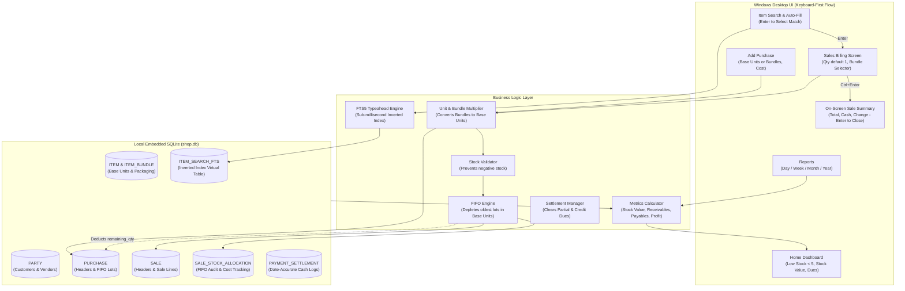

# High-Level Design (HLD) Document: Book Keeper
**System:** Offline-First Retail Accounting & Inventory Management Desktop Application  
**Target Environment:** Windows Laptop (Single-Node, Embedded Database)  
**Currency:** Indian Rupees (₹)  
**Status:** Approved Requirements & Entity Design Baseline (rev. 2026-11-21 — aligned per [Design Decisions](DESIGN_DECISIONS.md))  
**UI/UX Companion Document:** [UI/UX Specification](book_keeper_UI_UX_Specification.md)  

---

## 1. Executive Summary & Note
**Book Keeper** is a lightweight, offline-first desktop accounting and inventory management application designed for a small retail shop. It replaces complex, bloated enterprise billing software with a streamlined, fast, and reliable workflow focused on core operational realities: tracking inward stock purchases, outward sales, customer/vendor credit dues, bill-level partial payments, inventory valuation using **FIFO (First-In, First-Out)**, and instant low-stock visibility.

The system runs locally on a Windows laptop without requiring any standalone database servers or continuous internet connectivity. It uses an embedded relational database (SQLite) ensuring data portability, zero maintenance, simple file-copy backups, and standard schema evolution.

---

## 2. Requirements Specification

### 2.1. Functional Requirements (FR)

* **FR-01: Inward Stock & Purchase Management**
  * The user can record purchases of items into stock with item name, quantity, unit cost (₹), purchase date, and optional vendor details.
  * The user can specify the payment status: **Cash** (`PAID`), **Credit** (`UNPAID`), or **Partial** (`PARTIAL`) with an upfront `paid_amount` and remaining `balance_due`.
  * The stated status must agree with `paid_amount` (`PAID` ⇒ paid = total; `PARTIAL` ⇒ 0 < paid < total; `UNPAID` ⇒ paid = 0); paying more than the total is rejected. A vendor is required unless `PAID`.
* **FR-02: Outward Sales Management**
  * The user can record sales of items with quantity, selling price (₹), sale date, and optional customer details.
  * The user can record multi-item sales under a single transaction (cart-style billing).
  * The user can specify the payment status: **Cash** (`PAID`), **Credit** (`UNPAID`), or **Partial** (`PARTIAL`) with an upfront `paid_amount` and remaining `balance_due`.
  * The stated status must agree with `paid_amount` (`PAID` ⇒ paid ≥ total, excess is change and is not stored; `PARTIAL` ⇒ 0 < paid < total; `UNPAID` ⇒ paid = 0). A customer is required unless `PAID`.
* **FR-03: Strict FIFO Stock Depletion**
  * When an item is sold, the system automatically depletes inventory from the **oldest available stock lot** (First-In, First-Out). "Oldest" is entry order (lowest lot id); back-dated entries are treated as newest and never re-cost past sales.
  * When inventory for an item spans multiple batches with different purchase costs, the system splits depletion across batches and calculates the exact Cost of Goods Sold (COGS).
* **FR-04: Negative Stock Prevention**
  * The system strictly validates available stock across all active batches before committing a sale. Sales that exceed total available stock are blocked.
  * Validation sums the required base quantity per item across all cart lines (the same item on several lines is checked in aggregate). The same guard applies to negative adjustments, vendor returns, and replacement issues.
* **FR-05: Real-Time Low Stock Monitoring**
  * The system flags any item as "Low Stock" when its total aggregated stock across all batches drops below **5 units** (`current_stock < 5`).
  * Low stock items are surfaced on the Home / Dashboard screen.
* **FR-06: Symmetrical Credit & Dues Management**
  * **Customer Receivables**: The user can view total outstanding dues owed by customers (sum of `balance_due` on unpaid and partial sales).
  * **Vendor Payables**: The user can view total outstanding dues owed by the shop to suppliers (sum of `balance_due` on unpaid and partial purchases).
  * **Due Settlement**: The user can record subsequent payments against a specific bill (from Sales/Purchase History) or against a party's oldest open bills first (FIFO, from Credit & Dues). Each settlement decreases `balance_due`, can never exceed the outstanding amount, and logs the exact settlement date for daily cash register balancing.
  * **Single payment ledger**: every money event (upfront payment, settlement, return credit, cash refund in/out) is one `PAYMENT_SETTLEMENT` row; bill `paid_amount` / `balance_due` / `payment_status` are cached values derived from it (see Assumption 8).
* **FR-07: Returns & Replacements**
  * **Customer Sales Return**: Returning sold items. When items are marked **Restockable**, the system restores `remaining_quantity` on the original lots (traced via `SALE_STOCK_ALLOCATION`, latest-depleted first), re-entering inventory at their original cost. `DAMAGED_SCRAP` items are not restocked.
    * **Linked return** (against a sale line): returned qty ≤ sold − already returned; same item; refund rate ≤ the line's effective rate (defaults to it). Repeated partial returns never over-restore lots.
    * **Unlinked return** (no receipt): allowed; a Restockable unit re-enters stock as a new `RETURN`-source lot at the item's latest lot cost (user enters cost if the item never had a lot).
  * **Refund settlement (both directions)**: a **linked (tracked) return** reduces only its own bill's `balance_due` (capped at that balance); any remainder is paid out (customer) / received (vendor) as cash — it never moves to other bills. An **unlinked (untracked) return** with a known party is applied to that party's oldest open bills first, remainder in cash; walk-in returns are pure cash refunds.
  * **Replacement / Exchange (no-money swap)**: against a bill, one or more sold units come back — Restockable (e.g. a colour/size swap; goes back to its original lot) or Scrap (defective) — and one or more units of **any** item are issued from stock (FIFO). No money moves and revenue is not reversed; a value difference is shown as a warning only (use a refund + new sale when prices must be settled). Returned units are reversed exactly as in a refund return; issued units' cost becomes replacement COGS on the return date. The original sale is not altered.
  * **Vendor Purchase Return**: Returning stock to suppliers from a specific lot (qty ≤ lot remaining) or FIFO across the item's lots; settled per the refund rule above (payables first, then cash received).
* **FR-08: Standalone Stock Adjustments with FIFO Depletion**
  * The user can adjust stock quantities directly via item search (name or barcode) without referencing a sale or invoice ID, with an adjustment date and a reason: `DAMAGED`, `EXPIRED`, `THEFT_LOST`, or `COUNT_CORRECTION`.
  * **FIFO Depletion Linkage**: When an adjustment is negative (e.g. -5 damaged units), the system automatically triggers the FIFO allocation engine to deduct `remaining_quantity` from the oldest available lots, preventing phantom inventory lots and logging inventory write-off losses accurately.
  * **Positive adjustments** (found stock) create a new `ADJUSTMENT`-source lot at the item's most recent lot cost; if the item has never had a lot, the user must enter the unit cost. The selling price is never used as cost.
* **FR-09: Financial Aggregations & Reports**
  * Periodic totals (Day, Week, Month, Year presets or a custom range) for:
    * Total Sales (Gross Revenue), Sales Returns, and Net Sales
    * Total Purchases (net of vendor returns; excludes adjustment/opening/return lots)
    * Cash Flow (actual cash in vs. cash out, from the payment ledger)
    * Total Stock Valuation: Sum of (Remaining Lot Qty × Lot Unit Cost) across all active lots
    * Profit statement: Net Sales − COGS (net of returned units, plus replacement units issued) = Gross Profit; − Inventory Losses (write-offs, scrap returns) = Net Profit
* **FR-10: Lists & Operational Views**
  * Complete, filterable lists of all Sales, all Purchases, Pending Customer Dues (Receivables), and Pending Vendor Dues (Payables).
* **FR-11: Data Portability & Local Backup** *(v1 scope)*
  * Import items with opening stock from CSV / Excel (`.xlsx`): a dry-run validation report (row-level errors, duplicates) precedes execution with a conflict strategy (`SKIP`, `OVERWRITE`, `ADD_STOCK`); opening stock creates `OPENING`-source lots at the row's purchase cost. All-or-nothing.
  * One-click local database backup to a user-selected folder or external USB drive, plus a database integrity check.
  * *Deferred to v2:* all exports, parties import, opening dues, VedBill migration, restore from backup.
* **FR-12: Future Invoicing Foundation**
  * Transactions are stored with unique sequential transaction codes, customer/vendor relationships, line-item breakdowns, and shop profile headers, allowing instant printable bill generation without schema changes.
* **FR-13: Item Packaging & Bundles (Multi-UOM)**
  * The system supports pre-defined packaging bundles for an item (e.g., a "Box of 10 Pencils", a "Dozen of 12", a "Carton of 500 Sheets").
  * **Base Unit Integrity**: Inventory stock is always tracked and depleted via FIFO at the smallest base unit level (`base_unit`, e.g., Piece). Selling or purchasing in bundles automatically converts to base units via the bundle's multiplier (`quantity = bundle_quantity * units_per_bundle`).
  * **Dual Entry Points for Bundle Creation**:
    1. *Dedicated Item Master Screen*: Configured during initial item creation or editing (cold start). Bundles can be edited (including the multiplier) or deleted at any time. `units_per_bundle` must be > 1.
  * **Bundles are a data-entry convenience only**: bills record base units sold/bought and the price per base unit, plus a display-only snapshot of the pack used (`pack_label`, `pack_quantity`). Bill lines hold no reference to `ITEM_BUNDLE`, so changing or deleting a bundle never affects history.
    2. *Inline on the Fly*: An inline `[+ New Bundle]` option / shortcut (`Alt + B`) in the billing/purchase unit dropdown opens a quick modal dialog to define a new bundle name, multiplier, and default price without leaving the screen.
  * **Dynamic, Self-Learning Presets (Zero UI Hardcoding)**:
    * The system dynamically queries distinct `(bundle_name, units_per_bundle)` combinations from `ITEM_BUNDLE` ordered by usage frequency.
    * When creating a bundle for any item, typing or focusing the bundle field displays contextual suggestions showing both the name and historical size (e.g., `Box (10 units)`, `Box (20 units)`, `Dozen (12 units)`). Selecting a suggestion auto-fills both the label and multiplier while still allowing full custom typing.
    * As new packaging types are introduced by the shopkeeper, they immediately become available as presets for all items without requiring UI code changes.
* **FR-14: High-Speed Typeahead Search (SQLite FTS5)**
  * Instant auto-fill suggestions powered by an inverted index via SQLite FTS5 matching across item name, category, and barcode.
  * Sub-millisecond query responses supporting prefix typing (`pen*`) and tokenized multi-word search (`blue gel`).
* **FR-15: Rapid Keyboard-First Checkout Flow (Enter-Key Navigation)**
  * High-speed, heads-down counter workflow operating entirely via keyboard without mouse interaction:
    1. Focus in Item Search → Type 2-3 characters or scan barcode.
    2. Press `Enter` → Selects top match; item details and price auto-populate; focus jumps to Quantity.
    3. Quantity field defaults to `1` → Press `Enter` to accept or type quantity and press `Enter`.
    4. Focus jumps to Unit / Bundle selector → Defaults to Base Unit (or last used); Arrow keys switch to Box/Bundle if needed; `Alt + B` defines a new bundle → Press `Enter`.
    5. Focus jumps to Rate (pre-filled with the default base or bundle price, editable) → Press `Enter`.
    6. Line item commits to the bill → Focus loops back immediately to Item Search for the next item.
  * **Completing the Sale**: Pressing `Enter` on an empty search field (or pressing `Ctrl + Enter`) opens the **Payment dialog before anything is saved**:
    * Grand Total (₹)
    * Payment Status (`PAID` default, `PARTIAL`, `UNPAID`; the latter two require a customer)
    * Cash Received (auto-focused) & live Change to Return
  * Pressing `Enter` in the Payment dialog commits the sale (`paid_amount` = cash received for PAID/PARTIAL, 0 for UNPAID) and shows the result (bill code, balance due, change). Pressing `Enter` again resets the screen to a fresh, blank bill. `Escape` in the Payment dialog returns to the cart without saving.
  * *Note*: This is strictly an on-screen dialog; physical receipt printing and PDF/image export are deferred to future versions.
* **FR-16: Optional Maximum Retail Price (MRP)**
  * The system supports recording an optional Maximum Retail Price (MRP in ₹) on items and bundles. This serves as a printed reference price distinct from the shop's actual selling price (`default_sale_price`), allowing price-to-MRP comparisons.
* **FR-17: Soft-Deletion & Archival Integrity** *(deferred to v2)*
  * v1: Items and Parties cannot be deleted or archived at all. The `is_active` column is kept (always `1` in v1) and read paths already filter on it, so v2 can add archiving without schema changes.
  * v2 intent: Deletion acts as a soft archive (`is_active = 0`), hiding records from active search and selection lists while maintaining referential integrity for past bills, audit trails, and financial reports.

### 2.2. Non-Functional Requirements (NFR)

* **NFR-01: Zero External Server Overhead**
  * Must run on a standard Windows laptop without requiring background database services (e.g., PostgreSQL, MySQL, Docker).
  * Database engine: Embedded **SQLite** (`shop.db` in the OS app-data directory; overridable via `BOOK_KEEPER_DB_PATH`).
* **NFR-02: Fast Query & Dashboard Latency**
  * Instant load times (< 100ms) for the Home Screen and Low Stock widget by maintaining cached stock counts (`current_stock`) and a boolean flag (`is_low_stock`) on the item record.
* **NFR-03: Transaction Immutability & Audit Integrity**
  * Transactions cannot be deleted or overwritten once committed. Corrections and reversals must occur via formal returns, settlements, or stock adjustments.
* **NFR-04: Clean Schema Evolution**
  * Future schema enhancements are introduced via explicit, typed migrations (`ALTER TABLE ADD COLUMN`) rather than untyped JSON blobs, preserving clean 1-to-1 Excel/CSV mappings.
* **NFR-05: Modularity & Pluggable Stock Strategy**
  * The inventory allocation engine is decoupled such that the depletion strategy (currently FIFO) can be swapped for LIFO or Weighted Average without database restructuring.
* **NFR-06: Heads-Down Keyboard Ergonomics**
  * The entire core retail counter billing workflow operates with zero mouse clicks. Predictable Tab/Enter focus ordering and a fixed hotkey map: `F1` Dashboard, `F2` Sale, `F3` Purchase, `F4`/`Ctrl+F` item lookup, `F5` Credit & Dues, `F6` Inventory, `Alt+B` new bundle, `Alt+C` / `Alt+V` new customer / vendor, `Ctrl+B` backup, `Ctrl+Enter` complete bill, `Escape` close/back.

---

## 3. Scope Definition

### 3.1. In Scope (v1 Baseline)
1. **Item Master Management**: Items with Name, Unit, Category, Barcode/SKU, Default Sale Price, Cached Stock, and Low Stock Flag.
2. **Item Packaging & Bundles**: Multi-unit packaging (`ITEM_BUNDLE` e.g., Box, Dozen, Rim, Carton) with multiplier and default bundle price.
3. **Inline & Master Bundle Definition**: Ability to define bundles in the Item Master (cold start) or inline via `[+ New Bundle]` modal during billing/purchase.
4. **High-Speed Typeahead (SQLite FTS5)**: Inverted index virtual table for instant item suggestions across name, category, and barcode.
5. **Rapid Keyboard-First Checkout**: 100% keyboard-driven billing flow (Enter-key navigation, default Qty = 1, auto-fill).
6. **On-Screen Sale Summary Dialog**: Instant popup showing Grand Total, Payment Mode, Cash Received, and Change to Return.
7. **Party Management**: Directory for Customers and Vendors (Name, Phone, Notes); completely optional for walk-in transactions.
8. **Purchases (Inward Batches)**: Multi-item purchase entry in base units or bundles, tracking remaining quantities per line for FIFO stock lots.
9. **Sales (Outward Billing)**: Multi-item sales entry in base units or bundles, auto-depleting oldest purchase lots, preventing negative stock.
10. **Bill-Level Partial Payments**: Support for Cash, Credit, or Partial payments with upfront `paid_amount` and tracked `balance_due`.
11. **Due Settlements**: Dedicated `PaymentSettlement` records capturing date-accurate cash inflows and outflows as credit is cleared over time.
12. **Returns & Swaps**: Customer returns (linked or unlinked), defective swaps, and vendor returns.
13. **Physical Stock Adjustments**: Fast item lookup for damaged/expired write-offs and found stock.
14. **Reports & Dashboard**: Low-stock widget (< 5 items), Total Stock Value, Customer Dues, Vendor Dues, Period-based Sales & Purchases (Day/Week/Month/Year), Profit statement, Cash Flow.
15. **Import**: CSV/Excel import of Items with opening stock (dry-run + conflict strategy).
16. **Local Backup**: Direct database snapshot copy to local or removable drive, with integrity check.
17. **Shop Profile**: 1-row configuration table storing shop details for future invoice printing.

### 3.2. Out of Scope (Deferred to v2 / Future Versions)
1. **Physical Printing & PDF/Image Generation**: Thermal receipt printing, paper printouts, and PDF/image export of invoices or summaries are strictly out of scope for v1 (the Sale Summary Dialog is strictly an on-screen modal).
2. **Cloud Backups & Remote Synchronization**: Cloud sync (Google Drive, AWS S3, or remote API) is deferred; v1 is strictly local-first.
3. **Item-Level Partial Payments**: Partial payments are handled strictly at the bill/transaction level; mapping partial money to individual line items is out of scope.
4. **Complex Multi-Tier Tax Engine**: Comprehensive Indian GST slabs (CGST, SGST, IGST), HSN-based automated tax reports, and e-way bill generation.
5. **Pricing Tiers**: Wholesale, distributor, and customer-specific price rules.
6. **Back-Ordering & Negative Stock**: Sales when physical or entered stock is <= 0.
7. **Transaction Deletion**: Hard deletion of historical transaction records.
8. **Multi-Store / Multi-Branch**: Centralized inventory across multiple physical locations.
9. **Multi-User Role-Based Access Control (RBAC)**: User roles, permissions, and shift-management logins.
10. **Exports**: CSV/Excel exports of catalog, registers, daybook, P&L.
11. **Parties import, opening dues, VedBill migration, restore from backup.**
12. **Archiving / soft-deletion of Items and Parties (FR-17).**

---

## 4. Key Assumptions & Decisions

1. **Currency**: All monetary values are strictly denominated in **Indian Rupees (₹)**.
2. **Base Unit Inventory & Packaging Multipliers**: All stock tracking, FIFO lot storage, and low-stock alerts operate strictly in the item's smallest **Base Unit** (`base_unit`, e.g., Piece). Bundles are multipliers (e.g., 1 Box = 10 Pieces). When a sale or purchase occurs in a bundle, the system automatically multiplies to base units for inventory depletion.
3. **Bill-Level Partial Payments**: A transaction has `payment_status` as `PAID` (`balance_due = 0`), `PARTIAL` (something paid or credited, balance remains), or `UNPAID` (nothing paid or credited). Subsequent settlements and return credits reduce `balance_due` until 0. Money is fungible; partial payments apply to the total bill, never to specific individual items. Money is rounded to 2 decimals at line and bill level.
4. **Manual Delayed Entry**: The shopkeeper may make physical cash/credit sales first and enter records into the system at the end of the day or when convenient.
5. **Stock Valuation Formula**: Total Stock Value = Sum of (Remaining Quantity × Batch Unit Cost) across all active lots.
6. **Universal Low Stock Level**: An item is considered running low when its total physical stock across all available batches is strictly less than **5 units** (`current_stock < 5`).
7. **Optional Parties**: Retail cash customers or petty-cash supplier runs do not require customer/vendor profile creation; `party_id` is nullable.
8. **Single Payment Ledger**: Every money event is exactly one `PAYMENT_SETTLEMENT` row with a `kind`: `UPFRONT` (paid at billing), `SETTLEMENT` (later due payment), `RETURN_CREDIT` (non-cash due reduction from a return), `REFUND_OUT` (cash paid back to a customer), `REFUND_IN` (cash received back from a vendor). Bill headers are created with `paid_amount = 0, balance_due = total` and then updated only through the ledger: `paid_amount = Σ(UPFRONT + SETTLEMENT)`, `balance_due = total − paid_amount − Σ RETURN_CREDIT`. Cash in = sale UPFRONT/SETTLEMENT + purchase REFUND_IN; cash out = purchase UPFRONT/SETTLEMENT + sale REFUND_OUT. Daily cash drawer totals are ledger sums by `settlement_date`.
9. **Deferred Payment Mode (Null in v1 UI)**: The UI minimizes counter friction by not asking for payment instruments (UPI, Card, Net Banking). All upfront cash collections and cash settlements flow directly into the daily cash drawer register. The database retains `payment_mode` as `NULLABLE` for future version extensibility.
10. **Linked Return Reversal**: When a customer returns units from a sale line, the system walks that line's `SALE_STOCK_ALLOCATION` rows in reverse depletion order, using `quantity_depleted − returned_quantity` as each row's capacity, increments `returned_quantity`, and records the reversed FIFO cost on `RETURN_ITEM.cost_amount`. For `RESTOCKABLE` units it also restores `remaining_quantity` on the original `PURCHASE_ITEM` lots, bringing the item back at its exact historical cost. This makes repeated partial returns safe and keeps COGS net of returns.
11. **Stock Outflow FIFO Depletion**: Negative adjustments, replacement issues, and vendor returns consume the oldest available lots via the allocation engine and log each lot consumed in `STOCK_OUTFLOW_ALLOCATION` (with `source_type` and `source_id`). This prevents phantom inventory lots and records inventory loss accurately.
12. **Optional MRP Tracking**: `mrp` is stored as an optional reference attribute on `ITEM` and `ITEM_BUNDLE`, representing printed pack pricing distinct from the shop's actual selling price.
13. **Soft-Delete Archiving (v2)**: `ITEM` and `PARTY` carry an `is_active` flag reserved for v2 archiving; v1 never deletes or archives them.
14. **Lot Sources**: Every stock lot is a `PURCHASE_ITEM` under a `PURCHASE_TRANSACTION` whose `source` is `PURCHASE` (real supplier bill), `ADJUSTMENT` (found stock), `OPENING` (import opening stock) or `RETURN` (unlinked restockable customer return). Non-`PURCHASE` headers carry `total_amount = 0`, no party, status `PAID`, and their own code prefix (`ADJ-`, `OPN-`, `RTL-`). All purchase lists, counts, totals, payables and vendor-return pickers include only `source = PURCHASE`.
15. **FIFO Order**: Lots are consumed in entry order (ascending `PURCHASE_ITEM.id`).

---

## 5. System Architecture Overview



*For comprehensive page-by-page screen layouts, button actions, and keyboard navigation flows, refer to the [UI/UX Specification Document](file:///c:/custom_apps/book_keeper/docs/book_keeper_UI_UX_Specification.md).*

---

## 6. Entity Design & Data Model

### 6.1. Entity-Relationship Diagram

```mermaid
erDiagram
    SHOP_SETTING {
        int id PK
        string shop_name
        string phone
        string address
        string tax_id
    }

    PARTY ||--o{ PURCHASE_TRANSACTION : "supplies"
    PARTY ||--o{ SALE_TRANSACTION : "places"
    PARTY ||--o{ RETURN_TRANSACTION : "involved_in"
    PARTY ||--o{ PAYMENT_SETTLEMENT : "settles_with"

    ITEM ||--o{ PURCHASE_ITEM : "stocked_as"
    ITEM ||--o{ SALE_ITEM : "sold_as"
    ITEM ||--o{ RETURN_ITEM : "returned_as"
    ITEM ||--o{ STOCK_ADJUSTMENT : "adjusted_via"
    ITEM ||--o{ ITEM_BUNDLE : "has_packaging"

    PURCHASE_TRANSACTION ||--|{ PURCHASE_ITEM : "has_lines"
    PURCHASE_TRANSACTION ||--o{ PAYMENT_SETTLEMENT : "settled_by"
    PURCHASE_TRANSACTION ||--o{ RETURN_TRANSACTION : "returned_via"

    SALE_TRANSACTION ||--|{ SALE_ITEM : "has_lines"
    SALE_TRANSACTION ||--o{ PAYMENT_SETTLEMENT : "settled_by"
    SALE_TRANSACTION ||--o{ RETURN_TRANSACTION : "returned_via"

    PURCHASE_ITEM ||--o{ SALE_STOCK_ALLOCATION : "depleted_by"
    SALE_ITEM ||--o{ SALE_STOCK_ALLOCATION : "allocates_from"
    PURCHASE_ITEM ||--o{ STOCK_OUTFLOW_ALLOCATION : "depleted_by"

    RETURN_TRANSACTION ||--|{ RETURN_ITEM : "has_lines"
    RETURN_TRANSACTION ||--o{ PAYMENT_SETTLEMENT : "settled_by"
    SALE_ITEM ||--o{ RETURN_ITEM : "returned_via"
    PURCHASE_ITEM ||--o{ RETURN_ITEM : "vendor_returned_via"

    ITEM {
        int id PK
        string name "Item Name (Unique)"
        string category "Category"
        string barcode "Optional Barcode"
        string base_unit "Smallest unit: PCS, SHEET, KG"
        decimal mrp "Optional printed MRP"
        decimal default_sale_price "Default base rate"
        decimal current_stock "Cached total in base units"
        boolean is_low_stock "1 if stock under 5 base units"
        boolean is_active "1 if active, 0 if archived"
        datetime created_at "Creation timestamp"
    }

    ITEM_BUNDLE {
        int id PK
        int item_id FK
        string bundle_name "e.g. Box, Dozen, Rim, Carton"
        decimal units_per_bundle "Multiplier relative to base unit"
        decimal mrp "Optional bundle MRP"
        decimal default_bundle_price "Optional preset price"
        string barcode "Optional packaging barcode"
    }

    PARTY {
        int id PK
        string name "Customer or Vendor Name"
        string phone "Phone number"
        string party_type "CUSTOMER or VENDOR"
        string notes "Remarks"
        boolean is_active "1 if active, 0 if archived"
        datetime created_at "Creation timestamp"
    }

    PURCHASE_TRANSACTION {
        int id PK
        string transaction_code "PUR-/ADJ-/OPN-/RTL- per source"
        string source "PURCHASE, ADJUSTMENT, OPENING, RETURN"
        string supplier_invoice_ref "Optional supplier bill no."
        date transaction_date "Date"
        int party_id FK "Optional Vendor"
        string party_name "Snapshot at write time (DD-30)"
        string payment_mode "Optional / NULL in v1"
        string payment_status "PAID, PARTIAL, UNPAID"
        decimal total_amount "Total amount"
        decimal paid_amount "Paid upfront"
        decimal balance_due "Remaining payable"
        string notes "Remarks"
        datetime created_at "Creation timestamp"
    }

    PURCHASE_ITEM {
        int id PK
        int purchase_transaction_id FK
        int item_id FK
        string item_name "Snapshot at write time (DD-30)"
        string pack_label "Snapshot e.g. Box of 10 (NULL if base unit)"
        decimal pack_quantity "Snapshot qty in that pack"
        decimal quantity "Base units for FIFO"
        decimal unit_cost "Cost per base unit"
        decimal total_amount "Total cost"
        decimal remaining_quantity "Base units left for FIFO"
    }

    SALE_TRANSACTION {
        int id PK
        string transaction_code "e.g. SAL-1001"
        date transaction_date "Date"
        int party_id FK "Optional Customer"
        string party_name "Snapshot at write time (DD-30)"
        string payment_mode "Optional / NULL in v1"
        string payment_status "PAID, PARTIAL, UNPAID"
        decimal total_amount "Total amount"
        decimal paid_amount "Paid upfront"
        decimal balance_due "Remaining due"
        string notes "Remarks"
        datetime created_at "Creation timestamp"
    }

    SALE_ITEM {
        int id PK
        int sale_transaction_id FK
        int item_id FK
        string item_name "Snapshot at write time (DD-30)"
        string pack_label "Snapshot e.g. Box of 10 (NULL if base unit)"
        decimal pack_quantity "Snapshot qty in that pack"
        decimal quantity "Base units depleted via FIFO"
        decimal unit_price "Effective price per base unit"
        decimal total_amount "Line total"
    }

    SALE_STOCK_ALLOCATION {
        int id PK
        int sale_item_id FK
        int purchase_item_id FK
        decimal quantity_depleted "Deducted qty"
        decimal returned_quantity "Units since returned (default 0)"
        decimal unit_cost "Purchase cost"
    }

    STOCK_OUTFLOW_ALLOCATION {
        int id PK
        string source_type "ADJUSTMENT, REPLACEMENT, VENDOR_RETURN"
        int source_id "Adjustment or Return id"
        int purchase_item_id FK
        decimal quantity_depleted "Deducted qty"
        decimal unit_cost "Lot cost"
    }

    RETURN_TRANSACTION {
        int id PK
        string return_code "e.g. RET-1001"
        date return_date "Date"
        string return_type "CUSTOMER or VENDOR"
        int party_id FK "Optional Party"
        int original_transaction_id FK "Optional sale/purchase link"
        string settlement_type "REFUND or REPLACEMENT"
        decimal total_amount "Total value"
        string reason "Reason"
        string notes "Remarks"
        datetime created_at "Creation timestamp"
    }

    RETURN_ITEM {
        int id PK
        int return_transaction_id FK
        int item_id FK
        int sale_item_id FK "Customer return link (optional)"
        int purchase_item_id FK "Vendor return lot (optional)"
        string line_type "RETURNED or REPLACEMENT_ISSUED"
        decimal quantity "Base units"
        decimal unit_price "Rate per base unit"
        decimal total_amount "Amount"
        decimal cost_amount "FIFO cost of reversed/issued units"
        string condition "RESTOCKABLE or DAMAGED_SCRAP"
    }

    PAYMENT_SETTLEMENT {
        int id PK
        date settlement_date "Date"
        int party_id FK "Optional Party"
        string kind "UPFRONT, SETTLEMENT, RETURN_CREDIT, REFUND_OUT, REFUND_IN"
        string transaction_type "SALE or PURCHASE"
        int transaction_id FK "Optional bill"
        int return_id FK "Optional return"
        decimal amount_paid "Always positive"
        string payment_mode "Optional / NULL in v1"
        string notes "Remarks"
        datetime created_at "Creation timestamp"
    }

    STOCK_ADJUSTMENT {
        int id PK
        date adjustment_date "Date"
        int item_id FK "Item lookup"
        decimal quantity "Positive or Negative"
        decimal unit_cost "Positive adj lot cost"
        string reason "DAMAGED, EXPIRED, THEFT_LOST, COUNT_CORRECTION"
        string notes "Remarks"
        datetime created_at "Creation timestamp"
    }
```



---

### 6.2. Detailed Entity Dictionary

#### 1. `ITEM`
*Master table for all inventory products (tracked in smallest base unit).*
| Column | Type | Constraints | Description |
| :--- | :--- | :--- | :--- |
| `id` | INTEGER | PRIMARY KEY AUTOINCREMENT | Unique item identifier. |
| `name` | TEXT | NOT NULL, UNIQUE | Product name (e.g., "Apsara Platinum Pencil"). |
| `category` | TEXT | NULLABLE | Product category (e.g., "Stationery", "Snacks"). |
| `barcode` | TEXT | NULLABLE, INDEXED | Base unit barcode / SKU for instant scanner lookup. |
| `base_unit` | TEXT | NOT NULL DEFAULT 'PCS' | Smallest indivisible unit ('PCS', 'SHEET', 'KG', 'LTR'). |
| `mrp` | REAL | NULLABLE | Optional printed Maximum Retail Price in ₹. |
| `default_sale_price`| REAL | NOT NULL DEFAULT 0.0 | Suggested selling price per base unit in ₹. |
| `current_stock` | REAL | NOT NULL DEFAULT 0.0 | Cached sum of all active batch quantities (in base units). |
| `is_low_stock` | INTEGER | NOT NULL DEFAULT 0 | Fast-lookup flag: `1` if `current_stock < 5` base units, else `0`. |
| `is_active` | INTEGER | NOT NULL DEFAULT 1 | Soft-delete status: `1` active, `0` archived. |
| `created_at` | TEXT (ISO) | NOT NULL DEFAULT (CURRENT_TIMESTAMP) | Creation timestamp. |

#### 2. `ITEM_BUNDLE`
*Packaging tiers and multi-UOM definitions for items (Box, Dozen, Rim, Carton).*
| Column | Type | Constraints | Description |
| :--- | :--- | :--- | :--- |
| `id` | INTEGER | PRIMARY KEY AUTOINCREMENT | Unique bundle identifier. |
| `item_id` | INTEGER | NOT NULL, FK -> `ITEM(id)` | Parent item. |
| `bundle_name` | TEXT | NOT NULL | Packaging label (e.g., "Box of 10", "Dozen", "Carton"). |
| `units_per_bundle` | REAL | NOT NULL | Multiplier: number of base units in this bundle (e.g., 10, 12, 100). |
| `mrp` | REAL | NULLABLE | Optional bundle MRP in ₹. |
| `default_bundle_price`| REAL | NULLABLE | Optional bundle selling price in ₹ (e.g., ₹90 instead of 10x₹10). |
| `barcode` | TEXT | NULLABLE, INDEXED | Optional outer box barcode. |

#### 3. `ITEM_SEARCH_FTS` (Virtual Table)
*SQLite FTS5 inverted index virtual table for instant typeahead search.*
* Indexed fields: `name`, `category`, `barcode` (plus one extra row per bundle barcode, pointing at the parent item).
* Kept in sync by the application's item service after each committed item/bundle change (no SQLite triggers).

#### 4. `PARTY`
*Unified directory for customers and suppliers.*
| Column | Type | Constraints | Description |
| :--- | :--- | :--- | :--- |
| `id` | INTEGER | PRIMARY KEY AUTOINCREMENT | Unique party identifier. |
| `name` | TEXT | NOT NULL | Customer or Vendor business/personal name. |
| `phone` | TEXT | NULLABLE | Contact telephone number. |
| `party_type` | TEXT | CHECK IN ('CUSTOMER', 'VENDOR') | Role classification. |
| `notes` | TEXT | NULLABLE | Contact details, address, or credit remarks. |
| `is_active` | INTEGER | NOT NULL DEFAULT 1 | Soft-delete status: `1` active, `0` archived. |
| `created_at` | TEXT (ISO) | NOT NULL DEFAULT (CURRENT_TIMESTAMP) | Creation timestamp. |

#### 5. `PURCHASE_TRANSACTION`
*Header for inward stock purchase orders and bills.*
| Column | Type | Constraints | Description |
| :--- | :--- | :--- | :--- |
| `id` | INTEGER | PRIMARY KEY AUTOINCREMENT | Internal transaction ID. |
| `transaction_code` | TEXT | NOT NULL, UNIQUE | Human-readable code; prefix per source (`PUR-`, `ADJ-`, `OPN-`, `RTL-`), each with its own sequence. |
| `source` | TEXT | NOT NULL DEFAULT 'PURCHASE', CHECK IN ('PURCHASE','ADJUSTMENT','OPENING','RETURN') | Lot origin. Only `PURCHASE` rows are supplier bills; others have total 0, no party, status PAID. |
| `transaction_date` | TEXT (ISO) | NOT NULL | Date purchase was recorded. |
| `party_id` | INTEGER | NULLABLE, FK -> `PARTY(id)` | Supplier/vendor reference (null for walk-in). |
| `party_name` | TEXT | NULLABLE | Party name snapshot at write time (DD-30); bills display this, not the live name. |
| `payment_mode` | TEXT | NULLABLE | Upfront payment mode (deferred in v1 UI; defaults to cash drawer). |
| `payment_status` | TEXT | CHECK IN ('PAID', 'PARTIAL', 'UNPAID') | Settlement status. |
| `total_amount` | REAL | NOT NULL | Sum of all purchase line items in ₹. |
| `paid_amount` | REAL | NOT NULL DEFAULT 0.0 | Amount paid upfront in ₹. |
| `balance_due` | REAL | NOT NULL DEFAULT 0.0 | Remaining payable in ₹ (`total_amount - paid_amount`). |
| `supplier_invoice_ref` | TEXT | NULLABLE | Supplier's own invoice / DC number. |
| `notes` | TEXT | NULLABLE | Remarks. |
| `created_at` | TEXT (ISO) | NOT NULL DEFAULT (CURRENT_TIMESTAMP) | Creation timestamp. |

#### 6. `PURCHASE_ITEM` (The FIFO Stock Lot)
*Line item representing specific inward batches at specific costs.*
| Column | Type | Constraints | Description |
| :--- | :--- | :--- | :--- |
| `id` | INTEGER | PRIMARY KEY AUTOINCREMENT | Inward stock lot identifier. |
| `purchase_transaction_id` | INTEGER | NOT NULL, FK -> `PURCHASE_TRANSACTION(id)` | Parent transaction. |
| `item_id` | INTEGER | NOT NULL, FK -> `ITEM(id)` | Product purchased. |
| `item_name` | TEXT | NOT NULL | Item name snapshot at write time (DD-30). |
| `pack_label` | TEXT | NULLABLE | Display snapshot of the pack used at entry (e.g. "Box of 10"); NULL if entered in base units. No FK to `ITEM_BUNDLE`. |
| `pack_quantity` | REAL | NOT NULL | Display snapshot: quantity in that pack (equals `quantity` when base units). |
| `quantity` | REAL | NOT NULL | Base units (pack quantity × multiplier at entry time) for FIFO. |
| `unit_cost` | REAL | NOT NULL | Inward cost per base unit in ₹. |
| `total_amount` | REAL | NOT NULL | Total cost for this line item in ₹. |
| `remaining_quantity`| REAL | NOT NULL | Base units remaining in lot; decremented via FIFO sales. |

#### 7. `SALE_TRANSACTION`
*Header for outward sales bills.*
| Column | Type | Constraints | Description |
| :--- | :--- | :--- | :--- |
| `id` | INTEGER | PRIMARY KEY AUTOINCREMENT | Internal transaction ID. |
| `transaction_code` | TEXT | NOT NULL, UNIQUE | Bill/Invoice number (e.g., "SAL-1001"). |
| `transaction_date` | TEXT (ISO) | NOT NULL | Date sale was recorded. |
| `party_id` | INTEGER | NULLABLE, FK -> `PARTY(id)` | Customer reference (null for cash walk-in). |
| `party_name` | TEXT | NULLABLE | Party name snapshot at write time (DD-30). |
| `payment_mode` | TEXT | NULLABLE | Upfront payment mode (deferred in v1 UI; defaults to cash drawer). |
| `payment_status` | TEXT | CHECK IN ('PAID', 'PARTIAL', 'UNPAID') | Paid, Partial, or Due later. |
| `total_amount` | REAL | NOT NULL | Total bill value in ₹. |
| `paid_amount` | REAL | NOT NULL DEFAULT 0.0 | Amount received upfront in ₹. |
| `balance_due` | REAL | NOT NULL DEFAULT 0.0 | Remaining due in ₹ (`total_amount - paid_amount`). |
| `notes` | TEXT | NULLABLE | Customer or delivery notes. |
| `created_at` | TEXT (ISO) | NOT NULL DEFAULT (CURRENT_TIMESTAMP) | Creation timestamp. |

#### 8. `SALE_ITEM`
*Line item representing products sold in a transaction.*
| Column | Type | Constraints | Description |
| :--- | :--- | :--- | :--- |
| `id` | INTEGER | PRIMARY KEY AUTOINCREMENT | Sale line identifier. |
| `sale_transaction_id` | INTEGER | NOT NULL, FK -> `SALE_TRANSACTION(id)` | Parent transaction. |
| `item_id` | INTEGER | NOT NULL, FK -> `ITEM(id)` | Product sold. |
| `item_name` | TEXT | NOT NULL | Item name snapshot at write time (DD-30). |
| `pack_label` | TEXT | NULLABLE | Display snapshot of the pack used at entry (e.g. "Box of 10"); NULL if sold in base units. No FK to `ITEM_BUNDLE`. |
| `pack_quantity` | REAL | NOT NULL | Display snapshot: quantity in that pack (equals `quantity` when base units). |
| `quantity` | REAL | NOT NULL | Base units (pack quantity × multiplier at entry time) depleted via FIFO. |
| `unit_price` | REAL | NOT NULL | Effective selling rate per base unit in ₹. |
| `total_amount` | REAL | NOT NULL | Line total in ₹. |

#### 9. `SALE_STOCK_ALLOCATION`
*FIFO audit bridge recording exact batch depletion and cost allocation.*
| Column | Type | Constraints | Description |
| :--- | :--- | :--- | :--- |
| `id` | INTEGER | PRIMARY KEY AUTOINCREMENT | Allocation record ID. |
| `sale_item_id` | INTEGER | NOT NULL, FK -> `SALE_ITEM(id)` | Outward sale line. |
| `purchase_item_id` | INTEGER | NOT NULL, FK -> `PURCHASE_ITEM(id)` | Inward batch depleted. |
| `quantity_depleted` | REAL | NOT NULL | Base units consumed from this inward batch. |
| `returned_quantity` | REAL | NOT NULL DEFAULT 0 | Base units of this allocation later reversed by customer returns (restockable or scrap). Invariant: `0 ≤ returned_quantity ≤ quantity_depleted`. |
| `unit_cost` | REAL | NOT NULL | Purchase cost of this batch per base unit in ₹ (for COGS). |

*COGS for a sale = Σ (`quantity_depleted − returned_quantity`) × `unit_cost`.*

#### 10. `RETURN_TRANSACTION` & `RETURN_ITEM`
*Handles Customer Returns, Defective Swaps, and Vendor Returns.*
* Both carry name snapshots (DD-30): `RETURN_TRANSACTION.party_name`, `RETURN_ITEM.item_name`.
* `RETURN_TRANSACTION`: Contains `return_code` (`RET-`), `return_date`, `return_type` (`CUSTOMER`, `VENDOR`), `settlement_type` (`REFUND`, `REPLACEMENT` — `REPLACEMENT` is customer-only), `total_amount` (value of `RETURNED` lines), and optional links to the party and original bill (`original_transaction_id` → sale for customer, purchase for vendor).
* `RETURN_ITEM`: `line_type` (`RETURNED` or `REPLACEMENT_ISSUED`), item, quantity (base units), unit price, total, `cost_amount` (FIFO cost of reversed or issued units), `condition` (`RESTOCKABLE` or `DAMAGED_SCRAP`, for `RETURNED` customer lines), optional `sale_item_id` (customer) or `purchase_item_id` (vendor lot).
  * **Customer reversal:** see Assumption 10. Linked lines are capped at sold − already returned. Unlinked `RESTOCKABLE` lines create a `RETURN`-source lot at the latest lot cost (or a user-entered cost).
  * **Replacement / exchange:** `RETURNED` lines must be linked and are reversed like refund lines (restocked or scrapped). `REPLACEMENT_ISSUED` lines (any active item, any qty, `unit_price` 0) are FIFO-depleted with `STOCK_OUTFLOW_ALLOCATION(source_type = REPLACEMENT)`; their cost is replacement COGS. Revenue is not reversed and no money moves.
  * **Vendor return:** depletes the named lot (qty ≤ its remaining) or FIFO across the item's lots, logging `STOCK_OUTFLOW_ALLOCATION(source_type = VENDOR_RETURN)`.
  * **Refund settlement (`REFUND`):** value is applied as `RETURN_CREDIT` to the linked bill (capped at its balance), else to the party's oldest open bills; any remainder becomes `REFUND_OUT` (customer) / `REFUND_IN` (vendor) cash.

#### 11. `PAYMENT_SETTLEMENT` (Payment Ledger)
*The single ledger of every money event (see Assumption 8).*
* Stores `settlement_date`, `party_id`, `kind` (`UPFRONT`, `SETTLEMENT`, `RETURN_CREDIT`, `REFUND_OUT`, `REFUND_IN`), `transaction_type` (`SALE`, `PURCHASE`), nullable `transaction_id`, nullable `return_id`, `amount_paid` (> 0), `payment_mode` (nullable), `notes`, and `created_at`.
* `UPFRONT`, `SETTLEMENT` and `RETURN_CREDIT` rows require a `transaction_id` and must not exceed that bill's `balance_due`; they update the bill's cached `paid_amount` / `balance_due` / `payment_status`. Refund rows never change a bill balance.

#### 12. `STOCK_ADJUSTMENT`
*Direct physical stock count corrections (in base units).*
* Stores `adjustment_date`, `item_id` (via direct search/barcode), `quantity` (+/- base units, non-zero), `unit_cost` (positive adjustments only), `reason` (`DAMAGED`, `EXPIRED`, `COUNT_CORRECTION`, `THEFT_LOST`), `notes`, and `created_at`.
* **Negative:** FIFO depletion against the oldest lots, logged in `STOCK_OUTFLOW_ALLOCATION(source_type = ADJUSTMENT)`; the consumed cost is an inventory loss.
* **Positive (found stock):** creates an `ADJUSTMENT`-source lot at the item's most recent lot cost; if the item never had a lot, the user-supplied `unit_cost` is required.

#### 12a. `STOCK_OUTFLOW_ALLOCATION`
*FIFO audit for non-sale stock outflows.* `source_type` (`ADJUSTMENT`, `REPLACEMENT`, `VENDOR_RETURN`), `source_id`, `purchase_item_id`, `quantity_depleted`, `unit_cost`.

#### 13. `SHOP_SETTING`
*Single-row shop profile.*
* Stores `shop_name`, `phone`, `address`, and `tax_id` (optional GSTIN/PAN) to populate future bill headers.

---

## 7. Operational Query & Calculation Matrix

| Business Objective | Underlying SQL / Engine Logic |
| :--- | :--- |
| **Instant Low Stock List** | `SELECT * FROM ITEM WHERE is_active = 1 AND is_low_stock = 1 ORDER BY current_stock ASC;` |
| **Typeahead Auto-Fill (FTS5)** | `SELECT item_id, name, category, barcode, mrp, default_sale_price FROM item_search_fts JOIN ITEM ON item_search_fts.item_id = ITEM.id WHERE ITEM.is_active = 1 AND item_search_fts MATCH ? LIMIT 8;` |
| **Bundle to Base Unit Conversion** (write time only) | `quantity = pack_quantity * units_per_bundle; unit_price = line_total / quantity;` then snapshot `pack_label`, `pack_quantity` on the line |
| **Total Stock Valuation** | `SELECT SUM(remaining_quantity * unit_cost) FROM PURCHASE_ITEM WHERE remaining_quantity > 0;` |
| **Customer Receivables (Dues)** | `SELECT SUM(balance_due) FROM SALE_TRANSACTION WHERE payment_status IN ('UNPAID', 'PARTIAL');` |
| **Vendor Payables (Dues)** | `SELECT SUM(balance_due) FROM PURCHASE_TRANSACTION WHERE source = 'PURCHASE' AND payment_status IN ('UNPAID', 'PARTIAL');` |
| **Period Sales (Gross Revenue)** | `SELECT SUM(total_amount) FROM SALE_TRANSACTION WHERE transaction_date BETWEEN ? AND ?;` |
| **Period Sales Returns** | `SELECT SUM(total_amount) FROM RETURN_TRANSACTION WHERE return_type = 'CUSTOMER' AND settlement_type = 'REFUND' AND return_date BETWEEN ? AND ?;` |
| **Period Purchases (net)** | `SUM(total_amount) FROM PURCHASE_TRANSACTION WHERE source = 'PURCHASE' AND transaction_date BETWEEN ? AND ?` − `SUM(total_amount) FROM RETURN_TRANSACTION WHERE return_type = 'VENDOR' AND return_date BETWEEN ? AND ?` |
| **Period COGS** | `SELECT SUM((a.quantity_depleted - a.returned_quantity) * a.unit_cost) FROM SALE_STOCK_ALLOCATION a JOIN SALE_ITEM si ON a.sale_item_id = si.id JOIN SALE_TRANSACTION st ON si.sale_transaction_id = st.id WHERE st.transaction_date BETWEEN ? AND ?;` **+** `SUM(o.quantity_depleted * o.unit_cost)` over `STOCK_OUTFLOW_ALLOCATION` with `source_type = 'REPLACEMENT'` whose return is dated in range |
| **Period Inventory Losses** | `SUM(o.quantity_depleted * o.unit_cost)` over `STOCK_OUTFLOW_ALLOCATION` with `source_type = 'ADJUSTMENT'` dated by adjustment date, + `SUM(ri.cost_amount)` for customer `RETURNED` lines (REFUND or REPLACEMENT returns) with `condition = 'DAMAGED_SCRAP'`, by return date |
| **Period Profit** | Net Sales (Gross − Returns) − COGS = Gross Profit; Gross Profit − Inventory Losses = Net Profit |
| **FIFO Depletion Query** | `SELECT id, remaining_quantity, unit_cost FROM PURCHASE_ITEM WHERE item_id = ? AND remaining_quantity > 0 ORDER BY id ASC;` |
| **Linked Return Reversal** | `SELECT * FROM SALE_STOCK_ALLOCATION WHERE sale_item_id = ? AND quantity_depleted > returned_quantity ORDER BY id DESC;` then per row `UPDATE ... SET returned_quantity = returned_quantity + ?` and, if restockable, `UPDATE PURCHASE_ITEM SET remaining_quantity = remaining_quantity + ? WHERE id = ?;` |
| **Stock Outflow Depletion** (neg. adjustment, replacement, vendor return) | FIFO depletion loop deducting from oldest `PURCHASE_ITEM.remaining_quantity`, inserting `STOCK_OUTFLOW_ALLOCATION` rows |
| **Dynamic Bundle Presets & Sizes** | `SELECT bundle_name, units_per_bundle, COUNT(*) as usage_count FROM ITEM_BUNDLE GROUP BY bundle_name, units_per_bundle ORDER BY usage_count DESC;` |
| **Cash Flow / Drawer (period)** | From `PAYMENT_SETTLEMENT` where `settlement_date BETWEEN ? AND ?`: cash in = Σ(SALE·UPFRONT + SALE·SETTLEMENT + PURCHASE·REFUND_IN); cash out = Σ(PURCHASE·UPFRONT + PURCHASE·SETTLEMENT + SALE·REFUND_OUT); `RETURN_CREDIT` excluded. Live drawer = today's net. |

---

## 8. Technology Stack Decision

* **Shell & Desktop Framework:** **Tauri v2**
* **Frontend UI:** **React (TypeScript, Vite, Tailwind CSS)**
* **Backend & Business Logic:** **Rust**
* **Database Engine:** **Embedded SQLite (`rusqlite` / `sqlx-sqlite`)**
* **Packaging & Distribution:** **Native Windows Executable & NSIS Installer (`.exe`)**

### Rationale for Selection
1. **Zero-Network In-Process IPC:** Communicates between React and Rust via native OS IPC (Windows WebView2 message bridge). No local HTTP servers, open ports, or firewall warnings.
2. **Minimal Resource Footprint:** Leverages the OS-provided Edge WebView2 engine instead of bundling Chromium. Results in a ~10–15 MB installer and ~40–60 MB idle RAM footprint.
3. **Turnkey Native Packaging:** Native generation of self-contained `.exe` installers via NSIS with desktop shortcuts and isolated `%APPDATA%` data persistence.
4. **Future-Proof Extensibility:** The Rust core (FIFO depletion engine, transaction validation) and React UI are cleanly decoupled. This allows future expansion to macOS/Linux, dedicated databases (e.g., PostgreSQL), or remote cloud web hosting with minimal architectural rework.

### 8.2. Dual Execution Strategy: Native Windows & WSL2 (Smart App Control Compatibility)
To support diverse Windows 11 security configurations (such as environments enforcing **Smart App Control (SAC)**), the architecture natively supports two distinct operational modes:

1. **Native Windows Execution (Primary Production & Development Target):**
   * Operates as a native Windows desktop app (`book_keeper.exe`) using WebView2.
   * For local native development on Windows, Smart App Control is disabled (the standard developer setup), allowing `cargo`, `rustc`, and development binaries to run without kernel-level code-signing blocks (`os error 4551`).
2. **WSL2 Execution Mode (For Environments with Smart App Control Kept ON):**
   * In environments where Smart App Control must remain active in Enforcement mode, users and contributors can run the application inside **WSL2 (Linux kernel)**.
   * Because Smart App Control enforces policies strictly on Windows PE binaries (`.exe`/`.dll`), Linux ELF binaries running inside the WSL2 Hyper-V container are completely exempt from SAC blocks.
   * Leveraging Windows 11 **WSLg (GUI forwarding)**, launching the app inside WSL2 seamlessly projects the graphical window directly onto the host Windows desktop with native window controls, animations, and taskbar integration.
3. **Architectural Enablers in the Codebase:**
   * **Decoupled Rust Core (`book_keeper_core`):** The accounting logic, FIFO lot allocator, and SQLite queries are maintained in a clean, platform-agnostic module (`src-tauri/src/core/`) isolated from Tauri IPC macros.
   * **Configurable Database Path (`BOOK_KEEPER_DB_PATH`):** Resolves by default to `%APPDATA%\book_keeper\shop.db` on Windows and `~/.local/share/book_keeper/shop.db` on Linux/WSL, but supports an environment variable override allowing a WSL instance to read/write directly to Windows folders (e.g., `/mnt/c/Users/<user>/AppData/...`).
   * **Zero Win32-Specific Coupling:** All foundational crates (`rusqlite`, `chrono`, `serde`) are strictly cross-platform.

---

## 9. Tauri v2 IPC Command API Contracts & Architecture

### 9.1. Architectural Overview
Communication between the React frontend and the Rust backend uses Tauri v2's native in-process IPC (`@tauri-apps/api/core` -> `invoke`). There is zero HTTP or loopback network overhead. All requests are deserialized into typed Rust structs via `serde` and return `Result<T, AppError>`.

### 9.2. Consolidated vs. Granular Payloads & Backend Concurrency
* **Embedded SQLite Characteristics:** SQLite operates in-process with a single-file store (`shop.db`) in WAL mode. Firing multiple concurrent IPC commands from the UI across 7-8 separate calls creates unnecessary serialization overhead, IPC message round-trips, and temporary reader contention.
* **Consolidated Dashboard Metrics:** The `get_dashboard_metrics` API returns all home screen KPI numbers (sales, purchases, profit, stock valuation, customer dues, vendor dues, cash in drawer) in a **single payload**. The Rust backend computes these metrics in a single coordinated query (or via internal parallel `rayon`/`tokio` tasks) in `< 2 milliseconds`, eliminating UI layout shifts and visual "pop-in".
* **Separation of Heavyweight Time-Series:** Computationally heavier multi-point queries (such as `get_sales_purchase_trend`) are kept in dedicated APIs to allow instant KPI rendering while charts load asynchronously.

---

### 9.3. IPC Command Catalog by Operational Domain

#### 1. Dashboard Domain (`dashboard_api`)

```typescript
// Command: get_dashboard_metrics
// Input: none
interface DashboardMetrics {
  today_sales_amount: number;
  today_sales_count: number;
  today_purchase_amount: number;
  today_purchase_count: number;
  today_net_profit: number;           // Same formula as PnLReport.net_profit for today
  total_stock_valuation: number;      // Sum of (remaining_qty * unit_cost)
  customer_receivables: number;       // Total outstanding customer dues
  vendor_payables: number;            // Total outstanding vendor dues
  live_cash_in_drawer: number;        // Today's ledger cash in − cash out
}
// today_purchase_* count/sum only source = 'PURCHASE'.

// Command: get_recent_transactions
// Input: { limit: number }  -> last N sales + PURCHASE-source purchases + returns, newest first
interface RecentTransaction {
  kind: "SALE" | "PURCHASE" | "RETURN";
  id: number;
  code: string;
  date: string;
  created_at: string;
  party_name: string | null;
  amount: number;
  payment_status: "PAID" | "PARTIAL" | "UNPAID" | null; // null for returns
}

// Command: get_low_stock_alerts
// Input: none
interface LowStockItem {
  id: number;
  name: string;
  category: string | null;
  base_unit: string;
  current_stock: number;              // strictly < 5
  default_sale_price: number;
  mrp: number | null;
}

// Command: get_sales_purchase_trend
// Input: { period: "7d" | "30d" | "1y" }   (UI toggle: 7D / 30D / 1Y)
interface TrendDataPoint {
  date: string;                       // "YYYY-MM-DD"
  sales_amount: number;
  purchase_amount: number;
}
```

#### 2. Counter Billing & Sales Domain (`sale_api`)

```typescript
// Command: get_next_sale_code -> returns string (e.g. "SAL-1043")

// Command: create_sale
// Input: { payload: CreateSalePayload }
// Atomic transaction: Validates status/paid cross-check -> Validates stock per item (summed across lines) ->
// Inserts SALE_TRANSACTION (paid 0, balance = total) -> Inserts SALE_ITEM lines -> Executes FIFO depletion ->
// Inserts SALE_STOCK_ALLOCATION -> Updates ITEM cached stock -> Records UPFRONT ledger row (if paid > 0)
interface CreateSalePayload {
  transaction_date: string;           // "YYYY-MM-DD"
  party_id: number | null;            // null for walk-in; required unless PAID
  payment_status: "PAID" | "PARTIAL" | "UNPAID";
  paid_amount: number;                // cash received; PAID => >= total (excess = change, not stored)
  notes: string | null;
  items: Array<{
    item_id: number;
    bundle_id: number | null;         // write-time helper only: resolves multiplier + label, then snapshotted
    bundle_quantity: number;          // quantity in selected unit/bundle (stored as pack_quantity)
    unit_price: number;               // effective rate charged per bundle/unit
  }>;
}

// Returned response to immediately populate On-Screen Sale Summary Dialog:
interface SaleSummaryResponse {
  sale_id: number;
  transaction_code: string;
  total_amount: number;
  paid_amount: number;                // stored upfront (capped at total)
  balance_due: number;
  change_amount: number;              // max(0, cash received - total)
  payment_status: "PAID" | "PARTIAL" | "UNPAID";
}

// Command: get_sales_history
// Input: { filter: SalesHistoryFilter }  -> Paginated<SaleHistoryRow>
interface SalesHistoryFilter {
  start_date?: string;
  end_date?: string;
  payment_status?: "PAID" | "PARTIAL" | "UNPAID" | "ALL";
  party_id?: number;
  search_query?: string;              // matches transaction code or party name
  page: number;
  limit: number;
}
interface SaleHistoryRow {
  id: number; transaction_code: string; transaction_date: string; created_at: string;
  party_id: number | null; party_name: string | null; line_count: number;
  total_amount: number; paid_amount: number; balance_due: number;
  payment_status: "PAID" | "PARTIAL" | "UNPAID";
}

// Command: get_sale_details
// Input: { sale_id: number }
// Returns sale header, line items with bundle details, per-line returned qty, FIFO depletion cost breakdown,
// and the bill's ledger rows.
```

#### 3. Inward Purchases & FIFO Lots Domain (`purchase_api`)

```typescript
// Command: get_next_purchase_code -> returns string (e.g. "PUR-2015")

// Command: create_purchase
// Input: { payload: CreatePurchasePayload }
// Atomic transaction: Validates status/paid cross-check -> Inserts PURCHASE_TRANSACTION (source PURCHASE,
// paid 0, balance = total) -> Inserts PURCHASE_ITEM lots (remaining_quantity = normalized base quantity) ->
// Increments ITEM.current_stock & updates is_low_stock -> Records UPFRONT ledger row (if paid > 0)
interface CreatePurchasePayload {
  transaction_date: string;           // "YYYY-MM-DD"
  party_id: number | null;            // supplier reference; required unless PAID
  supplier_invoice_ref: string | null;
  payment_status: "PAID" | "PARTIAL" | "UNPAID";
  paid_amount: number;                // PAID => == total; never > total
  notes: string | null;
  items: Array<{
    item_id: number;
    bundle_id: number | null;         // write-time helper only (see create_sale)
    bundle_quantity: number;          // stored as pack_quantity
    unit_cost: number;                // inward cost per bundle or base unit
  }>;
}

// Command: get_purchases_history
// Input: { filter: PurchaseHistoryFilter }  (same shape as SalesHistoryFilter; only source = PURCHASE)
// -> Paginated<PurchaseHistoryRow> (SaleHistoryRow fields + supplier_invoice_ref)

// Command: get_purchase_details
// Input: { purchase_id: number }
// Returns header, lines, remaining FIFO units per line, and the bill's ledger rows.
```

#### 4. Inventory, Bundles & Typeahead Domain (`inventory_api`)

```typescript
// Command: search_items_fts
// Input: { query: string, limit?: number }
// High-speed inverted-index search across Name, Barcode, Category
interface ItemSearchResult {
  id: number;
  name: string;
  category: string | null;
  barcode: string | null;
  base_unit: string;
  mrp: number | null;
  default_sale_price: number;
  current_stock: number;
  is_low_stock: boolean;
  bundles: Array<{
    id: number;
    bundle_name: string;
    units_per_bundle: number;
    mrp: number | null;
    default_bundle_price: number | null;
  }>;
}

// Command: get_items_catalog
// Input: { category?: string, show_low_stock_only?: boolean, page: number, limit: number }

// Command: create_item
// Input: { payload: CreateItemPayload }
interface CreateItemPayload {
  name: string;
  category: string | null;
  barcode: string | null;
  base_unit: string;
  mrp: number | null;
  default_sale_price: number;
}

// Command: update_item
// Input: { item_id: number, payload: UpdateItemPayload }   (master fields only; never stock)

// (archive_item: deferred to v2 — FR-17)

// Command: get_item_lots
// Input: { item_id: number }  -> all lots (any source) with remaining > 0 first, newest last
interface ItemLot {
  purchase_item_id: number; purchase_transaction_id: number; transaction_code: string;
  source: "PURCHASE" | "ADJUSTMENT" | "OPENING" | "RETURN";
  transaction_date: string; vendor_name: string | null;
  quantity: number; remaining_quantity: number; unit_cost: number;
}

// Command: get_bundle_suggestions
// Input: none
// Returns dynamic, distinct packaging presets and multipliers derived from existing ITEM_BUNDLE data
interface BundleSuggestion {
  bundle_name: string;                // e.g. "Box", "Dozen", "Carton", "Strip"
  units_per_bundle: number;           // e.g. 10, 20, 12
  usage_count: number;                // frequency of use across inventory
}

// Command: create_bundle
// Input: { payload: CreateBundlePayload }
// Called from Item Master as well as inline billing shortcut [Alt + B]
interface CreateBundlePayload {
  item_id: number;
  bundle_name: string;                // e.g. "Box of 10", "Dozen"
  units_per_bundle: number;           // multiplier > 1
  mrp: number | null;
  default_bundle_price: number | null;
  barcode: string | null;
}

// Command: update_bundle
// Input: { bundle_id: number, payload: Omit<CreateBundlePayload, "item_id"> }
// Any field may change, including units_per_bundle; bills keep their own snapshot.

// Command: delete_bundle
// Input: { bundle_id: number }  -> always allowed (bill lines hold no reference)
```

#### 5. Credit & Dues Management Domain (`dues_api`)

```typescript
// Command: get_party_dues_summary
// Input: { party_type: "CUSTOMER" | "VENDOR" }
interface PartyDueSummary {
  party_id: number;
  party_name: string;
  phone: string | null;
  unsettled_bills_count: number;
  earliest_bill_date: string;
  total_invoiced: number;
  total_paid: number;
  balance_due: number;                // current net outstanding
}

// Command: settle_bill_payment
// Input: { payload: SettlePaymentPayload }
// Records SETTLEMENT ledger row(s). If transaction_id is provided, settles that specific bill
// (amount <= its balance_due); if null, applies to the party's oldest open bills first
// (ORDER BY transaction_date, id; amount <= party's total outstanding). Rejects otherwise.
// UI: per-bill "Settle" on every open bill; lump-sum "Receive/Pay on account" on Credit & Dues.
// Transitions payment_status to 'PAID' when balance_due reaches 0.
interface SettlePaymentPayload {
  party_id: number;
  transaction_type: "SALE" | "PURCHASE";
  transaction_id?: number | null;     // specific bill (or null for FIFO settlement)
  settlement_date: string;            // "YYYY-MM-DD"
  amount_paid: number;
  notes: string | null;
}

// Command: get_party_ledger
// Input: { party_id: number } -> open/closed bills + ledger rows + returns for the party, chronological

// Party directory commands: create_party, update_party, get_party,
// list_parties { party_type?, active_only }, search_parties { query, party_type? }
// List/search rows carry outstanding_balance and transaction_count. (archive_party deferred to v2.)
```

#### 6. Returns & Physical Adjustments Domain (`returns_adjustments_api`)

```typescript
// Command: create_customer_return
// Input: { payload: CustomerReturnPayload }  -> { return_id, return_code, credited_amount, cash_refunded }
// Atomic transaction (BEGIN IMMEDIATE):
//  1. Validate: linked lines -> sale_item belongs to original_sale_id, same item,
//     qty <= sold - already returned, unit_price <= line effective base price.
//     REPLACEMENT -> original_sale_id required, every RETURNED line linked, replacement_items non-empty
//     (any active item, any qty > 0), stock available (aggregated per item). No value check.
//  2. Insert RETURN_TRANSACTION & RETURN_ITEM lines.
//  3. Linked lines: reverse allocations (returned_quantity), restore lots if RESTOCKABLE, set cost_amount.
//     Unlinked RESTOCKABLE: create RETURN-source lot (latest cost, else line.unit_cost_override required).
//  4. REFUND: RETURN_CREDIT to original sale (capped at balance) / else party's oldest open sales;
//     remainder -> REFUND_OUT (linked return: own bill only; unlinked: party's oldest bills).
//     REPLACEMENT: FIFO-issue replacement units (STOCK_OUTFLOW_ALLOCATION, source REPLACEMENT,
//     cost = replacement COGS), no money.
//  5. Update ITEM cached stock.
interface CustomerReturnPayload {
  original_sale_id: number | null;
  party_id: number | null;
  return_date: string;
  settlement_type: "REFUND" | "REPLACEMENT";
  reason: string | null;
  notes: string | null;
  items: Array<{
    item_id: number;
    sale_item_id: number | null;      // linked sale line (required for REPLACEMENT)
    quantity: number;                 // returned base units
    unit_price: number;               // <= original effective base price when linked
    condition: "RESTOCKABLE" | "DAMAGED_SCRAP";
    unit_cost_override: number | null;// only for unlinked RESTOCKABLE when item has no prior lot
  }>;
  replacement_items: Array<{ item_id: number; quantity: number }>; // REPLACEMENT only (any item, base units), else []
}

// Command: create_vendor_return
// Input: { payload: VendorReturnPayload }  -> { return_id, return_code, credited_amount, cash_refunded }
// Atomic transaction (BEGIN IMMEDIATE): deplete named lot (qty <= remaining) or FIFO across item lots,
// log STOCK_OUTFLOW_ALLOCATION (source VENDOR_RETURN), value = Σ qty × lot unit_cost.
// Settlement: RETURN_CREDIT to original purchase (capped at balance) / else vendor's oldest open
// purchases; remainder -> REFUND_IN (cash received).
interface VendorReturnPayload {
  original_purchase_id: number | null;
  party_id: number | null;
  return_date: string;
  reason: string | null;
  notes: string | null;
  items: Array<{
    item_id: number;
    purchase_item_id: number | null;  // specific lot (must be PURCHASE-source, same item) or null for FIFO
    quantity: number;                 // returned base units
  }>;
}

// Command: list_returns
// Input: { filter: { return_type?: "CUSTOMER" | "VENDOR"; start_date?: string; end_date?: string; page: number; limit: number } }

// Command: get_return_details
// Input: { return_id: number } -> header, lines, allocations, ledger rows

// Command: create_stock_adjustment
// Input: { payload: StockAdjustmentPayload }  -> { adjustment_id, loss_value }
// If quantity < 0: FIFO depletion from oldest lots, STOCK_OUTFLOW_ALLOCATION (source ADJUSTMENT).
// If quantity > 0: creates an ADJUSTMENT-source lot at latest lot cost (else unit_cost required).
// Updates ITEM.current_stock & is_low_stock.
interface StockAdjustmentPayload {
  item_id: number;
  adjustment_date: string;            // "YYYY-MM-DD"
  quantity: number;                   // non-zero; positive (+) to add, negative (-) to write off
  unit_cost: number | null;           // positive only; required if item has no prior lot
  reason: "DAMAGED" | "EXPIRED" | "COUNT_CORRECTION" | "THEFT_LOST";
  notes: string | null;
}

// Command: list_stock_adjustments
// Input: { item_id?: number, page: number, limit: number }
```

#### 7. Financial Reports & Backup Domain (`reports_api`, `settings_api`)

```typescript
// Command: get_pnl_report
// Input: { from_date: string, to_date: string }
interface PnLReport {
  gross_sales: number;
  sales_returns: number;              // customer REFUND returns in period
  net_sales: number;                  // gross_sales - sales_returns
  cogs: number;                       // FIFO COGS net of returned units + replacement units issued
  gross_profit: number;               // net_sales - cogs
  inventory_losses: number;           // write-offs + scrap returns
  net_profit: number;                 // gross_profit - inventory_losses
  total_purchases: number;            // PURCHASE-source purchases - vendor returns
}

// Command: get_stock_valuation_report
// Input: none
interface StockValuationReport {
  total_valuation: number;            // Sum of (remaining_quantity * unit_cost)
  active_lots_count: number;
  categories_breakdown: Array<{
    category: string;
    items_count: number;
    valuation: number;
  }>;
}

// Command: get_cash_flow_report
// Input: { from_date: string, to_date: string }
interface CashFlowReport {                // all from PAYMENT_SETTLEMENT by settlement_date
  sales_cash_inflow: number;            // SALE·UPFRONT
  customer_settlements_inflow: number;  // SALE·SETTLEMENT
  vendor_refunds_inflow: number;        // PURCHASE·REFUND_IN
  purchase_cash_outflow: number;        // PURCHASE·UPFRONT
  vendor_settlements_outflow: number;   // PURCHASE·SETTLEMENT
  refunds_cash_outflow: number;         // SALE·REFUND_OUT
  net_cash_balance: number;             // inflows - outflows
}

// Command: backup_database
// Input: { destination_path: string }  -> absolute path of book_keeper_backup_YYYYMMDD_HHMM.db
// Creates a clean SQLite online snapshot copy of shop.db to destination folder or USB.

// Command: verify_database_integrity -> boolean (PRAGMA integrity_check)

// Command: get_shop_settings / update_shop_settings (single row id = 1)

// Command: validate_items_import
// Input: { file_path: string }  (.csv or .xlsx, Template A columns)
// Dry run, no writes -> { valid_count, rows_with_errors: [{ row, field, message }], duplicates: [{ row, name, existing_item_id }] }

// Command: execute_items_import
// Input: { file_path: string, conflict_strategy: "SKIP" | "OVERWRITE" | "ADD_STOCK" }
// One BEGIN IMMEDIATE transaction; any invalid row aborts everything. New items + optional bundle;
// opening stock -> one OPN- header with a lot per item at Purchase Cost. Reindexes FTS after commit.
// -> { created, updated, skipped, stock_lots_created }
```

### 9.4. Atomic Transaction & Concurrency Controls
* All state-mutating operations (`create_sale`, `create_purchase`, `settle_bill_payment`, `create_customer_return`, `create_vendor_return`, `create_stock_adjustment`, `create_item`, `update_item`, `create_bundle`, `update_bundle`, `delete_bundle`, `create_party`, `update_party`, `update_shop_settings`, `execute_items_import`) are wrapped within SQLite **`BEGIN IMMEDIATE`** transactions in Rust.
* No operation updates or deletes a committed transaction row except through the cached-value updates defined above (`paid_amount`, `balance_due`, `payment_status`, `remaining_quantity`, `returned_quantity`, `current_stock`, `is_low_stock`).
* This guarantees that FIFO lot allocation and inventory decrement operate in complete isolation, preventing double-depletion or race conditions even under rapid scanning.
