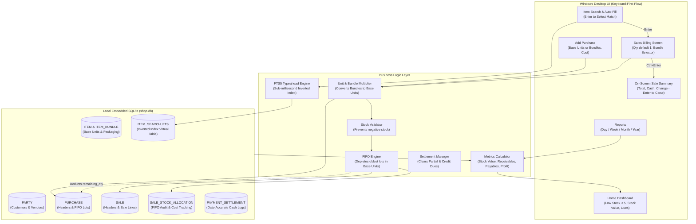

# High-Level Design (HLD) Document: Book Keeper
**System:** Offline-First Retail Accounting & Inventory Management Desktop Application  
**Target Environment:** Windows Laptop (Single-Node, Embedded Database)  
**Currency:** Indian Rupees (₹)  
**Status:** Approved Requirements & Entity Design Baseline  
**UI/UX Companion Document:** [UI/UX Specification](file:///c:/custom_apps/book_keeper/docs/book_keeper_UI_UX_Specification.md)  

---

## 1. Executive Summary & Note
**Book Keeper** is a lightweight, offline-first desktop accounting and inventory management application designed for a small retail shop. It replaces complex, bloated enterprise billing software with a streamlined, fast, and reliable workflow focused on core operational realities: tracking inward stock purchases, outward sales, customer/vendor credit dues, bill-level partial payments, inventory valuation using **FIFO (First-In, First-Out)**, and instant low-stock visibility.

The system runs locally on a Windows laptop without requiring any standalone database servers or continuous internet connectivity. It uses an embedded relational database (SQLite) ensuring data portability, zero maintenance, simple file-copy backups, and standard schema evolution.

---

## 2. Requirements Specification

### 2.1. Functional Requirements (FR)

* **FR-01: Inward Stock & Purchase Management**
  * The user can record purchases of items into stock with item name, quantity, unit cost (₹), purchase date, and optional vendor details.
  * The user can specify the payment status: **Cash** (`PAID`), **Credit** (`UNPAID`), or **Partial** (`PARTIAL`) with an upfront `paid_amount` and remaining `balance_due`.
* **FR-02: Outward Sales Management**
  * The user can record sales of items with quantity, selling price (₹), sale date, and optional customer details.
  * The user can record multi-item sales under a single transaction (cart-style billing).
  * The user can specify the payment status: **Cash** (`PAID`), **Credit** (`UNPAID`), or **Partial** (`PARTIAL`) with an upfront `paid_amount` and remaining `balance_due`.
* **FR-03: Strict FIFO Stock Depletion**
  * When an item is sold, the system automatically depletes inventory from the **oldest available purchase batch** (First-In, First-Out).
  * When inventory for an item spans multiple batches with different purchase costs, the system splits depletion across batches and calculates the exact Cost of Goods Sold (COGS).
* **FR-04: Negative Stock Prevention**
  * The system strictly validates available stock across all active batches before committing a sale. Sales that exceed total available stock are blocked.
* **FR-05: Real-Time Low Stock Monitoring**
  * The system flags any item as "Low Stock" when its total aggregated stock across all batches drops below **5 units** (`current_stock < 5`).
  * Low stock items are surfaced on the Home / Dashboard screen.
* **FR-06: Symmetrical Credit & Dues Management**
  * **Customer Receivables**: The user can view total outstanding dues owed by customers (sum of `balance_due` on unpaid and partial sales).
  * **Vendor Payables**: The user can view total outstanding dues owed by the shop to suppliers (sum of `balance_due` on unpaid and partial purchases).
  * **Due Settlement**: The user can record subsequent payments against specific bills. Each settlement decreases `balance_due` and logs the exact settlement date for daily cash register balancing.
* **FR-07: Returns & Replacements**
  * **Customer Sales Return**: Returning sold items for cash refunds or credit due reduction. When items are marked **Restockable**, the system automatically restores `remaining_quantity` on the original inward `PURCHASE_ITEM` lots (traced via `SALE_STOCK_ALLOCATION`), re-entering inventory at their original inward cost.
  * **Defective Item Replacement**: Swapping a defective sold item with a fresh one without disrupting monetary ledgers.
  * **Vendor Purchase Return**: Returning damaged/unsold stock to suppliers, reducing vendor payables or logging cash refunds.
* **FR-08: Standalone Stock Adjustments with FIFO Depletion**
  * The user can adjust stock quantities directly via item search (name or barcode) without referencing a sale or invoice ID, specifying reasons such as `DAMAGED`, `EXPIRED`, `THEFT_LOST`, or `COUNT_CORRECTION`.
  * **FIFO Depletion Linkage**: When an adjustment is negative (e.g. -5 damaged units), the system automatically triggers the FIFO allocation engine to deduct `remaining_quantity` from the oldest available purchase lots, preventing phantom inventory lots and logging inventory write-off losses accurately.
* **FR-09: Financial Aggregations & Reports**
  * Periodic totals (Day, Week, Month, Year) for:
    * Total Sales (Gross Revenue)
    * Total Purchases
    * Cash Flow (Actual cash collected vs. cash paid out)
    * Total Stock Valuation: Sum of (Remaining Batch Qty × Batch Unit Cost) across all active lots
    * Net Profit: Period Gross Sales - Period COGS
* **FR-10: Lists & Operational Views**
  * Complete, filterable lists of all Sales, all Purchases, Pending Customer Dues (Receivables), and Pending Vendor Dues (Payables).
* **FR-11: Data Portability & Local Backup**
  * Export data to CSV / Excel sheets.
  * Import items and opening records from CSV / Excel sheets.
  * One-click local database backup to a user-selected folder or external USB drive.
* **FR-12: Future Invoicing Foundation**
  * Transactions are stored with unique sequential transaction codes, customer/vendor relationships, line-item breakdowns, and shop profile headers, allowing instant printable bill generation without schema changes.
* **FR-13: Item Packaging & Bundles (Multi-UOM)**
  * The system supports pre-defined packaging bundles for an item (e.g., a "Box of 10 Pencils", a "Dozen of 12", a "Carton of 500 Sheets").
  * **Base Unit Integrity**: Inventory stock is always tracked and depleted via FIFO at the smallest base unit level (`base_unit`, e.g., Piece). Selling or purchasing in bundles automatically converts to base units via the bundle's multiplier (`quantity = bundle_quantity * units_per_bundle`).
  * **Dual Entry Points for Bundle Creation**:
    1. *Dedicated Item Master Screen*: Configured during initial item creation or editing (cold start).
    2. *Inline on the Fly*: An inline `[+ New Bundle]` option / shortcut (`Alt + B`) in the billing/purchase unit dropdown opens a quick modal dialog to define a new bundle name, multiplier, and default price without leaving the screen.
  * **Dynamic, Self-Learning Presets (Zero UI Hardcoding)**:
    * The system dynamically queries distinct `(bundle_name, units_per_bundle)` combinations from `ITEM_BUNDLE` ordered by usage frequency.
    * When creating a bundle for any item, typing or focusing the bundle field displays contextual suggestions showing both the name and historical size (e.g., `Box (10 units)`, `Box (20 units)`, `Dozen (12 units)`). Selecting a suggestion auto-fills both the label and multiplier while still allowing full custom typing.
    * As new packaging types are introduced by the shopkeeper, they immediately become available as presets for all items without requiring UI code changes.
* **FR-14: High-Speed Typeahead Search (SQLite FTS5)**
  * Instant auto-fill suggestions powered by an inverted index via SQLite FTS5 matching across item name, category, and barcode.
  * Sub-millisecond query responses supporting prefix typing (`pen*`) and tokenized multi-word search (`blue gel`).
* **FR-15: Rapid Keyboard-First Checkout Flow (Enter-Key Navigation)**
  * High-speed, heads-down counter workflow operating entirely via keyboard without mouse interaction:
    1. Focus in Item Search → Type 2-3 characters or scan barcode.
    2. Press `Enter` → Selects top match; item details and price auto-populate; focus jumps to Quantity.
    3. Quantity field defaults to `1` → Press `Enter` to accept or type quantity and press `Enter`.
    4. Focus jumps to Unit / Bundle selector → Defaults to Base Unit (or last used); Arrow keys switch to Box/Bundle if needed → Press `Enter`.
    5. Line item commits to the bill → Focus loops back immediately to Item Search for the next item.
  * **Completing the Sale**: Pressing `Enter` on an empty search field (or pressing `Ctrl + Enter`) completes the sale.
  * **On-Screen Sale Summary Dialog**: An on-screen modal immediately pops up displaying:
    * Grand Total (₹)
    * Payment Mode (Cash, Credit, Partial)
    * Cash Received & Change to Return
  * Pressing `Enter` on the summary dialog dismisses it and resets the screen to a fresh, blank bill ready for the next customer.
  * *Note*: This is strictly an on-screen dialog; physical receipt printing and PDF/image export are deferred to future versions.
* **FR-16: Optional Maximum Retail Price (MRP)**
  * The system supports recording an optional Maximum Retail Price (MRP in ₹) on items and bundles. This serves as a printed reference price distinct from the shop's actual selling price (`default_sale_price`), allowing price-to-MRP comparisons.
* **FR-17: Soft-Deletion & Archival Integrity**
  * Items and Parties cannot be hard-deleted if they are linked to historical transactions. Deletion acts as a soft archive (`is_active = 0`), hiding them from active search and selection lists while maintaining complete referential integrity for past bills, audit trails, and financial reports.

### 2.2. Non-Functional Requirements (NFR)

* **NFR-01: Zero External Server Overhead**
  * Must run on a standard Windows laptop without requiring background database services (e.g., PostgreSQL, MySQL, Docker).
  * Database engine: Embedded **SQLite** (`shop.db`).
* **NFR-02: Fast Query & Dashboard Latency**
  * Instant load times (< 100ms) for the Home Screen and Low Stock widget by maintaining cached stock counts (`current_stock`) and a boolean flag (`is_low_stock`) on the item record.
* **NFR-03: Transaction Immutability & Audit Integrity**
  * Transactions cannot be deleted or overwritten once committed. Corrections and reversals must occur via formal returns, settlements, or stock adjustments.
* **NFR-04: Clean Schema Evolution**
  * Future schema enhancements are introduced via explicit, typed migrations (`ALTER TABLE ADD COLUMN`) rather than untyped JSON blobs, preserving clean 1-to-1 Excel/CSV mappings.
* **NFR-05: Modularity & Pluggable Stock Strategy**
  * The inventory allocation engine is decoupled such that the depletion strategy (currently FIFO) can be swapped for LIFO or Weighted Average without database restructuring.
* **NFR-06: Heads-Down Keyboard Ergonomics**
  * The entire core retail counter billing workflow operates with zero mouse clicks. Predictable Tab/Enter focus ordering, hotkeys for bundle creation (`Alt + B`), and `Escape` to cancel.

---

## 3. Scope Definition

### 3.1. In Scope (v1 Baseline)
1. **Item Master Management**: Items with Name, Unit, Category, Barcode/SKU, Default Sale Price, Cached Stock, and Low Stock Flag.
2. **Item Packaging & Bundles**: Multi-unit packaging (`ITEM_BUNDLE` e.g., Box, Dozen, Rim, Carton) with multiplier and default bundle price.
3. **Inline & Master Bundle Definition**: Ability to define bundles in the Item Master (cold start) or inline via `[+ New Bundle]` modal during billing/purchase.
4. **High-Speed Typeahead (SQLite FTS5)**: Inverted index virtual table for instant item suggestions across name, category, and barcode.
5. **Rapid Keyboard-First Checkout**: 100% keyboard-driven billing flow (Enter-key navigation, default Qty = 1, auto-fill).
6. **On-Screen Sale Summary Dialog**: Instant popup showing Grand Total, Payment Mode, Cash Received, and Change to Return.
7. **Party Management**: Directory for Customers and Vendors (Name, Phone, Notes); completely optional for walk-in transactions.
8. **Purchases (Inward Batches)**: Multi-item purchase entry in base units or bundles, tracking remaining quantities per line for FIFO stock lots.
9. **Sales (Outward Billing)**: Multi-item sales entry in base units or bundles, auto-depleting oldest purchase lots, preventing negative stock.
10. **Bill-Level Partial Payments**: Support for Cash, Credit, or Partial payments with upfront `paid_amount` and tracked `balance_due`.
11. **Due Settlements**: Dedicated `PaymentSettlement` records capturing date-accurate cash inflows and outflows as credit is cleared over time.
12. **Returns & Swaps**: Customer returns, defective swaps, and vendor returns.
13. **Physical Stock Adjustments**: Fast item lookup for damaged/expired write-offs.
14. **Reports & Dashboard**: Low-stock widget (< 5 items), Total Stock Value, Customer Dues, Vendor Dues, Period-based Sales & Purchases (Day/Week/Month/Year), Net Profit calculation.
15. **Import / Export**: CSV/Excel support for Items and Transactions.
16. **Local Backup**: Direct database snapshot copy to local or removable drive.
17. **Shop Profile**: 1-row configuration table storing shop details for future invoice printing.

### 3.2. Out of Scope (Deferred to v2 / Future Versions)
1. **Physical Printing & PDF/Image Generation**: Thermal receipt printing, paper printouts, and PDF/image export of invoices or summaries are strictly out of scope for v1 (the Sale Summary Dialog is strictly an on-screen modal).
2. **Cloud Backups & Remote Synchronization**: Cloud sync (Google Drive, AWS S3, or remote API) is deferred; v1 is strictly local-first.
3. **Item-Level Partial Payments**: Partial payments are handled strictly at the bill/transaction level; mapping partial money to individual line items is out of scope.
4. **Complex Multi-Tier Tax Engine**: Comprehensive Indian GST slabs (CGST, SGST, IGST), HSN-based automated tax reports, and e-way bill generation.
5. **Pricing Tiers**: Wholesale, distributor, and customer-specific price rules.
6. **Back-Ordering & Negative Stock**: Sales when physical or entered stock is <= 0.
7. **Transaction Deletion**: Hard deletion of historical transaction records.
8. **Multi-Store / Multi-Branch**: Centralized inventory across multiple physical locations.
9. **Multi-User Role-Based Access Control (RBAC)**: User roles, permissions, and shift-management logins.

---

## 4. Key Assumptions & Decisions

1. **Currency**: All monetary values are strictly denominated in **Indian Rupees (₹)**.
2. **Base Unit Inventory & Packaging Multipliers**: All stock tracking, FIFO lot storage, and low-stock alerts operate strictly in the item's smallest **Base Unit** (`base_unit`, e.g., Piece). Bundles are multipliers (e.g., 1 Box = 10 Pieces). When a sale or purchase occurs in a bundle, the system automatically multiplies to base units for inventory depletion.
3. **Bill-Level Partial Payments**: A transaction has `payment_status` as `PAID` (fully paid), `PARTIAL` (partially paid upfront), or `UNPAID` (full credit). Subsequent settlements reduce `balance_due` until 0. Money is fungible; partial payments apply to the total bill, never to specific individual items.
4. **Manual Delayed Entry**: The shopkeeper may make physical cash/credit sales first and enter records into the system at the end of the day or when convenient.
5. **Stock Valuation Formula**: Total Stock Value = Sum of (Remaining Quantity × Batch Unit Cost) across all active lots.
6. **Universal Low Stock Level**: An item is considered running low when its total physical stock across all available batches is strictly less than **5 units** (`current_stock < 5`).
7. **Optional Parties**: Retail cash customers or petty-cash supplier runs do not require customer/vendor profile creation; `party_id` is nullable.
8. **Settlement Cash Flow Integrity**: Every payment received or made to clear dues is recorded in `PAYMENT_SETTLEMENT` with the settlement date, guaranteeing that daily cash drawer totals reflect actual cash collected that day.
9. **Deferred Payment Mode (Null in v1 UI)**: The UI minimizes counter friction by not asking for payment instruments (UPI, Card, Net Banking). All upfront cash collections and cash settlements flow directly into the daily cash drawer register. The database retains `payment_mode` as `NULLABLE` for future version extensibility.
10. **Restockable Returns FIFO Lot Restoration**: When a customer returns an item marked as `RESTOCKABLE`, the system traces the sale via `SALE_STOCK_ALLOCATION` and restores `remaining_quantity` directly to the original inward `PURCHASE_ITEM` lots (in reverse order of depletion). This brings the item back into active stock at its exact historical purchase cost.
11. **Negative Stock Adjustment FIFO Depletion**: When a stock adjustment decreases physical inventory (e.g., write-off for `DAMAGED` or `EXPIRED` goods), the FIFO allocation engine immediately consumes the oldest available `PURCHASE_ITEM` lots. This prevents discarded goods from persisting as phantom inventory lots and records inventory loss accurately.
12. **Optional MRP Tracking**: `mrp` is stored as an optional reference attribute on `ITEM` and `ITEM_BUNDLE`, representing printed pack pricing distinct from the shop's actual selling price.
13. **Soft-Delete Archiving**: Inward/outward transactions link foreign keys to items and parties. To preserve relational integrity and immutable financial history, `ITEM` and `PARTY` utilize an `is_active` flag (`1` active, `0` archived) instead of hard SQL `DELETE`.

---

## 5. System Architecture Overview



*For comprehensive page-by-page screen layouts, button actions, and keyboard navigation flows, refer to the [UI/UX Specification Document](file:///c:/custom_apps/book_keeper/docs/book_keeper_UI_UX_Specification.md).*

---

## 6. Entity Design & Data Model

### 6.1. Entity-Relationship Diagram

```mermaid
erDiagram
    SHOP_SETTING {
        int id PK
        string shop_name
        string phone
        string address
        string tax_id
    }

    PARTY ||--o{ PURCHASE_TRANSACTION : "supplies"
    PARTY ||--o{ SALE_TRANSACTION : "places"
    PARTY ||--o{ RETURN_TRANSACTION : "involved_in"
    PARTY ||--o{ PAYMENT_SETTLEMENT : "settles_with"

    ITEM ||--o{ PURCHASE_ITEM : "stocked_as"
    ITEM ||--o{ SALE_ITEM : "sold_as"
    ITEM ||--o{ RETURN_ITEM : "returned_as"
    ITEM ||--o{ STOCK_ADJUSTMENT : "adjusted_via"
    ITEM ||--o{ ITEM_BUNDLE : "has_packaging"

    ITEM_BUNDLE ||--o{ PURCHASE_ITEM : "packaged_as"
    ITEM_BUNDLE ||--o{ SALE_ITEM : "packaged_as"

    PURCHASE_TRANSACTION ||--|{ PURCHASE_ITEM : "has_lines"
    PURCHASE_TRANSACTION ||--o{ PAYMENT_SETTLEMENT : "settled_by"
    PURCHASE_TRANSACTION ||--o{ RETURN_TRANSACTION : "returned_via"

    SALE_TRANSACTION ||--|{ SALE_ITEM : "has_lines"
    SALE_TRANSACTION ||--o{ PAYMENT_SETTLEMENT : "settled_by"
    SALE_TRANSACTION ||--o{ RETURN_TRANSACTION : "returned_via"

    PURCHASE_ITEM ||--o{ SALE_STOCK_ALLOCATION : "depleted_by"
    SALE_ITEM ||--o{ SALE_STOCK_ALLOCATION : "allocates_from"

    RETURN_TRANSACTION ||--|{ RETURN_ITEM : "has_lines"

    ITEM {
        int id PK
        string name "Item Name (Unique)"
        string category "Category"
        string barcode "Optional Barcode"
        string base_unit "Smallest unit: PCS, SHEET, KG"
        decimal mrp "Optional printed MRP"
        decimal default_sale_price "Default base rate"
        decimal current_stock "Cached total in base units"
        boolean is_low_stock "1 if stock under 5 base units"
        boolean is_active "1 if active, 0 if archived"
        datetime created_at "Creation timestamp"
    }

    ITEM_BUNDLE {
        int id PK
        int item_id FK
        string bundle_name "e.g. Box, Dozen, Rim, Carton"
        decimal units_per_bundle "Multiplier relative to base unit"
        decimal mrp "Optional bundle MRP"
        decimal default_bundle_price "Optional preset price"
        string barcode "Optional packaging barcode"
    }

    PARTY {
        int id PK
        string name "Customer or Vendor Name"
        string phone "Phone number"
        string party_type "CUSTOMER or VENDOR"
        string notes "Remarks"
        boolean is_active "1 if active, 0 if archived"
        datetime created_at "Creation timestamp"
    }

    PURCHASE_TRANSACTION {
        int id PK
        string transaction_code "e.g. PUR-1001"
        date transaction_date "Date"
        int party_id FK "Optional Vendor"
        string payment_mode "Optional / NULL in v1"
        string payment_status "PAID, PARTIAL, UNPAID"
        decimal total_amount "Total amount"
        decimal paid_amount "Paid upfront"
        decimal balance_due "Remaining payable"
        string notes "Remarks"
        datetime created_at "Creation timestamp"
    }

    PURCHASE_ITEM {
        int id PK
        int purchase_transaction_id FK
        int item_id FK
        int bundle_id FK "Optional bundle (NULL if base unit)"
        decimal bundle_quantity "Qty in selected bundle"
        decimal quantity "Base units (bundle_qty * multiplier) for FIFO"
        decimal unit_cost "Cost per base unit"
        decimal total_amount "Total cost"
        decimal remaining_quantity "Base units left for FIFO"
    }

    SALE_TRANSACTION {
        int id PK
        string transaction_code "e.g. SAL-1001"
        date transaction_date "Date"
        int party_id FK "Optional Customer"
        string payment_mode "Optional / NULL in v1"
        string payment_status "PAID, PARTIAL, UNPAID"
        decimal total_amount "Total amount"
        decimal paid_amount "Paid upfront"
        decimal balance_due "Remaining due"
        string notes "Remarks"
        datetime created_at "Creation timestamp"
    }

    SALE_ITEM {
        int id PK
        int sale_transaction_id FK
        int item_id FK
        int bundle_id FK "Optional bundle (NULL if base unit)"
        decimal bundle_quantity "Qty in selected bundle"
        decimal quantity "Base units (bundle_qty * multiplier) for FIFO"
        decimal unit_price "Effective price per base unit"
        decimal total_amount "Line total"
    }

    SALE_STOCK_ALLOCATION {
        int id PK
        int sale_item_id FK
        int purchase_item_id FK
        decimal quantity_depleted "Deducted qty"
        decimal unit_cost "Purchase cost"
    }

    RETURN_TRANSACTION {
        int id PK
        string return_code "e.g. RET-1001"
        date return_date "Date"
        string return_type "CUSTOMER or VENDOR"
        int party_id FK "Optional Party"
        int original_transaction_id FK "Optional link"
        string settlement_type "REFUND, DUE, REPLACEMENT"
        decimal total_amount "Total value"
        string reason "Reason"
        string notes "Remarks"
    }

    RETURN_ITEM {
        int id PK
        int return_transaction_id FK
        int item_id FK
        int sale_item_id FK "Optional link to restore FIFO lot"
        decimal quantity "Returned Qty"
        decimal unit_price "Rate"
        decimal total_amount "Amount"
        string condition "RESTOCKABLE or SCRAP"
    }

    PAYMENT_SETTLEMENT {
        int id PK
        date settlement_date "Date"
        int party_id FK "Optional Party"
        string transaction_type "SALE or PURCHASE"
        int transaction_id FK "Transaction ID"
        decimal amount_paid "Amount cleared"
        string payment_mode "Optional / NULL in v1"
        string notes "Remarks"
        datetime created_at "Creation timestamp"
    }

    STOCK_ADJUSTMENT {
        int id PK
        date adjustment_date "Date"
        int item_id FK "Item lookup"
        decimal quantity "Positive or Negative"
        string reason "DAMAGED, EXPIRED, COUNT"
        string notes "Remarks"
        datetime created_at "Creation timestamp"
    }
```



---

### 6.2. Detailed Entity Dictionary

#### 1. `ITEM`
*Master table for all inventory products (tracked in smallest base unit).*
| Column | Type | Constraints | Description |
| :--- | :--- | :--- | :--- |
| `id` | INTEGER | PRIMARY KEY AUTOINCREMENT | Unique item identifier. |
| `name` | TEXT | NOT NULL, UNIQUE | Product name (e.g., "Apsara Platinum Pencil"). |
| `category` | TEXT | NULLABLE | Product category (e.g., "Stationery", "Snacks"). |
| `barcode` | TEXT | NULLABLE, INDEXED | Base unit barcode / SKU for instant scanner lookup. |
| `base_unit` | TEXT | NOT NULL DEFAULT 'PCS' | Smallest indivisible unit ('PCS', 'SHEET', 'KG', 'LTR'). |
| `mrp` | REAL | NULLABLE | Optional printed Maximum Retail Price in ₹. |
| `default_sale_price`| REAL | NOT NULL DEFAULT 0.0 | Suggested selling price per base unit in ₹. |
| `current_stock` | REAL | NOT NULL DEFAULT 0.0 | Cached sum of all active batch quantities (in base units). |
| `is_low_stock` | INTEGER | NOT NULL DEFAULT 0 | Fast-lookup flag: `1` if `current_stock < 5` base units, else `0`. |
| `is_active` | INTEGER | NOT NULL DEFAULT 1 | Soft-delete status: `1` active, `0` archived. |
| `created_at` | TEXT (ISO) | NOT NULL DEFAULT (CURRENT_TIMESTAMP) | Creation timestamp. |

#### 2. `ITEM_BUNDLE`
*Packaging tiers and multi-UOM definitions for items (Box, Dozen, Rim, Carton).*
| Column | Type | Constraints | Description |
| :--- | :--- | :--- | :--- |
| `id` | INTEGER | PRIMARY KEY AUTOINCREMENT | Unique bundle identifier. |
| `item_id` | INTEGER | NOT NULL, FK -> `ITEM(id)` | Parent item. |
| `bundle_name` | TEXT | NOT NULL | Packaging label (e.g., "Box of 10", "Dozen", "Carton"). |
| `units_per_bundle` | REAL | NOT NULL | Multiplier: number of base units in this bundle (e.g., 10, 12, 100). |
| `mrp` | REAL | NULLABLE | Optional bundle MRP in ₹. |
| `default_bundle_price`| REAL | NULLABLE | Optional bundle selling price in ₹ (e.g., ₹90 instead of 10x₹10). |
| `barcode` | TEXT | NULLABLE, INDEXED | Optional outer box barcode. |

#### 3. `ITEM_SEARCH_FTS` (Virtual Table)
*SQLite FTS5 inverted index virtual table for instant typeahead search.*
* Indexed fields: `name`, `category`, `barcode`.
* Synced automatically with `ITEM` and `ITEM_BUNDLE` via SQLite insert/update/delete triggers.

#### 4. `PARTY`
*Unified directory for customers and suppliers.*
| Column | Type | Constraints | Description |
| :--- | :--- | :--- | :--- |
| `id` | INTEGER | PRIMARY KEY AUTOINCREMENT | Unique party identifier. |
| `name` | TEXT | NOT NULL | Customer or Vendor business/personal name. |
| `phone` | TEXT | NULLABLE | Contact telephone number. |
| `party_type` | TEXT | CHECK IN ('CUSTOMER', 'VENDOR') | Role classification. |
| `notes` | TEXT | NULLABLE | Contact details, address, or credit remarks. |
| `is_active` | INTEGER | NOT NULL DEFAULT 1 | Soft-delete status: `1` active, `0` archived. |
| `created_at` | TEXT (ISO) | NOT NULL DEFAULT (CURRENT_TIMESTAMP) | Creation timestamp. |

#### 5. `PURCHASE_TRANSACTION`
*Header for inward stock purchase orders and bills.*
| Column | Type | Constraints | Description |
| :--- | :--- | :--- | :--- |
| `id` | INTEGER | PRIMARY KEY AUTOINCREMENT | Internal transaction ID. |
| `transaction_code` | TEXT | NOT NULL, UNIQUE | Human-readable code (e.g., "PUR-1001"). |
| `transaction_date` | TEXT (ISO) | NOT NULL | Date purchase was recorded. |
| `party_id` | INTEGER | NULLABLE, FK -> `PARTY(id)` | Supplier/vendor reference (null for walk-in). |
| `payment_mode` | TEXT | NULLABLE | Upfront payment mode (deferred in v1 UI; defaults to cash drawer). |
| `payment_status` | TEXT | CHECK IN ('PAID', 'PARTIAL', 'UNPAID') | Settlement status. |
| `total_amount` | REAL | NOT NULL | Sum of all purchase line items in ₹. |
| `paid_amount` | REAL | NOT NULL DEFAULT 0.0 | Amount paid upfront in ₹. |
| `balance_due` | REAL | NOT NULL DEFAULT 0.0 | Remaining payable in ₹ (`total_amount - paid_amount`). |
| `notes` | TEXT | NULLABLE | Supplier invoice reference or remarks. |
| `created_at` | TEXT (ISO) | NOT NULL DEFAULT (CURRENT_TIMESTAMP) | Creation timestamp. |

#### 6. `PURCHASE_ITEM` (The FIFO Stock Lot)
*Line item representing specific inward batches at specific costs.*
| Column | Type | Constraints | Description |
| :--- | :--- | :--- | :--- |
| `id` | INTEGER | PRIMARY KEY AUTOINCREMENT | Inward stock lot identifier. |
| `purchase_transaction_id` | INTEGER | NOT NULL, FK -> `PURCHASE_TRANSACTION(id)` | Parent transaction. |
| `item_id` | INTEGER | NOT NULL, FK -> `ITEM(id)` | Product purchased. |
| `bundle_id` | INTEGER | NULLABLE, FK -> `ITEM_BUNDLE(id)` | Selected bundle (NULL if bought loose in base units). |
| `bundle_quantity` | REAL | NOT NULL | Quantity in terms of selected bundle or base unit. |
| `quantity` | REAL | NOT NULL | Normalized base units (`bundle_quantity * multiplier`) for FIFO. |
| `unit_cost` | REAL | NOT NULL | Inward cost per base unit in ₹. |
| `total_amount` | REAL | NOT NULL | Total cost for this line item in ₹. |
| `remaining_quantity`| REAL | NOT NULL | Base units remaining in lot; decremented via FIFO sales. |

#### 7. `SALE_TRANSACTION`
*Header for outward sales bills.*
| Column | Type | Constraints | Description |
| :--- | :--- | :--- | :--- |
| `id` | INTEGER | PRIMARY KEY AUTOINCREMENT | Internal transaction ID. |
| `transaction_code` | TEXT | NOT NULL, UNIQUE | Bill/Invoice number (e.g., "SAL-1001"). |
| `transaction_date` | TEXT (ISO) | NOT NULL | Date sale was recorded. |
| `party_id` | INTEGER | NULLABLE, FK -> `PARTY(id)` | Customer reference (null for cash walk-in). |
| `payment_mode` | TEXT | NULLABLE | Upfront payment mode (deferred in v1 UI; defaults to cash drawer). |
| `payment_status` | TEXT | CHECK IN ('PAID', 'PARTIAL', 'UNPAID') | Paid, Partial, or Due later. |
| `total_amount` | REAL | NOT NULL | Total bill value in ₹. |
| `paid_amount` | REAL | NOT NULL DEFAULT 0.0 | Amount received upfront in ₹. |
| `balance_due` | REAL | NOT NULL DEFAULT 0.0 | Remaining due in ₹ (`total_amount - paid_amount`). |
| `notes` | TEXT | NULLABLE | Customer or delivery notes. |
| `created_at` | TEXT (ISO) | NOT NULL DEFAULT (CURRENT_TIMESTAMP) | Creation timestamp. |

#### 8. `SALE_ITEM`
*Line item representing products sold in a transaction.*
| Column | Type | Constraints | Description |
| :--- | :--- | :--- | :--- |
| `id` | INTEGER | PRIMARY KEY AUTOINCREMENT | Sale line identifier. |
| `sale_transaction_id` | INTEGER | NOT NULL, FK -> `SALE_TRANSACTION(id)` | Parent transaction. |
| `item_id` | INTEGER | NOT NULL, FK -> `ITEM(id)` | Product sold. |
| `bundle_id` | INTEGER | NULLABLE, FK -> `ITEM_BUNDLE(id)` | Selected bundle (NULL if sold loose in base units). |
| `bundle_quantity` | REAL | NOT NULL | Quantity in terms of selected bundle or base unit. |
| `quantity` | REAL | NOT NULL | Normalized base units (`bundle_quantity * multiplier`) depleted via FIFO. |
| `unit_price` | REAL | NOT NULL | Effective selling rate per base unit in ₹. |
| `total_amount` | REAL | NOT NULL | Line total in ₹. |

#### 9. `SALE_STOCK_ALLOCATION`
*FIFO audit bridge recording exact batch depletion and cost allocation.*
| Column | Type | Constraints | Description |
| :--- | :--- | :--- | :--- |
| `id` | INTEGER | PRIMARY KEY AUTOINCREMENT | Allocation record ID. |
| `sale_item_id` | INTEGER | NOT NULL, FK -> `SALE_ITEM(id)` | Outward sale line. |
| `purchase_item_id` | INTEGER | NOT NULL, FK -> `PURCHASE_ITEM(id)` | Inward batch depleted. |
| `quantity_depleted` | REAL | NOT NULL | Base units consumed from this inward batch. |
| `unit_cost` | REAL | NOT NULL | Purchase cost of this batch per base unit in ₹ (for COGS). |

#### 10. `RETURN_TRANSACTION` & `RETURN_ITEM`
*Handles Customer Returns, Defective Swaps, and Vendor Returns.*
* `RETURN_TRANSACTION`: Contains `return_code`, `return_date`, `return_type` (`CUSTOMER_RETURN`, `VENDOR_RETURN`), `settlement_type` (`CASH_REFUND`, `REDUCE_DUE`, `REPLACEMENT`), `total_amount`, and optional links to parties or original bills.
* `RETURN_ITEM`: Item, returned quantity (in base units), unit price, `condition` (`RESTOCKABLE` or `DAMAGED_SCRAP`), and optional `sale_item_id` FK.
  * **Restocking Logic:** When `condition = 'RESTOCKABLE'` and `sale_item_id` is linked, the system queries `SALE_STOCK_ALLOCATION` for that line and increments `remaining_quantity` directly on the original `PURCHASE_ITEM` lot(s). This restores active inventory at the exact original purchase cost.

#### 11. `PAYMENT_SETTLEMENT`
*Logs subsequent partial and full settlement payments against bills.*
* Stores `settlement_date`, `party_id`, `transaction_type` (`SALE_SETTLEMENT` [Cash In] or `PURCHASE_SETTLEMENT` [Cash Out]), `transaction_id`, `amount_paid`, `payment_mode` (nullable), `notes`, and `created_at`.
* Decrements the `balance_due` on the target transaction. When `balance_due` reaches 0, updates `payment_status` to `'PAID'`.

#### 12. `STOCK_ADJUSTMENT`
*Direct physical stock count corrections (in base units).*
* Stores `adjustment_date`, `item_id` (via direct search/barcode), `quantity` (+/- base units), `reason` (`DAMAGED`, `EXPIRED`, `COUNT_CORRECTION`, `THEFT_LOST`), `notes`, and `created_at`.
* **FIFO Depletion on Negative Adjustments:** When `quantity < 0`, the engine executes FIFO depletion against the oldest available `PURCHASE_ITEM` lots, decrementing `remaining_quantity` and logging the inventory write-off loss. When `quantity > 0` (found stock), a new adjustment inward lot is created using the item's latest purchase unit cost.

#### 13. `SHOP_SETTING`
*Single-row shop profile.*
* Stores `shop_name`, `phone`, `address`, and `tax_id` (optional GSTIN/PAN) to populate future bill headers.

---

## 7. Operational Query & Calculation Matrix

| Business Objective | Underlying SQL / Engine Logic |
| :--- | :--- |
| **Instant Low Stock List** | `SELECT * FROM ITEM WHERE is_active = 1 AND is_low_stock = 1 ORDER BY current_stock ASC;` |
| **Typeahead Auto-Fill (FTS5)** | `SELECT item_id, name, category, barcode, mrp, default_sale_price FROM item_search_fts JOIN ITEM ON item_search_fts.item_id = ITEM.id WHERE ITEM.is_active = 1 AND item_search_fts MATCH ? LIMIT 8;` |
| **Bundle to Base Unit Conversion** | `quantity = bundle_quantity * units_per_bundle; unit_price = bundle_total / quantity;` |
| **Total Stock Valuation** | `SELECT SUM(remaining_quantity * unit_cost) FROM PURCHASE_ITEM WHERE remaining_quantity > 0;` |
| **Customer Receivables (Dues)** | `SELECT SUM(balance_due) FROM SALE_TRANSACTION WHERE payment_status IN ('UNPAID', 'PARTIAL');` |
| **Vendor Payables (Dues)** | `SELECT SUM(balance_due) FROM PURCHASE_TRANSACTION WHERE payment_status IN ('UNPAID', 'PARTIAL');` |
| **Period Sales (Gross Revenue)** | `SELECT SUM(total_amount) FROM SALE_TRANSACTION WHERE transaction_date BETWEEN ? AND ?;` |
| **Period Purchases** | `SELECT SUM(total_amount) FROM PURCHASE_TRANSACTION WHERE transaction_date BETWEEN ? AND ?;` |
| **Period COGS** | `SELECT SUM(a.quantity_depleted * a.unit_cost) FROM SALE_STOCK_ALLOCATION a JOIN SALE_ITEM si ON a.sale_item_id = si.id JOIN SALE_TRANSACTION st ON si.sale_transaction_id = st.id WHERE st.transaction_date BETWEEN ? AND ?;` |
| **Period Net Profit** | Period Gross Sales - Period COGS |
| **FIFO Depletion Query** | `SELECT id, remaining_quantity, unit_cost FROM PURCHASE_ITEM WHERE item_id = ? AND remaining_quantity > 0 ORDER BY id ASC;` |
| **Restockable Return Lot Restoration** | `UPDATE PURCHASE_ITEM SET remaining_quantity = remaining_quantity + ? WHERE id = ?;` (using allocation lots in reverse order) |
| **Negative Stock Adjustment Depletion**| Runs FIFO depletion loop deducting from oldest `PURCHASE_ITEM.remaining_quantity` and logging loss value |
| **Dynamic Bundle Presets & Sizes** | `SELECT bundle_name, units_per_bundle, COUNT(*) as usage_count FROM ITEM_BUNDLE GROUP BY bundle_name, units_per_bundle ORDER BY usage_count DESC;` |
| **Daily Cash Flow (Drawer Total)**| `(Upfront Cash from Sales Today + Customer Settlements Today) - (Upfront Cash for Purchases Today + Vendor Settlements Today + Cash Refunds Today)` |

---

## 8. Technology Stack Decision

* **Shell & Desktop Framework:** **Tauri v2**
* **Frontend UI:** **React (TypeScript, Vite, Tailwind CSS)**
* **Backend & Business Logic:** **Rust**
* **Database Engine:** **Embedded SQLite (`rusqlite` / `sqlx-sqlite`)**
* **Packaging & Distribution:** **Native Windows Executable & NSIS Installer (`.exe`)**

### Rationale for Selection
1. **Zero-Network In-Process IPC:** Communicates between React and Rust via native OS IPC (Windows WebView2 message bridge). No local HTTP servers, open ports, or firewall warnings.
2. **Minimal Resource Footprint:** Leverages the OS-provided Edge WebView2 engine instead of bundling Chromium. Results in a ~10–15 MB installer and ~40–60 MB idle RAM footprint.
3. **Turnkey Native Packaging:** Native generation of self-contained `.exe` installers via NSIS with desktop shortcuts and isolated `%APPDATA%` data persistence.
4. **Future-Proof Extensibility:** The Rust core (FIFO depletion engine, transaction validation) and React UI are cleanly decoupled. This allows future expansion to macOS/Linux, dedicated databases (e.g., PostgreSQL), or remote cloud web hosting with minimal architectural rework.

---

## 9. Tauri v2 IPC Command API Contracts & Architecture

### 9.1. Architectural Overview
Communication between the React frontend and the Rust backend uses Tauri v2's native in-process IPC (`@tauri-apps/api/core` -> `invoke`). There is zero HTTP or loopback network overhead. All requests are deserialized into typed Rust structs via `serde` and return `Result<T, AppError>`.

### 9.2. Consolidated vs. Granular Payloads & Backend Concurrency
* **Embedded SQLite Characteristics:** SQLite operates in-process with a single-file store (`shop.db`) in WAL mode. Firing multiple concurrent IPC commands from the UI across 7-8 separate calls creates unnecessary serialization overhead, IPC message round-trips, and temporary reader contention.
* **Consolidated Dashboard Metrics:** The `get_dashboard_metrics` API returns all home screen KPI numbers (sales, purchases, profit, stock valuation, customer dues, vendor dues, cash in drawer) in a **single payload**. The Rust backend computes these metrics in a single coordinated query (or via internal parallel `rayon`/`tokio` tasks) in `< 2 milliseconds`, eliminating UI layout shifts and visual "pop-in".
* **Separation of Heavyweight Time-Series:** Computationally heavier multi-point queries (such as `get_sales_purchase_trend`) are kept in dedicated APIs to allow instant KPI rendering while charts load asynchronously.

---

### 9.3. IPC Command Catalog by Operational Domain

#### 1. Dashboard Domain (`dashboard_api`)

```typescript
// Command: get_dashboard_metrics
// Input: none
interface DashboardMetrics {
  today_sales_amount: number;
  today_sales_count: number;
  today_purchase_amount: number;
  today_purchase_count: number;
  today_net_profit: number;           // Today's Sales - Today's COGS
  total_stock_valuation: number;      // Sum of (remaining_qty * unit_cost)
  customer_receivables: number;       // Total outstanding customer dues
  vendor_payables: number;            // Total outstanding vendor dues
  live_cash_in_drawer: number;        // Physical cash balancing formula
}

// Command: get_low_stock_alerts
// Input: none
interface LowStockItem {
  id: number;
  name: string;
  category: string | null;
  base_unit: string;
  current_stock: number;              // strictly < 5
  default_sale_price: number;
  mrp: number | null;
}

// Command: get_sales_purchase_trend
// Input: { period: "7d" | "30d" | "1y" }
interface TrendDataPoint {
  date: string;                       // "YYYY-MM-DD"
  sales_amount: number;
  purchase_amount: number;
}
```

#### 2. Counter Billing & Sales Domain (`sale_api`)

```typescript
// Command: get_next_sale_code -> returns string (e.g. "SAL-1043")

// Command: create_sale
// Input: { payload: CreateSalePayload }
// Atomic transaction: Validates stock across lots -> Inserts SALE_TRANSACTION -> 
// Inserts SALE_ITEM lines -> Executes FIFO depletion -> Inserts SALE_STOCK_ALLOCATION -> Updates ITEM cached stock
interface CreateSalePayload {
  transaction_date: string;           // "YYYY-MM-DD"
  party_id: number | null;            // null for walk-in
  payment_status: "PAID" | "PARTIAL" | "UNPAID";
  paid_amount: number;
  notes: string | null;
  items: Array<{
    item_id: number;
    bundle_id: number | null;         // null if sold in base units
    bundle_quantity: number;          // quantity in selected unit/bundle
    unit_price: number;               // effective rate charged per bundle/unit
  }>;
}

// Returned response to immediately populate On-Screen Sale Summary Dialog:
interface SaleSummaryResponse {
  sale_id: number;
  transaction_code: string;
  total_amount: number;
  paid_amount: number;
  balance_due: number;
  payment_status: "PAID" | "PARTIAL" | "UNPAID";
}

// Command: get_sales_history
// Input: { filter: SalesHistoryFilter }
interface SalesHistoryFilter {
  start_date?: string;
  end_date?: string;
  payment_status?: "PAID" | "PARTIAL" | "UNPAID" | "ALL";
  party_id?: number;
  search_query?: string;
  page: number;
  limit: number;
}

// Command: get_sale_details
// Input: { sale_id: number }
// Returns sale header, line items with bundle details, and FIFO depletion cost breakdown.
```

#### 3. Inward Purchases & FIFO Lots Domain (`purchase_api`)

```typescript
// Command: get_next_purchase_code -> returns string (e.g. "PUR-2015")

// Command: create_purchase
// Input: { payload: CreatePurchasePayload }
// Atomic transaction: Inserts PURCHASE_TRANSACTION -> Inserts PURCHASE_ITEM lots 
// (remaining_quantity = normalized base quantity) -> Increments ITEM.current_stock & updates is_low_stock
interface CreatePurchasePayload {
  transaction_date: string;           // "YYYY-MM-DD"
  party_id: number | null;            // supplier reference
  supplier_invoice_ref: string | null;
  payment_status: "PAID" | "PARTIAL" | "UNPAID";
  paid_amount: number;
  notes: string | null;
  items: Array<{
    item_id: number;
    bundle_id: number | null;
    bundle_quantity: number;
    unit_cost: number;                // inward cost per bundle or base unit
  }>;
}

// Command: get_purchases_history
// Input: { filter: PurchaseHistoryFilter }

// Command: get_purchase_details
// Input: { purchase_id: number }
// Returns header, lines, and remaining FIFO units per line.
```

#### 4. Inventory, Bundles & Typeahead Domain (`inventory_api`)

```typescript
// Command: search_items_fts
// Input: { query: string, limit?: number }
// High-speed inverted-index search across Name, Barcode, Category
interface ItemSearchResult {
  id: number;
  name: string;
  category: string | null;
  barcode: string | null;
  base_unit: string;
  mrp: number | null;
  default_sale_price: number;
  current_stock: number;
  is_low_stock: boolean;
  bundles: Array<{
    id: number;
    bundle_name: string;
    units_per_bundle: number;
    mrp: number | null;
    default_bundle_price: number | null;
  }>;
}

// Command: get_items_catalog
// Input: { category?: string, show_low_stock_only?: boolean, page: number, limit: number }

// Command: create_item
// Input: { payload: CreateItemPayload }
interface CreateItemPayload {
  name: string;
  category: string | null;
  barcode: string | null;
  base_unit: string;
  mrp: number | null;
  default_sale_price: number;
}

// Command: update_item
// Input: { item_id: number, payload: UpdateItemPayload }

// Command: archive_item
// Input: { item_id: number } (Soft-deletes: sets is_active = 0)

// Command: get_bundle_suggestions
// Input: none
// Returns dynamic, distinct packaging presets and multipliers derived from existing ITEM_BUNDLE data
interface BundleSuggestion {
  bundle_name: string;                // e.g. "Box", "Dozen", "Carton", "Strip"
  units_per_bundle: number;           // e.g. 10, 20, 12
  usage_count: number;                // frequency of use across inventory
}

// Command: create_bundle
// Input: { payload: CreateBundlePayload }
// Called from Item Master as well as inline billing shortcut [Alt + B]
interface CreateBundlePayload {
  item_id: number;
  bundle_name: string;                // e.g. "Box of 10", "Dozen"
  units_per_bundle: number;           // multiplier > 1
  mrp: number | null;
  default_bundle_price: number | null;
  barcode: string | null;
}
```

#### 5. Credit & Dues Management Domain (`dues_api`)

```typescript
// Command: get_party_dues_summary
// Input: { party_type: "CUSTOMER" | "VENDOR" }
interface PartyDueSummary {
  party_id: number;
  party_name: string;
  phone: string | null;
  unsettled_bills_count: number;
  earliest_bill_date: string;
  total_invoiced: number;
  total_paid: number;
  balance_due: number;                // current net outstanding
}

// Command: settle_bill_payment
// Input: { payload: SettlePaymentPayload }
// Records PAYMENT_SETTLEMENT, decrements balance_due on oldest unpaid transactions (FIFO settlement), 
// and transitions payment_status to 'PAID' when balance_due reaches 0.
interface SettlePaymentPayload {
  party_id: number;
  transaction_type: "SALE" | "PURCHASE";
  settlement_date: string;            // "YYYY-MM-DD"
  amount_paid: number;
  notes: string | null;
}
```

#### 6. Returns & Physical Adjustments Domain (`returns_adjustments_api`)

```typescript
// Command: create_customer_return
// Input: { payload: CustomerReturnPayload }
// Atomic transaction: Inserts RETURN_TRANSACTION & RETURN_ITEM lines.
// If condition is 'RESTOCKABLE', restores remaining_quantity in original PURCHASE_ITEM lot(s).
// Applies settlement: CASH_REFUND (drawer outflow) or REDUCE_DUE (credit adjustment).
interface CustomerReturnPayload {
  original_sale_id: number | null;
  party_id: number | null;
  settlement_type: "CASH_REFUND" | "REDUCE_DUE" | "DEFECTIVE_REPLACEMENT";
  notes: string | null;
  items: Array<{
    item_id: number;
    sale_item_id: number | null;      // linked sale item for lot restoration
    quantity: number;                 // returned base units
    unit_price: number;
    condition: "RESTOCKABLE" | "DAMAGED_SCRAP";
  }>;
}

// Command: create_stock_adjustment
// Input: { payload: StockAdjustmentPayload }
// If quantity < 0: triggers FIFO depletion loop deducting from oldest active PURCHASE_ITEM lots.
// If quantity > 0: creates an adjustment inward lot. Updates ITEM.current_stock & is_low_stock.
interface StockAdjustmentPayload {
  item_id: number;
  quantity: number;                   // positive (+) to add, negative (-) to write off
  reason: "DAMAGED" | "EXPIRED" | "COUNT_CORRECTION" | "THEFT_LOST";
  notes: string | null;
}
```

#### 7. Financial Reports & Backup Domain (`reports_api`, `settings_api`)

```typescript
// Command: get_pnl_report
// Input: { from_date: string, to_date: string }
interface PnLReport {
  gross_sales: number;
  cogs: number;                       // Total FIFO Cost of Goods Sold
  net_profit: number;                 // gross_sales - cogs
}

// Command: get_stock_valuation_report
// Input: none
interface StockValuationReport {
  total_valuation: number;            // Sum of (remaining_quantity * unit_cost)
  active_lots_count: number;
  categories_breakdown: Array<{
    category: string;
    items_count: number;
    valuation: number;
  }>;
}

// Command: get_cash_flow_report
// Input: { from_date: string, to_date: string }
interface CashFlowReport {
  sales_cash_inflow: number;
  customer_settlements_inflow: number;
  purchase_cash_outflow: number;
  vendor_settlements_outflow: number;
  refunds_cash_outflow: number;
  net_cash_balance: number;
}

// Command: backup_database
// Input: { destination_path: string }
// Creates a clean SQLite online snapshot copy of shop.db to destination folder or USB.
```

### 9.4. Atomic Transaction & Concurrency Controls
* All state-mutating operations (`create_sale`, `create_purchase`, `settle_bill_payment`, `create_customer_return`, `create_stock_adjustment`) are wrapped within SQLite **`BEGIN IMMEDIATE`** transactions in Rust.
* This guarantees that FIFO lot allocation and inventory decrement operate in complete isolation, preventing double-depletion or race conditions even under rapid scanning.
