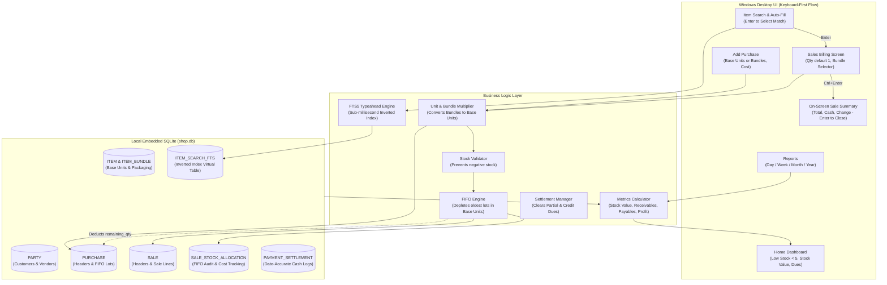

# High-Level Design (HLD) Document: Book Keeper
**System:** Offline-First Retail Accounting & Inventory Management Desktop Application  
**Target Environment:** Windows Laptop (Single-Node, Embedded Database)  
**Currency:** Indian Rupees (₹)  
**Status:** Approved Requirements & Entity Design Baseline  

---

## 1. Executive Summary & Note
**Book Keeper** is a lightweight, offline-first desktop accounting and inventory management application designed for a small retail shop. It replaces complex, bloated enterprise billing software with a streamlined, fast, and reliable workflow focused on core operational realities: tracking inward stock purchases, outward sales, customer/vendor credit dues, bill-level partial payments, inventory valuation using **FIFO (First-In, First-Out)**, and instant low-stock visibility.

The system runs locally on a Windows laptop without requiring any standalone database servers or continuous internet connectivity. It uses an embedded relational database (SQLite) ensuring data portability, zero maintenance, simple file-copy backups, and standard schema evolution.

---

## 2. Requirements Specification

### 2.1. Functional Requirements (FR)

* **FR-01: Inward Stock & Purchase Management**
  * The user can record purchases of items into stock with item name, quantity, unit cost (₹), purchase date, and optional vendor details.
  * The user can specify the payment status: **Cash** (`PAID`), **Credit** (`UNPAID`), or **Partial** (`PARTIAL`) with an upfront `paid_amount` and remaining `balance_due`.
* **FR-02: Outward Sales Management**
  * The user can record sales of items with quantity, selling price (₹), sale date, and optional customer details.
  * The user can record multi-item sales under a single transaction (cart-style billing).
  * The user can specify the payment status: **Cash** (`PAID`), **Credit** (`UNPAID`), or **Partial** (`PARTIAL`) with an upfront `paid_amount` and remaining `balance_due`.
* **FR-03: Strict FIFO Stock Depletion**
  * When an item is sold, the system automatically depletes inventory from the **oldest available purchase batch** (First-In, First-Out).
  * When inventory for an item spans multiple batches with different purchase costs, the system splits depletion across batches and calculates the exact Cost of Goods Sold (COGS).
* **FR-04: Negative Stock Prevention**
  * The system strictly validates available stock across all active batches before committing a sale. Sales that exceed total available stock are blocked.
* **FR-05: Real-Time Low Stock Monitoring**
  * The system flags any item as "Low Stock" when its total aggregated stock across all batches drops below **5 units** (`current_stock < 5`).
  * Low stock items are surfaced on the Home / Dashboard screen.
* **FR-06: Symmetrical Credit & Dues Management**
  * **Customer Receivables**: The user can view total outstanding dues owed by customers (sum of `balance_due` on unpaid and partial sales).
  * **Vendor Payables**: The user can view total outstanding dues owed by the shop to suppliers (sum of `balance_due` on unpaid and partial purchases).
  * **Due Settlement**: The user can record subsequent payments against specific bills. Each settlement decreases `balance_due` and logs the exact settlement date for daily cash register balancing.
* **FR-07: Returns & Replacements**
  * **Customer Sales Return**: Returning sold items for cash refunds or credit due reduction, with restockable items re-entering inventory.
  * **Defective Item Replacement**: Swapping a defective sold item with a fresh one without disrupting monetary ledgers.
  * **Vendor Purchase Return**: Returning damaged/unsold stock to suppliers, reducing vendor payables or logging cash refunds.
* **FR-08: Standalone Stock Adjustments**
  * The user can adjust stock quantities directly via item search (name or barcode) without referencing a sale or invoice ID, specifying reasons such as `DAMAGED`, `EXPIRED`, or `COUNT_CORRECTION`.
* **FR-09: Financial Aggregations & Reports**
  * Periodic totals (Day, Week, Month, Year) for:
    * Total Sales (Gross Revenue)
    * Total Purchases
    * Cash Flow (Actual cash collected vs. cash paid out)
    * Total Stock Valuation: Sum of (Remaining Batch Qty × Batch Unit Cost) across all active lots
    * Net Profit: Period Gross Sales - Period COGS
* **FR-10: Lists & Operational Views**
  * Complete, filterable lists of all Sales, all Purchases, Pending Customer Dues (Receivables), and Pending Vendor Dues (Payables).
* **FR-11: Data Portability & Local Backup**
  * Export data to CSV / Excel sheets.
  * Import items and opening records from CSV / Excel sheets.
  * One-click local database backup to a user-selected folder or external USB drive.
* **FR-12: Future Invoicing Foundation**
  * Transactions are stored with unique sequential transaction codes, customer/vendor relationships, line-item breakdowns, and shop profile headers, allowing instant printable bill generation without schema changes.
* **FR-13: Item Packaging & Bundles (Multi-UOM)**
  * The system supports pre-defined packaging bundles for an item (e.g., a "Box of 10 Pencils", a "Dozen of 12", a "Carton of 500 Sheets").
  * **Base Unit Integrity**: Inventory stock is always tracked and depleted via FIFO at the smallest base unit level (`base_unit`, e.g., Piece). Selling or purchasing in bundles automatically converts to base units via the bundle's multiplier (`quantity = bundle_quantity * units_per_bundle`).
  * **Dual Entry Points for Bundle Creation**:
    1. *Dedicated Item Master Screen*: Configured during initial item creation or editing (cold start).
    2. *Inline on the Fly*: An inline `[+ New Bundle]` option / shortcut (`Alt + B`) in the billing/purchase unit dropdown opens a quick modal dialog to define a new bundle name, multiplier, and default price without leaving the screen.
* **FR-14: High-Speed Typeahead Search (SQLite FTS5)**
  * Instant auto-fill suggestions powered by an inverted index via SQLite FTS5 matching across item name, category, and barcode.
  * Sub-millisecond query responses supporting prefix typing (`pen*`) and tokenized multi-word search (`blue gel`).
* **FR-15: Rapid Keyboard-First Checkout Flow (Enter-Key Navigation)**
  * High-speed, heads-down counter workflow operating entirely via keyboard without mouse interaction:
    1. Focus in Item Search → Type 2-3 characters or scan barcode.
    2. Press `Enter` → Selects top match; item details and price auto-populate; focus jumps to Quantity.
    3. Quantity field defaults to `1` → Press `Enter` to accept or type quantity and press `Enter`.
    4. Focus jumps to Unit / Bundle selector → Defaults to Base Unit (or last used); Arrow keys switch to Box/Bundle if needed → Press `Enter`.
    5. Line item commits to the bill → Focus loops back immediately to Item Search for the next item.
  * **Completing the Sale**: Pressing `Enter` on an empty search field (or pressing `Ctrl + Enter`) completes the sale.
  * **On-Screen Sale Summary Dialog**: An on-screen modal immediately pops up displaying:
    * Grand Total (₹)
    * Payment Mode (Cash, Credit, Partial)
    * Cash Received & Change to Return
  * Pressing `Enter` on the summary dialog dismisses it and resets the screen to a fresh, blank bill ready for the next customer.
  * *Note*: This is strictly an on-screen dialog; physical receipt printing and PDF/image export are deferred to future versions.

### 2.2. Non-Functional Requirements (NFR)

* **NFR-01: Zero External Server Overhead**
  * Must run on a standard Windows laptop without requiring background database services (e.g., PostgreSQL, MySQL, Docker).
  * Database engine: Embedded **SQLite** (`shop.db`).
* **NFR-02: Fast Query & Dashboard Latency**
  * Instant load times (< 100ms) for the Home Screen and Low Stock widget by maintaining cached stock counts (`current_stock`) and a boolean flag (`is_low_stock`) on the item record.
* **NFR-03: Transaction Immutability & Audit Integrity**
  * Transactions cannot be deleted or overwritten once committed. Corrections and reversals must occur via formal returns, settlements, or stock adjustments.
* **NFR-04: Clean Schema Evolution**
  * Future schema enhancements are introduced via explicit, typed migrations (`ALTER TABLE ADD COLUMN`) rather than untyped JSON blobs, preserving clean 1-to-1 Excel/CSV mappings.
* **NFR-05: Modularity & Pluggable Stock Strategy**
  * The inventory allocation engine is decoupled such that the depletion strategy (currently FIFO) can be swapped for LIFO or Weighted Average without database restructuring.
* **NFR-06: Heads-Down Keyboard Ergonomics**
  * The entire core retail counter billing workflow operates with zero mouse clicks. Predictable Tab/Enter focus ordering, hotkeys for bundle creation (`Alt + B`), and `Escape` to cancel.

---

## 3. Scope Definition

### 3.1. In Scope (v1 Baseline)
1. **Item Master Management**: Items with Name, Unit, Category, Barcode/SKU, Default Sale Price, Cached Stock, and Low Stock Flag.
2. **Item Packaging & Bundles**: Multi-unit packaging (`ITEM_BUNDLE` e.g., Box, Dozen, Rim, Carton) with multiplier and default bundle price.
3. **Inline & Master Bundle Definition**: Ability to define bundles in the Item Master (cold start) or inline via `[+ New Bundle]` modal during billing/purchase.
4. **High-Speed Typeahead (SQLite FTS5)**: Inverted index virtual table for instant item suggestions across name, category, and barcode.
5. **Rapid Keyboard-First Checkout**: 100% keyboard-driven billing flow (Enter-key navigation, default Qty = 1, auto-fill).
6. **On-Screen Sale Summary Dialog**: Instant popup showing Grand Total, Payment Mode, Cash Received, and Change to Return.
7. **Party Management**: Directory for Customers and Vendors (Name, Phone, Notes); completely optional for walk-in transactions.
8. **Purchases (Inward Batches)**: Multi-item purchase entry in base units or bundles, tracking remaining quantities per line for FIFO stock lots.
9. **Sales (Outward Billing)**: Multi-item sales entry in base units or bundles, auto-depleting oldest purchase lots, preventing negative stock.
10. **Bill-Level Partial Payments**: Support for Cash, Credit, or Partial payments with upfront `paid_amount` and tracked `balance_due`.
11. **Due Settlements**: Dedicated `PaymentSettlement` records capturing date-accurate cash inflows and outflows as credit is cleared over time.
12. **Returns & Swaps**: Customer returns, defective swaps, and vendor returns.
13. **Physical Stock Adjustments**: Fast item lookup for damaged/expired write-offs.
14. **Reports & Dashboard**: Low-stock widget (< 5 items), Total Stock Value, Customer Dues, Vendor Dues, Period-based Sales & Purchases (Day/Week/Month/Year), Net Profit calculation.
15. **Import / Export**: CSV/Excel support for Items and Transactions.
16. **Local Backup**: Direct database snapshot copy to local or removable drive.
17. **Shop Profile**: 1-row configuration table storing shop details for future invoice printing.

### 3.2. Out of Scope (Deferred to v2 / Future Versions)
1. **Physical Printing & PDF/Image Generation**: Thermal receipt printing, paper printouts, and PDF/image export of invoices or summaries are strictly out of scope for v1 (the Sale Summary Dialog is strictly an on-screen modal).
2. **Cloud Backups & Remote Synchronization**: Cloud sync (Google Drive, AWS S3, or remote API) is deferred; v1 is strictly local-first.
3. **Item-Level Partial Payments**: Partial payments are handled strictly at the bill/transaction level; mapping partial money to individual line items is out of scope.
4. **Complex Multi-Tier Tax Engine**: Comprehensive Indian GST slabs (CGST, SGST, IGST), HSN-based automated tax reports, and e-way bill generation.
5. **Pricing Tiers**: Wholesale, distributor, and customer-specific price rules.
6. **Back-Ordering & Negative Stock**: Sales when physical or entered stock is <= 0.
7. **Transaction Deletion**: Hard deletion of historical transaction records.
8. **Multi-Store / Multi-Branch**: Centralized inventory across multiple physical locations.
9. **Multi-User Role-Based Access Control (RBAC)**: User roles, permissions, and shift-management logins.

---

## 4. Key Assumptions & Decisions

1. **Currency**: All monetary values are strictly denominated in **Indian Rupees (₹)**.
2. **Base Unit Inventory & Packaging Multipliers**: All stock tracking, FIFO lot storage, and low-stock alerts operate strictly in the item's smallest **Base Unit** (`base_unit`, e.g., Piece). Bundles are multipliers (e.g., 1 Box = 10 Pieces). When a sale or purchase occurs in a bundle, the system automatically multiplies to base units for inventory depletion.
3. **Bill-Level Partial Payments**: A transaction has `payment_status` as `PAID` (fully paid), `PARTIAL` (partially paid upfront), or `UNPAID` (full credit). Subsequent settlements reduce `balance_due` until 0. Money is fungible; partial payments apply to the total bill, never to specific individual items.
4. **Manual Delayed Entry**: The shopkeeper may make physical cash/credit sales first and enter records into the system at the end of the day or when convenient.
5. **Stock Valuation Formula**: Total Stock Value = Sum of (Remaining Quantity × Batch Unit Cost) across all active lots.
6. **Universal Low Stock Level**: An item is considered running low when its total physical stock across all available batches is strictly less than **5 units** (`current_stock < 5`).
7. **Optional Parties**: Retail cash customers or petty-cash supplier runs do not require customer/vendor profile creation; `party_id` is nullable.
8. **Settlement Cash Flow Integrity**: Every payment received or made to clear dues is recorded in `PAYMENT_SETTLEMENT` with the settlement date, guaranteeing that daily cash drawer totals reflect actual cash collected that day.

---

## 5. System Architecture Overview

---

## 6. Entity Design & Data Model

### 6.1. Entity-Relationship Diagram

```mermaid
erDiagram
    SHOP_SETTING {
        int id PK
        string shop_name
        string phone
        string address
        string tax_id
    }

    PARTY ||--o{ PURCHASE_TRANSACTION : "supplies"
    PARTY ||--o{ SALE_TRANSACTION : "places"
    PARTY ||--o{ RETURN_TRANSACTION : "involved_in"
    PARTY ||--o{ PAYMENT_SETTLEMENT : "settles_with"

    ITEM ||--o{ PURCHASE_ITEM : "stocked_as"
    ITEM ||--o{ SALE_ITEM : "sold_as"
    ITEM ||--o{ RETURN_ITEM : "returned_as"
    ITEM ||--o{ STOCK_ADJUSTMENT : "adjusted_via"
    ITEM ||--o{ ITEM_BUNDLE : "has_packaging"

    ITEM_BUNDLE ||--o{ PURCHASE_ITEM : "packaged_as"
    ITEM_BUNDLE ||--o{ SALE_ITEM : "packaged_as"

    PURCHASE_TRANSACTION ||--|{ PURCHASE_ITEM : "has_lines"
    PURCHASE_TRANSACTION ||--o{ PAYMENT_SETTLEMENT : "settled_by"
    PURCHASE_TRANSACTION ||--o{ RETURN_TRANSACTION : "returned_via"

    SALE_TRANSACTION ||--|{ SALE_ITEM : "has_lines"
    SALE_TRANSACTION ||--o{ PAYMENT_SETTLEMENT : "settled_by"
    SALE_TRANSACTION ||--o{ RETURN_TRANSACTION : "returned_via"

    PURCHASE_ITEM ||--o{ SALE_STOCK_ALLOCATION : "depleted_by"
    SALE_ITEM ||--o{ SALE_STOCK_ALLOCATION : "allocates_from"

    RETURN_TRANSACTION ||--|{ RETURN_ITEM : "has_lines"

    ITEM {
        int id PK
        string name "Item Name (Unique)"
        string category "Category"
        string barcode "Optional Barcode"
        string base_unit "Smallest unit: PCS, SHEET, KG"
        decimal default_sale_price "Default base rate"
        decimal current_stock "Cached total in base units"
        boolean is_low_stock "1 if stock under 5 base units"
    }

    ITEM_BUNDLE {
        int id PK
        int item_id FK
        string bundle_name "e.g. Box, Dozen, Rim, Carton"
        decimal units_per_bundle "Multiplier relative to base unit"
        decimal default_bundle_price "Optional preset price"
        string barcode "Optional packaging barcode"
    }

    PARTY {
        int id PK
        string name "Customer or Vendor Name"
        string phone "Phone number"
        string party_type "CUSTOMER or VENDOR"
        string notes "Remarks"
    }

    PURCHASE_TRANSACTION {
        int id PK
        string transaction_code "e.g. PUR-1001"
        date transaction_date "Date"
        int party_id FK "Optional Vendor"
        string payment_mode "CASH or CREDIT"
        string payment_status "PAID, PARTIAL, UNPAID"
        decimal total_amount "Total amount"
        decimal paid_amount "Paid upfront"
        decimal balance_due "Remaining payable"
        string notes "Remarks"
    }

    PURCHASE_ITEM {
        int id PK
        int purchase_transaction_id FK
        int item_id FK
        int bundle_id FK "Optional bundle (NULL if base unit)"
        decimal bundle_quantity "Qty in selected bundle"
        decimal quantity "Base units (bundle_qty * multiplier) for FIFO"
        decimal unit_cost "Cost per base unit"
        decimal total_amount "Total cost"
        decimal remaining_quantity "Base units left for FIFO"
    }

    SALE_TRANSACTION {
        int id PK
        string transaction_code "e.g. SAL-1001"
        date transaction_date "Date"
        int party_id FK "Optional Customer"
        string payment_mode "CASH or CREDIT"
        string payment_status "PAID, PARTIAL, UNPAID"
        decimal total_amount "Total amount"
        decimal paid_amount "Paid upfront"
        decimal balance_due "Remaining due"
        string notes "Remarks"
    }

    SALE_ITEM {
        int id PK
        int sale_transaction_id FK
        int item_id FK
        int bundle_id FK "Optional bundle (NULL if base unit)"
        decimal bundle_quantity "Qty in selected bundle"
        decimal quantity "Base units (bundle_qty * multiplier) for FIFO"
        decimal unit_price "Effective price per base unit"
        decimal total_amount "Line total"
    }

    SALE_STOCK_ALLOCATION {
        int id PK
        int sale_item_id FK
        int purchase_item_id FK
        decimal quantity_depleted "Deducted qty"
        decimal unit_cost "Purchase cost"
    }

    RETURN_TRANSACTION {
        int id PK
        string return_code "e.g. RET-1001"
        date return_date "Date"
        string return_type "CUSTOMER or VENDOR"
        int party_id FK "Optional Party"
        int original_transaction_id FK "Optional link"
        string settlement_type "REFUND, DUE, REPLACEMENT"
        decimal total_amount "Total value"
        string reason "Reason"
        string notes "Remarks"
    }

    RETURN_ITEM {
        int id PK
        int return_transaction_id FK
        int item_id FK
        decimal quantity "Returned Qty"
        decimal unit_price "Rate"
        decimal total_amount "Amount"
        string condition "RESTOCKABLE or SCRAP"
    }

    PAYMENT_SETTLEMENT {
        int id PK
        date settlement_date "Date"
        int party_id FK "Optional Party"
        string transaction_type "SALE or PURCHASE"
        int transaction_id FK "Transaction ID"
        decimal amount_paid "Amount cleared"
        string payment_mode "CASH or BANK"
        string notes "Remarks"
    }

    STOCK_ADJUSTMENT {
        int id PK
        date adjustment_date "Date"
        int item_id FK "Item lookup"
        decimal quantity "Positive or Negative"
        string reason "DAMAGED, EXPIRED, COUNT"
        string notes "Remarks"
    }
```

---

### 6.2. Detailed Entity Dictionary

#### 1. `ITEM`
*Master table for all inventory products (tracked in smallest base unit).*
| Column | Type | Constraints | Description |
| :--- | :--- | :--- | :--- |
| `id` | INTEGER | PRIMARY KEY AUTOINCREMENT | Unique item identifier. |
| `name` | TEXT | NOT NULL, UNIQUE | Product name (e.g., "Apsara Platinum Pencil"). |
| `category` | TEXT | NULLABLE | Product category (e.g., "Stationery", "Snacks"). |
| `barcode` | TEXT | NULLABLE, INDEXED | Base unit barcode / SKU for instant scanner lookup. |
| `base_unit` | TEXT | NOT NULL DEFAULT 'PCS' | Smallest indivisible unit ('PCS', 'SHEET', 'KG', 'LTR'). |
| `default_sale_price`| REAL | NOT NULL DEFAULT 0.0 | Suggested selling price per base unit in ₹. |
| `current_stock` | REAL | NOT NULL DEFAULT 0.0 | Cached sum of all active batch quantities (in base units). |
| `is_low_stock` | INTEGER | NOT NULL DEFAULT 0 | Fast-lookup flag: `1` if `current_stock < 5` base units, else `0`. |

#### 2. `ITEM_BUNDLE`
*Packaging tiers and multi-UOM definitions for items (Box, Dozen, Rim, Carton).*
| Column | Type | Constraints | Description |
| :--- | :--- | :--- | :--- |
| `id` | INTEGER | PRIMARY KEY AUTOINCREMENT | Unique bundle identifier. |
| `item_id` | INTEGER | NOT NULL, FK -> `ITEM(id)` | Parent item. |
| `bundle_name` | TEXT | NOT NULL | Packaging label (e.g., "Box of 10", "Dozen", "Carton"). |
| `units_per_bundle` | REAL | NOT NULL | Multiplier: number of base units in this bundle (e.g., 10, 12, 100). |
| `default_bundle_price`| REAL | NULLABLE | Optional bundle selling price in ₹ (e.g., ₹90 instead of 10x₹10). |
| `barcode` | TEXT | NULLABLE, INDEXED | Optional outer box barcode. |

#### 3. `ITEM_SEARCH_FTS` (Virtual Table)
*SQLite FTS5 inverted index virtual table for instant typeahead search.*
* Indexed fields: `name`, `category`, `barcode`.
* Synced automatically with `ITEM` and `ITEM_BUNDLE` via SQLite insert/update/delete triggers.

#### 4. `PARTY`
*Unified directory for customers and suppliers.*
| Column | Type | Constraints | Description |
| :--- | :--- | :--- | :--- |
| `id` | INTEGER | PRIMARY KEY AUTOINCREMENT | Unique party identifier. |
| `name` | TEXT | NOT NULL | Customer or Vendor business/personal name. |
| `phone` | TEXT | NULLABLE | Contact telephone number. |
| `party_type` | TEXT | CHECK IN ('CUSTOMER', 'VENDOR') | Role classification. |
| `notes` | TEXT | NULLABLE | Contact details, address, or credit remarks. |

#### 5. `PURCHASE_TRANSACTION`
*Header for inward stock purchase orders and bills.*
| Column | Type | Constraints | Description |
| :--- | :--- | :--- | :--- |
| `id` | INTEGER | PRIMARY KEY AUTOINCREMENT | Internal transaction ID. |
| `transaction_code` | TEXT | NOT NULL, UNIQUE | Human-readable code (e.g., "PUR-1001"). |
| `transaction_date` | TEXT (ISO) | NOT NULL | Date purchase was recorded. |
| `party_id` | INTEGER | NULLABLE, FK -> `PARTY(id)` | Supplier/vendor reference (null for walk-in). |
| `payment_mode` | TEXT | CHECK IN ('CASH', 'CREDIT') | Upfront funding mode. |
| `payment_status` | TEXT | CHECK IN ('PAID', 'PARTIAL', 'UNPAID') | Settlement status. |
| `total_amount` | REAL | NOT NULL | Sum of all purchase line items in ₹. |
| `paid_amount` | REAL | NOT NULL DEFAULT 0.0 | Amount paid upfront in ₹. |
| `balance_due` | REAL | NOT NULL DEFAULT 0.0 | Remaining payable in ₹ (`total_amount - paid_amount`). |
| `notes` | TEXT | NULLABLE | Supplier invoice reference or remarks. |

#### 6. `PURCHASE_ITEM` (The FIFO Stock Lot)
*Line item representing specific inward batches at specific costs.*
| Column | Type | Constraints | Description |
| :--- | :--- | :--- | :--- |
| `id` | INTEGER | PRIMARY KEY AUTOINCREMENT | Inward stock lot identifier. |
| `purchase_transaction_id` | INTEGER | NOT NULL, FK -> `PURCHASE_TRANSACTION(id)` | Parent transaction. |
| `item_id` | INTEGER | NOT NULL, FK -> `ITEM(id)` | Product purchased. |
| `bundle_id` | INTEGER | NULLABLE, FK -> `ITEM_BUNDLE(id)` | Selected bundle (NULL if bought loose in base units). |
| `bundle_quantity` | REAL | NOT NULL | Quantity in terms of selected bundle or base unit. |
| `quantity` | REAL | NOT NULL | Normalized base units (`bundle_quantity * multiplier`) for FIFO. |
| `unit_cost` | REAL | NOT NULL | Inward cost per base unit in ₹. |
| `total_amount` | REAL | NOT NULL | Total cost for this line item in ₹. |
| `remaining_quantity`| REAL | NOT NULL | Base units remaining in lot; decremented via FIFO sales. |

#### 7. `SALE_TRANSACTION`
*Header for outward sales bills.*
| Column | Type | Constraints | Description |
| :--- | :--- | :--- | :--- |
| `id` | INTEGER | PRIMARY KEY AUTOINCREMENT | Internal transaction ID. |
| `transaction_code` | TEXT | NOT NULL, UNIQUE | Bill/Invoice number (e.g., "SAL-1001"). |
| `transaction_date` | TEXT (ISO) | NOT NULL | Date sale was recorded. |
| `party_id` | INTEGER | NULLABLE, FK -> `PARTY(id)` | Customer reference (null for cash walk-in). |
| `payment_mode` | TEXT | CHECK IN ('CASH', 'CREDIT') | Upfront payment mode. |
| `payment_status` | TEXT | CHECK IN ('PAID', 'PARTIAL', 'UNPAID') | Paid, Partial, or Due later. |
| `total_amount` | REAL | NOT NULL | Total bill value in ₹. |
| `paid_amount` | REAL | NOT NULL DEFAULT 0.0 | Amount received upfront in ₹. |
| `balance_due` | REAL | NOT NULL DEFAULT 0.0 | Remaining due in ₹ (`total_amount - paid_amount`). |
| `notes` | TEXT | NULLABLE | Customer or delivery notes. |

#### 8. `SALE_ITEM`
*Line item representing products sold in a transaction.*
| Column | Type | Constraints | Description |
| :--- | :--- | :--- | :--- |
| `id` | INTEGER | PRIMARY KEY AUTOINCREMENT | Sale line identifier. |
| `sale_transaction_id` | INTEGER | NOT NULL, FK -> `SALE_TRANSACTION(id)` | Parent transaction. |
| `item_id` | INTEGER | NOT NULL, FK -> `ITEM(id)` | Product sold. |
| `bundle_id` | INTEGER | NULLABLE, FK -> `ITEM_BUNDLE(id)` | Selected bundle (NULL if sold loose in base units). |
| `bundle_quantity` | REAL | NOT NULL | Quantity in terms of selected bundle or base unit. |
| `quantity` | REAL | NOT NULL | Normalized base units (`bundle_quantity * multiplier`) depleted via FIFO. |
| `unit_price` | REAL | NOT NULL | Effective selling rate per base unit in ₹. |
| `total_amount` | REAL | NOT NULL | Line total in ₹. |

#### 9. `SALE_STOCK_ALLOCATION`
*FIFO audit bridge recording exact batch depletion and cost allocation.*
| Column | Type | Constraints | Description |
| :--- | :--- | :--- | :--- |
| `id` | INTEGER | PRIMARY KEY AUTOINCREMENT | Allocation record ID. |
| `sale_item_id` | INTEGER | NOT NULL, FK -> `SALE_ITEM(id)` | Outward sale line. |
| `purchase_item_id` | INTEGER | NOT NULL, FK -> `PURCHASE_ITEM(id)` | Inward batch depleted. |
| `quantity_depleted` | REAL | NOT NULL | Base units consumed from this inward batch. |
| `unit_cost` | REAL | NOT NULL | Purchase cost of this batch per base unit in ₹ (for COGS). |

#### 10. `RETURN_TRANSACTION` & `RETURN_ITEM`
*Handles Customer Returns, Defective Swaps, and Vendor Returns.*
* `RETURN_TRANSACTION`: Contains `return_code`, `return_date`, `return_type` (`CUSTOMER_RETURN`, `VENDOR_RETURN`), `settlement_type` (`CASH_REFUND`, `REDUCE_DUE`, `REPLACEMENT`), `total_amount`, and optional links to parties or original bills.
* `RETURN_ITEM`: Item, returned quantity (in base units), unit price, and `condition` (`RESTOCKABLE` to re-enter stock or `DAMAGED_SCRAP`).

#### 11. `PAYMENT_SETTLEMENT`
*Logs subsequent partial and full settlement payments against bills.*
* Stores `settlement_date`, `transaction_type` (`SALE_SETTLEMENT` [Cash In] or `PURCHASE_SETTLEMENT` [Cash Out]), `transaction_id`, and `amount_paid`.
* Decrements the `balance_due` on the target transaction. When `balance_due` reaches 0, updates `payment_status` to `'PAID'`.

#### 12. `STOCK_ADJUSTMENT`
*Direct physical stock count corrections (in base units).*
* Stores `adjustment_date`, `item_id` (via direct search/barcode), `quantity` (+/- base units), and `reason` (`DAMAGED`, `EXPIRED`, `COUNT_CORRECTION`). Completely independent of sale/invoice IDs.

#### 13. `SHOP_SETTING`
*Single-row shop profile.*
* Stores `shop_name`, `phone`, `address`, and `tax_id` (optional GSTIN/PAN) to populate future bill headers.

---

## 7. Operational Query & Calculation Matrix

| Business Objective | Underlying SQL / Engine Logic |
| :--- | :--- |
| **Instant Low Stock List** | `SELECT * FROM ITEM WHERE is_low_stock = 1 ORDER BY current_stock ASC;` |
| **Typeahead Auto-Fill (FTS5)** | `SELECT item_id, name, category, barcode, default_sale_price FROM item_search_fts WHERE item_search_fts MATCH ? LIMIT 8;` |
| **Bundle to Base Unit Conversion** | `quantity = bundle_quantity * units_per_bundle; unit_price = bundle_total / quantity;` |
| **Total Stock Valuation** | `SELECT SUM(remaining_quantity * unit_cost) FROM PURCHASE_ITEM WHERE remaining_quantity > 0;` |
| **Customer Receivables (Dues)** | `SELECT SUM(balance_due) FROM SALE_TRANSACTION WHERE payment_status IN ('UNPAID', 'PARTIAL');` |
| **Vendor Payables (Dues)** | `SELECT SUM(balance_due) FROM PURCHASE_TRANSACTION WHERE payment_status IN ('UNPAID', 'PARTIAL');` |
| **Period Sales (Gross Revenue)** | `SELECT SUM(total_amount) FROM SALE_TRANSACTION WHERE transaction_date BETWEEN ? AND ?;` |
| **Period Purchases** | `SELECT SUM(total_amount) FROM PURCHASE_TRANSACTION WHERE transaction_date BETWEEN ? AND ?;` |
| **Period COGS** | `SELECT SUM(a.quantity_depleted * a.unit_cost) FROM SALE_STOCK_ALLOCATION a JOIN SALE_ITEM si ON a.sale_item_id = si.id JOIN SALE_TRANSACTION st ON si.sale_transaction_id = st.id WHERE st.transaction_date BETWEEN ? AND ?;` |
| **Period Net Profit** | Period Gross Sales - Period COGS |
| **FIFO Depletion Query** | `SELECT id, remaining_quantity, unit_cost FROM PURCHASE_ITEM WHERE item_id = ? AND remaining_quantity > 0 ORDER BY id ASC;` |
| **Daily Cash Flow (Drawer Total)**| `(Upfront Cash from Sales Today + Customer Settlements Today) - (Upfront Cash for Purchases Today + Vendor Settlements Today + Cash Refunds Today)` |

---

## 8. Technology Stack Decision

* **Shell & Desktop Framework:** **Tauri v2**
* **Frontend UI:** **React (TypeScript, Vite, Tailwind CSS)**
* **Backend & Business Logic:** **Rust**
* **Database Engine:** **Embedded SQLite (`rusqlite` / `sqlx-sqlite`)**
* **Packaging & Distribution:** **Native Windows Executable & NSIS Installer (`.exe`)**

### Rationale for Selection
1. **Zero-Network In-Process IPC:** Communicates between React and Rust via native OS IPC (Windows WebView2 message bridge). No local HTTP servers, open ports, or firewall warnings.
2. **Minimal Resource Footprint:** Leverages the OS-provided Edge WebView2 engine instead of bundling Chromium. Results in a ~10–15 MB installer and ~40–60 MB idle RAM footprint.
3. **Turnkey Native Packaging:** Native generation of self-contained `.exe` installers via NSIS with desktop shortcuts and isolated `%APPDATA%` data persistence.
4. **Future-Proof Extensibility:** The Rust core (FIFO depletion engine, transaction validation) and React UI are cleanly decoupled. This allows future expansion to macOS/Linux, dedicated databases (e.g., PostgreSQL), or remote cloud web hosting with minimal architectural rework.
