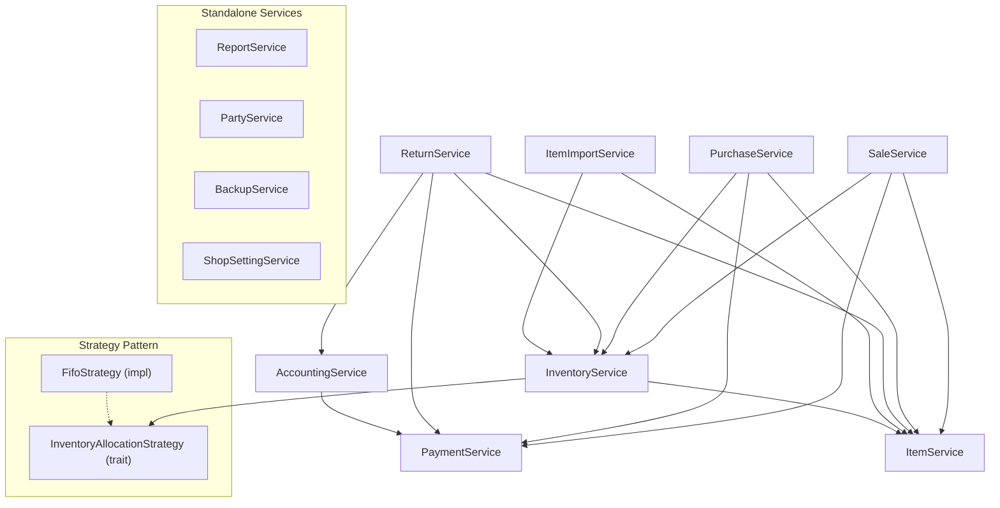
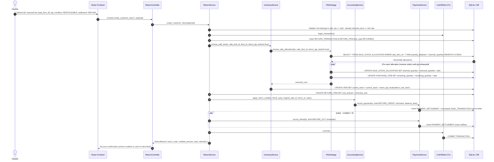
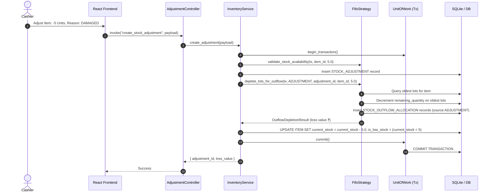
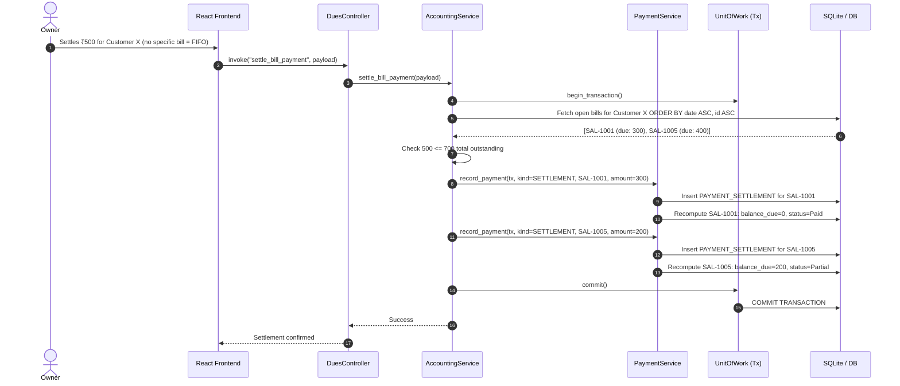
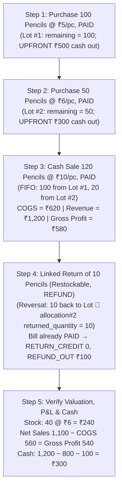

# Low-Level Design (LLD) Document: Book Keeper
**System:** Offline-First Retail Accounting & Inventory Management Desktop Application  
**Target Environment:** Windows Desktop (Tauri v2 + Rust + SQLite / Pluggable PostgreSQL + React 19)  
**Parent Document:** [High-Level Design (HLD)](file:///data/data/com.termux/files/home/book_keeper/docs/book_keeper_HLD.md)  
**UI/UX Companion Document:** [UI/UX Specification](file:///data/data/com.termux/files/home/book_keeper/docs/book_keeper_UI_UX_Specification.md)  
**Migration Specification:** [Data Import, Export & Migration](file:///data/data/com.termux/files/home/book_keeper/docs/book_keeper_data_import_export_and_migration.md)  
**Decisions Record:** [Design Decisions](DESIGN_DECISIONS.md) (authoritative where documents disagree)  
**Status:** Approved Architectural Low-Level Design Baseline (v3 — 2026-11-21 alignment: payment ledger, lot sources, return reversal, v1 scope)  

---

## 1. Executive Summary & Design Objectives

This Low-Level Design (LLD) document translates the business requirements, data structures, and operational workflows specified in the HLD into concrete, modular, testable software abstractions for the backend.

### 1.1 Core Architectural Principles
1. **Model-View-Controller-Service (MVCS) Pattern**:
   * **Controllers (`api/controllers`)**: Thin Tauri IPC command handlers responsible strictly for request deserialization, input validation, delegating to domain services, and mapping results or domain errors into typed IPC responses.
   * **Services (`services`)**: Granular, single-responsibility business logic classes. Orchestrates transactions, calculations, unit conversions, and domain rules.
   * **Data Access Repositories (`repositories`)**: Dedicated data access components isolated behind strict interfaces (traits) to encapsulate SQL persistence.
   * **Models / Entities (`domain`)**: Rich domain models, value objects, and Data Transfer Objects (DTOs).
2. **Pluggable Persistence & Reverse Search Abstraction**:
   * The database access layer and the typeahead inverted index (reverse search) are hidden entirely behind interfaces (`Repository` and `SearchIndexer` traits).
   * v1 ships with **Embedded SQLite** (`rusqlite` in WAL mode) and **SQLite FTS5** for sub-millisecond offline desktop search.
   * The system can be swapped to **PostgreSQL** or **Elasticsearch / Meilisearch / Tantivy** simply by providing alternative implementations bound to the same interface contracts without modifying any service or controller code.
3. **Strict Granularity & Single Responsibility (SRP)**:
   * Rather than monolithic service objects, business logic is split into cohesive units with decoupled concerns:
     * `InventoryAllocationStrategy` (`FifoStrategy`): Pure lot allocation, depletion, and restoration mechanics behind a strategy interface (FIFO by default, pluggable for LIFO/Weighted Average).
     * `InventoryService`: Centralized single source of truth for stock levels (`current_stock`, `is_low_stock`), lot lifecycle (all lot sources), physical adjustments, return reversals, replacement issues, vendor-return outflows, and the lot inspector.
     * `ItemService`: Item and bundle catalog master data, search index sync, and item validation (master data only, no stock mutations).
     * `PaymentService`: Sole writer of the payment ledger (`PaymentSettlement` rows of every `kind`) and of the cached bill money fields (`paid_amount`, `balance_due`, `payment_status`), which it recomputes from the ledger invariant after every write.
     * `AccountingService`: Analytical dues aggregation, bill settlement ordering (specific bill or FIFO across oldest open bills) for both cash settlements and return credits, party ledgers.
     * `SaleService`: Counter checkout orchestration, pricing, and bill summaries (delegates stock operations to `InventoryService` and payments to `PaymentService`).
     * `PurchaseService`: Inward batch generation and supplier bills (delegates stock addition to `InventoryService` and payments to `PaymentService`).
     * `ReturnService`: Customer/vendor returns and defective item swaps (delegates stock operations to `InventoryService` and refunds/adjustments to `PaymentService`).
     * `ReportService`: Fast consolidated KPI aggregations and financial statements (pure read-only).
     * `PartyService`: Customer & supplier directory master data and validation.
     * `ShopSettingService`: Single-row shop configuration and profile settings.
     * `BackupService`: Zero-downtime database snapshots via SQLite Online Backup API, integrity check.
     * `ItemImportService`: CSV/XLSX items import with dry-run validation and conflict strategy (v1 scope of FR-11).
     * *Deferred to v2 (code removed in v1): `MigrationService` (VedBill), exports, parties import, restore.*
4. **Decoupled Unit of Work / Transaction Abstraction**:
   * Multi-table operations (e.g., checkout inserting sales, updating purchase lot remainders, logging allocations, and refreshing item stock cache) run inside an atomic `UnitOfWork` transaction boundary, preventing partial writes and race conditions.

---

## 2. Package & Directory Structure

```
src-tauri/src/
├── api/                           # [Controller Layer] IPC Command Entrypoints (Thin)
│   ├── mod.rs                     # Command registration & router
│   ├── sale_controller.rs         # Checkout, sale codes, sales history
│   ├── purchase_controller.rs     # Inward purchase orders, purchase history
│   ├── item_controller.rs         # Master catalog, bundles, bundle suggestions
│   ├── dues_controller.rs         # Customer/Vendor dues & payment settlements (calls AccountingService)
│   ├── return_controller.rs       # Customer & vendor returns, swaps
│   ├── adjustment_controller.rs   # Physical stock adjustments & write-offs (calls InventoryService)
│   ├── report_controller.rs       # Dashboard KPIs, PnL, cash flow, stock valuation
│   ├── party_controller.rs        # Customer & supplier directory
│   ├── import_controller.rs       # Items import: validate (dry run) + execute
│   └── settings_controller.rs     # Shop settings, database backup, integrity check
│
├── core/                          # [Domain & Models Layer] Pure Domain Logic & Types
│   ├── mod.rs
│   ├── error.rs                   # AppError, DomainResult, Result type
│   ├── entities/                  # Core entity structs
│   │   ├── mod.rs
│   │   ├── item.rs                # Item & ItemBundle
│   │   ├── party.rs               # Customer & Vendor profiles
│   │   ├── purchase.rs            # PurchaseTransaction & PurchaseItem (FIFO Lot)
│   │   ├── sale.rs                # SaleTransaction, SaleItem, SaleStockAllocation
│   │   ├── settlement.rs          # PaymentSettlement
│   │   ├── stock_return.rs        # ReturnTransaction & ReturnItem
│   │   ├── adjustment.rs          # StockAdjustment & StockOutflowAllocation
│   │   └── shop_setting.rs        # Shop profile settings
│   ├── value_objects/             # Immutable value objects
│   │   ├── mod.rs
│   │   ├── transaction_code.rs    # SAL-XXXX, PUR-XXXX, RET-XXXX
│   │   ├── payment_status.rs      # PAID, PARTIAL, UNPAID
│   │   ├── party_type.rs          # CUSTOMER, VENDOR
│   │   ├── allocation_method.rs   # AllocationMethod enum { Fifo }
│   │   ├── payment_kind.rs        # UPFRONT, SETTLEMENT, RETURN_CREDIT, REFUND_OUT, REFUND_IN
│   │   ├── lot_source.rs          # PURCHASE, ADJUSTMENT, OPENING, RETURN
│   │   └── outflow_source.rs      # ADJUSTMENT, REPLACEMENT, VENDOR_RETURN
│   └── dtos/                      # Request / Response Transfer Objects
│       ├── mod.rs
│       ├── sale_dto.rs            # CreateSalePayload, SaleSummaryResponse, SalesFilter
│       ├── purchase_dto.rs        # CreatePurchasePayload, PurchaseFilter
│       ├── item_dto.rs            # CreateItemPayload, ItemSearchResult, BundleSuggestion
│       ├── dues_dto.rs            # PartyDueSummary, SettlePaymentPayload
│       ├── payment_dto.rs         # NEW: RecordPaymentPayload, RecordRefundPayload
│       ├── return_dto.rs          # CustomerReturnPayload, VendorReturnPayload
│       ├── adjustment_dto.rs      # StockAdjustmentPayload
│       ├── report_dto.rs          # DashboardMetrics, PnLReport, CashFlowReport, RecentTransaction
│       └── import_dto.rs          # ImportValidationReport, ImportSummary, ConflictStrategy
│
├── services/                      # [Service Layer] Business Rules & Orchestration
│   ├── mod.rs
│   ├── contracts/                 # Service Interfaces (Traits)
│   │   ├── inventory_allocation_strategy.rs # Strategy trait for lot allocation (replaces fifo_service.rs)
│   │   ├── inventory_service.rs             # Centralized stock & adjustments (replaces adjustment_service.rs)
│   │   ├── payment_service.rs               # Transactional payments & refunds (split from dues_service)
│   │   ├── accounting_service.rs            # Dues aggregation & bill settlement (replaces dues_service.rs)
│   │   ├── sale_service.rs
│   │   ├── purchase_service.rs
│   │   ├── item_service.rs                  # Master data only
│   │   ├── return_service.rs
│   │   ├── report_service.rs
│   │   ├── party_service.rs
│   │   ├── item_import_service.rs
│   │   ├── backup_service.rs
│   │   └── shop_setting_service.rs
│   └── impl/                      # Concrete Service Implementations
│       ├── fifo_strategy.rs                 # FIFO lot allocation algorithm
│       ├── inventory_service_impl.rs        # Inventory operations & stock cache
│       ├── payment_service_impl.rs          # Payment record persistence & balances
│       ├── accounting_service_impl.rs       # Dues calculation & FIFO bill settlement
│       ├── sale_service_impl.rs
│       ├── purchase_service_impl.rs
│       ├── item_service_impl.rs
│       ├── return_service_impl.rs
│       ├── report_service_impl.rs
│       ├── party_service_impl.rs
│       ├── item_import_service_impl.rs
│       ├── backup_service_impl.rs
│       └── shop_setting_service_impl.rs
│
├── data/                          # [Data Access Layer] Storage & Reverse Index (UNCHANGED)
│   ├── mod.rs
│   ├── contracts/                 # Storage & Search Interfaces (Traits)
│   │   ├── unit_of_work.rs        # Atomic transaction manager abstraction
│   │   ├── item_repository.rs
│   │   ├── bundle_repository.rs
│   │   ├── purchase_repository.rs # Inward batches & remaining quantity queries
│   │   ├── sale_repository.rs
│   │   ├── allocation_repository.rs
│   │   ├── party_repository.rs
│   │   ├── settlement_repository.rs
│   │   ├── return_repository.rs
│   │   ├── adjustment_repository.rs
│   │   ├── outflow_allocation_repository.rs # STOCK_OUTFLOW_ALLOCATION
│   │   ├── report_repository.rs
│   │   ├── setting_repository.rs
│   │   └── search_indexer.rs      # Reverse search trait (FTS5 / Elasticsearch)
│   │
│   └── sqlite/                    # Default Offline SQLite Implementations
│       ├── mod.rs
│       ├── connection.rs          # Pool management, WAL mode, pragmas (foreign_keys=ON, busy_timeout)
│       ├── migrations.rs          # Typed schema migrations (v1..vN)
│       ├── sqlite_uow.rs          # BEGIN IMMEDIATE transaction implementation
│       ├── repositories/          # SqliteItemRepo, SqliteSaleRepo, etc.
│       │   ├── item_repo.rs
│       │   ├── purchase_repo.rs
│       │   ├── sale_repo.rs
│       │   ├── settlement_repo.rs
│       │   └── ...
│       └── fts_indexer.rs         # SQLite FTS5 Inverted Index Implementation
│
└── app_state.rs                   # Dependency Injection Container (Arc<dyn Service>)
```

---

## 3. Core Domain Entities & Value Objects (`core/domain`)

### 3.1 Value Objects & Enums

```rust
// core/value_objects/item_type.rs  (FR-21, DD-42)
#[derive(Debug, Clone, Copy, PartialEq, Eq, Default, Serialize, Deserialize)]
#[serde(rename_all = "SCREAMING_SNAKE_CASE")]
pub enum ItemType { #[default] Physical, Service }

// core/value_objects/allocation_method.rs
/// Enum selecting the inventory allocation strategy at DI wiring time.
#[derive(Debug, Clone, Copy, PartialEq, Eq, Serialize, Deserialize)]
pub enum AllocationMethod {
    Fifo,
    // Future: Lifo, WeightedAverage
}

// core/value_objects/payment_status.rs
#[derive(Debug, Clone, Copy, PartialEq, Eq, Serialize, Deserialize)]
pub enum PaymentStatus {
    Paid,
    Partial,
    Unpaid,
}

// core/value_objects/party_type.rs
#[derive(Debug, Clone, Copy, PartialEq, Eq, Serialize, Deserialize)]
pub enum PartyType {
    Customer,
    Vendor,
}

// core/value_objects/stock_condition.rs
#[derive(Debug, Clone, Copy, PartialEq, Eq, Serialize, Deserialize)]
pub enum StockCondition {
    Restockable,
    DamagedScrap,
}

// core/value_objects/adjustment_reason.rs
#[derive(Debug, Clone, Copy, PartialEq, Eq, Serialize, Deserialize)]
pub enum AdjustmentReason {
    Damaged,
    Expired,
    CountCorrection,
    TheftLost,
    /// Positive only; lot at user-entered cost (DD-40).
    UnrecordedStock,
}

// core/value_objects/settlement_type.rs
/// Refund = apply value to dues first (RETURN_CREDIT), remainder as cash (REFUND_OUT / REFUND_IN).
/// Replacement = customer-only no-money swap (defective or variant, any item issued).
#[derive(Debug, Clone, Copy, PartialEq, Eq, Serialize, Deserialize)]
pub enum SettlementType {
    Refund,
    Replacement,
}

// core/value_objects/return_type.rs
#[derive(Debug, Clone, Copy, PartialEq, Eq, Serialize, Deserialize)]
pub enum ReturnType {
    Customer,
    Vendor,
}

// core/value_objects/return_line_type.rs
#[derive(Debug, Clone, Copy, PartialEq, Eq, Serialize, Deserialize)]
pub enum ReturnLineType {
    Returned,
    ReplacementIssued,
}

// core/value_objects/payment_kind.rs
/// Every PAYMENT_SETTLEMENT row has exactly one kind. Amounts are always > 0.
/// Cash direction is derived from (TransactionType, PaymentKind):
///   in : Sale·Upfront, Sale·Settlement, Purchase·RefundIn
///   out: Purchase·Upfront, Purchase·Settlement, Sale·RefundOut
///   non-cash: ReturnCredit
#[derive(Debug, Clone, Copy, PartialEq, Eq, Serialize, Deserialize)]
pub enum PaymentKind {
    Upfront,       // paid at billing time; reduces bill balance
    Settlement,    // later due payment; reduces bill balance
    ReturnCredit,  // return value offset against a bill; reduces bill balance, no cash
    RefundOut,     // cash paid back to a customer; bill balance untouched
    RefundIn,      // cash received back from a vendor; bill balance untouched
}

// core/value_objects/transaction_type.rs
#[derive(Debug, Clone, Copy, PartialEq, Eq, Serialize, Deserialize)]
pub enum TransactionType {
    Sale,
    Purchase,
}

// core/value_objects/lot_source.rs
/// Origin of a PURCHASE_TRANSACTION (and its lots). Only Purchase is a supplier bill.
/// Code prefixes: Purchase "PUR-", Adjustment "ADJ-", Opening "OPN-", Return "RTL-" (independent sequences).
#[derive(Debug, Clone, Copy, PartialEq, Eq, Serialize, Deserialize)]
pub enum LotSource {
    Purchase,
    Adjustment,
    Opening,
    Return,
}

// core/value_objects/outflow_source.rs
#[derive(Debug, Clone, Copy, PartialEq, Eq, Serialize, Deserialize)]
pub enum OutflowSourceType {
    Adjustment,    // source_id = stock_adjustment.id
    Replacement,   // source_id = return_transaction.id
    VendorReturn,  // source_id = return_transaction.id
}
```

> **Serialization:** all enums serialize as `SCREAMING_SNAKE_CASE` strings (`"RETURN_CREDIT"`, `"DAMAGED_SCRAP"`, …) both over IPC and as `TEXT` in SQLite.

### 3.2 Core Entities

```rust
// core/entities/item.rs
#[derive(Debug, Clone, Serialize, Deserialize)]
pub struct Item {
    pub id: i64,
    pub name: String,
    pub item_type: ItemType,      // PHYSICAL (default) | SERVICE; v1.1 services accept PHYSICAL only
    pub category: Option<String>,
    pub barcode: Option<String>,
    pub base_unit: String,
    pub mrp: Option<f64>,
    pub default_sale_price: f64,
    pub current_stock: f64,       // Cached sum across active purchase lots
    pub is_low_stock: bool,       // true if current_stock < 5.0 base units
    pub is_active: bool,          // 1: Active, 0: Soft-archived
    pub created_at: String,       // ISO-8601
    pub updated_at: String,       // ISO-8601
}

#[derive(Debug, Clone, Serialize, Deserialize)]
pub struct ItemBundle {
    pub id: i64,
    pub item_id: i64,
    pub bundle_name: String,      // e.g. "Box of 10", "Dozen"
    pub units_per_bundle: f64,    // Multiplier relative to base_unit
    pub mrp: Option<f64>,
    pub default_bundle_price: Option<f64>,
    pub barcode: Option<String>,
}

// core/entities/party.rs
#[derive(Debug, Clone, Serialize, Deserialize)]
pub struct Party {
    pub id: i64,
    pub name: String,
    pub phone: Option<String>,
    pub party_type: PartyType,
    pub notes: Option<String>,
    pub is_active: bool,
    pub created_at: String,
    pub updated_at: String,
}

// core/entities/purchase.rs
#[derive(Debug, Clone, Serialize, Deserialize)]
pub struct PurchaseTransaction {
    pub id: i64,
    pub transaction_code: String, // "PUR-1001" / "ADJ-0001" / "OPN-0001" / "RTL-0001"
    pub source: LotSource,        // Non-Purchase: total 0, party None, status Paid
    pub transaction_date: String, // "YYYY-MM-DD"
    pub party_id: Option<i64>,    // Supplier
    pub party_name: Option<String>, // Snapshot at write time (DD-30)
    pub payment_mode: Option<String>,
    pub payment_status: PaymentStatus,
    pub total_amount: f64,
    pub paid_amount: f64,
    pub balance_due: f64,
    pub notes: Option<String>,
    pub created_at: String,
}

#[derive(Debug, Clone, Serialize, Deserialize)]
pub struct PurchaseItem {
    pub id: i64,
    pub purchase_transaction_id: i64,
    pub item_id: i64,
    pub item_name: String,          // Name snapshot at write time (DD-30)
    pub pack_label: Option<String>, // Display snapshot ("Box of 10"); None = base units. No bundle FK (DD-28)
    pub pack_quantity: f64,         // Display snapshot: qty in that pack
    pub quantity: f64,              // Base units (pack_quantity × multiplier at entry)
    pub unit_cost: f64,             // Cost per base unit in ₹
    pub total_amount: f64,
    pub remaining_quantity: f64,  // Active lot base units available for FIFO
}

// core/entities/sale.rs
#[derive(Debug, Clone, Serialize, Deserialize)]
pub struct SaleTransaction {
    pub id: i64,
    pub transaction_code: String, // e.g. "SAL-1001"
    pub transaction_date: String, // "YYYY-MM-DD"
    pub party_id: Option<i64>,    // Customer
    pub party_name: Option<String>, // Snapshot at write time (DD-30)
    pub payment_mode: Option<String>,
    pub payment_status: PaymentStatus,
    pub total_amount: f64,
    pub paid_amount: f64,
    pub balance_due: f64,
    pub notes: Option<String>,
    pub created_at: String,
}

#[derive(Debug, Clone, Serialize, Deserialize)]
pub struct SaleItem {
    pub id: i64,
    pub sale_transaction_id: i64,
    pub item_id: i64,
    pub item_name: String,          // Name snapshot at write time (DD-30)
    pub pack_label: Option<String>, // Display snapshot ("Box of 10"); None = base units. No bundle FK (DD-28)
    pub pack_quantity: f64,         // Display snapshot: qty in that pack
    pub quantity: f64,              // Base units
    pub unit_price: f64,            // Effective selling rate per base unit
    pub total_amount: f64,
}

#[derive(Debug, Clone, Serialize, Deserialize)]
pub struct SaleStockAllocation {
    pub id: i64,
    pub sale_item_id: i64,
    pub purchase_item_id: i64,    // Inward batch depleted
    pub quantity_depleted: f64,   // Base units consumed from lot
    pub returned_quantity: f64,   // Base units later reversed by customer returns (0..=quantity_depleted)
    pub unit_cost: f64,           // Historical inward cost per base unit (for COGS)
}

// core/entities/settlement.rs  — the payment ledger
#[derive(Debug, Clone, Serialize, Deserialize)]
pub struct PaymentSettlement {
    pub id: i64,
    pub settlement_date: String,  // "YYYY-MM-DD"
    pub party_id: Option<i64>,
    pub kind: PaymentKind,
    pub transaction_type: TransactionType,
    pub transaction_id: Option<i64>, // Required for Upfront/Settlement/ReturnCredit
    pub return_id: Option<i64>,      // Set for ReturnCredit/RefundOut/RefundIn
    pub amount_paid: f64,            // > 0
    pub payment_mode: Option<String>,
    pub notes: Option<String>,
    pub created_at: String,
}

// core/entities/stock_return.rs
#[derive(Debug, Clone, Serialize, Deserialize)]
pub struct ReturnTransaction {
    pub id: i64,
    pub return_code: String,           // e.g. "RET-1001"
    pub return_date: String,           // "YYYY-MM-DD"
    pub return_type: ReturnType,       // Customer or Vendor
    pub party_id: Option<i64>,
    pub original_transaction_id: Option<i64>, // Sale id (Customer) / Purchase id (Vendor)
    pub settlement_type: SettlementType,      // Vendor: always Refund
    pub total_amount: f64,                    // Σ Returned lines' total_amount
    pub reason: Option<String>,
    pub notes: Option<String>,
    pub created_at: String,
}

#[derive(Debug, Clone, Serialize, Deserialize)]
pub struct ReturnItem {
    pub id: i64,
    pub return_transaction_id: i64,
    pub line_type: ReturnLineType,     // Returned or ReplacementIssued
    pub item_id: i64,
    pub item_name: String,             // Name snapshot at write time (DD-30)
    pub sale_item_id: Option<i64>,     // Customer: linked sale line (None = unlinked return)
    pub purchase_item_id: Option<i64>, // Vendor: named lot (None = FIFO)
    pub quantity: f64,                 // Base units
    pub unit_price: f64,               // Per base unit (Vendor: lot unit_cost; ReplacementIssued: 0)
    pub total_amount: f64,
    pub cost_amount: f64,              // FIFO cost of reversed (Returned) or issued (ReplacementIssued) units
    pub condition: Option<StockCondition>, // Customer Returned lines only
}

// core/entities/adjustment.rs
#[derive(Debug, Clone, Serialize, Deserialize)]
pub struct StockAdjustment {
    pub id: i64,
    pub adjustment_date: String,       // "YYYY-MM-DD"
    pub item_id: i64,
    pub quantity: f64,                 // Non-zero. Positive (+) to add, negative (-) to write off
    pub unit_cost: Option<f64>,        // Positive adjustments only; always Some for UnrecordedStock
    pub reason: AdjustmentReason,
    pub notes: Option<String>,
    pub created_at: String,
}

/// FIFO audit trail for every non-sale stock outflow (negative adjustments, replacement issues,
/// vendor returns). Mirrors SALE_STOCK_ALLOCATION.
#[derive(Debug, Clone, Serialize, Deserialize)]
pub struct StockOutflowAllocation {
    pub id: i64,
    pub source_type: OutflowSourceType,
    pub source_id: i64,                // stock_adjustment.id or return_transaction.id
    pub purchase_item_id: i64,         // Lot depleted
    pub quantity_depleted: f64,        // Base units consumed from lot
    pub unit_cost: f64,                // Lot cost per base unit (for loss valuation)
}

// core/entities/shop_setting.rs
#[derive(Debug, Clone, Serialize, Deserialize)]
pub struct ShopSetting {
    pub id: i64,
    pub shop_name: String,
    pub phone: Option<String>,
    pub address: Option<String>,
    pub tax_id: Option<String>,        // GSTIN / PAN
}
```

### 3.3 Payment Transfer Objects (`core/dtos/payment_dto.rs`)

```rust
// core/dtos/payment_dto.rs

/// Balance-reducing ledger entry: kind ∈ {Upfront, Settlement, ReturnCredit}.
pub struct RecordPaymentPayload {
    pub kind: PaymentKind,
    pub party_id: Option<i64>,
    pub transaction_type: TransactionType,
    pub transaction_id: i64,         // Required
    pub return_id: Option<i64>,      // Required iff kind == ReturnCredit
    pub settlement_date: String,     // "YYYY-MM-DD"
    pub amount_paid: f64,            // > 0 and <= bill balance_due (after rounding)
    pub payment_mode: Option<String>,
    pub notes: Option<String>,
}

/// Cash refund ledger entry: kind ∈ {RefundOut (Sale), RefundIn (Purchase)}. Never touches bill balances.
pub struct RecordRefundPayload {
    pub kind: PaymentKind,
    pub party_id: Option<i64>,
    pub transaction_type: TransactionType,
    pub transaction_id: Option<i64>, // Linked bill, if any (informational)
    pub return_id: i64,              // Required
    pub refund_date: String,
    pub amount: f64,                 // > 0
    pub payment_mode: Option<String>,
    pub notes: Option<String>,
}
```

---

## 4. Reverse Search & Inverted Index Abstraction (`data/contracts/search_indexer.rs`)

To guarantee that the typeahead search can be seamlessly swapped between **SQLite FTS5**, **Elasticsearch**, **Tantivy**, or **PostgreSQL tsvector/trigram**, the search engine is isolated behind the `ItemSearchIndexer` interface.

```rust
// data/contracts/search_indexer.rs

#[derive(Debug, Clone, Serialize, Deserialize)]
pub struct ItemSearchResult {
    pub id: i64,
    pub name: String,
    pub category: Option<String>,
    pub barcode: Option<String>,
    pub base_unit: String,
    pub mrp: Option<f64>,
    pub default_sale_price: f64,
    pub current_stock: f64,
    pub is_low_stock: bool,
    pub item_type: ItemType,      // FR-21; after base_unit in the real struct
    pub bundles: Vec<ItemBundleSearchResult>,
}

#[derive(Debug, Clone, Serialize, Deserialize)]
pub struct ItemBundleSearchResult {
    pub id: i64,
    pub bundle_name: String,
    pub units_per_bundle: f64,
    pub mrp: Option<f64>,
    pub default_bundle_price: Option<f64>,
}

pub trait ItemSearchIndexer: Send + Sync {
    /// High-speed typeahead lookup matching prefix across name, barcode, and category (< 1ms).
    fn search(&self, query: &str, limit: usize) -> Result<Vec<ItemSearchResult>, AppError>;

    /// Indexes or updates an item and its associated packaging bundles in the search catalog.
    fn index_item(&self, item: &Item, bundles: &[ItemBundle]) -> Result<(), AppError>;

    /// Deletes an item from the search index (or marks it inactive).
    fn remove_item(&self, item_id: i64) -> Result<(), AppError>;

    /// Rebuilds the search index entirely from storage (used in migration & bulk restore).
    fn rebuild_index(&self, items_with_bundles: &[(Item, Vec<ItemBundle>)]) -> Result<(), AppError>;
}
```

### 4.1 Default v1 Implementation: `SqliteFts5SearchIndexer`
The SQLite implementation uses the virtual table `ITEM_SEARCH_FTS` defined with FTS5:
```sql
CREATE VIRTUAL TABLE IF NOT EXISTS item_search_fts USING fts5(
    item_id UNINDEXED,
    name,
    category,
    barcode,
    tokenize = 'unicode61 remove_diacritics 2'
);
```

> **Design Note — Tokenizer Selection:** The Porter stemmer is intentionally omitted. While useful for English prose, it interferes with numeric barcode lookups and short product abbreviations common in retail catalogs (e.g., "PG", "LTR"). The `unicode61` tokenizer handles multi-script text and diacritics correctly without semantic stemming artifacts.

> **Design Note — Bundle Barcode Coverage:** `ITEM_BUNDLE.barcode` values (outer box barcodes) are indexed as additional rows in the FTS5 table with the **parent item's `item_id`**. When `index_item()` is called, it inserts one FTS row for the item itself and one additional FTS row per bundle that has a non-null barcode. This ensures scanning a box barcode at the counter resolves to the correct parent item without requiring a secondary lookup query.

Query execution sanitizes input tokens and executes prefix matching (`token*`):
```sql
SELECT i.id, i.name, i.category, i.barcode, i.base_unit, i.mrp, 
       i.default_sale_price, i.current_stock, i.is_low_stock
FROM item_search_fts fts
JOIN item i ON fts.item_id = i.id
WHERE i.is_active = 1 AND item_search_fts MATCH ?
ORDER BY rank LIMIT ?;
```

---

### 4.2 Generic FTS index, party index and low-stock rule (v1.1, schema v4)

* `trait FtsIndex` (`data/contracts/search_indexer.rs`): `table`, `reindex(key)`, `reindex_many`, `remove`, `rebuild`, `indexed_count`, `source_count`, `search_keys(query, limit)`. Blanket impl for `Arc<T>`.
* `FtsSpec { table, key_column, columns, source_all_sql, source_one_sql, source_count_sql }` and `SqliteFtsIndex` (`data/sqlite/fts.rs`), specs `ITEM_FTS`, `PARTY_FTS` in `data/sqlite/fts_specs.rs`. `fts_prefix_query` turns alphanumeric tokens into `"tok"*` (ANDed); `None` when there is none.
* `ItemSearchIndexer` stays the item read facade; its `rebuild_index`, `indexed_item_count`, `remove_item` delegate to `SqliteFtsIndex(ITEM_FTS)`.
* `party_search_fts(party_id UNINDEXED, name, phone, phone_digits)` (v4). Sync rule: write after commit via `sync_after_commit` (failures logged, never fail the command); startup `ensure_fts_index` repairs count mismatches; `data_reset(All)` rebuilds every index in `fts_indexes`.
* Query rules: blank query = no filter; non-blank query with no alphanumeric token matches nothing. `PartyRepository::list_rows` uses FTS; a digits-only query of 3+ digits also matches `phone_digits LIKE %q%`; results ordered by name.
* Low stock rule: `core::stock_rules::is_low_stock(item_type, stock, threshold) = Physical && stock < threshold`; SQL twin `LOW_STOCK_SQL`; `DEFAULT_LOW_STOCK_THRESHOLD = 5.0` replaces `LOW_STOCK_THRESHOLD`. `items.low_stock_threshold REAL NOT NULL DEFAULT 5 CHECK (>= 0)`; 0 = never low.
* `ItemRepository::update_stock_cache(item_id, new_stock)` (flag derived in SQL), `update_low_stock_threshold`, `recompute_low_stock_flags` (also run by the startup stock audit).
* `ItemService::update_low_stock_threshold(item_id, threshold) -> ItemSearchResult`; validation field `low_stock_threshold`, message "Low stock level must be a number that is 0 or more". `PartyService` takes `Arc<dyn FtsIndex>`. `LowStockItem` carries `low_stock_threshold`.
* IPC: `update_item_low_stock_threshold(item_id, threshold)`. `AppState.party_index`, `AppState.fts_indexes`, `DataResetServiceImpl::with_fts_indexes`.
* Import: optional "Low Stock Level" column (blank = 5).
* Tests: TC-LOW-01..08, TC-PSRCH-01..08, TC-FTS-01..05, TC-MIG-V4, TC-IMP-LSL-01..04.

## 5. Storage Repositories & Transaction Boundary (`data/contracts`)

### 5.1 Unit of Work & Transaction Abstraction
To execute atomic operations across multiple repositories without exposing SQLite or PostgreSQL transaction handles to the services:

```rust
// data/contracts/unit_of_work.rs

pub trait UnitOfWork: Send + Sync {
    /// Begins an immediate write transaction.
    fn begin_transaction(&self) -> Result<Box<dyn TransactionContext>, AppError>;
}

pub trait TransactionContext {
    /// Commits all staged mutations atomically.
    fn commit(self: Box<Self>) -> Result<(), AppError>;

    /// Explicitly aborts the transaction (automatic on drop if not committed).
    fn rollback(self: Box<Self>) -> Result<(), AppError>;

    // Repositories scoped to the live transaction handle:
    fn items(&mut self) -> &mut dyn ItemRepository;
    fn bundles(&mut self) -> &mut dyn BundleRepository;
    fn purchases(&mut self) -> &mut dyn PurchaseRepository;
    fn sales(&mut self) -> &mut dyn SaleRepository;
    fn allocations(&mut self) -> &mut dyn AllocationRepository;
    fn settlements(&mut self) -> &mut dyn SettlementRepository;
    fn returns(&mut self) -> &mut dyn ReturnRepository;
    fn adjustments(&mut self) -> &mut dyn AdjustmentRepository;
    fn outflow_allocations(&mut self) -> &mut dyn OutflowAllocationRepository;
    fn settings(&mut self) -> &mut dyn SettingRepository;
    fn parties(&mut self) -> &mut dyn PartyRepository;
}
```

### 5.2 Granular Repository Contracts

```rust
// data/contracts/item_repository.rs
pub trait ItemRepository {
    fn find_by_id(&self, id: i64) -> Result<Option<Item>, AppError>;
    fn find_by_name(&self, name: &str) -> Result<Option<Item>, AppError>;
    fn find_by_barcode(&self, barcode: &str) -> Result<Option<Item>, AppError>;
    fn list_catalog(&self, category: Option<&str>, low_stock_only: bool, offset: usize, limit: usize) -> Result<Vec<Item>, AppError>;
    fn create(&mut self, item: &Item) -> Result<i64, AppError>;
    fn update(&mut self, item: &Item) -> Result<(), AppError>;
    fn update_stock_cache(&mut self, item_id: i64, new_stock: f64, is_low_stock: bool) -> Result<(), AppError>;
    // archive(): deferred to v2 (FR-17)
}

// data/contracts/purchase_repository.rs
pub trait PurchaseRepository {
    fn create_transaction(&mut self, tx: &PurchaseTransaction) -> Result<i64, AppError>;
    fn create_purchase_item(&mut self, line: &PurchaseItem) -> Result<i64, AppError>;
    fn find_transaction_by_id(&self, id: i64) -> Result<Option<PurchaseTransaction>, AppError>;
    fn find_purchase_item_by_id(&self, id: i64) -> Result<Option<PurchaseItem>, AppError>;
    /// Next code for the given source's own prefix/sequence (PUR-/ADJ-/OPN-/RTL-).
    fn get_next_transaction_code(&self, source: LotSource) -> Result<String, AppError>;

    /// Core FIFO query: lots of any source with remaining_quantity > 0, ORDER BY id ASC.
    fn get_active_lots_for_item(&self, item_id: i64) -> Result<Vec<PurchaseItem>, AppError>;
    /// unit_cost of the item's most recent lot (highest id, any source, any remaining); None if never stocked.
    fn get_latest_lot_cost(&self, item_id: i64) -> Result<Option<f64>, AppError>;
    /// Lot inspector rows (joins header for code/source/date/vendor name).
    fn list_lots_for_item(&self, item_id: i64) -> Result<Vec<ItemLot>, AppError>;

    /// Sets remaining quantity on a lot; implementations must reject values < 0 or > lot.quantity.
    fn update_remaining_quantity(&mut self, lot_id: i64, new_remaining_qty: f64) -> Result<(), AppError>;
    /// Writes cached money fields only; called exclusively by PaymentService.
    fn update_money_fields(&mut self, tx_id: i64, paid_amount: f64, balance_due: f64, status: PaymentStatus) -> Result<(), AppError>;
    /// Open bills for FIFO settlement / credit: source = Purchase, balance_due > 0, ORDER BY transaction_date, id.
    fn list_open_for_party(&self, party_id: i64) -> Result<Vec<PurchaseTransaction>, AppError>;
    /// History list: source = Purchase only; filter incl. search_query on code / party name.
    fn list_purchases(&self, filter: &PurchaseHistoryFilter, offset: usize, limit: usize) -> Result<(Vec<PurchaseHistoryRow>, usize), AppError>;
    /// Σ quantity on vendor RETURN_ITEMs referencing this lot.
    fn get_returned_quantity_for_lot(&self, purchase_item_id: i64) -> Result<f64, AppError>;
}

// data/contracts/sale_repository.rs
pub trait SaleRepository {
    fn create_transaction(&mut self, tx: &SaleTransaction) -> Result<i64, AppError>;
    fn create_sale_item(&mut self, line: &SaleItem) -> Result<i64, AppError>;
    fn find_transaction_by_id(&self, id: i64) -> Result<Option<SaleTransaction>, AppError>;
    fn find_sale_item_by_id(&self, id: i64) -> Result<Option<SaleItem>, AppError>;
    fn get_next_transaction_code(&self) -> Result<String, AppError>;
    /// Writes cached money fields only; called exclusively by PaymentService.
    fn update_money_fields(&mut self, tx_id: i64, paid_amount: f64, balance_due: f64, status: PaymentStatus) -> Result<(), AppError>;
    /// Open bills for FIFO settlement / credit: balance_due > 0, ORDER BY transaction_date, id.
    fn list_open_for_party(&self, party_id: i64) -> Result<Vec<SaleTransaction>, AppError>;
    fn list_sales(&self, filter: &SalesHistoryFilter, offset: usize, limit: usize) -> Result<(Vec<SaleHistoryRow>, usize), AppError>;
    /// Σ quantity of customer Returned RETURN_ITEMs referencing this sale line.
    fn get_returned_quantity_for_line(&self, sale_item_id: i64) -> Result<f64, AppError>;
}

// data/contracts/allocation_repository.rs  (SALE_STOCK_ALLOCATION)
pub trait AllocationRepository {
    fn create_allocation(&mut self, allocation: &SaleStockAllocation) -> Result<i64, AppError>;
    fn find_by_sale_item_id(&self, sale_item_id: i64) -> Result<Vec<SaleStockAllocation>, AppError>;
    /// Allocations with quantity_depleted > returned_quantity, ORDER BY id DESC (reversal order).
    fn find_reversible_by_sale_item_id(&self, sale_item_id: i64) -> Result<Vec<SaleStockAllocation>, AppError>;
    fn update_returned_quantity(&mut self, allocation_id: i64, new_returned_qty: f64) -> Result<(), AppError>;
}

// data/contracts/settlement_repository.rs  (PAYMENT_SETTLEMENT ledger)
pub trait SettlementRepository {
    fn create_settlement(&mut self, settlement: &PaymentSettlement) -> Result<i64, AppError>;
    fn list_by_party(&self, party_id: i64) -> Result<Vec<PaymentSettlement>, AppError>;
    fn list_by_transaction(&self, tx_type: TransactionType, tx_id: i64) -> Result<Vec<PaymentSettlement>, AppError>;
    /// Σ amount_paid for a bill grouped by kind (used to recompute the cached header invariant).
    fn sum_by_kind_for_transaction(&self, tx_type: TransactionType, tx_id: i64) -> Result<LedgerTotals, AppError>;
}

// data/contracts/party_repository.rs
pub trait PartyRepository {
    fn find_by_id(&self, id: i64) -> Result<Option<Party>, AppError>;
    fn list(&self, party_type: Option<PartyType>, active_only: bool) -> Result<Vec<Party>, AppError>;
    fn search(&self, query: &str, party_type: Option<PartyType>) -> Result<Vec<Party>, AppError>;
    fn create(&mut self, party: &Party) -> Result<i64, AppError>;
    fn update(&mut self, party: &Party) -> Result<(), AppError>;
    // archive(): deferred to v2 (FR-17)
    /// Purchase side counts source = Purchase only.
    fn get_party_due_summary(&self, party_type: PartyType) -> Result<Vec<PartyDueSummary>, AppError>;
}

// data/contracts/bundle_repository.rs
pub trait BundleRepository {
    fn find_by_id(&self, id: i64) -> Result<Option<ItemBundle>, AppError>;
    fn find_by_item_id(&self, item_id: i64) -> Result<Vec<ItemBundle>, AppError>;
    fn find_by_barcode(&self, barcode: &str) -> Result<Option<ItemBundle>, AppError>;
    fn create(&mut self, bundle: &ItemBundle) -> Result<i64, AppError>;
    fn update(&mut self, bundle: &ItemBundle) -> Result<(), AppError>;
    fn delete(&mut self, bundle_id: i64) -> Result<(), AppError>; // hard delete; bill lines don't reference bundles
    fn get_bundle_suggestions(&self) -> Result<Vec<BundleSuggestion>, AppError>;
}

// data/contracts/return_repository.rs
pub trait ReturnRepository {
    fn create_return_transaction(&mut self, tx: &ReturnTransaction) -> Result<i64, AppError>;
    fn create_return_item(&mut self, item: &ReturnItem) -> Result<i64, AppError>;
    fn update_return_item_cost(&mut self, return_item_id: i64, cost_amount: f64) -> Result<(), AppError>;
    fn find_return_by_id(&self, id: i64) -> Result<Option<ReturnTransaction>, AppError>;
    fn find_items_by_return_id(&self, id: i64) -> Result<Vec<ReturnItem>, AppError>;
    fn get_next_return_code(&self) -> Result<String, AppError>;
    fn list_returns(&self, filter: &ReturnsFilter, offset: usize, limit: usize) -> Result<(Vec<ReturnTransaction>, usize), AppError>;
}

// data/contracts/adjustment_repository.rs
pub trait AdjustmentRepository {
    fn create_adjustment(&mut self, adj: &StockAdjustment) -> Result<i64, AppError>;
    fn list_adjustments(&self, item_id: Option<i64>, offset: usize, limit: usize) -> Result<(Vec<StockAdjustment>, usize), AppError>;
}

// data/contracts/outflow_allocation_repository.rs  (STOCK_OUTFLOW_ALLOCATION)
pub trait OutflowAllocationRepository {
    fn create_allocation(&mut self, alloc: &StockOutflowAllocation) -> Result<i64, AppError>;
    fn find_by_source(&self, source_type: OutflowSourceType, source_id: i64) -> Result<Vec<StockOutflowAllocation>, AppError>;
}

// data/contracts/setting_repository.rs
pub trait SettingRepository {
    fn get_shop_setting(&self) -> Result<ShopSetting, AppError>;
    fn upsert_shop_setting(&mut self, setting: &ShopSetting) -> Result<(), AppError>;
}

// data/contracts/report_repository.rs
pub trait ReportRepository: Send + Sync {
    fn get_dashboard_metrics(&self, today_date: &str) -> Result<DashboardMetrics, AppError>;
    fn get_low_stock_items(&self) -> Result<Vec<Item>, AppError>;
    fn get_sales_purchase_trend(&self, days: usize) -> Result<Vec<TrendDataPoint>, AppError>;
    fn get_pnl_report(&self, from_date: &str, to_date: &str) -> Result<PnLReport, AppError>;
    fn get_stock_valuation_report(&self) -> Result<StockValuationReport, AppError>;
    fn get_cash_flow_report(&self, from_date: &str, to_date: &str) -> Result<CashFlowReport, AppError>;
    fn get_recent_transactions(&self, limit: usize) -> Result<Vec<RecentTransaction>, AppError>;
}
```

### 5.3 Schema Rules (`data/sqlite/migrations.rs`)
* `PRAGMA foreign_keys = ON`, `journal_mode = WAL`, `synchronous = NORMAL`, `busy_timeout = 5000` on every connection.
* Enum columns are `TEXT` with `CHECK (... IN (...))` constraints matching §3.1.
* `PAYMENT_SETTLEMENT`: `CHECK (amount_paid > 0)`, `CHECK (kind IN ('REFUND_OUT','REFUND_IN') OR transaction_id IS NOT NULL)`.
* `PURCHASE_ITEM`: `CHECK (remaining_quantity >= 0 AND remaining_quantity <= quantity)`.
* `SALE_STOCK_ALLOCATION`: `CHECK (returned_quantity >= 0 AND returned_quantity <= quantity_depleted)`.
* `ITEM_BUNDLE`: `CHECK (units_per_bundle > 1)`.
* `STOCK_ADJUSTMENT`: `CHECK (quantity <> 0)`, reason enum incl. `UNRECORDED_STOCK` (v5), `CHECK (reason <> 'UNRECORDED_STOCK' OR (quantity > 0 AND unit_cost IS NOT NULL))`.
* Indexes: `purchase_item(item_id, remaining_quantity)`, `sale_stock_allocation(sale_item_id)`, `stock_outflow_allocation(source_type, source_id)`, `payment_settlement(settlement_date)`, `payment_settlement(transaction_type, transaction_id)`, `sale_transaction(transaction_date)`, `purchase_transaction(source, transaction_date)`, `item(barcode)`, `item_bundle(barcode)`, `return_item(sale_item_id)`, `return_item(purchase_item_id)`.
* Name snapshots (DD-30): `party_name` on sale/purchase/return headers, `item_name` on sale/purchase/return lines, written by the creating service; history/detail queries read snapshots.
* `ITEM.item_type TEXT NOT NULL DEFAULT 'PHYSICAL' CHECK (item_type IN ('PHYSICAL','SERVICE'))`, added by migration **v3** `item_type` (`ALTER TABLE ADD COLUMN`; existing rows become PHYSICAL).
* Every migration has a frozen-fixture upgrade test: `src-tauri/tests/fixtures/schema/vN.sql` holds the exact DDL delta of migration N as shipped (v1 = full aligned schema) plus its `schema_version` row and `PRAGMA user_version`. Tests build a vN-1 database from fixtures 1..N-1, seed rows, run `run_migrations`, and assert the data survived. Fixture files are never edited after the migration ships.
* Pre-migration backup (DD-29): when `applied > 0` and a migration is pending, `run_migrations` snapshots the database with `VACUUM INTO` (same connection, path from `PRAGMA database_list`) to `<db dir>/backups/book_keeper_premigration_v{applied}_to_v{latest}_YYYYMMDD_HHMM.db` before applying any step. Failure returns `MigrationError` and applies nothing; in-memory databases skip it. `BackupKind::PreMigration` makes DD-33 rotation delete such files after `retentionDays`.
* Schema strategy (DD-29): v1 is the aligned schema itself (pre-release rewrite); a legacy pre-alignment DB is detected and rejected.
* Migrations are numbered, forward-only, recorded in a `schema_version` table, each applied in one transaction; `ALTER TABLE ADD COLUMN` / new tables for additive changes (NFR-04). Changing a CHECK constraint uses a table rebuild (create new, copy rows with ids, carry `sqlite_sequence`, drop, rename, recreate indexes) with foreign keys off, inside the migration's transaction (DD-29). No JSON blob columns.
* Migration log: v1 `aligned_schema`, v2 `backup_directory`, v3 `item_type`, v4 `low_stock_threshold_party_fts`, v5 `unrecorded_stock_reason`.

---

## 6. Granular Service Layer (`services/`)

### 6.1 Architecture Overview & Service Responsibility Matrix

The service layer is structured to guarantee clean separation of concerns, single-responsibility compliance, and pluggable algorithm extensibility:

| Service | Owns | Does NOT do |
|---|---|---|
| **`InventoryAllocationStrategy`** (`FifoStrategy`) | Lot depletion/restoration algorithms, allocation record creation | Stock cache updates, business validation, transaction orchestration |
| **`InventoryService`** | Stock levels (`current_stock`, `is_low_stock`), lot lifecycle, physical adjustments, synthetic lot creation | Item master data, payment recording, dues logic |
| **`ItemService`** | Item + Bundle CRUD, search index sync, item validation | Stock mutations, payment logic |
| **`PaymentService`** | All `PaymentSettlement` ledger rows (every kind); sole writer of `paid_amount`/`balance_due`/`payment_status`, recomputed from the ledger invariant | Deciding *which* bills to pay, dues aggregation, stock |
| **`AccountingService`** | Dues aggregation, FIFO bill ordering for settlements **and** return credits, party ledgers | Executing payment records (delegates to `PaymentService`) |
| **`SaleService`** | Checkout orchestration, pricing, bill summary generation | Stock mutations (delegates to `InventoryService`), payment recording (delegates to `PaymentService`) |
| **`PurchaseService`** | Inward batch orchestration, cost normalization, lot creation | Stock cache updates (delegates to `InventoryService`), payment recording (delegates to `PaymentService`) |
| **`ReturnService`** | Return orchestration, condition assessment, replacement logic | Stock mutations (delegates to `InventoryService`), payment/refund recording (delegates to `PaymentService`) |
| **`ReportService`** | Read-only KPI aggregations, P&L, cash flow, stock valuation | Everything — pure reads |
| **`PartyService`** | Customer/vendor master data CRUD, search | Everything else |



---

### 6.2 Inventory Allocation Strategy (`InventoryAllocationStrategy` Trait & `FifoStrategy`)

The mathematical core of stock lot depletion and restoration is isolated behind the Strategy pattern (`InventoryAllocationStrategy`). Implementations contain zero business orchestration; they operate strictly on lots via the `TransactionContext` repositories. This allows future allocation methods (LIFO, Weighted Average) to be plugged in seamlessly.

```rust
// services/contracts/inventory_allocation_strategy.rs

#[derive(Debug, Clone)]
pub struct DepletionResult {
    pub total_cogs: f64,
    pub allocations: Vec<SaleStockAllocation>,
}

#[derive(Debug, Clone)]
pub struct OutflowDepletionResult {
    pub total_cost: f64,                       // Σ qty × lot cost (loss value / return value)
    pub allocations: Vec<StockOutflowAllocation>,
}

#[derive(Debug, Clone)]
pub struct ReversalResult {
    pub reversed_cost: f64,                    // Σ reversed qty × allocation unit_cost
}

/// Strategy interface for inventory lot allocation algorithms.
/// Implementations are pure algorithmic — they operate on lots via the
/// TransactionContext repositories and contain zero business orchestration.
pub trait InventoryAllocationStrategy: Send + Sync {
    /// Validates that total active stock across lots >= required_base_qty.
    /// Returns InsufficientStockError if unavailable.
    fn validate_stock_availability(
        &self,
        uow: &mut dyn TransactionContext,
        item_id: i64,
        required_base_qty: f64,
    ) -> Result<(), AppError>;

    /// Depletes lots in strategy-defined order (FIFO = oldest first).
    /// Decrements `remaining_quantity` on purchase lots and logs sale allocations.
    fn deplete_lots_for_sale(
        &self,
        uow: &mut dyn TransactionContext,
        sale_item_id: i64,
        item_id: i64,
        required_base_qty: f64,
    ) -> Result<DepletionResult, AppError>;

    /// Reverses `quantity` units of a sale line for a customer return.
    /// Walks reversible allocations (quantity_depleted > returned_quantity) in reverse
    /// depletion order, increments returned_quantity; if `restock`, also adds the units back to
    /// each allocation's lot remaining_quantity. Fails if quantity exceeds total reversible.
    fn reverse_sale_allocations(
        &self,
        uow: &mut dyn TransactionContext,
        sale_item_id: i64,
        quantity: f64,
        restock: bool,
    ) -> Result<ReversalResult, AppError>;

    /// Depletes lots for a non-sale outflow (negative adjustment, replacement issue, vendor return
    /// in FIFO mode) and writes StockOutflowAllocation rows tagged with (source_type, source_id).
    fn deplete_lots_for_outflow(
        &self,
        uow: &mut dyn TransactionContext,
        source_type: OutflowSourceType,
        source_id: i64,
        item_id: i64,
        quantity: f64,
    ) -> Result<OutflowDepletionResult, AppError>;
}
```

```rust
// services/impl/fifo_strategy.rs

/// FIFO (First-In, First-Out) implementation of InventoryAllocationStrategy.
/// Depletes oldest lots first (ORDER BY id ASC — entry order, any lot source).
/// Reverses latest-depleted first (allocations ORDER BY id DESC).
pub struct FifoStrategy;
```

> **Strategy boundary (NFR-05):** the ordering of lots and of reversals lives only inside the strategy. Services never query lots in a particular order themselves. Named-lot vendor returns are not a strategy concern (the lot is chosen by the user) and are handled by `InventoryService` directly.

#### Detailed FIFO Depletion Algorithm (sale and outflow share it)
```
Input: item_id, required_base_qty (> 0)          EPS = 1e-9
1. Fetch active lots: SELECT * FROM purchase_item WHERE item_id = ? AND remaining_quantity > 0 ORDER BY id ASC.
2. Verify: SUM(lot.remaining_quantity) + EPS >= required_base_qty. Else InsufficientStockError { required, available }.
3. remaining_needed = required_base_qty; total_cost = 0.0
4. For each lot in active_lots:
     take_qty = MIN(lot.remaining_quantity, remaining_needed)
     lot_repo.update_remaining_quantity(lot.id, lot.remaining_quantity - take_qty)
     write allocation row (sale: SALE_STOCK_ALLOCATION; outflow: STOCK_OUTFLOW_ALLOCATION with source)
     total_cost += take_qty * lot.unit_cost
     remaining_needed -= take_qty
     If remaining_needed <= EPS: BREAK
5. Return result { total_cost, allocations }
```

#### Reversal Algorithm (customer returns)
```
Input: sale_item_id, qty (> 0), restock: bool
1. allocs = SELECT * FROM sale_stock_allocation WHERE sale_item_id = ? AND quantity_depleted > returned_quantity ORDER BY id DESC
2. Verify SUM(quantity_depleted - returned_quantity) + EPS >= qty, else ValidationError("return exceeds sold quantity")
3. For each a in allocs while qty > EPS:
     take = MIN(a.quantity_depleted - a.returned_quantity, qty)
     allocation_repo.update_returned_quantity(a.id, a.returned_quantity + take)
     if restock: lot.remaining_quantity += take   (repo rejects > lot.quantity)
     reversed_cost += take * a.unit_cost; qty -= take
4. Return ReversalResult { reversed_cost }
```

---

### 6.3 Centralized Inventory Service (`InventoryService`)

`InventoryService` is the centralized, authoritative single source of truth for all inventory mutations. No other service modifies `ITEM.current_stock`, `ITEM.is_low_stock`, or `PURCHASE_ITEM.remaining_quantity` directly. It absorbs physical stock adjustments and coordinates lot allocation through the pluggable strategy.

```rust
// services/contracts/inventory_service.rs

pub trait InventoryService: Send + Sync {
    /// Validates that sufficient stock exists for every item. `requirements` holds the
    /// required base qty per item ALREADY SUMMED across all lines of the operation.
    fn validate_stock_availability(
        &self,
        uow: &mut dyn TransactionContext,
        requirements: &[(i64 /*item_id*/, f64 /*total_base_qty*/)],
    ) -> Result<(), AppError>;

    /// Depletes lots via the allocation strategy and updates ITEM.current_stock.
    /// Called by SaleService during checkout for each sale line.
    fn deplete_stock_for_sale(
        &self,
        uow: &mut dyn TransactionContext,
        sale_item_id: i64,
        item_id: i64,
        required_base_qty: f64,
    ) -> Result<DepletionResult, AppError>;

    /// Creates a new purchase lot and increments ITEM.current_stock.
    /// Called by PurchaseService for each inward line.
    fn add_stock_for_purchase(
        &self,
        uow: &mut dyn TransactionContext,
        purchase_item: &PurchaseItem,
    ) -> Result<(), AppError>;

    /// Linked customer return: reverses sale allocations via the strategy (restock = RESTOCKABLE)
    /// and, if restocking, increments ITEM.current_stock. Returns the reversed FIFO cost.
    fn reverse_sale_line(
        &self,
        uow: &mut dyn TransactionContext,
        sale_item_id: i64,
        item_id: i64,
        quantity: f64,
        restock: bool,
    ) -> Result<f64, AppError>;

    /// Creates a non-purchase lot (source Adjustment / Opening / Return): inserts a zero-value
    /// header with its own code sequence (party None, status Paid), one PurchaseItem lot,
    /// increments ITEM.current_stock. Cost = explicit cost if given, else latest lot cost,
    /// else ValidationError("unit cost required"). Returns the lot id.
    fn create_source_lot(
        &self,
        uow: &mut dyn TransactionContext,
        source: LotSource,
        date: &str,
        item_id: i64,
        quantity: f64,
        unit_cost: Option<f64>,
        notes: Option<String>,
    ) -> Result<i64, AppError>;

    /// FIFO outflow for replacement issues and negative adjustments: strategy depletion +
    /// StockOutflowAllocation rows + ITEM.current_stock decrement. Returns total cost.
    fn issue_stock_outflow(
        &self,
        uow: &mut dyn TransactionContext,
        source_type: OutflowSourceType,
        source_id: i64,
        item_id: i64,
        quantity: f64,
    ) -> Result<f64, AppError>;

    /// Vendor return: named lot (must be Purchase-source, same item, qty <= remaining) is depleted
    /// directly; None -> FIFO via issue_stock_outflow(VendorReturn). Both log StockOutflowAllocation
    /// and decrement ITEM.current_stock. Returns Σ qty × lot unit_cost (the return value).
    fn remove_stock_for_vendor_return(
        &self,
        uow: &mut dyn TransactionContext,
        return_id: i64,
        item_id: i64,
        purchase_item_id: Option<i64>,
        quantity: f64,
    ) -> Result<f64, AppError>;

    /// Executes a physical stock adjustment in its own BEGIN IMMEDIATE transaction.
    /// Negative: issue_stock_outflow(Adjustment). Positive: create_source_lot(Adjustment).
    fn create_adjustment(
        &self,
        payload: StockAdjustmentPayload,
    ) -> Result<StockAdjustmentResult /* { adjustment_id, loss_value } */, AppError>;

    /// Set stock on hand (FR-08 rev.). Own BEGIN IMMEDIATE; delta = counted - current_stock.
    fn set_item_stock(&self, payload: SetItemStockPayload) -> Result<SetItemStockResult, AppError>;

    /// Lot inspector (all sources).
    fn get_item_lots(&self, item_id: i64) -> Result<Vec<ItemLot>, AppError>;

    /// Lists historical stock adjustments.
    fn list_adjustments(
        &self,
        item_id: Option<i64>,
        page: usize,
        limit: usize,
    ) -> Result<PaginatedList<StockAdjustment>, AppError>;
}
```

#### Stock Cache Update Logic (Owned Exclusively by `InventoryService`):
```
After any stock mutation (inside the same transaction):
  new_stock = item.current_stock + delta          (delta signed)
  is_low = new_stock < 5.0
  item_repo.update_stock_cache(item_id, new_stock, is_low)
Invariant (checked in tests): ITEM.current_stock == Σ PURCHASE_ITEM.remaining_quantity for the item (± EPS).
```

#### Physical Stock Adjustment Execution Logic:
0. Validate: item exists, is active and PHYSICAL (FR-21); `quantity != 0`; `adjustment_date` is a valid date; `UNRECORDED_STOCK` requires `quantity > 0` else `ValidationError{field:"quantity"}`. Both `create_adjustment` and `set_item_stock` share the private `post_adjustment` helper.

**Negative Adjustment (`quantity < 0`) — Write-Off / Loss:**
1. `uow.begin_transaction()`
2. `validate_stock_availability(uow, [(item_id, abs(quantity))])` → `InsufficientStockError` if short.
3. Persist `StockAdjustment` (`unit_cost = None`) → `adjustment_id`.
4. `issue_stock_outflow(uow, Adjustment, adjustment_id, item_id, abs(quantity))` → `loss_value`.
5. `uow.commit()`; return `{ adjustment_id, loss_value }`.

**Positive Adjustment (`quantity > 0`) — Found Stock / Count Correction:**
1. `uow.begin_transaction()`
2. Resolve cost: `payload.unit_cost` if given, else `purchase_repo.get_latest_lot_cost(item_id)`, else `ValidationError { field: "unit_cost", message: "unit cost required: item has no prior lot" }`.
3. Persist `StockAdjustment` (with resolved `unit_cost`) → `adjustment_id`.
4. `create_source_lot(uow, Adjustment, adjustment_date, item_id, quantity, Some(cost), notes = "Stock adjustment #<id>: <reason>")` (code `ADJ-XXXX`).
5. `uow.commit()`; return `{ adjustment_id, loss_value: 0 }`.

#### Set Stock On Hand (`set_item_stock`):
```rust
pub struct SetItemStockPayload { item_id: i64, counted_quantity: f64, unit_cost: Option<f64>, adjustment_date: String, notes: Option<String> }
pub struct SetItemStockResult { adjustment_id: Option<i64>, delta: f64, reason: Option<AdjustmentReason>,
                                previous_stock: f64, new_stock: f64, unit_cost: Option<f64>, value_change: f64 }
```
0. Validate: `counted_quantity` finite and >= 0 (`field "counted_quantity"`); date valid; `unit_cost`, if given, finite and >= 0.
1. `begin_transaction()`.
2. Load the item: NotFound if missing; must be active and PHYSICAL.
3. `delta = round_qty(counted - current_stock)` (1e-6).
4. If `|delta| <= EPS`: rollback, return no-op (nothing written).
5. `delta > 0`: `post_adjustment(UnrecordedStock, delta, unit_cost)`; `delta < 0`: `post_adjustment(CountCorrection, delta, None)` (a given `unit_cost` is ignored).
6. Commit; `value_change = +delta x cost` (unrecorded) or `-loss` (count correction).

> **Design Rationale — Source-tagged lots:** every unit of stock must live in a depletable `PURCHASE_ITEM` lot so `current_stock` always equals Σ lot remainders. Non-purchase lots hang off a zero-value `PURCHASE_TRANSACTION` whose `source` ≠ `PURCHASE`; every purchase-facing query filters `source = 'PURCHASE'`, so these never appear as supplier bills, in purchase totals/counts, payables, or vendor-return lot pickers.

---

### 6.4 Payment Service (`PaymentService`)

`PaymentService` is the **only** writer of the payment ledger and of the cached bill money fields. It is called during checkout/inward (UPFRONT), dues settlements (SETTLEMENT), and returns (RETURN_CREDIT, REFUND_OUT, REFUND_IN).

```rust
// services/contracts/payment_service.rs

pub trait PaymentService: Send + Sync {
    /// Balance-reducing entry (kind ∈ Upfront | Settlement | ReturnCredit) against one bill.
    /// 1. Load bill; amount = round2(payload.amount_paid); reject amount <= 0 or amount > balance_due + EPS
    ///    (ValidationError "Payment exceeds outstanding balance").
    /// 2. Insert PaymentSettlement row.
    /// 3. recompute_bill(tx_type, tx_id).
    /// Returns the settlement id.
    fn record_payment(
        &self,
        uow: &mut dyn TransactionContext,
        payload: RecordPaymentPayload,
    ) -> Result<i64, AppError>;

    /// Cash refund (RefundOut for customers, RefundIn from vendors). Inserts a ledger row only;
    /// never changes any bill balance.
    fn record_refund(
        &self,
        uow: &mut dyn TransactionContext,
        payload: RecordRefundPayload,
    ) -> Result<i64, AppError>;
}

/// Internal helper used after every balance-reducing insert:
///   totals = settlement_repo.sum_by_kind_for_transaction(tx_type, tx_id)
///   paid   = round2(totals.upfront + totals.settlement)
///   credit = round2(totals.return_credit)
///   balance = round2(total_amount - paid - credit)            (must be >= 0)
///   status = Paid if balance == 0 else Partial if paid + credit > 0 else Unpaid
///   repo.update_money_fields(tx_id, paid, balance, status)
fn recompute_bill(uow, tx_type, tx_id) -> Result<(), AppError>;
```

> `reduce_transaction_balance` is removed: due reductions from returns are `RETURN_CREDIT` ledger rows so they are auditable and survive a recompute.

---

### 6.5 Accounting & Dues Service (`AccountingService`)

`AccountingService` owns the analytical and bookkeeping concern of party ledgers and dues. It determines *what* to pay (which bills, in what order) and delegates the actual *execution* of payments to `PaymentService`.

```rust
// services/contracts/accounting_service.rs

pub trait AccountingService: Send + Sync {
    /// Aggregates all outstanding dues for customers or vendors.
    fn get_party_dues_summary(
        &self,
        party_type: PartyType,
    ) -> Result<Vec<PartyDueSummary>, AppError>;

    /// v1.2 D9: THE settlement core. One BEGIN IMMEDIATE, 1..=200 unique allocations, all or nothing.
    /// Errors name `allocations[i].amount_paid` / `allocations[i].transaction_id`.
    fn settle_bills_batch(&self, payload: SettleBatchPayload) -> Result<SettlementResult, AppError>;

    /// v1.2 D8: edit / delete one SETTLEMENT row (any other kind -> ValidationError(kind)); both end in recompute_bill.
    fn update_settlement(&self, settlement_id: i64, payload: UpdateSettlementPayload) -> Result<PaymentSettlement, AppError>;
    fn delete_settlement(&self, settlement_id: i64) -> Result<DeleteSettlementResult /* { removed_amount, transaction_id } */, AppError>;

    /// Cash settlement (kind Settlement) in its own BEGIN IMMEDIATE transaction:
    /// specific bill or FIFO across the party's oldest open bills.
    /// v1.2: a wrapper over the batch core (a bill id = a batch of one; None = FIFO allocation builder).
    fn settle_bill_payment(
        &self,
        payload: SettlePaymentPayload,
    ) -> Result<SettlementResult /* { settlement_ids, bills_touched } */, AppError>;

    /// Applies a return's value as RETURN_CREDIT inside the caller's transaction.
    /// target: Some(bill_id) -> that bill only; None -> party's oldest open bills (FIFO).
    /// Returns the amount actually credited (<= value); caller pays the remainder as cash.
    fn apply_return_credit(
        &self,
        uow: &mut dyn TransactionContext,
        tx_type: TransactionType,
        party_id: Option<i64>,
        target_bill: Option<i64>,
        return_id: i64,
        date: &str,
        value: f64,
    ) -> Result<f64, AppError>;

    /// Returns transaction-level ledger history for a party (bills, ledger rows, returns).
    fn get_party_ledger(
        &self,
        party_id: i64,
    ) -> Result<PartyLedgerView, AppError>;
}
```

#### Settlement Execution Logic:
0. Validate: `amount_paid > 0` (round2); party exists and matches `transaction_type` (SALE ⇒ CUSTOMER, PURCHASE ⇒ VENDOR).
1. `uow.begin_transaction()`
2. **If `transaction_id` is provided (Specific Bill Settlement):**
   * Fetch target bill; it must belong to `party_id` (and be `source = PURCHASE` for purchases).
   * Delegate to `PaymentService.record_payment(uow, kind = Settlement, ...)` (rejects amount > balance_due).
3. **If `transaction_id` is `None` (FIFO Bill Settlement):**
   * `bills = repo.list_open_for_party(party_id)` (ordered `transaction_date ASC, id ASC`).
   * If `amount_paid > Σ bills.balance_due + EPS`: `ValidationError("Settlement amount exceeds total outstanding dues")` **before** writing anything.
   * Loop oldest-first: `apply = MIN(bill.balance_due, remaining)`; `record_payment(kind = Settlement, amount = apply)`; `remaining -= apply`; stop at `remaining <= EPS`.
4. `uow.commit()`

#### Return Credit Logic (`apply_return_credit`):
1. `target_bill = Some(id)`: `credit = MIN(value, bill.balance_due)`; if `credit > 0`: `record_payment(kind = ReturnCredit, return_id, amount = credit)`.
2. `target_bill = None, party_id = Some(p)`: same FIFO loop as settlement over `list_open_for_party(p)` with `kind = ReturnCredit`, stopping when the value is exhausted or bills run out (no error when value exceeds dues).
3. `party_id = None`: credit = 0.
4. Return total credited.

---

### 6.6 Item Catalog & Bundles Master Data Service (`ItemService`)

`ItemService` is strictly a **master data management service**. It owns item and bundle definitions, catalog search indexing, and validation. It does **not** perform any stock mutations — that is `InventoryService`'s exclusive domain.

```rust
// services/contracts/item_service.rs

pub trait ItemService: Send + Sync {
    fn get_catalog(&self, category: Option<String>, low_stock_only: bool, page: usize, limit: usize) -> Result<PaginatedList<ItemSearchResult>, AppError>;
    fn create_item(&self, payload: CreateItemPayload) -> Result<i64, AppError>;
    fn update_item(&self, item_id: i64, payload: UpdateItemPayload) -> Result<(), AppError>; // master fields only
    // archive_item: deferred to v2 (FR-17)
    fn create_bundle(&self, payload: CreateBundlePayload) -> Result<i64, AppError>;
    fn update_bundle(&self, bundle_id: i64, payload: UpdateBundlePayload) -> Result<(), AppError>;
    fn delete_bundle(&self, bundle_id: i64) -> Result<(), AppError>;
    fn get_bundle_suggestions(&self) -> Result<Vec<BundleSuggestion>, AppError>;
}
```

* **Validation**: item `name` non-empty, trimmed, unique (case-insensitive); `barcode` unique across items and bundles when present; `default_sale_price >= 0`; `mrp` null or `> 0`. Bundle: `bundle_name` non-empty, `units_per_bundle > 1`, prices null or `>= 0`, unique `(item_id, bundle_name)`.
* **Bundles are freely editable (DD-28)**: any field, including `units_per_bundle`, may change and bundles may be deleted at any time. Bill lines store base `quantity` plus a display snapshot (`pack_label`, `pack_quantity`) and never reference `ITEM_BUNDLE`. Reindex the item after bundle changes (bundle barcodes are FTS rows).
* **Item type (FR-21, DD-42)**: `item_type` is optional in create/update payloads (`None` => create: `PHYSICAL`, update: keep). `SERVICE` is rejected in v1.1 with `ValidationError { field: "item_type", message: "Service items are not supported yet. Only physical (stocked) items can be saved in this version." }`. The import always creates `PHYSICAL`.
* **DTO note**: `ItemSearchResult` (catalog and FTS rows) carries `item_type`. `CreateItemPayload` and `UpdateItemPayload` carry `#[serde(default)] item_type: Option<ItemType>`.

* **Used by**:
  * `InventoryService` — to validate items are active and resolve bundle multipliers.
  * `SaleService` — to validate items and resolve bundle multipliers during checkout line processing.
  * `PurchaseService` — to validate items and resolve bundle multipliers during inward line processing.
* **Dynamic Bundle Suggestions**: Queries distinct packaging names and multipliers ordered by historical usage frequency (`SELECT bundle_name, units_per_bundle, COUNT(*) FROM item_bundle GROUP BY bundle_name, units_per_bundle ORDER BY 3 DESC`).
* **Search Index Sync**: Calls `indexer.index_item()` **after** the item/bundle transaction commits (the indexer uses its own connection). A failed reindex is logged and surfaced as `SearchIndexError` but never rolls back the committed master data; `rebuild_index` runs at startup if the FTS row count disagrees with active items.

---

### 6.7 Counter Billing & Sales Service (`SaleService`)

`SaleService` orchestrates the checkout counter flow. It validates cart lines, calculates pricing and totals, persists sale transactions, delegates stock depletion to `InventoryService`, and delegates payment recording to `PaymentService`.

```rust
// services/contracts/sale_service.rs

pub trait SaleService: Send + Sync {
    /// Generates next sequential sale transaction code (e.g., "SAL-1043").
    fn get_next_sale_code(&self) -> Result<String, AppError>;

    /// Executes complete atomic checkout workflow.
    fn create_sale(&self, payload: CreateSalePayload) -> Result<SaleSummaryResponse, AppError>;

    /// Retrieves paginated sale history.
    fn get_sales_history(&self, filter: SalesHistoryFilter) -> Result<PaginatedList<SaleTransaction>, AppError>;

    /// Retrieves detailed breakdown of a sale including lines, bundles, and FIFO cost breakdown.
    fn get_sale_details(&self, sale_id: i64) -> Result<SaleDetailView, AppError>;
}
```

#### Sales Domain DTOs (`core/dtos/sale_dto.rs`):
```rust
#[derive(Debug, Clone, Serialize, Deserialize)]
pub struct CreateSalePayload {
    pub transaction_date: String,           // "YYYY-MM-DD"
    pub party_id: Option<i64>,              // Customer ID (required if UNPAID or PARTIAL)
    pub payment_status: PaymentStatus,      // Paid, Partial, Unpaid — cross-checked against paid_amount
    pub paid_amount: f64,                   // Cash received (Paid: may exceed total; excess = change)
    pub notes: Option<String>,
    pub items: Vec<CreateSaleItemPayload>,
}

#[derive(Debug, Clone, Serialize, Deserialize)]
pub struct CreateSaleItemPayload {
    pub item_id: i64,
    pub bundle_id: Option<i64>,             // Write-time helper only: resolves multiplier + label; not stored
    pub bundle_quantity: f64,               // Units entered in selected packaging (stored as pack_quantity)
    pub unit_price: f64,                    // Rate charged per selected bundle/unit (₹)
}

#[derive(Debug, Clone, Serialize, Deserialize)]
pub struct SaleSummaryResponse {
    pub sale_id: i64,
    pub transaction_code: String,
    pub total_amount: f64,
    pub paid_amount: f64,
    pub balance_due: f64,
    pub change_amount: f64,                 // MAX(0, paid_amount - total_amount)
    pub payment_status: PaymentStatus,
}
```

#### Detailed Atomic Checkout Execution Workflow:
1. `uow.begin_transaction()`
2. **Basic Validation**: Reject if `payload.items` is empty, `transaction_date` invalid, any `bundle_quantity <= 0`, or any `unit_price < 0`. If `party_id` is given it must be an active `CUSTOMER`.
3. **Line-Item Resolution**:
   * For each line:
     * Fetch `Item` via `ItemService`. Reject if missing or `!item.is_active`.
     * Resolve bundle multiplier (if `bundle_id` provided: verify `bundle.item_id == item.id`, `multiplier = bundle.units_per_bundle`; else `multiplier = 1.0`).
     * `base_qty = line.bundle_quantity * multiplier`.
     * `line_total = round2(line.bundle_quantity * line.unit_price)`.
     * `effective_base_price = line_total / base_qty`.
   * **Stock Availability Check (aggregated)**: build `required[item_id] = Σ base_qty` across all lines, then `inventory_service.validate_stock_availability(uow, &required)` → `InsufficientStockError` on any shortfall.
4. **Total & Payment Cross-Check** (`total_amount = round2(Σ line_total)`, `paid = round2(paid_amount)`):
   * `Paid`: require `paid >= total` → `upfront = total`, `change = paid − total`.
   * `Partial`: require `0 < paid < total` → `upfront = paid`, `change = 0`.
   * `Unpaid`: require `paid == 0` → `upfront = 0`, `change = 0`.
   * Any mismatch → `ValidationError { field: "paid_amount" }`. If status ≠ `Paid` and `party_id` is `None` → `ValidationError { field: "party_id", message: "customer required for credit" }`.
   * Edge: `total == 0` is only valid with `Paid` and `paid == 0`.
5. **Persist Transaction Header**: `next_code = sale_repo.get_next_transaction_code()`; insert `SaleTransaction` with `total_amount`, `paid_amount = 0`, `balance_due = total_amount`, `payment_status = Unpaid` (placeholder; fixed by step 7 or left Unpaid).
6. **Line Insertion & Stock Depletion**: for each line insert `SaleItem` (`quantity = base_qty`, `unit_price = effective_base_price`, `total_amount = line_total`, `pack_label = bundle.bundle_name` or `None`, `pack_quantity = line.bundle_quantity`; no bundle id stored), then `inventory_service.deplete_stock_for_sale(uow, sale_item_id, item.id, base_qty)` (strategy depletion + allocations + stock cache).
7. **Upfront Payment**: if `upfront > 0`: `payment_service.record_payment(uow, { kind: Upfront, transaction_type: Sale, transaction_id: sale_id, settlement_date: transaction_date, amount_paid: upfront, .. })` — this is the only place the header money fields are set.
8. `uow.commit()`
9. Return `SaleSummaryResponse { sale_id, transaction_code, total_amount, paid_amount: upfront, balance_due: total − upfront, change_amount: change, payment_status }` (values re-read from the header after commit).

---

### 6.8 Inward Purchases Service (`PurchaseService`)

`PurchaseService` coordinates inward stock receipt from suppliers. It normalizes unit costs, persists purchase transactions and inward lots, delegates stock cache increments to `InventoryService`, and delegates supplier payments to `PaymentService`.

```rust
// services/contracts/purchase_service.rs

pub trait PurchaseService: Send + Sync {
    fn get_next_purchase_code(&self) -> Result<String, AppError>;
    fn create_purchase(&self, payload: CreatePurchasePayload) -> Result<i64, AppError>;
    fn get_purchases_history(&self, filter: PurchaseHistoryFilter) -> Result<PaginatedList<PurchaseTransaction>, AppError>;
    fn get_purchase_details(&self, purchase_id: i64) -> Result<PurchaseDetailView, AppError>;
}
```

#### Purchase Domain DTOs (`core/dtos/purchase_dto.rs`):
```rust
#[derive(Debug, Clone, Serialize, Deserialize)]
pub struct CreatePurchasePayload {
    pub transaction_date: String,           // "YYYY-MM-DD"
    pub party_id: Option<i64>,              // Vendor/Supplier (required if UNPAID or PARTIAL)
    pub supplier_invoice_ref: Option<String>,  // persisted in PURCHASE_TRANSACTION.supplier_invoice_ref
    pub payment_status: PaymentStatus,      // Paid, Partial, Unpaid — cross-checked
    pub paid_amount: f64,                   // Upfront cash paid (never > total)
    pub notes: Option<String>,
    pub items: Vec<CreatePurchaseItemPayload>,
}

#[derive(Debug, Clone, Serialize, Deserialize)]
pub struct CreatePurchaseItemPayload {
    pub item_id: i64,
    pub bundle_id: Option<i64>,             // Write-time helper only; not stored (DD-28)
    pub bundle_quantity: f64,               // Inward quantity in bundle or base units (stored as pack_quantity)
    pub unit_cost: f64,                     // Inward cost per selected unit/bundle (₹)
}
```

#### Detailed Inward Stock Ingestion Execution Workflow:
1. `uow.begin_transaction()`
2. **Validation**: Reject if `payload.items` is empty, date invalid, any `bundle_quantity <= 0`, or any `unit_cost < 0`. Items must exist and be active; bundles must belong to the item. If `party_id` is given it must be an active `VENDOR`.
3. **Line Calculations & Cost Normalization**:
   * For each inward line:
     * `multiplier = bundle.units_per_bundle` if bundle specified, else `1.0`.
     * `base_qty = line.bundle_quantity * multiplier`.
     * `line_total = round2(line.bundle_quantity * line.unit_cost)`.
     * `unit_cost_base = line_total / base_qty`.
4. **Total & Payment Cross-Check** (`total_amount = round2(Σ line_total)`, `paid = round2(paid_amount)`):
   * `paid > total` → always rejected.
   * `Paid` ⇒ `paid == total`; `Partial` ⇒ `0 < paid < total`; `Unpaid` ⇒ `paid == 0`; mismatch → `ValidationError`.
   * Status ≠ `Paid` requires `party_id`.
5. **Header**: insert `PurchaseTransaction { source: Purchase, transaction_code: get_next_transaction_code(Purchase), paid_amount: 0, balance_due: total_amount, payment_status: Unpaid, notes: supplier_invoice_ref + notes }`. (`supplier_invoice_ref` is stored in its own column.)
6. **Inward Lot Storage & Stock Cache**: for each line insert `PurchaseItem` with `quantity = remaining_quantity = base_qty`, `unit_cost = unit_cost_base`, `pack_label`/`pack_quantity` snapshot (no bundle id), then `inventory_service.add_stock_for_purchase(uow, &purchase_item)`.
7. **Upfront Payment**: if `paid > 0`: `payment_service.record_payment(uow, { kind: Upfront, transaction_type: Purchase, transaction_id: purchase_id, settlement_date: transaction_date, amount_paid: paid, .. })`.
8. `uow.commit()`
9. Return `{ purchase_id, transaction_code }`.

---

### 6.9 Returns & Replacements Service (`ReturnService`)

`ReturnService` handles customer returns (linked or unlinked), defective replacements, and vendor returns. It delegates inventory movements to `InventoryService`, due offsets to `AccountingService.apply_return_credit`, and cash refunds to `PaymentService.record_refund`.

```rust
// services/contracts/return_service.rs

pub trait ReturnService: Send + Sync {
    fn create_customer_return(&self, payload: CustomerReturnPayload) -> Result<ReturnResult, AppError>;
    fn create_vendor_return(&self, payload: VendorReturnPayload) -> Result<ReturnResult, AppError>;
    fn get_next_return_code(&self) -> Result<String, AppError>;
    fn list_returns(&self, filter: ReturnsFilter) -> Result<PaginatedList<ReturnTransaction>, AppError>;
    fn get_return_details(&self, return_id: i64) -> Result<ReturnDetailView, AppError>;
}

pub struct ReturnResult {
    pub return_id: i64,
    pub return_code: String,
    pub credited_amount: f64,   // applied to dues as RETURN_CREDIT
    pub cash_refunded: f64,     // REFUND_OUT (customer) / REFUND_IN (vendor)
}
```

#### Customer Return Execution Workflow:
1. **Validate (before any write)**:
   * `items` non-empty; every `quantity > 0`; `unit_price >= 0`; `return_date` valid.
   * If `original_sale_id` is set: the sale exists; `party_id` defaults to the sale's party and must match if given.
   * For each **linked** line (`sale_item_id` set): the sale line exists, belongs to `original_sale_id` (which is then required), `line.item_id == sale_item.item_id`, and `quantity <= sale_item.quantity − sale_repo.get_returned_quantity_for_line(sale_item_id)` — summing duplicates of the same `sale_item_id` within the payload; `unit_price <= sale_item.unit_price + EPS`.
   * **Unlinked** line (`sale_item_id` None): only allowed with `settlement_type = Refund`; item must exist and be active.
   * `Replacement`: `original_sale_id` required; every returned line linked; `replacement_items` non-empty, each an active item (any item — same or different, e.g. colour swap) with `quantity > 0`; aggregated stock check for replacement items (`validate_stock_availability`). No value-equality check (UI warns on difference).
   * `Refund`: `replacement_items` must be empty.
2. `uow.begin_transaction()`
3. Insert `ReturnTransaction { return_code: RET-XXXX, return_type: Customer, settlement_type, total_amount: round2(Σ quantity × unit_price), .. }` (for `Replacement`, `total_amount` is still the returned value, but it is excluded from Sales Returns).
4. For each returned line: insert `ReturnItem { line_type: Returned, condition, .. }`, then:
   * **Linked (Refund or Replacement alike):** `cost = inventory_service.reverse_sale_line(uow, sale_item_id, item_id, qty, restock = condition == Restockable)`.
   * **Unlinked + Restockable:** `inventory_service.create_source_lot(uow, Return, return_date, item_id, qty, unit_cost_override, notes = "Return RET-XXXX")`; `cost = qty × lot cost`.
   * **Unlinked + DamagedScrap:** no stock change, `cost = 0`.
   * `return_repo.update_return_item_cost(id, round2(cost))`.
5. **Settlement**:
   * `Refund`: `value = total_amount`; `credited = accounting_service.apply_return_credit(uow, Sale, party_id, original_sale_id, return_id, return_date, value)`; `cash = round2(value − credited)`; if `cash > 0`: `payment_service.record_refund(uow, { kind: RefundOut, transaction_type: Sale, transaction_id: original_sale_id, return_id, amount: cash, .. })`.
   * `Replacement`: for each replacement item insert `ReturnItem { line_type: ReplacementIssued, unit_price: 0, total_amount: 0 }`, then `cost = inventory_service.issue_stock_outflow(uow, Replacement, return_id, item_id, qty)` and store it in `cost_amount` (reported as replacement COGS). No ledger rows.
   * Settlement scope: a linked return credits **only** `original_sale_id`; the party-wide FIFO credit (`target_bill = None`) is used only for unlinked returns.
6. `uow.commit()`
7. Return `ReturnResult`.

#### Vendor Return Execution Workflow:
1. **Validate**: `items` non-empty, `quantity > 0`. If `original_purchase_id` is set: must be `source = Purchase`; party defaults to its vendor. A named `purchase_item_id` must be a `Purchase`-source lot of the same item (and of `original_purchase_id` when that is given) with `quantity <= remaining_quantity` (summing duplicates). Aggregated stock check for FIFO lines.
2. `uow.begin_transaction()`
3. Insert `ReturnTransaction { return_type: Vendor, settlement_type: Refund, total_amount: 0 (set after step 4) }`.
4. For each line: `value = inventory_service.remove_stock_for_vendor_return(uow, return_id, item_id, purchase_item_id, qty)`; insert `ReturnItem { line_type: Returned, unit_price: value / qty, total_amount: round2(value), cost_amount: round2(value), condition: None }`. Then update the header `total_amount = round2(Σ value)`.
5. **Settlement**: `credited = accounting_service.apply_return_credit(uow, Purchase, party_id, original_purchase_id, return_id, return_date, total)`; `cash = round2(total − credited)`; if `cash > 0`: `record_refund(uow, { kind: RefundIn, transaction_type: Purchase, .. })`.
6. `uow.commit()`
7. Return `ReturnResult`.

---

### 6.10 Consolidated Reporting & Telemetry Service (`ReportService`)

```rust
// services/contracts/report_service.rs

pub trait ReportService: Send + Sync {
    /// Coordinated single-payload query returning all dashboard KPIs in < 2ms.
    fn get_dashboard_metrics(&self) -> Result<DashboardMetrics, AppError>;
    fn get_low_stock_alerts(&self) -> Result<Vec<LowStockItem>, AppError>;
    fn get_sales_purchase_trend(&self, period: &str) -> Result<Vec<TrendDataPoint>, AppError>;
    fn get_pnl_report(&self, from_date: &str, to_date: &str) -> Result<PnLReport, AppError>;
    fn get_stock_valuation_report(&self) -> Result<StockValuationReport, AppError>;
    fn get_cash_flow_report(&self, from_date: &str, to_date: &str) -> Result<CashFlowReport, AppError>;
    fn get_recent_transactions(&self, limit: usize) -> Result<Vec<RecentTransaction>, AppError>;
}
```

#### Metric Definitions (single source; dashboard "today" = report with from = to = today)
Dates are inclusive `YYYY-MM-DD` strings compared lexically. All sums `COALESCE(..., 0)` and rounded to 2 decimals on output.

| Metric | Definition |
|---|---|
| `gross_sales` | Σ `sale_transaction.total_amount` where `transaction_date` in range |
| `sales_returns` | Σ `return_transaction.total_amount` where `return_type = CUSTOMER AND settlement_type = REFUND` and `return_date` in range |
| `net_sales` | `gross_sales − sales_returns` |
| `cogs` | Σ `(a.quantity_depleted − a.returned_quantity) × a.unit_cost` over `sale_stock_allocation` of sales dated in range **+** Σ `REPLACEMENT` outflow allocations `quantity_depleted × unit_cost` for returns dated in range |
| `gross_profit` | `net_sales − cogs` |
| `inventory_losses` | Σ `ADJUSTMENT` outflow allocations `quantity_depleted × unit_cost` (by adjustment date) + Σ `return_item.cost_amount` (customer returns of either settlement type, `line_type = RETURNED`, `condition = DAMAGED_SCRAP`, by return date) |
| `net_profit` | `gross_profit − inventory_losses` |
| `total_purchases` | Σ `purchase_transaction.total_amount` (`source = PURCHASE`, in range) − Σ vendor `return_transaction.total_amount` (in range) |
| `today_sales_count` / `today_purchase_count` | Count of sale bills / `PURCHASE`-source purchase bills dated today |
| `total_stock_valuation` | Σ `remaining_quantity × unit_cost` over all lots with `remaining_quantity > 0` (any source) |
| `customer_receivables` / `vendor_payables` | Σ `balance_due` over sale bills / `PURCHASE`-source purchase bills with `balance_due > 0` |
| Cash flow buckets | Ledger sums by `(transaction_type, kind)` with `settlement_date` in range (see HLD §9.3 `CashFlowReport`); `net_cash_balance = inflows − outflows`; `cash_in_hand` = `opening_cash` + all-time `net_cash_balance` up to today (§20, FR-33) |
| Trend | One point per day (`7d`, `30d`) or per month (`1y`) with `sales_amount` = gross sales and `purchase_amount` = `PURCHASE`-source purchases; missing days are zero-filled |
| Stock valuation categories | Group by `COALESCE(item.category, 'Uncategorized')` |

---

### 6.11 Party Directory Service (`PartyService`)

```rust
// services/contracts/party_service.rs

pub trait PartyService: Send + Sync {
    fn create_party(&self, payload: CreatePartyPayload) -> Result<i64, AppError>;
    fn update_party(&self, id: i64, payload: UpdatePartyPayload) -> Result<(), AppError>;
    // archive_party: deferred to v2 (FR-17)
    fn get_party(&self, id: i64) -> Result<Party, AppError>;
    fn list_parties(&self, party_type: Option<PartyType>, active_only: bool) -> Result<Vec<PartyListRow /* Party + outstanding_balance + transaction_count */>, AppError>;
    fn search_parties(&self, query: &str, party_type: Option<PartyType>) -> Result<Vec<PartyListRow>, AppError>;
}
```

* **Validation**: `name` non-empty (trimmed); `party_type` cannot change once the party has any transaction; phone free text.
* **Search**: Performs prefix matching on `name` and `phone` columns for the party selector typeahead in billing and purchase screens; results carry `outstanding_balance` for the selector's balance pill.

---

### 6.12 Shop Settings Service (`ShopSettingService`)

```rust
// services/contracts/shop_setting_service.rs

pub trait ShopSettingService: Send + Sync {
    fn get_settings(&self) -> Result<ShopSetting, AppError>;
    fn update_settings(&self, settings: ShopSetting) -> Result<(), AppError>;
}
```

* **Single-Row Upsert**: The `SHOP_SETTING` table always contains exactly one row (seeded during schema migration with defaults). `update_settings()` performs an `UPDATE` on `id = 1`.

---

### 6.13 Database Backup Service (`BackupService`)

```rust
// services/contracts/backup_service.rs

pub trait BackupService: Send + Sync {
    /// Creates a clean online snapshot of the active database to destination path.
    /// Uses SQLite Online Backup API (sqlite3_backup_init) for zero-downtime, consistent copies.
    /// Returns the absolute path of the created backup file.
    fn backup_database(&self, destination_path: &str) -> Result<String, AppError>;

    /// Runs `PRAGMA integrity_check` and returns true if the database is healthy.
    fn verify_database_integrity(&self) -> Result<bool, AppError>;
}
```

* **File Naming**: Auto-generates timestamped filename: `book_keeper_backup_YYYYMMDD_HHMM.db` (suffix `_2`, `_3` … if it exists; never overwrites).
* **Destination Validation**: Validates that the destination is an existing writable directory before initiating backup; returns `IoError` otherwise.
* **Database Location**: `shop.db` in the Tauri app-data directory; `BOOK_KEEPER_DB_PATH` (full file path) overrides it. Resolved once in `main.rs` and passed to `build_sqlite_app_state`.

---

### 6.14 Items Import Service (`ItemImportService`) — FR-11 v1

```rust
// services/contracts/item_import_service.rs
pub trait ItemImportService: Send + Sync {
    /// Dry run: parse .csv / .xlsx (by extension), validate every row, detect duplicates. No writes.
    fn validate_items_import(&self, file_path: &str) -> Result<ImportValidationReport, AppError>;
    /// Re-parses and re-validates, then imports all-or-nothing in one BEGIN IMMEDIATE transaction.
    fn execute_items_import(&self, file_path: &str, strategy: ConflictStrategy) -> Result<ImportSummary, AppError>;
}

pub enum ConflictStrategy { Skip, Overwrite, AddStock }
```

* **Columns** (Template A): `Item Name`*, `Category`, `Barcode`, `Base Unit`*, `MRP`, `Sale Price`*, `Purchase Cost`*, `Opening Stock` (default 0), `Packaging Bundle`, `Units Per Bundle`. The single source of truth is `COLUMNS` in `item_import_service_impl.rs`; the downloadable templates are generated from it.
* **Files**: `.csv` (UTF-8 with or without BOM; non-UTF-8 falls back to Windows-1252), `.xlsx` / `.xls` (first sheet only). Blank rows are ignored; row numbers match the sheet (header = row 1).
* **Header validation** (match ignores case and extra/odd whitespace): unknown, missing-required and duplicate columns are **all** reported together as `header_issues` in the report (not an `Err`). Each has an actionable message, the column letter, and a `suggestion` (closest template name by edit distance, else a meaning hint: qty/stock -> Opening Stock, rate/price -> Sale Price, cost/purchase -> Purchase Cost, unit/uom -> Base Unit, ...). Aliases are never mapped silently. `execute_*` refuses while any header issue exists.
* **Name hygiene** (`core::value_objects::clean_name`, also used by `ItemService` create/update and bundle names): trim, collapse inner whitespace, NBSP -> space, drop zero-width chars/BOM, keep case. Names that collide after cleaning are row errors.
* **Row validation**: required fields present; numbers parse and are `>= 0` (`MRP > 0` when given; `Units Per Bundle > 1`, both bundle fields or neither); duplicate names / barcodes *within the file* are errors; barcode uniqueness against DB. Every `ImportRowError` carries the item `name` and a message that says how to fix it (e.g. comma decimals, currency signs).
* **Duplicates vs DB** (matched by case-insensitive name) are reported, not errors; the strategy decides:
  * `Skip`: leave the existing item untouched.
  * `Overwrite`: update category/barcode/MRP/sale price (never stock, never base unit).
  * `AddStock`: leave the master data and add the row's stock as new lot(s).
* **Execution**: rows carry `lots: Vec<OpeningLot { date, qty, cost }>` (spreadsheet: one lot dated today when Opening Stock > 0). Lots are grouped by date and created with `InventoryService.create_source_lots(Opening, date, ...)` **once per date, oldest first** (one `OPN-XXXX` header per date), so FIFO order (`purchase_items.id`) follows the source dates. Everything is one transaction; any error rolls back the whole import. FTS is reindexed for touched items after commit.
* `ImportValidationReport { valid_count, rows_with_errors, duplicates, header_issues, warnings, lots_to_create, expected_columns }`; `ImportSummary { created, updated, skipped, stock_lots_created }`.
* **Template download**: `write_items_import_template(dest_path, format: CSV | XLSX) -> saved path`. CSV = UTF-8 BOM + header row. XLSX = sheet "Items" (headers only; required columns shaded; header notes; number validation; text-formatted name/barcode/unit columns; frozen header) + sheet "Instructions" (ignored on import). Written to a temp file then renamed into place.

### 6.14a VedBill inventory migration (`VedbillImportService`)

* Commands: `validate_vedbill_import(file_path)`, `execute_vedbill_import(file_path, conflict_strategy)`; same report/summary types and strategies as 6.14.
* **Reader** (`data::contracts::VedbillBackupReader`, impl `data::vedbill::ZipVedbillReader`): `.vb` is a ZIP. Only the `company.db` entry is extracted (exact name, size-capped) to a private temp folder that is deleted afterwards, then opened `SQLITE_OPEN_READ_ONLY`. Needed columns are probed with `PRAGMA table_info`; missing ones give a "format not supported" error. `company_manifest.json` `schemaVersion != 8` gives a file-level warning (row 0).
* **Mapping** (`vedbill_import_service_impl::map_snapshot`):
  * every `items` row becomes an item; `SERVICE` items too, with no stock;
  * name -> `clean_name`; unit = primary unit short name (else `PCS`); sale price = `salePrice`; MRP = `mrp` when > 0; category and barcode empty (VedBill categories are expense categories; `itemCode` is not a barcode);
  * **stock = the VedBill lots, one to one**: each `stock_lots` row with `remainingPrimaryQty > 0` becomes an OPENING lot with the same quantity, `purchasePrice` and local `lotDate`, oldest first; lots <= 0 (oversold) are dropped;
  * no positive lots but `primaryQuantity > 0`: one lot of that quantity at `purchasePrice` (or 0), dated `openingStockDate` or today;
  * negative `primaryQuantity` with no positive lots: stock 0.
  * Each deviation (name cleaned, screen stock != lot sum, lots dropped, fallback lot, zero cost, service, missing unit) is a `warning`.
* Re-running with `Skip` is idempotent (everything is a duplicate by name).

> *Deferred to v2:* VedBill parties / documents / payments history, parties import / opening dues, all exports, restore from backup.

---

## 7. Controller Layer (`api/controllers`)

Controllers expose Tauri v2 IPC command functions (`#[tauri::command]`). They receive the shared application state container `tauri::State<'_, AppState>` and remain strictly stateless and thin.

> **Controller Mapping Notes**:
> - `dues_controller.rs` retains its existing IPC endpoint signatures for frontend compatibility, but internally delegates to `AccountingService`.
> - `adjustment_controller.rs` retains its existing IPC endpoint signatures for frontend compatibility, but internally delegates to `InventoryService`.

### 7.1 Sale Controller Implementation Example

```rust
// api/sale_controller.rs

#[tauri::command]
pub async fn get_next_sale_code(
    state: tauri::State<'_, AppState>,
) -> Result<String, String> {
    state.sale_service
        .get_next_sale_code()
        .map_err(|e| e.to_string())
}

#[tauri::command]
pub async fn create_sale(
    state: tauri::State<'_, AppState>,
    payload: CreateSalePayload,
) -> Result<SaleSummaryResponse, String> {
    state.sale_service
        .create_sale(payload)
        .map_err(|e| e.to_string())
}

#[tauri::command]
pub async fn get_sales_history(
    state: tauri::State<'_, AppState>,
    filter: SalesHistoryFilter,
) -> Result<PaginatedList<SaleTransaction>, String> {
    state.sale_service
        .get_sales_history(filter)
        .map_err(|e| e.to_string())
}
```

### 7.2 Item Search Controller Implementation Example

```rust
// api/item_controller.rs

#[tauri::command]
pub async fn search_items_fts(
    state: tauri::State<'_, AppState>,
    query: String,
    limit: Option<usize>,
) -> Result<Vec<ItemSearchResult>, String> {
    state.search_indexer
        .search(&query, limit.unwrap_or(8))
        .map_err(|e| e.to_string())
}
```

---

## 8. Dependency Injection & State Composition (`app_state.rs`)

The `AppState` container binds trait objects (`Arc<dyn Trait>`) at application startup. This makes switching backends to PostgreSQL or Elasticsearch as simple as changing the constructor initialization in `main.rs`:

```rust
// app_state.rs

pub struct AppState {
    pub unit_of_work: Arc<dyn UnitOfWork>,
    pub search_indexer: Arc<dyn ItemSearchIndexer>,
    pub inventory_allocation_strategy: Arc<dyn InventoryAllocationStrategy>,
    pub inventory_service: Arc<dyn InventoryService>,
    pub item_service: Arc<dyn ItemService>,
    pub sale_service: Arc<dyn SaleService>,
    pub purchase_service: Arc<dyn PurchaseService>,
    pub payment_service: Arc<dyn PaymentService>,
    pub accounting_service: Arc<dyn AccountingService>,
    pub return_service: Arc<dyn ReturnService>,
    pub report_service: Arc<dyn ReportService>,
    pub party_service: Arc<dyn PartyService>,
    pub item_import_service: Arc<dyn ItemImportService>,
    pub backup_service: Arc<dyn BackupService>,
    pub shop_setting_service: Arc<dyn ShopSettingService>,
}
```

### 8.1 SQLite v1 Bootstrapping Wiring

```rust
pub fn build_sqlite_app_state(db_path: &Path) -> Result<AppState, AppError> {
    let pool = SqliteConnectionPool::new(db_path)?;
    run_schema_migrations(&pool)?;

    let uow: Arc<dyn UnitOfWork> = Arc::new(SqliteUnitOfWork::new(pool.clone()));
    let search_indexer: Arc<dyn ItemSearchIndexer> = Arc::new(SqliteFts5SearchIndexer::new(pool.clone()));

    // Strategy: FIFO allocation (swap this line for LIFO/WeightedAverage in the future)
    let allocation_strategy: Arc<dyn InventoryAllocationStrategy> = Arc::new(FifoStrategy);

    // Core services
    let item_service: Arc<dyn ItemService> = Arc::new(ItemServiceImpl::new(uow.clone(), search_indexer.clone()));
    let inventory_service: Arc<dyn InventoryService> = Arc::new(InventoryServiceImpl::new(
        uow.clone(), allocation_strategy.clone(), item_service.clone()
    ));
    let payment_service: Arc<dyn PaymentService> = Arc::new(PaymentServiceImpl::new(uow.clone()));
    let accounting_service: Arc<dyn AccountingService> = Arc::new(AccountingServiceImpl::new(
        uow.clone(), payment_service.clone()
    ));
    // NOTE: ReturnServiceImpl additionally receives accounting_service.clone() (apply_return_credit).

    // Orchestration services
    let sale_service: Arc<dyn SaleService> = Arc::new(SaleServiceImpl::new(
        uow.clone(), inventory_service.clone(), payment_service.clone(), item_service.clone()
    ));
    let purchase_service: Arc<dyn PurchaseService> = Arc::new(PurchaseServiceImpl::new(
        uow.clone(), inventory_service.clone(), payment_service.clone(), item_service.clone()
    ));
    let return_service: Arc<dyn ReturnService> = Arc::new(ReturnServiceImpl::new(
        uow.clone(), inventory_service.clone(), payment_service.clone(), item_service.clone()
    ));

    // Standalone services
    let report_service: Arc<dyn ReportService> = Arc::new(ReportServiceImpl::new(pool.clone()));
    let party_service: Arc<dyn PartyService> = Arc::new(PartyServiceImpl::new(uow.clone()));
    let item_import_service: Arc<dyn ItemImportService> = Arc::new(ItemImportServiceImpl::new(
        uow.clone(), item_service.clone(), inventory_service.clone(), search_indexer.clone()
    ));
    let backup_service: Arc<dyn BackupService> = Arc::new(BackupServiceImpl::new(pool.clone()));
    let shop_setting_service: Arc<dyn ShopSettingService> = Arc::new(ShopSettingServiceImpl::new(uow.clone()));

    Ok(AppState {
        unit_of_work: uow,
        search_indexer,
        inventory_allocation_strategy: allocation_strategy,
        inventory_service,
        item_service,
        sale_service,
        purchase_service,
        payment_service,
        accounting_service,
        return_service,
        report_service,
        party_service,
        item_import_service,
        backup_service,
        shop_setting_service,
    })
}
```

---

## 9. Sequence Diagrams for Critical Workflows

### 9.1 High-Speed Sale Billing Checkout Flow (Revised)

```mermaid
sequenceDiagram
    autonumber
    actor Cashier
    participant UI as React Frontend
    participant SC as SaleController
    participant SS as SaleService
    participant IS as InventoryService
    participant FS as FifoStrategy
    participant PS as PaymentService
    participant UOW as UnitOfWork (Tx)
    participant DB as SQLite / DB

    Cashier->>UI: Types Item + Qty + Enter -> Press Enter/Ctrl+Enter to Pay
    UI->>SC: invoke("create_sale", payload)
    SC->>SS: create_sale(payload)
    SS->>UOW: begin_transaction()

    SS->>SS: Cross-check payment_status vs paid_amount; sum base qty per item
    SS->>IS: validate_stock_availability(tx, [(item_id, Σ base_qty)])
    loop For each distinct item
        IS->>FS: validate_stock_availability(tx, item_id, total_qty)
        FS->>DB: Query active lots (remaining_quantity > 0)
        DB-->>FS: Active lots
    end
    IS-->>SS: Stock Validated

    SS->>DB: Insert SALE_TRANSACTION header (paid 0, balance = total)

    loop For each line item
        SS->>DB: Insert SALE_ITEM line
        SS->>IS: deplete_stock_for_sale(tx, sale_item_id, item_id, base_qty)
        IS->>FS: deplete_lots_for_sale(tx, sale_item_id, item_id, base_qty)
        FS->>DB: Decrement PURCHASE_ITEM.remaining_quantity
        FS->>DB: Insert SALE_STOCK_ALLOCATION record
        FS-->>IS: DepletionResult (COGS)
        IS->>DB: Update ITEM.current_stock & is_low_stock
        IS-->>SS: DepletionResult
    end

    opt upfront > 0
        SS->>PS: record_payment(tx, kind=UPFRONT, sale_id, upfront)
        PS->>DB: Insert PAYMENT_SETTLEMENT (kind UPFRONT)
        PS->>DB: Recompute SALE_TRANSACTION paid_amount, balance_due & payment_status from ledger
    end

    SS->>UOW: commit()
    UOW->>DB: COMMIT TRANSACTION
    SS-->>SC: SaleSummaryResponse
    SC-->>UI: { sale_id, code, total, paid, balance_due, change, status }
    UI->>Cashier: Payment dialog switches to result view (Enter = new bill)
```

---

### 9.2 Restockable Customer Return & FIFO Lot Restoration (Revised)



---

### 9.3 Negative Stock Adjustment — Damaged / Expired Write-Off (Revised)



---

### 9.4 Dues Settlement Flow (New)



---

### 9.5 Set Stock On Hand (Unrecorded Stock)

```mermaid
sequenceDiagram
    autonumber
    participant UI
    participant IS as InventoryService
    participant DB
    UI->>IS: set_item_stock(item, counted, unit_cost?)
    IS->>DB: BEGIN IMMEDIATE; read item
    IS->>IS: delta = counted - current_stock
    alt delta > 0
        IS->>DB: insert adjustment row (UNRECORDED_STOCK) + create_source_lot(ADJUSTMENT)
    else delta < 0
        IS->>DB: insert adjustment row (COUNT_CORRECTION) + issue_stock_outflow
    end
    IS->>DB: apply_stock_delta (recomputes is_low_stock)
    IS->>DB: COMMIT
    IS-->>UI: SetItemStockResult
```

---

## 10. Error Handling & Concurrency Matrix

### 10.1 Structured AppError Hierarchy
All service and repository methods return `Result<T, AppError>`. `AppError` implements `serde::Serialize` and `Display` to produce user-friendly error codes:

```rust
// core/error.rs

#[derive(Debug, thiserror::Error, Serialize)]
#[serde(tag = "type", content = "details")]
pub enum AppError {
    #[error("Validation Error: {message}")]
    ValidationError { field: String, message: String },

    #[error("Insufficient stock for item '{item_name}'. Required: {required}, Available: {available}")]
    InsufficientStockError { item_id: i64, item_name: String, required: f64, available: f64 },

    #[error("Entity not found: {entity} with identifier {id}")]
    NotFound { entity: &'static str, id: String },

    #[error("Database concurrency conflict: {0}")]
    ConcurrencyConflict(String),

    #[error("Database execution error: {0}")]
    DatabaseError(String),

    #[error("Search index error: {0}")]
    SearchIndexError(String),

    #[error("Migration error: {0}")]
    MigrationError(String),

    #[error("IO / File system error: {0}")]
    IoError(String),

    /// FR-20 (v8): an edit/delete was refused by a guard. `code` is one of the reason codes in §14.4.
    #[error("Bill locked: {message}")]
    BillLocked { code: String, message: String },
}
```

### 10.2 Concurrency & Atomic Locking (SQLite WAL + `BEGIN IMMEDIATE`)
1. **WAL Mode**: SQLite runs with `PRAGMA journal_mode = WAL` and `PRAGMA synchronous = NORMAL`. This ensures readers never block writers and writers never block readers.
2. **Immediate Lock Escalation**: Every state-mutating service method (`create_sale`, `create_purchase`, `settle_bill_payment`, `create_customer_return`, `create_vendor_return`, `create_adjustment`, `set_item_stock`, item/bundle/party/settings writes, `execute_items_import`, and the v1.1 FR-20 commands `update_sale`, `delete_sale`, `update_purchase`, `delete_purchase`, `delete_return`) calls `uow.begin_transaction()` exactly once, at the top, and passes the open context down (never nested), which executes:
   ```sql
   BEGIN IMMEDIATE TRANSACTION;
   ```
   This acquires an exclusive write lock immediately at the start of the transaction, completely preventing `SQLITE_BUSY` deadlocks during rapid barcode scans or parallel background migrations.

---

## 11. Comprehensive Backend Test Specifications & Test Matrix

This section establishes the authoritative test suites, test cases, inputs, and expected assertions across the entire backend. All test cases must pass in automated CI/CD (`cargo test`) before any code merge.

### 11.1 Testing Strategy & Harness Architecture
1. **Unit Testing (`core/` & `services/impl/`)**:
   * Uses mock repositories (via `mockall` or in-memory structs implementing repository traits) to test domain calculations, validation rules, and error paths in complete isolation.
1a. **Mock client (DD-27)**: the frontend mock is a thin fixture provider; no business-rule tests run against it.
2. **Integration Testing (`data/sqlite/`)**:
   * Uses fast, in-process SQLite databases (`:memory:`) to verify SQL schema migrations, trigger execution, FTS5 virtual tables, and foreign key constraints (`PRAGMA foreign_keys = ON`).
3. **End-to-End Domain Scenario Testing**:
   * Exercises multi-service workflows via the `AppState` container against temporary SQLite files.

---

### 11.2 Inventory Allocation Strategy Test Suite (`fifo_strategy_test.rs`)

| Test ID | Test Case Name | Preconditions / Setup | Input / Action | Expected Result & Assertions |
| :--- | :--- | :--- | :--- | :--- |
| **TC-FIFO-001** | Single Lot Full Depletion | Lot #1 has `remaining_quantity = 10`, `unit_cost = 5.0` | `deplete_lots_for_sale(qty = 10)` | • Lot #1 `remaining_quantity` becomes `0.0`.<br>• Allocations: 1 record (`qty = 10`, `unit_cost = 5.0`).<br>• Returned COGS = `50.0`. |
| **TC-FIFO-002** | Multi-Lot Split Depletion with Differing Costs | Lot #1: `qty = 5`, `cost = 4.0`<br>Lot #2: `qty = 10`, `cost = 6.0` | `deplete_lots_for_sale(qty = 8)` | • Depletes 5 from Lot #1 (`remaining = 0`).<br>• Depletes 3 from Lot #2 (`remaining = 7`).<br>• Returned COGS = `(5 * 4.0) + (3 * 6.0) = 38.0`.<br>• 2 `SALE_STOCK_ALLOCATION` rows created. |
| **TC-FIFO-003** | Insufficient Stock Rejection (Negative Stock Prevention) | Lot #1 has `remaining_quantity = 4.0` | `validate_stock_availability(qty = 5.0)` | • Fails with `AppError::InsufficientStockError`.<br>• `required = 5.0`, `available = 4.0`.<br>• Zero database mutations occur (Tx rolled back). |
| **TC-FIFO-004** | Restockable Return Reversal in Reverse Order | Sale depleted:<br>• 2 from Lot #1<br>• 3 from Lot #2 | `reverse_sale_allocations(qty = 4, restock = true)` | • Restores 3 to Lot #2 (latest depleted first), 1 to Lot #1.<br>• Allocation `returned_quantity`: Lot #2 row = 3, Lot #1 row = 1.<br>• Returned cost = 3×cost₂ + 1×cost₁. |
| **TC-FIFO-005** | Scrap Return Reversal Without Restock | Sale depleted 5 units | `reverse_sale_allocations(qty = 5, restock = false)` | • Lots unchanged.<br>• `returned_quantity` = 5 across allocations (COGS reversed).<br>• Reversed cost returned for `cost_amount`. |
| **TC-FIFO-006** | Negative Outflow FIFO Depletion | Lot #1: `qty = 10`, `cost = 12.0` | `deplete_lots_for_outflow(ADJUSTMENT, adj_id, qty = 3.0)` | • Lot #1 `remaining_quantity` becomes `7.0`.<br>• `total_cost = 36.0 ₹`.<br>• One `StockOutflowAllocation(source_type = ADJUSTMENT, source_id = adj_id)`. |
| **TC-FIFO-007** | Repeated Partial Returns Never Over-Restore | Sale of 5 from Lot #1 (lot qty 5) | Reverse 3, then 2, then 1 | • First two succeed; lot back to 5, `returned_quantity = 5`.<br>• Third fails with `ValidationError`; nothing changes. |
| **TC-FIFO-008** | Fractional Quantities Within Tolerance | Lots 0.1 + 0.2 | Deplete 0.3 | • Succeeds (EPS); both lots reach 0. |

---

### 11.3 Payment Service Test Suite (`payment_service_test.rs`)

| Test ID | Test Case Name | Preconditions / Setup | Input / Action | Expected Result & Assertions |
| :--- | :--- | :--- | :--- | :--- |
| **TC-PAY-001** | Record full payment clears balance | Bill with `balance_due = 250.0` | `record_payment(sale_id, amount = 250.0)` | • `PaymentSettlement` created.<br>• `balance_due` → `0.0`.<br>• `payment_status` → `Paid`. |
| **TC-PAY-002** | Record partial payment updates status | Bill with `balance_due = 500.0` | `record_payment(sale_id, amount = 100.0)` | • `PaymentSettlement` created.<br>• `balance_due` → `400.0`.<br>• `payment_status` → `Partial`. |
| **TC-PAY-003** | Overpayment rejected | Bill with `balance_due = 500.0` | `record_payment(sale_id, amount = 600.0)` | • `ValidationError("Payment exceeds outstanding balance")`.<br>• No DB mutations. |
| **TC-PAY-004** | Refund is a ledger row that leaves balances alone | Paid bill, return id R | `record_refund(kind = REFUND_OUT, return_id = R, amount = 50.0)` | • One `PaymentSettlement(kind = REFUND_OUT, amount 50)`.<br>• Bill `paid_amount`/`balance_due`/`status` unchanged. |
| **TC-PAY-005** | Upfront counted exactly once | `create_sale` total 100, PARTIAL paid 40 | — | • Header `paid = 40, balance = 60, PARTIAL`.<br>• Exactly one `UPFRONT` row of 40.<br>• Cash flow today: sales inflow = 40 (not 80). |
| **TC-PAY-006** | Return credit reduces balance, not paid | Bill total 100, paid 40 | `record_payment(kind = RETURN_CREDIT, 30)` | • `paid = 40`, `balance = 30`, `PARTIAL`.<br>• Not counted in cash flow. |
| **TC-PAY-007** | Recompute is idempotent | Any bill with mixed ledger rows | Recompute twice | • Same header values; `balance = total − paid − credits`. |

---

### 11.4 Inventory Service Test Suite (`inventory_service_test.rs`)

| Test ID | Test Case Name | Preconditions / Setup | Input / Action | Expected Result & Assertions |
| :--- | :--- | :--- | :--- | :--- |
| **TC-INV-001** | Deplete stock updates cache atomically | Item with `current_stock = 25.0` | `deplete_stock_for_sale(item_id, qty = 10)` | • FIFO lots depleted.<br>• `current_stock` → `15.0`.<br>• `is_low_stock` → `false`. |
| **TC-INV-002** | Add stock increments cache | Item with `current_stock = 0.0` | `add_stock_for_purchase(purchase_item)` with `base_qty = 100` | • Lot created with `remaining_quantity = 100`.<br>• `current_stock` → `100.0`.<br>• `is_low_stock` → `false`. |
| **TC-INV-003** | Reverse sale line (restock) increments cache | Item with `current_stock = 20.0` | `reverse_sale_line(sale_item_id, item_id, qty = 5, restock = true)` | • Lots restored via strategy.<br>• `current_stock` → `25.0`. |
| **TC-INV-004** | Negative adjustment creates audit trail | Item with active lots | `create_adjustment(item_id, qty = -3, reason = Damaged)` | • `StockAdjustment` + `StockOutflowAllocation(ADJUSTMENT)` rows created.<br>• `current_stock` decremented.<br>• `loss_value` returned. |
| **TC-INV-005** | Positive adjustment creates ADJUSTMENT-source lot | Item whose latest lot cost = 7.5 | `create_adjustment(item_id, qty = +10, reason = CountCorrection)` | • Header `source = ADJUSTMENT`, code `ADJ-0001`, total 0, PAID; lot `unit_cost = 7.5`.<br>• `current_stock` incremented.<br>• Not in `get_purchases_history`, purchase counts, or payables; `PUR-` sequence unaffected. |
| **TC-INV-007** | Positive adjustment without prior lot needs cost | Item never stocked | `create_adjustment(+5, unit_cost = None)` then with `unit_cost = 4.0` | • First: `ValidationError(field = unit_cost)`.<br>• Second: lot at 4.0. |
| **TC-INV-008** | Stock cache invariant | After any mix of sale, purchase, return, adjustment, replacement, vendor return | Compare | • `ITEM.current_stock == Σ lot.remaining_quantity` for every item. |
| **TC-INV-009** | Vendor return named lot | Lot L of 10 remaining | `remove_stock_for_vendor_return(lot = L, qty = 4)`; then qty = 7 | • First: L = 6, outflow row `VENDOR_RETURN`, value = 4 × cost.<br>• Second: rejected (> remaining). |
| **TC-INV-010** | Unrecorded stock at entered cost | Lot 10@7.5 | `create_adjustment(+4, UnrecordedStock, cost 9.0)` | • loss 0; stock 14; ADJ lot 4@9.0; row `unit_cost = 9.0`; not a purchase; no ledger rows. |
| **TC-INV-011** | Unrecorded stock defaults to latest lot cost | Lot 10@7.5 | same, `unit_cost = None` | • Lot and stored cost 7.5. |
| **TC-INV-012** | Unrecorded stock, no lot, no cost | Item never stocked | `UnrecordedStock`, `None` | • `ValidationError(unit_cost)`; nothing written. |
| **TC-INV-013** | Unrecorded stock must be positive | Any | `UnrecordedStock`, qty -2 | • `ValidationError(quantity)`; nothing written. |
| **TC-INV-014** | Set stock up | Lot 10@5 | `set_item_stock(25, cost 6)` | • delta 15, UnrecordedStock, new 25, value_change 90; lot ADJ@6. |
| **TC-INV-015** | Set stock down | Lots 4@5, 10@7 | `set_item_stock(8, cost 99)` | • delta -6, CountCorrection FIFO (4@5, 2@7), value_change -34, cost ignored, no new lot. |
| **TC-INV-016** | Set stock equal | Any | counted == current (+1e-12) | • No-op; nothing written; next ADJ code unchanged. |
| **TC-INV-017** | Set stock validation | Any | negative/NaN count, bad date, unknown/inactive/SERVICE item, no cost | • Each rejected; nothing written. |
| **TC-INV-018** | Low-stock recompute on set | Stock 3 | set 12, set 2, custom threshold | • Flag follows the item's threshold. |
| **TC-INV-019** | Fractional set | Lot 9.7@1 | set 10 | • new stock 10 within 1e-9; invariant holds. |
| **TC-INV-006** | Low stock flag transition | Item `current_stock = 6.0` | `deplete_stock_for_sale` depletes 2 units | • `current_stock` transitions `6.0` → `4.0`.<br>• `is_low_stock` transitions `false` → `true`. |

---

### 11.5 Counter Billing & Sales Service Test Suite (`sale_service_test.rs`)

*(Note: Internal implementation delegates stock operations to `InventoryService` and payments to `PaymentService`)*

| Test ID | Test Case Name | Preconditions / Setup | Input / Action | Expected Result & Assertions |
| :--- | :--- | :--- | :--- | :--- |
| **TC-SALE-001** | Full Cash Sale (PAID) | Item has stock = 20, rate = 15.0 | `create_sale` with 2 base units, `paid_amount = 30.0` | • `payment_status` = `Paid`.<br>• `balance_due` = `0.0`.<br>• `SaleSummaryResponse` returns `total = 30.0, paid = 30.0, balance_due = 0.0`.<br>• Item `current_stock` updated to 18.0 via `InventoryService`. |
| **TC-SALE-002** | Partial Payment Sale (PARTIAL) | Item has stock = 10, rate = 100.0 | `create_sale` with 1 base unit, `paid_amount = 40.0` | • `payment_status` = `Partial`.<br>• `balance_due` = `60.0`.<br>• `SaleSummaryResponse` returns `balance_due = 60.0`. |
| **TC-SALE-003** | Full Credit Sale (UNPAID) | Customer Party linked, item stock = 50 | `create_sale` with 5 units @ 20.0, `paid_amount = 0.0` | • `payment_status` = `Unpaid`.<br>• `balance_due` = `100.0`.<br>• Customer receivables increased by 100.0. |
| **TC-SALE-004** | Bundle Unit Sale Multiplier Conversion | Bundle "Box of 10", multiplier = 10.0, rate = 90.0 | `create_sale` with 2 Boxes | • Converts to 20 base units.<br>• Validates and depletes 20 base units via `InventoryService`.<br>• Item `current_stock` decrements by 20. |
| **TC-SALE-005** | Low Stock Flag Transition (`current_stock < 5`) | Item initial stock = 6.0, `is_low_stock = false` | `create_sale` with 2 units | • New `current_stock` = 4.0.<br>• `is_low_stock` transitions to `true`.<br>• Appears immediately in Low Stock API query. |
| **TC-SALE-006** | Empty Cart Validation | No items provided | `create_sale` with empty items array | • Fails with `AppError::ValidationError("items cannot be empty")`. |
| **TC-SALE-007** | Sequential Transaction Code Generation | Latest sale code is `SAL-1005` | `get_next_sale_code()` | • Returns `SAL-1006`. |
| **TC-SALE-008** | Status / paid mismatch rejected | — | PAID with paid < total; PARTIAL with paid = 0; UNPAID with paid > 0 | • Each fails `ValidationError(field = paid_amount)`; no rows written. |
| **TC-SALE-009** | Aggregate stock check across lines | Stock 5 | Two lines of the same item, 3 + 3 | • `InsufficientStockError(required 6, available 5)`; nothing written. |
| **TC-SALE-010** | Credit requires customer | — | PARTIAL/UNPAID with `party_id = None` | • `ValidationError(field = party_id)`. |
| **TC-SALE-011** | Change on overpaid cash sale | Total 95 | PAID, `paid_amount = 100` | • Stored `paid = 95`, one UPFRONT row of 95, `change_amount = 5`. |

---

### 11.6 Inward Purchase Service Test Suite (`purchase_service_test.rs`)

*(Note: Internal implementation delegates stock lot addition to `InventoryService` and payments to `PaymentService`)*

| Test ID | Test Case Name | Preconditions / Setup | Input / Action | Expected Result & Assertions |
| :--- | :--- | :--- | :--- | :--- |
| **TC-PUR-001** | Loose Base Unit Inward | Item current stock = 0.0, `is_low_stock = true` | `create_purchase` with 50 units @ 10.0 ₹ | • Inserts `PURCHASE_TRANSACTION`.<br>• Creates `PURCHASE_ITEM` lot with `remaining_quantity = 50.0`.<br>• Item `current_stock` becomes `50.0`.<br>• `is_low_stock` clears to `false`. |
| **TC-PUR-002** | Packaging Bundle Inward Normalization | Item base unit: PCS. Bundle: "Carton" (500 PCS) | `create_purchase` with 2 Cartons @ 4,000 ₹/carton | • Normalizes base units to `1,000.0 PCS`.<br>• Computes effective `unit_cost = 8.0 ₹/PCS`.<br>• `remaining_quantity = 1,000.0`. |
| **TC-PUR-003** | Partial Payment Supplier Purchase | Supplier party linked | `create_purchase` total = 5,000, PARTIAL, `paid_amount = 2,000` | • `payment_status` = `Partial`.<br>• `balance_due` = `3,000.0`.<br>• One UPFRONT ledger row of 2,000.<br>• Vendor payables increased by 3,000.0. |
| **TC-PUR-004** | Purchase overpayment rejected | — | total 1,000, PAID, `paid_amount = 1,200` | • `ValidationError`; nothing written. |
| **TC-PUR-005** | Supplier invoice ref persisted | — | `supplier_invoice_ref = "INV-77"` | • Stored on header; returned in history row and details. |

---

### 11.7 Item Master & Reverse Search Indexer Test Suite (`search_indexer_test.rs`)

| Test ID | Test Case Name | Preconditions / Setup | Input / Action | Expected Result & Assertions |
| :--- | :--- | :--- | :--- | :--- |
| **TC-SRCH-001** | Sub-millisecond Prefix Search | Item "Apsara Platinum Pencil" exists | `search_items_fts(query = "Aps*")` | • Returns item in results list.<br>• Latency < 1ms.<br>• Includes bundle mappings. |
| **TC-SRCH-002** | Barcode Exact & Prefix Scanner Lookup | Item has barcode `"8901030381023"` | `search_items_fts(query = "8901030381023")` | • Exact match returned as first result. |
| **TC-SRCH-003** | Soft-Deleted / Archived Item Exclusion | Item archived (`is_active = 0`) | `search_items_fts(query = "<archived item name>")` | • Returns 0 results (hidden from active search). |
| **TC-SRCH-004** | Dynamic Bundle Suggestion Aggregation | 10 items have bundle "Box" (10 units), 2 have "Dozen" (12 units) | `get_bundle_suggestions()` | • Top suggestion: `("Box", 10, usage_count = 10)`.<br>• Second: `("Dozen", 12, usage_count = 2)`. |

| **TC-TYP-01** | Default item type | `create_item` without `item_type` | Read item, catalog, FTS result | • All report `PHYSICAL`. |
| **TC-TYP-02** | Explicit PHYSICAL accepted | `item_type = Some(Physical)` | `create_item` | • Succeeds. |
| **TC-TYP-03** | SERVICE rejected on create | `item_type = Some(Service)` | `create_item` | • `ValidationError(field = "item_type")`; nothing written. |
| **TC-TYP-04** | SERVICE rejected on update | Existing PHYSICAL item | `update_item` with `Some(Service)` / `None` | • Rejected and unchanged / keeps `PHYSICAL`. |

Schema upgrade cases (`schema_test.rs`): a frozen v4 database upgrades to v5 (`stock_adjustments` rebuilt; ids, `sqlite_sequence`, outflow joins, indexes preserved; CHECK accepts `UNRECORDED_STOCK` only with qty > 0 and a cost); fresh DB has `items.item_type` NOT NULL default `'PHYSICAL'` with CHECK; a frozen v2 database upgrades to v3 with all existing items `PHYSICAL`, stock and settings intact.

---

### 11.8 Accounting & Dues Settlement Test Suite (`accounting_service_test.rs`)

*(Note: Settlement internally delegates payment execution to `PaymentService`)*

| Test ID | Test Case Name | Preconditions / Setup | Input / Action | Expected Result & Assertions |
| :--- | :--- | :--- | :--- | :--- |
| **TC-DUES-001** | Full Due Settlement | Sale `SAL-1001` has `balance_due = 250.0`, `status = Partial` | `settle_bill_payment(amount = 250.0)` | • Creates `PAYMENT_SETTLEMENT` record via `PaymentService`.<br>• `SAL-1001` `balance_due` becomes `0.0`.<br>• `payment_status` transitions to `Paid`. |
| **TC-DUES-002** | Incremental Partial Settlement | Sale `SAL-1002` has `balance_due = 500.0` | `settle_bill_payment(amount = 200.0)` | • `SAL-1002` `balance_due` becomes `300.0`.<br>• `payment_status` remains `Partial`. |
| **TC-DUES-003** | Daily Cash Drawer Settlement Reconciliation | Today: upfront sales cash = 1,000, customer dues settled = 400 | `get_dashboard_metrics()` | • `live_cash_in_drawer` includes both upfront sales cash and settled dues (`1,400 ₹`), each counted once. |
| **TC-DUES-004** | FIFO settlement across bills | SAL-A due 300 (older), SAL-B due 400 | `settle_bill_payment(transaction_id = None, 500)` | • A → 0 PAID, B → 200 PARTIAL; two SETTLEMENT rows. |
| **TC-DUES-005** | FIFO over-settlement rejected up front | Total outstanding 700 | settle 800 | • `ValidationError`; no rows written. |
| **TC-DUES-006** | Specific bill over-settlement rejected | Bill due 100 | settle 150 with `transaction_id` | • `ValidationError`; no rows written. |
| **TC-DUES-007** | Party / type mismatch | Vendor party | settle `transaction_type = SALE` | • `ValidationError`. |
| **TC-DUES-008..** (v1.2) | Batch settlement and correction | See `accounting_service_test.rs` | `settle_bills_batch`, `update_settlement`, `delete_settlement` | • Atomic rollback, duplicate / wrong party / non-PURCHASE / over-balance rejected, kind guard, delete restores balance and status. |

---

### 11.9 Financial Reporting & KPI Telemetry Test Suite (`report_service_test.rs`)

| Test ID | Test Case Name | Preconditions / Setup | Input / Action | Expected Result & Assertions |
| :--- | :--- | :--- | :--- | :--- |
| **TC-REP-001** | Consolidated Dashboard Metrics Speed & Integrity | Active sales, purchases, and active lots | `get_dashboard_metrics()` | • Returns today sales, purchases, net profit, stock valuation, dues, cash drawer in single payload.<br>• Query executes in < 2ms. |
| **TC-REP-002** | Periodic Net Profit Calculation | Period sales = 10,000 ₹.<br>Depleted allocations COGS = 7,200 ₹ | `get_pnl_report(from, to)` | • `gross_sales` = `10,000.0`.<br>• `cogs` = `7,200.0`.<br>• `net_profit` = `2,800.0`. |
| **TC-REP-003** | Stock Valuation Accuracy | Lot A: 10 @ 20 ₹ = 200<br>Lot B: 5 @ 10 ₹ = 50 | `get_stock_valuation_report()` | • `total_valuation` = `250.0 ₹`. |
| **TC-REP-004** | Full P&L statement | Sales 1,000 (COGS 600); restockable REFUND return of value 100 (cost 60); scrap REFUND return value 50 (cost 30); write-off cost 20; REPLACEMENT returning 1 restockable unit (cost 10) and issuing 1 unit of another item (cost 12) | `get_pnl_report` | • `gross_sales 1000`, `sales_returns 150`, `net_sales 850`, `cogs 600 − 60 − 30 − 10 + 12 = 512`, `gross_profit 338`, `inventory_losses 20 + 30 = 50`, `net_profit 288`. |
| **TC-REP-005** | Cash flow buckets from ledger | Sale UPFRONT 500, SETTLEMENT 200, REFUND_OUT 50; purchase UPFRONT 300, SETTLEMENT 100, REFUND_IN 40; RETURN_CREDIT 70 | `get_cash_flow_report` | • In = 740, out = 450, net = 290; RETURN_CREDIT excluded. |
| **TC-REP-006** | Non-purchase lots excluded | ADJ and OPN lots exist | dashboard + purchases + payables | • Not counted; valuation includes them. |
| **TC-REP-UNREC-1** | Unrecorded stock adds valuation only | Purchase lot 10@5 | `set_item_stock(30, cost 3)` | • Valuation +60, active lots +1; P&L purchases/losses/net/gross, cash flow, dashboard purchases/payables, recent transactions and purchase history unchanged. |
| **TC-REP-UNREC-2** | Later sale and write-off use entered cost | Lot 10@5 then set stock 45 @3 | sell 35; set stock to 5 | • COGS 125; inventory_losses 15. |

---

### 11.10 Returns Test Suite (`return_service_test.rs`)

| Test ID | Test Case Name | Preconditions / Setup | Input / Action | Expected Result & Assertions |
| :--- | :--- | :--- | :--- | :--- |
| **TC-RET-001** | Linked refund on unpaid bill → credit only | Sale 100 UNPAID (customer C) | Return value 30 REFUND | • One RETURN_CREDIT 30; balance 70; no REFUND_OUT. |
| **TC-RET-002** | Linked refund on partly paid bill → credit then cash | Sale 100, paid 80 (balance 20) | Return value 50 | • RETURN_CREDIT 20 (bill PAID) + REFUND_OUT 30. |
| **TC-RET-003** | Return qty cap | Line sold 5, already returned 3 | Return 3 | • `ValidationError`; nothing written. |
| **TC-RET-004** | Item / line mismatch & price cap | Line item A @ 10/unit | Return item B on that line; or A @ 12 | • Both rejected. |
| **TC-RET-005** | Unlinked restockable return | Item with latest lot cost 6; walk-in | Unlinked RESTOCKABLE 2 @ 10 | • `RETURN`-source lot (RTL-) of 2 @ 6; REFUND_OUT 20; stock +2. |
| **TC-RET-006** | Unlinked return for known customer | Customer has open bills 15 (older) and 40 | Unlinked value 30 | • RETURN_CREDIT 15 + 15 (FIFO); no cash. |
| **TC-RET-007** | Defective replacement (same item) | Sale line 2 units @ cost 8; stock available | REPLACEMENT: 1 returned DAMAGED_SCRAP, 1 of same item issued (cost 9) | • Allocation `returned_quantity` 1; `cost_amount` 8 → inventory loss; outflow row REPLACEMENT cost 9 → COGS; no ledger rows; not in sales returns. |
| **TC-RET-008** | Colour swap (different item, resellable) | Sold "Pen Blue" (cost 5); "Pen Red" in stock (cost 5.5) | REPLACEMENT: 1 Blue RESTOCKABLE returned, 1 Red issued | • Blue lot +1; Blue allocation `returned_quantity` 1 (COGS −5); Red lot −1 (COGS +5.5); stock caches correct; no money; no loss. |
| **TC-RET-011** | Replacement validation | — | Unlinked returned line, empty issue list, issued item out of stock | • Each rejected; nothing written. |
| **TC-RET-012** | Linked return never touches other bills | Customer has SAL-A (due 50) and SAL-B (paid) | Linked return on SAL-B value 30 | • No RETURN_CREDIT on SAL-A; REFUND_OUT 30. |
| **TC-RET-009** | Vendor return on open purchase | Purchase 1,000, balance 300 | Return lots worth 500 | • RETURN_CREDIT 300 + REFUND_IN 200; purchases report net −500. |
| **TC-RET-010** | Vendor return lot must be PURCHASE-source | ADJ lot | Named-lot vendor return on it | • Rejected. |

---

### 11.11 Items Import Test Suite (`item_import_service_test.rs`)

| Test ID | Test Case Name | Preconditions / Setup | Input / Action | Expected Result & Assertions |
| :--- | :--- | :--- | :--- | :--- |
| **TC-IMP-001** | Dry run reports row errors | CSV with missing name, bad number, dup name in file | `validate_items_import` | • Errors with row numbers and fields; DB unchanged. |
| **TC-IMP-002** | Execute creates items, bundles, OPENING lots | Valid XLSX, 3 items, 2 with opening stock | `execute_items_import(SKIP)` | • 3 items, one `OPN-` header, 2 lots at Purchase Cost, stock cache correct, FTS finds them. |
| **TC-IMP-003** | Conflict strategies | Existing item "Pen" | SKIP / OVERWRITE / ADD_STOCK | • Unchanged / master fields updated (stock untouched) / new OPENING lot added. |
| **TC-IMP-004** | All-or-nothing | One invalid row among valid | `execute_items_import` | • Error; nothing written. |

---

### 11.12 End-to-End (E2E) Integration Lifecycle Scenario



* **Automated E2E Test Verification (`tests/e2e_lifecycle_test.rs`)**:
  * Executes the 5 steps sequentially in a clean SQLite database.
  * After Step 3: Stock = 30, Lot #1 = 0, Lot #2 = 30, `cogs = 620`, `gross_profit = 580`; `SALE_STOCK_ALLOCATION` has exactly 2 rows (100 from Lot #1, 20 from Lot #2); exactly 3 UPFRONT ledger rows.
  * After Step 4: Stock = 40, Lot #1 = 0, Lot #2 = 40; allocation (Lot #2) `returned_quantity = 10`, allocation (Lot #1) `returned_quantity = 0`; `RETURN_ITEM.cost_amount = 60`; one `REFUND_OUT` of 100 and no `RETURN_CREDIT`.
  * After Step 5: `total_stock_valuation == 240.0`, `is_low_stock == false`; P&L for the day: `gross_sales 1200`, `sales_returns 100`, `net_sales 1100`, `cogs 560`, `gross_profit 540`, `inventory_losses 0`, `net_profit 540`; `live_cash_in_drawer == 300`; `STOCK_OUTFLOW_ALLOCATION` empty.


---

## 12. Store Expenses (FR-18, schema v6, `feat/expenses`)

### 12.1 Entities (`core/entities/expense.rs`)
```rust
pub struct ExpenseType { pub id: i64, pub name: String, pub is_active: bool, pub created_at: String }
pub struct Expense { pub id: i64, pub expense_code: String, pub expense_date: String, pub expense_type_id: i64,
    pub expense_type_name: String, pub amount: f64, pub notes: Option<String>, pub created_at: String,
    pub updated_at: Option<String> }
```

### 12.2 DTOs (`core/dtos/expense_dto.rs`)
`CreateExpenseTypePayload { name }`, `ExpensePayload { expense_date, expense_type_id, amount, notes }`,
`ExpenseFilter { start_date, end_date, expense_type_id, search_query, page, limit }` with `validate() -> PageRequest`,
`ExpenseListResponse { items, total, page, limit, period_total }` (flat; `period_total` = sum over ALL rows matching the filter),
`ExpenseTypeTotal { expense_type_id, expense_type_name, amount }`.

### 12.3 Search
`EXPENSE_TYPE_FTS` (`data/sqlite/fts_specs.rs`, table `expense_type_search_fts(expense_type_id UNINDEXED, name)`) is a plain `FtsSpec` served by the shared `SqliteFtsIndex`; it is pushed into `AppState.fts_indexes` (so `data_reset(All)` rebuilds it) and checked at startup with `ensure_fts_index`. Sync is `sync_after_commit`; failures are logged and never fail the command (deliberate difference from `ItemService`: the cash entry is already committed and startup repairs the index).

### 12.4 Code sequences (FR-20 no-reuse, R3)
v6 adds `code_sequences(prefix PRIMARY KEY, last_value)` seeded from the existing maxima of SAL-, PUR-, ADJ-, OPN-, RTL-, RET-, EXP-. `code_gen::next_code` = `MAX(last_value, MAX(code number)) + 1` and upserts `last_value` in the caller's transaction (for all prefixes), so deleting the newest bill/expense never frees its code. Previews (`get_next_*_code`, read context) do not write. `data_reset(Transactions)` deletes the sequence rows of transaction prefixes (SAL, PUR, ADJ, RTL, RET, EXP) so codes restart; `All` clears the table.

### 12.5 `ExpenseRepository` (`tx.expenses()`)
Type ops: `create_type`, `update_type_name`, `find_type_by_id`, `find_type_by_name` (`COLLATE NOCASE`), `list_types`, `find_types_by_ids`, `count_types`. Expense ops: `get_next_expense_code`, `create`, `update`, `delete` (NotFound on 0 rows), `find_by_id`, `list(filter, offset, limit) -> (rows, total, period_total)` (search on code/type name/notes with `LIKE ... ESCAPE`; order `expense_date DESC, id DESC`), `sum_between`, `totals_by_type_between` (grouped by type id, label = `MAX(expense_type_name)` of the snapshot, so a period may show the last name the type was recorded under, DD-30).

### 12.6 Schema rules
`amount > 0`; type name unique NOCASE and non-blank; FK `expenses.expense_type_id -> expense_types(id)` (no type-delete command exists).

### 12.7 `ExpenseService`
Commands: `search_expense_types`, `list_expense_types`, `create_expense_type`, `update_expense_type`, `get_next_expense_code`, `create_expense`, `update_expense`, `delete_expense`, `list_expenses`.
Validation (ValidationError on field): `name` non-empty after cleanup, <= 80; `expense_date` valid; `amount` finite, > 0 after `round2`; `notes` <= 500; `expense_type_id` must exist and be active (NotFound).
**Type create is idempotent (R5):** an existing name (NOCASE, after whitespace cleanup) returns the existing row; a UNIQUE race re-reads. **Rename clash** with another id is `ValidationError(name)`; a case-only change of the same id is allowed. Expense rows keep their snapshot name until the expense itself is edited (edit refreshes it).
Create expense: validate, begin tx, resolve type, `next_code`, insert with snapshot, commit. Update keeps code and `created_at`, sets `updated_at`. Delete is a hard delete.
Blank search query returns active types (capped), otherwise `search_keys` order.

### 12.8 Metric definitions
`operating_expenses` = sum of expenses by `expense_date` in range (v7 adds purchase charges); `expenses_by_type`; `net_profit = gross_profit + other_income - inventory_losses - operating_expenses` (`other_income`, `sales_discounts` are 0 placeholders until v7); `expenses_cash_outflow`; `net_cash_balance` = ledger net - expenses; `live_cash_in_drawer` = today's net cash balance; `today_expenses_amount` = sum where `expense_date = today`. One drawer formula: `accounting_service_impl::cash_position`.

### 12.9 Reset
`Transactions` deletes `expenses`; `All` also deletes `expense_types`; FTS rebuilt after `All`.

### 12.10 Tests
`expense_service_test.rs` (TC-EXP-001..010), report tests TC-EXP-011..013, reset TC-EXP-014, startup repair TC-EXP-015, schema v6 upgrade/CHECK tests, code_sequences no-reuse and reset tests.

---

## 13. Bill Charges & Discounts (FR-19, schema v7, `feat/bill-charges`)

### 13.1 Entities, value objects, DTOs
`ChargeEffect { Charge, Discount }`, `ChargeAppliesTo { Sale, Purchase, Both }` (`covers(side)`); both SCREAMING_SNAKE_CASE. `ChargeType { id, name, effect, applies_to, default_amount: Option<f64>, is_active, created_at }`; `BillCharge { id, transaction_type, transaction_id, charge_type_id, charge_name, effect, amount }` (name/effect are snapshots). `SaleTransaction` and `PurchaseTransaction` gain `items_subtotal`, `charges_total`, `discounts_total` (last fields). DTOs: `BillChargeInput { charge_type_id, amount }`, `CreateChargeTypePayload { name, effect, applies_to, default_amount }`; `CreateSalePayload`/`CreatePurchasePayload` gain `#[serde(default)] charges`; history rows gain the three totals; detail views gain `charges`; `SaleItemDetail` gains `net_unit_price`.

### 13.2 Schema v7 (rules)
`charge_types` (`name UNIQUE COLLATE NOCASE`, CHECK on effect/applies_to, `default_amount IS NULL OR > 0`), `bill_charges` (`amount > 0`, index `(transaction_type, transaction_id)`, FK to `charge_types`), `charge_type_search_fts`. Existing bills migrate with `items_subtotal = total_amount` (non-PURCHASE-source purchase headers: 0), charges and discounts 0. No seed charge types (a reset-All would otherwise differ from a fresh install). Fixture `tests/fixtures/schema/v7.sql`.

### 13.3 Search (R1)
`CHARGE_TYPE_FTS` in `fts_specs.rs` over `SqliteFtsIndex`, pushed into `fts_indexes` (reset rebuild automatic), `ensure_fts_index` at startup, `sync_after_commit` after commits (failures logged).

### 13.4 `bill_math` (`services/impl/bill_math.rs`; reused by FR-20 edit/delete)
`validate_charge_inputs` (<= 50 lines, amount finite and `round2 > 0`, field `charges.amount`), `resolve_bill_charges` (type exists, active, `applies_to.covers(side)`, field `charge_type_id`), `compute_bill_totals` (`items_subtotal = round2(sum line totals)`, `total = round2(items + charges - discounts)`; discounts above the bill: `ValidationError(charges)`), `insert_bill_charges` (purchase side rejects non-PURCHASE source), `delete_bill_charges`, `net_unit_price(unit, items_subtotal, discounts_total)` = unit * clamp(1 - discounts/items, 0, 1), `sale_payment_split`, `purchase_upfront` (moved verbatim from the services). Purchase lot `unit_cost` is unaffected by charges (DD-38).

### 13.5 `ChargeTypeService`
`search_charge_types(query, side, limit)` (blank query: applicable types by name; limit 1..=50, default 8; otherwise FTS keys filtered by `applies_to IN (side,'BOTH')` and active, rank kept), `create_charge_type`. **R5:** an existing name (case-insensitive) is `ValidationError(name)` (effect/applies_to would be ambiguous). Other fields: `name`, `default_amount`.

### 13.6 Returns, reports, reset
Linked return unit price <= `net_unit_price` of the sale line; charges are never auto-refunded. P&L: `gross_sales = sum(items_subtotal)`, `sales_discounts`, `net_sales = gross - discounts - returns`, `sale_charges_income`, `purchase_discounts_income`, `other_income = sale_charges_income + purchase_discounts_income`, `purchase_charges_expense`, `operating_expenses = expenses + purchase_charges_expense`. Dashboard today sales/purchases and trend use `items_subtotal`; dues, ledger and cash keep `total_amount`. Reset: `Transactions` deletes `bill_charges`; `All` also deletes `charge_types`.

### 13.7 Commands & tests
`search_charge_types { query, applies_to, limit? }`, `create_charge_type { payload }`. Suite `bill_charges_test.rs`, `bill_math` unit tests, schema v7 upgrade test.


## 14. Bill Correction (FR-20, schema v8, `feat/bill-edit-delete`)

### 14.1 Entities and DTOs
`SaleTransaction` and `PurchaseTransaction` gain `updated_at: Option<String>` (last field; `None` on create, set by every edit). `RETURN_ITEM.purchase_item_id` is also written for the `RETURN` lot of an unlinked restockable customer line. DTOs (`core/dtos/correction_dto.rs`): `CorrectionTarget { Sale, Purchase, Return }` (SCREAMING_SNAKE), `GuardReason { code, message, blocks_edit, blocks_delete }`, `LotEditLimit { purchase_item_id, consumed_quantity, referenced, vendor_returned }`, `BillEditGuard { target, id, code, can_edit, can_delete, can_change_party, reasons, upfront_amount, applied_amount, removed_cash_amount, removed_credit_amount, lot_limits }`, `DeleteBillResult { removed_cash_amount }`, `DeleteReturnResult { removed_cash_amount, removed_credit_amount }`. `CreatePurchaseItemPayload` gains `#[serde(default)] purchase_item_id: Option<i64>`; `create_purchase` rejects `Some`. There is **no** `CodeSequence` entity change: `code_sequences` exists since v6 and `next_code` upserts the high-water mark on issue, so deleting a record never frees its code; `retire_code` is not needed.

### 14.2 Schema v8 (rules)
```sql
ALTER TABLE sale_transactions ADD COLUMN updated_at TEXT;
ALTER TABLE purchase_transactions ADD COLUMN updated_at TEXT;
CREATE INDEX idx_return_tx_original ON return_transactions(return_type, original_transaction_id);
```
Fixture `tests/fixtures/schema/v8.sql`; test `v7_database_upgrades_to_v8_keeping_bills`.

### 14.3 Repository contracts (§5.2 additions)
- `SaleRepository`: `update_header_for_edit(&SaleTransaction)` (date, party, snapshot name, mode, notes, subtotal/charges/discounts/total, `updated_at`; never code, `created_at` or the cached money fields), `delete_sale_items(sale_id)`, `delete_transaction(id)`.
- `PurchaseRepository`: `update_header_for_edit`, `update_purchase_item(&PurchaseItem)` (table CHECK `0 <= remaining <= quantity`), `delete_purchase_item(id)`, `delete_transaction(id)`, `is_lot_referenced(lot)` (sale allocation, outflow allocation or return line points at it), `is_lot_referenced_except_return(lot, return_id)`, `find_return_lots_by_note(note, item_id)`.
- `AllocationRepository`: `delete_by_sale_item_id`, `sale_item_ids_for_lot`, `update_unit_cost_for_lot`.
- `OutflowAllocationRepository`: `delete_by_source`, `exists_for_lot(lot, type)`, `source_ids_for_lot(lot, type)`, `update_unit_cost_for_lot` (`ADJUSTMENT`, `REPLACEMENT` only).
- `SettlementRepository`: `delete_by_transaction(type, id, kinds) -> Vec<PaymentSettlement>`, `update_party_for_transaction(type, id, party, kinds)`, `return_credit_return_ids(type, id)`, `delete_by_return(return_id) -> Vec<PaymentSettlement>`.
- `ReturnRepository`: `list_linked(return_type, original_id)`, `newer_linked_return(&ReturnTransaction) -> Option<String>`, `list_customer_returned_items_for_sale_item(sid)` (id order), `set_return_item_lot`, `delete_return(id)` (items then header).

### 14.4 Guard reason codes
| Code | Blocks | When |
|---|---|---|
| `LINKED_RETURNS` | edit, delete | any linked return of the same `return_type` |
| `RETURN_CREDITS` | delete (and party change) | `RETURN_CREDIT` rows from an unlinked return |
| `NOT_A_PURCHASE` | edit, delete | header `source != PURCHASE` |
| `CONSUMED_LOTS` | delete | any lot referenced |
| `TOTAL_BELOW_APPLIED` | edit | new total < Σ SETTLEMENT + Σ RETURN_CREDIT |
| `PARTY_CHANGE_WITH_CREDITS` | edit | party changed while unlinked-return credits exist |
| `PARTY_REQUIRED_WITH_PAYMENTS` | edit | party cleared while applied > 0 |
| `LOT_BELOW_CONSUMED` | edit | lot quantity < `quantity - remaining` |
| `CONSUMED_LINE_CHANGED` / `CONSUMED_LINE_REMOVED` | edit | item change / removal of a referenced lot |
| `VENDOR_RETURNED_COST_CHANGE` | edit | cost change on a lot with a `VENDOR_RETURN` outflow |
| `NEWER_RETURN` | delete return | a newer return exists on the same original bill |
| `RESTOCKED_CONSUMED` | delete return | restocked units no longer in the lot |
| `RETURN_LOT_USED` | delete return | the `RETURN` lot has allocations or `remaining < quantity`, or was not found |

### 14.5 Strategy, services and algorithms
`InventoryAllocationStrategy::replay_reversals(allocs, qtys) -> Vec<Vec<(alloc_id, take)>>` has a **default body** (pure; sort allocations by id descending, capacity = `quantity_depleted`, for each qty take `min(cap, left)`), so the test `LifoStrategy` is unaffected. `InventoryService` gains `reverse_sale_bill_stock`, `edit_purchase_lot(LotEdit)` (+ private `recost_lot`), `remove_purchase_lot`, `plan_return_undo` (read-only, shared by the guard and the delete) and `apply_return_undo`. `PaymentService` (still the only ledger writer) gains `delete_bill_ledger`, `repoint_bill_party`, `recompute`, `delete_return_ledger`. `SaleService` / `PurchaseService` gain `update_*`, `delete_*`, `get_*_edit_guard`; `ReturnService` gains `delete_return`, `get_return_delete_guard`. The create paths are split into tx-scoped helpers (`validate_*_shape`, `resolve_*`, `check_*_payment`) shared with edit and reuse the FR-19 `bill_math` helpers (`resolve_bill_charges`, `compute_bill_totals`, `insert_bill_charges`, `delete_bill_charges`, `sale_payment_split`, `purchase_upfront`). Guards live in `services/impl/bill_guard.rs`.

```
evaluate_sale_guard(tx, sale_id):
  linked = returns.list_linked(CUSTOMER, sale_id); rc_returns = settlements.return_credit_return_ids(SALE, id)
  totals = settlements.sum_by_kind_for_transaction(SALE, id); applied = settlement + return_credit
  removed_cash = upfront + settlement
  reasons += LINKED_RETURNS {edit, delete} if linked; RETURN_CREDITS {delete} if rc_returns
  can_change_party = rc_returns empty
evaluate_purchase_guard: as sale with VENDOR; source != PURCHASE -> NOT_A_PURCHASE {edit, delete};
  per lot: consumed = quantity - remaining, referenced = is_lot_referenced, vendor_returned = outflows.exists(lot, VENDOR_RETURN);
  any referenced -> CONSUMED_LOTS {delete}
evaluate_return_guard: can_edit = false; newer_linked_return -> NEWER_RETURN {delete}; dry-run plan_return_undo -> RESTOCKED_CONSUMED / RETURN_LOT_USED {delete}
  removed_cash = Σ REFUND_* rows; removed_credit = Σ RETURN_CREDIT rows of the return

update_sale(id, payload):                       // one BEGIN IMMEDIATE
  validate_sale_shape(payload); old = find or NotFound
  g = evaluate_sale_guard; !can_edit -> BillLocked(first edit reason)
  inventory.reverse_sale_bill_stock(id)         // lots += depleted - returned, allocations deleted, stock cache +
  sales.delete_sale_items(id); delete_bill_charges(SALE, id); payment.delete_bill_ledger(SALE, id, [UPFRONT])
  r = resolve_sale(payload)                     // party, lines, charges, totals (shared with create)
  party changed and !can_change_party -> PARTY_CHANGE_WITH_CREDITS; no party and applied > 0 -> PARTY_REQUIRED_WITH_PAYMENTS
  inventory.validate_stock_availability(requirements)       // stock after reversal
  total + MONEY_EPS < applied -> TOTAL_BELOW_APPLIED
  (upfront, change) = check_sale_payment(status, paid, open = round2(total - applied), party)
  sales.update_header_for_edit; post lines (FIFO); insert charges
  if party changed: payment.repoint_bill_party; payment.recompute; if upfront > 0: record UPFRONT on payload date
delete_sale(id): guard.can_delete else BillLocked; reverse stock; delete items, charges, ledger (ALL kinds -> removed cash); delete header (code stays retired)

update_purchase(id, payload):
  guard; delete charges and UPFRONT; r = resolve_purchase (lines carry optional purchase_item_id); party/applied/total checks as sale (VENDOR)
  each line's purchase_item_id must be a lot of this purchase and used once, else ValidationError
  old lots not kept -> remove_purchase_lot (CONSUMED_LINE_REMOVED if referenced)
  kept lines -> edit_purchase_lot; new lines -> add_stock_for_purchase; header, charges, repoint, recompute, UPFRONT
edit_purchase_lot(lot, e):
  consumed = quantity - remaining; referenced = is_lot_referenced
  item changed and referenced -> CONSUMED_LINE_CHANGED; e.quantity + EPS < consumed -> LOT_BELOW_CONSUMED
  new_remaining = max(0, e.quantity - consumed); cost_changed and outflows.exists(lot, VENDOR_RETURN) -> VENDOR_RETURNED_COST_CHANGE
  update the lot; stock delta (new_remaining - remaining, or per item when the item changed); if cost_changed and referenced: recost_lot
recost_lot(lot, c):
  allocations.update_unit_cost_for_lot; outflows.update_unit_cost_for_lot
  for each sale line using the lot: takes = strategy.replay_reversals(allocs, RETURNED items' qty in id order); cost_amount = round2(Σ take * alloc.unit_cost)
  for each REPLACEMENT return using the lot: walk its outflow rows in id order across its REPLACEMENT_ISSUED lines; cost_amount = round2(Σ qty * unit_cost)
delete_purchase(id): guard; remove every lot (stock -remaining); delete charges, ledger (ALL), header

delete_return(rid):
  newer linked return on the same bill -> NEWER_RETURN
  plan = inventory.plan_return_undo(r)           // dry-run; RESTOCKED_CONSUMED / RETURN_LOT_USED
  payment.delete_return_ledger(rid) -> (cash, credit)  // recomputes each bill that had a credit
  returns.delete_return(rid)                      // items then header
  inventory.apply_return_undo(plan)               // after the return items are gone, so the FK to a RETURN lot is free
plan (CUSTOMER): per linked RETURNED line: takes = replay for the sale line; mine = this item's takes;
    returned_quantity -= take per allocation; restockable: lot.remaining >= take else RESTOCKED_CONSUMED, lot -= take, stock -
  per unlinked RESTOCKABLE line: lot = ri.purchase_item_id, else legacy notes lookup; lot unreferenced (except this return) and remaining == quantity
    else RETURN_LOT_USED; delete the lot, delete its header if empty, stock -qty
  REPLACEMENT: restore_outflow (lots += qty, delete rows, stock +)
plan (VENDOR): restore_outflow(VENDOR_RETURN)
```

### 14.6 Controllers
`update_sale`, `delete_sale`, `update_purchase`, `delete_purchase`, `delete_return` in the existing controllers; `correction_controller::get_bill_edit_guard(target, id)` dispatches to the three services. All registered in `main.rs`.

### 14.7 Test matrix
`bill_correction_test.rs`: sale edit (quantity up/down, item change, own-units stock check and rollback, date moves UPFRONT, PAID/PARTIAL/UNPAID transitions, party change re-points settlements, unlinked-credit party lock, total floor, party required with payments, linked-return lock then unlock, delete restores lots/stock/cash, credit lock on delete, lump-sum settlement of the other bill untouched, no code reuse, charges reposted, guard reasons); purchase edit (nothing consumed, quantity floor, referenced line change/remove, fully-returned lot still referenced, cost change re-costs COGS and valuation, adjustment loss, scrap and replacement `cost_amount`, vendor-return cost lock, linked vendor return lock, vendor change, delete, `CONSUMED_LOTS`, `NOT_A_PURCHASE`, `purchase_item_id` rejected on create and foreign lot rejected). `return_delete_test.rs`: linked refund/cash/scrap, restocked-consumed, unlinked restock lot removal and `RETURN_LOT_USED`, credit over two bills, legacy notes lookup, replacement, vendor FIFO and named lot, newest-first rule, sale editable again, `RET-` not reused. Shared invariants in `tests/common`: `assert_ledger_invariant`, `assert_stock_invariant`, `assert_lot_flow_invariant` after every operation. Also `fifo_strategy_test` (`replay_reversals` equals the real reversal takes), `data_access_test` (repo methods), `schema_test` (v8).

## 15. Item Details & History (FR-23, schema v9, `feat/item-details-history`)

### 15.1 Schema v9
`sale_items.transaction_date` and `purchase_items.transaction_date` (`TEXT NOT NULL DEFAULT ''`) are back-filled from the header in the migration itself, then indexed:
`idx_sale_items_item_date (item_id, transaction_date DESC, sale_transaction_id DESC)` and `idx_purchase_items_item_date (item_id, transaction_date DESC, purchase_transaction_id DESC)`. Fixture `v9.sql`.

### 15.2 Keeping the line date equal to the header date
No entity change. `create_sale_item` / `create_purchase_item` take the date from the header with a `(SELECT transaction_date FROM <header> WHERE id = ?)` sub-select (the header is always inserted first). Both `update_header_for_edit` methods also run `UPDATE <lines> SET transaction_date = ? WHERE <fk> = ?`. No other code writes a header `transaction_date`. Invariant `assert_line_date_invariant` (in `tests/common/invariants.rs`, called by the ledger and lot-flow invariants) fails on any mismatch.

### 15.3 Queries (final form)
Page (sales; purchases add `JOIN purchase_transactions h ... AND h.source = 'PURCHASE'` inside the sub-select):
```sql
SELECT st.id, st.transaction_code, st.transaction_date, st.party_name
FROM (SELECT DISTINCT sale_transaction_id AS tid, transaction_date AS d FROM sale_items
      WHERE item_id = ?1 ORDER BY transaction_date DESC, sale_transaction_id DESC LIMIT ?2 OFFSET ?3) x
JOIN sale_transactions st ON st.id = x.tid
```
**DISTINCT was kept** (EXPLAIN shows `SEARCH ... USING COVERING INDEX idx_sale_items_item_date (item_id=?)` and no TEMP B-TREE for the sub-select). The outer `ORDER BY` was dropped because it cost a `USE TEMP B-TREE FOR ORDER BY`; the repo re-sorts the at most 50 rows by `(date DESC, id DESC)` in Rust.
Total: `COUNT(DISTINCT ...)` needs a TEMP B-TREE, so the count is `SELECT COUNT(*) FROM (SELECT 1 FROM sale_items WHERE item_id = ?1 GROUP BY transaction_date, sale_transaction_id)`, which streams in index order.
The test `item_history_queries_use_the_v9_indexes_without_a_temp_btree` runs EXPLAIN QUERY PLAN on the production SQL constants.

### 15.4 Service, DTO, IPC
`InventoryService::get_item_sales / get_item_purchases(item_id, page, limit)`: default limit 10, max 50, unknown item `NotFound`, returns `Paginated<ItemBillRef { bill_id, transaction_code, transaction_date, party_name }>`. Commands `get_item_sales`, `get_item_purchases` (adjustment controller).

### 15.5 UI
`ItemDetailsDrawer` (summary, Lots with `LotInspector`, lazy Sales / Purchases tabs with `Pager` + `Table scroll="none"`, View opens `BillDetailDrawer`, Edit opens `ItemEditDrawer`). Inventory keys (D1) live in `hooks/useGridKeyboardNav.ts`: Up/Down, Enter, Right/Left (lots row), PageUp/PageDown, Home/End, Down from search enters the grid, Up on row 0 returns, E edit, S set stock (PHYSICAL only); keys typed in INPUT/SELECT/TEXTAREA/BUTTON are ignored; the active row is kept by item id across refreshes.

## 16. Lot Purchase Price Edit (FR-25, no schema, `feat/lot-purchase-price`)

### 16.1 Placement
`update_lot_purchase_price(UpdateLotPricePayload { purchase_item_id, unit_price }) -> LotPriceUpdateResult` lives on `PurchaseService` (it needs `InventoryService` and `PaymentService`, which `InventoryServiceImpl` must not depend on). It runs in ONE `BEGIN IMMEDIATE` and reuses `edit_purchase_lot` (which enforces `VENDOR_RETURNED_COST_CHANGE` and calls `recost_lot`) and the `bill_guard` rules.
`ItemLot` gains `pack_label` and `pack_quantity` (`source` and `purchase_transaction_id` already exist). `AdjustmentRepository::update_unit_cost(id, cost)` is new.

### 16.2 Algorithm
1. Validate `unit_price` finite and `>= 0`. Load the lot and its header. `RETURN` source: `ValidationError`.
2. `total = round2(pack_quantity * unit_price)`, `unit_cost = total / quantity`. `|unit_cost - lot.unit_cost| <= 1e-9`: no-op (nothing written).
3. `OPENING` / `ADJUSTMENT`: `edit_purchase_lot` with the same item/pack/qty and the new cost (so `recost_lot` runs). For `ADJUSTMENT` also set `stock_adjustments.unit_cost` for the id in the header note `Stock adjustment #{id}` (skipped if absent).
4. `PURCHASE`: `evaluate_purchase_guard` (`LINKED_RETURNS`, `NOT_A_PURCHASE`); `edit_purchase_lot`; header totals = `compute_bill_totals(stored line totals, existing charges)` (lines are never rebuilt from rates); `update_header_for_edit` (sets `updated_at`); then the V4 payment rule:
   - `applied = SUM(SETTLEMENT) + SUM(RETURN_CREDIT)`, `upfront_old = SUM(UPFRONT)`, `open = new_total - applied`.
   - `open < -EPS`: `BillLocked TOTAL_BELOW_APPLIED`.
   - Paid entirely upfront (`old balance_due <= EPS` and `applied <= EPS`): `upfront_new = new_total`.
   - Else `upfront_new = min(upfront_old, open)`. No UPFRONT row is ever created where none existed unless the bill was paid entirely upfront.
   - `delete_bill_ledger([Upfront])`, `record_payment(Upfront)` on the bill date when `> 0`, `recompute`.
5. Sale bills are never touched; only allocation / outflow costs (COGS) change through `recost_lot`.

### 16.3 UI
No TypeScript mirror (DD-56): `LotPriceEditModal` shows `preview_lot_purchase_price` (section 17).


## 17. Previews (DD-56, no schema, `refactor/backend-previews`)

The UI never computes money, payment status, settlement or refund split, FIFO or stock. Every figure shown before Save comes from a `preview_*` command: the SAME service code as the real command, run in a transaction that is rolled back (never committed, no FTS sync).

### 17.1 Pattern
Each command is split into `<cmd>_in_tx(&self, tx, ...)` (all the work), `<cmd>` (begin, `_in_tx`, commit, post-commit work) and `preview_<cmd>` (begin, `_in_tx`, `tx.rollback()`). `code_sequences` and ids are rolled back with the transaction.
Bill commands pass a `BillFigures` recorder into `_in_tx` (`price_*` fills it right after the totals) so a preview returns the totals even when a later check (stock, payment, `TOTAL_BELOW_APPLIED`) fails. The totals now run before the stock check, and both before the payment check, on create and edit.
`bill_preview(fig, outcome)` turns the outcome into a `BillPreview`; `PreviewError::from_app_error` maps `ValidationError` (field, message), `BillLocked` (code, message), `InsufficientStockError` (`items`) and `NotFound` (`id`) to `{field, message}`. Other errors stay failures.

### 17.2 Commands
| Command | Wraps | Returns |
|---|---|---|
| `preview_sale { payload: PreviewSalePayload, sale_id? }` | `create_sale` / `update_sale` | `BillPreview` (errors as data; payment optional, `payment: null` when no status) |
| `preview_purchase { payload: PreviewPurchasePayload, purchase_id? }` | `create_purchase` / `update_purchase` | `BillPreview` |
| `preview_lot_purchase_price { payload }` | `update_lot_purchase_price` | `LotPriceUpdateResult`, or the command's error |
| `preview_settlement_allocation { party_id, transaction_type, amount }` | the lump-sum branch of `settle_bill_payment` (`lump_sum_allocations`: validation + `fifo_allocations`) | `[{transaction_id, amount_paid}]`, or the command's error |
| `preview_customer_return` / `preview_vendor_return { payload }` | `create_customer_return` / `create_vendor_return` | `ReturnResult` (now also `total_amount`, and `issued_value` for a replacement) |
| `preview_stock_adjustment { payload }` | `create_adjustment` | `StockAdjustmentPreview` (unit cost used, loss, value change) |
| `preview_set_item_stock { payload }` | `set_item_stock` | `SetItemStockResult` |

### 17.3 Tests (`tests/preview_test.rs`)
Equivalence (preview equals the command, field by field), no side effects (row counts, `code_sequences`, `current_stock` unchanged) and same errors (preview `errors` equal the command's error mapped to `{field, message}`).

## 18. No Future-Dated Entries (FR-28, DD-58, no schema, `feat/no-future-dates`, v1.3 C3)
* **Rule.** An entry date may be today or earlier. The check is backend-only; the UI `max=` is input help.
* **Clock seam.** `core::clock::today_local() -> String` (local date, `YYYY-MM-DD`). Tests pin it per thread with `with_today(date, || ..)` / `TodayGuard::new(date)`, so services need no constructor change and parallel tests do not interfere. `ReportServiceImpl::with_fixed_today` is unchanged.
* **Helpers (`core::money`).** `check_entry_date(field, date, today)` calls `check_date`, then `date > today` (lexical ISO compare) gives `ValidationError { field, message: "Date cannot be in the future" }`. `check_entry_date_now(field, date)` passes `today_local()`.
* **Validation table.**

| Command family | Field | Notes |
|---|---|---|
| `create_sale`, `update_sale`, `preview_sale` | `transaction_date` | shared `validate_sale_shape`; editing a future-dated bill without moving its date is rejected |
| `create_purchase`, `update_purchase`, `preview_purchase` | `transaction_date` | shared `validate_purchase_shape` |
| `create_expense` / `update_expense` | `expense_date` | |
| `settle_bill_payment`, batch settlement, edit settlement | `settlement_date` | previews share the validators |
| `create_customer_return`, `create_vendor_return` (and previews) | `return_date` | |
| `create_adjustment`, `set_item_stock` (and previews) | `adjustment_date` | |

* **Not covered.** Report from/to filters (`report_service_impl`, `check_date` only), internal source-lot creation, imports.
* **Tests.** Per family: today passes, tomorrow is rejected with the field above; the preview returns the same `{field, message}`; an existing future-dated bill (inserted through the repo) is rejected on edit without a date change.

## 19. Sale-Row Lot Draw (FR-31, DD-60, no schema, `feat/sale-lot-prices`, v1.3 C4)
* **Command.** `preview_lot_draw { item_id, quantity, prior_quantity }` (`adjustment_controller`, `InventoryService::preview_lot_draw`). Quantities are base units, finite and >= 0, else `ValidationError { field }`. Read-only: runs in `begin_read()`; nothing is written.
* **Strategy hook.** `InventoryAllocationStrategy::open_lots_in_draw_order(uow, item_id) -> Vec<PurchaseItem>` returns lots with `remaining_quantity > EPS` in the strategy's depletion order (FIFO: lowest `purchase_item.id`). The ordering stays in the strategy; the service never sorts.
* **DTO.** `LotDraw { lots: [LotDrawLot { purchase_item_id, transaction_code, source, unit_cost, remaining_quantity, draw_quantity }], draw_cost, available, shortfall }`.
* **Algorithm.** `skip = prior_quantity`; for each lot in order: `after_skip = max(0, remaining - skip)`, `skip = max(0, skip - remaining)`, `draw = min(after_skip, left)`, `left -= draw`. `draw_cost = Σ draw × unit_cost`; `available = Σ remaining`; `shortfall = max(0, prior + quantity - available)` (EPS-clamped to 0). Unknown item -> `NotFound`; SERVICE item -> empty `lots`, `available` 0, `shortfall` 0. Lot code and source come from `list_lots_for_item`, joined by `purchase_item_id`.
* **Tests (`tests/lot_draw_test.rs`).** Multi-lot draw with prior quantity, shortfall, no rows written, SERVICE item, unknown item, invalid quantity.

## 20. Dashboard Cash in Hand (FR-32, FR-33, DD-61, DD-62, schema v10, `feat/dashboard-cash`, v1.3 C5)
* **Schema v10** (`cash_opening`): `ALTER TABLE shop_settings ADD COLUMN opening_cash REAL NOT NULL DEFAULT 0 CHECK (opening_cash >= 0);`. Fixture `v10.sql` (frozen, records `schema_version` 10). Existing rows get 0.
* **Settings.** `ShopSetting` gains `opening_cash: f64`. `get_shop_setting` reads it and `upsert_shop_setting` writes it. `ShopSettingServiceImpl::update_settings` validates it: finite and >= 0 (else `ValidationError { field: "opening_cash" }`), then `round2`. The `get_shop_settings` / `update_shop_settings` commands carry it (no new command).
* **DashboardMetrics.** `today_net_profit` is removed (and the `pnl` call with it). `live_cash_in_drawer` becomes `cash_in_hand`. Kept: today's sales / purchase totals and counts, `total_stock_valuation`, receivables, payables, `today_expenses_amount` (today only).
* **Formula.** `cash_in_hand = round2(opening_cash + cash_position(tx, "0000-01-01", today).2)`, read in one `begin_read()` snapshot. `cash_position` is still the only drawer formula (DD-37 expenses included). Rows dated after today are outside the range, so a future-dated row never counts. A credit sale writes no cash ledger row, so it does not move cash.
* **Accounting service.** `calculate_live_cash_drawer(today)` is renamed `calculate_cash_in_hand(today)`, with the same all-time meaning plus opening cash. The Cash Flow report is unchanged (movement within its period).
* **Tests.** `tests/report_service_test.rs`: cash carries across days (sale yesterday, expense today); includes opening cash; ignores rows after today; does not move on a credit sale; dashboard has no profit field. Settings: opening cash round trip, negative and non-finite rejected. `tests/schema_test.rs`: v9 -> v10 upgrade keeps data, defaults 0, CHECK rejects negatives, frozen fixture matches. Existing drawer tests are updated to the all-time meaning.

## 21. History Profit (FR-34, DD-63, no schema, `feat/history-profit`, v1.3 C6)
* **IPC (extended payloads only).** `SalesHistoryFilter` gains `include_profit: Option<bool>` (`#[serde(default)]`; purchases ignore it). `SaleHistoryRow` gains `profit: Option<f64>`: `null` unless `include_profit == Some(true)`; when absent/false the SQL is exactly the old query with a literal `NULL` column. `SaleItemDetail` gains `cost_amount: f64` and `profit: f64`; `SaleDetailView` gains `profit_summary: ProfitSummary { lines_profit, charges, return_adjustment, total }`, always computed (one bill).
* **Formula (same sources as the P&L, `report_repo.rs` `PNL_SQL`, restricted to one bill).**
  `profit = total_amount - cost_net - refunds - scrap_cost - replacement_cost`, rounded to 2 places, where
  `cost_net = SUM((quantity_depleted - returned_quantity) * unit_cost)` over `sale_stock_allocations` of the bill's lines (`returned_quantity` rises for restocked and scrapped units alike, so restocked units give their cost back);
  `refunds = SUM(return_transactions.total_amount)` for `CUSTOMER` returns with `settlement_type = 'REFUND'` and `original_transaction_id = bill` (a REPLACEMENT return does not reduce revenue, as in the P&L);
  `scrap_cost = SUM(return_items.cost_amount)` of `RETURNED` / `DAMAGED_SCRAP` lines whose `sale_item_id` belongs to the bill (the cost stays spent);
  `replacement_cost = SUM(stock_outflow_allocations.quantity_depleted * unit_cost)` with `source_type = 'REPLACEMENT'` whose return has `original_transaction_id = bill`.
  `total_amount` already is items subtotal + charges - discounts. Equivalent to the plan wording: full allocation cost, minus the restocked return cost.
* **Shared SQL.** Four correlated scalar sub-selects (consts in `sale_repo.rs`, correlated on `t.id`) are composed by `format!` into the history column and into `SaleRepository::bill_profit_parts(sale_id) -> BillProfitParts { cost_net, refunds, scrap_cost, replacement_cost, total }` (same expression, so history and details cannot drift). The formula is documented on the const.
* **Line profit (details).** `cost_amount = SUM((quantity_depleted - returned_quantity) * unit_cost)` of the line's allocations, `round2`. `profit = round2(total_amount * net_unit_price(1.0, items_subtotal, discounts_total) - cost_amount)` (`bill_math::net_unit_price`, the FR-19 net-rate rule).
* **Summary.** `return_adjustment = -(refunds + scrap_cost + replacement_cost)` (<= 0), `charges = charges_total`, `total = BillProfitParts.total`, `lines_profit = round2(total - charges - return_adjustment)` so the footer reconciles exactly (equals items subtotal - discounts - cost_net).
* **Tests (`tests/history_profit_test.rs`, real SQLite, real services).** Simple bill; multi-lot FIFO; bill discount + charge; partial linked restockable refund; scrap refund; replacement; history profit == `profit_summary.total` for every bill; profit == the P&L net profit for a period holding only those bills; `include_profit` absent -> `null`; details and history write nothing.

## 22. Party Opening Balance (FR-35, DD-64, schema v11, `feat/party-opening-balance`, v1.3 C7)
* **Schema v11** (`party_opening_balance`): `ALTER TABLE sale_transactions ADD COLUMN is_opening_balance INTEGER NOT NULL DEFAULT 0 CHECK (is_opening_balance IN (0,1))`, the same on `purchase_transactions`; `CREATE UNIQUE INDEX ux_sale_opening_party ON sale_transactions(party_id) WHERE is_opening_balance = 1` and `ux_purchase_opening_party` likewise (at most one opening bill per party). Frozen fixture `tests/fixtures/schema/v11.sql`; in `tests/schema_test.rs`: a v10 -> v11 upgrade test (data kept, flag defaults 0, a second flagged bill for one party rejected) and a fixture-vs-migrated shape test.
* **Code sequence.** `code_gen::OPENING_BALANCE_CODE = { prefix: "OB-", start: 1, width: 4 }`, one sequence shared by both sides. It is issued from the global high-water mark in `code_sequences`, with the max taken over both tables so a customer and a vendor never share a code. The `Transactions` reset clears `OB-` with the other transaction prefixes.
* **Entities / DTOs.** `SaleTransaction` and `PurchaseTransaction` gain `is_opening_balance: bool` (`#[serde(default)]`; read by `TX_COLS`, written by `create_transaction`). `Party` gains `opening_balance: Option<PartyOpeningBalance { bill_id, transaction_code, amount, as_of_date, settled_amount }>` (`#[serde(default)]`; filled by `PartyRepository::find_by_id` and `list_rows`). `CreatePartyPayload` / `UpdatePartyPayload` gain `opening_balance: Option<OpeningBalanceInput { amount, as_of_date }>` (`#[serde(default)]`). `PartyLedgerBill` gains `is_opening_balance`; `SaleDetailView.sale` / `PurchaseDetailView.purchase` carry it through the header.
* **Service (`party_service_impl.rs`).** `create_party` and `update_party` run in one `BEGIN IMMEDIATE`:
  * Input: `amount` finite and >= 0, `round2`; `as_of_date` via `check_entry_date_now("opening_balance.as_of_date", ..)` (C3). Errors are `ValidationError` with field `opening_balance.amount` / `opening_balance.as_of_date`.
  * Customer: a sale header, no lines, `party_id` / `party_name`, `transaction_date = as_of_date`, `items_subtotal = total_amount = amount`, charges and discounts 0, flag 1, code `OB-nnnn`, then `recompute_bill` (UNPAID, balance = amount). Vendor: the same on `purchase_transactions` with `source = 'PURCHASE'`, no lots, no supplier invoice ref.
  * Update (`opening_balance` present): no bill yet -> create. A bill exists -> `applied = Σ SETTLEMENT + Σ RETURN_CREDIT`; if `amount < applied` -> `ValidationError("opening_balance.amount", "₹X is already settled against the opening balance")`, else update the header (amount, date, `updated_at`) and `recompute_bill`. `amount = 0`: nothing applied -> delete the header (the code stays burned); something applied -> the same error. `opening_balance` absent leaves an existing bill untouched.
  * Changing `party_type` while an opening bill exists -> `ValidationError("party_type", ...)`.
  * Nothing here writes a `payment_settlements` row: opening bills never move cash (`cash_in_hand_at` and `ledger_cash_summary` are unchanged). Only their settlements (ordinary `SETTLEMENT` rows) are cash events.
* **Repositories.** `SaleRepository` / `PurchaseRepository` gain `find_opening_for_party(party_id)`. Updates reuse `update_header_for_edit`; removal reuses `delete_transaction`.
* **Guard.** `bill_guard::OPENING_BALANCE = "OPENING_BALANCE"` (blocks edit and delete, `can_change_party = false`). `evaluate_sale_guard` / `evaluate_purchase_guard` return it for a flagged header, so `update_*` and `delete_*` reject it through the existing guard path. A customer or vendor return against an opening bill is rejected with a `ValidationError` (no lines exist to return).
* **Exclusion list (authoritative; every query on `sale_transactions` / `purchase_transactions` was reviewed).**

  | Query | Decision |
  |---|---|
  | `sale_repo::list_history` rows + count (`history_where` base cond) | exclude `t.is_opening_balance = 0` |
  | `purchase_repo::list_history` rows + count | exclude |
  | `report_repo::PNL_SQL` (gross sales, sale discounts, sale charges, COGS join, purchases, purchase discounts, purchase charges) | exclude |
  | `report_repo::sales_totals`, `purchase_totals` (dashboard today) | exclude |
  | `report_repo::trend_buckets`, `recent_transactions` (sale and purchase arms) | exclude |
  | `sale_repo::bill_profit_parts` / `profit_expr` (FR-34) | profit `0` for a flagged bill (history never lists it) |
  | `party_repo::list_rows` `transaction_count` | exclude (a bill count, not a balance) |
  | Item history (`ITEM_SALES_*` and the purchase equivalents), vendor-return lot pickers, stock valuation | not reachable: they read `sale_items` / `purchase_items`, and an opening bill has no lines or lots |
  | Bill edit / delete (FR-20), customer and vendor returns, bill print | refused (guard reason `OPENING_BALANCE`; UI hides Edit / Delete / Print / Return) |
  | `report_repo::dues_totals`, `party_repo::list_rows` `outstanding_balance`, `get_party_due_summary` | **include** (dues) |
  | `list_open_for_party` (sale, purchase): single settle, batch settle, oldest-first preview, return-credit FIFO | **include**, ordered `transaction_date, id` (`as_of_date` is the bill date) |
  | `list_sales` / `list_purchases` for the party ledger | **include** |
  | `ledger_cash_summary`, `cash_position`, `cash_in_hand_at` | unchanged (no ledger row exists until a settlement) |
  | `maintenance_repo` Transactions reset | opening bills are deleted with the other bills |
* **Tests (`tests/party_opening_balance_test.rs`, real SQLite).** Exclusion test (one opening bill per side, then history lists and counts, dashboard today, trend, recent, P&L, profit and cash equal the empty-book values; dues totals, ledger and the party balance include it); settling moves cash (by the settled amount only); amount below settled is rejected (and amount 0 with settlements); removing an unsettled opening bill works; at most one per party; the settlement preview and batch include it oldest first; party type change rejected; future `as_of_date`, negative and non-finite amounts rejected; edit / delete / return of an opening bill rejected with `OPENING_BALANCE`; the reset clears opening bills. `tests/schema_test.rs`: v10 -> v11 upgrade and frozen fixture.
* **Dues paths and history (added in delivery).** The Credit & Dues and batch-settlement bill lists are built from the history endpoints, so `SalesHistoryFilter` gains `include_opening_balance: Option<bool>` (`#[serde(default)]`, default off) and `SaleHistoryRow` / `PurchaseHistoryRow` gain `is_opening_balance: bool`. When the flag is true the base condition `is_opening_balance = 0` is dropped; the history pages never send it. Tested in `dues_paths_can_list_the_opening_bill_flagged`.

## 23. Settlement History (FR-42, DD-72, no schema, `feat/settlement-history`, v1.4 D1b)
* **Command.** `get_settlement_history(filter: SettlementHistoryFilter) -> SettlementHistoryPage` in `dues_controller.rs`, registered in `main.rs`; service method `AccountingService::get_settlement_history` (read context). Read-only. Edit and delete reuse `update_settlement` / `delete_settlement` (no rule duplicated, DD-56).
* **DTOs (`dues_dto.rs`).** `SettlementHistoryFilter { from_date, to_date, side: Option<TransactionType>, party_search: Option<String>, page, page_size }`; `SettlementHistoryRow { settlement_id, settlement_date, party_id: Option<i64>, party_name: String, transaction_type, transaction_id, transaction_code, is_opening_balance, amount, payment_mode, notes }`; `SettlementHistoryPage { rows, total_received, total_paid, total_count }`. Validation (`ValidationError`): `page >= 1`, `page_size` in 1..=200, `from_date <= to_date` (valid `YYYY-MM-DD`). Period inputs are not entry dates (FR-28 does not apply).
* **SQL (`SettlementRepository::list_settlement_history`).** One shared `FROM/WHERE`:
  `FROM payment_settlements ps LEFT JOIN sale_transactions st ON ps.transaction_type='SALE' AND st.id=ps.transaction_id LEFT JOIN purchase_transactions pt ON ps.transaction_type='PURCHASE' AND pt.id=ps.transaction_id LEFT JOIN parties p ON p.id=ps.party_id WHERE ps.kind='SETTLEMENT' AND ps.settlement_date BETWEEN ?from AND ?to AND (?side IS NULL OR ps.transaction_type=?side) AND (?fts IS NULL OR ps.party_id IN (SELECT party_id FROM party_search_fts WHERE party_search_fts MATCH ?fts))`.
  Rows: `COALESCE(p.name, st.party_name, pt.party_name, '')`, `COALESCE(st.transaction_code, pt.transaction_code)`, `COALESCE(st.is_opening_balance, pt.is_opening_balance, 0)`, `ORDER BY ps.settlement_date DESC, ps.id DESC LIMIT ?size OFFSET ?off`. Totals: a second statement over the same `WHERE` (`SUM(CASE ps.transaction_type WHEN 'SALE' ...)`, `COUNT(*)`), so they ignore paging; sums are `round2`. Party search reuses the FTS helper `fts_prefix_query` and `party_search_fts` (same as `party_repo::list_rows`, FR-14); a blank or no-token query: blank = no filter, no alphanumeric token = no rows. Uses `idx_settlements_date`.
* **UI.** See UI LLD "Settlement history".
* **Tests (`tests/settlement_history_test.rs`, real SQLite).** only SETTLEMENT kind listed (UPFRONT / RETURN_CREDIT / REFUND excluded); side filter; date range inclusive; party search; opening-bill settlement flagged with `OB-` code; totals ignore paging; ordering (date desc, id desc); validation errors; read-only (row counts unchanged); an `update_settlement` / `delete_settlement` is reflected on the next read.


## 24. Service Items and Selling Services (FR-36, FR-37, DD-65..DD-67, DD-71, schema v12, `feat/service-items`, v1.4 D2)
* **Schema v12** (`migrations.rs`, frozen `tests/fixtures/schema/v12.sql`): table `service_components(id, service_item_id FK, component_item_id FK, quantity_per_unit REAL CHECK > 0, UNIQUE(service_item_id, component_item_id), CHECK(service_item_id <> component_item_id))` + `idx_service_components_component`; `items.service_cost REAL NULL CHECK >= 0`; `sale_items.service_cost_total REAL NULL CHECK >= 0`; `DROP INDEX idx_sale_items_item` (prefix of `idx_sale_items_item_date`; no query names it, checked by grep). No data backfill. Upgrade test + frozen-fixture shape test in `tests/schema_test.rs`.
* **Entity / repo.** `ServiceComponent { id, service_item_id, component_item_id, quantity_per_unit }` (`core/entities/item.rs`); `Item.service_cost: Option<f64>`; `SaleItem.service_cost_total: Option<f64>`. New `ServiceComponentRepository` on the UoW (`tx.service_components()`): `list_for_service(service_id)`, `replace_for_service(service_id, &[(component_id, qty)])` (delete + insert), `services_using(component_id)`, `can_make(&[service_id]) -> HashMap<i64, i64>`. `item_repo` COLS/insert/update carry `service_cost`.
* **Shared SQL (`data/sqlite/service_sql.rs`).** `can_make_sql(alias)` = `(SELECT MIN(CAST(c.current_stock / sc.quantity_per_unit + 1e-9 AS INTEGER)) FROM service_components sc JOIN items c ON c.id = sc.component_item_id WHERE sc.service_item_id = <alias>.id)` (NULL when no components; the 1e-9 guards float division, stock is never negative). `misc_cost_expr(si)` = `MAX(0.0, COALESCE(si.service_cost_total, 0.0) - COALESCE((SELECT SUM((a.quantity_depleted - a.returned_quantity) * a.unit_cost) FROM sale_stock_allocations a WHERE a.sale_item_id = si.id), 0.0))`. **This is the only definition of misc. cost (X3)**; it is used by bill profit (`PROFIT_MISC` in `sale_repo.rs`), line profit (`get_sale_details`, via `SaleRepository::list_line_misc_costs`), P&L `service_misc_costs` (`report_repo.rs`), and is the one D3 must reuse. Nothing but `service_cost_total` is stored.
* **Item service.** `validate_item_type` no longer rejects SERVICE. Create SERVICE: `service_cost` finite >= 0 or None (round2); `components` validated (active PHYSICAL, not self, no duplicates, qty finite > 0); `initial_stock` / `initial_cost` / `bundles` rejected; `is_low_stock = 0`. Update: payload `item_type` that differs from the stored type -> `ValidationError(item_type, "Item type cannot be changed")`; `components: Some(list)` replaces, `None` keeps; `service_cost` is a full replacement (None clears). PHYSICAL items reject `service_cost` and non-empty `components`. `create_bundle` on a service rejected. `ItemSearchResult` gains `service_cost: Option<f64>` and `can_make: Option<i64>` (services with components; else None). New: `get_service_components(item_id) -> Vec<ServiceComponentView { component_item_id, name, base_unit, quantity_per_unit, current_stock }>`, `preview_service_cost(PreviewServiceCostPayload { components, service_cost }) -> ServiceCostPreview { components_cost, misc_cost, unit_cost }` (read context; components_cost = FIFO cost of drawing one unit's quantities from the open lots of each component, units beyond stock cost 0; misc = `max(0, round2(service_cost) - components_cost)`; unit_cost = sum). Editing components never touches past sales.
* **X5 guards (each has a Rust test).** Services are rejected ("'<name>' is a service item and has no stock") in: purchase lines (`purchase_service_impl`), `create_bundle`, `create_item` with `initial_stock`/bundles, `create_source_lots` (opening, unrecorded stock), `add_stock_for_purchase`, stock adjustment and set stock (existing `require_stockable`), `issue_stock_outflow` / vendor return lines, customer return lines and replacement issue (DD-67 message "Services cannot be returned"). Quick create from billing creates physical only (no `item_type` is sent). Valuation sums lots, so services never appear. `is_low_stock` stays 0 (existing `LOW_STOCK_SQL`).
* **Sale path.** `resolve_sale` marks a SERVICE line: bundle not allowed, components loaded, `ResolvedSaleLine { components: Vec<(item_id, qty)>, service_cost_total }`. Availability: with no service line the old aggregated check is unchanged; with any service line the lines are walked in order with a running per-item total so physical and service lines share the same lots, and a shortfall on a service line returns `ValidationError("items", "Not enough '<component>' for service '<service>' (line N): need X, have Y")`. `post_sale_lines`: a service line inserts the `sale_items` row with `service_cost_total = round2(service_cost x quantity)` (NULL when no service cost), then `deplete_stock_for_sale(sale_item_id, component_id, quantity x qty_per_unit)` per component. Edit/delete use `reverse_sale_bill_stock`, **fixed to credit stock to the lot's item** (it used the line's item id, wrong for service lines). A repost re-costs at the then-current FIFO and Service cost. `preview_sale` runs the same code in a rolled-back transaction, so it matches the command.
* **Preview lot draw (DD-56).** `preview_lot_draw(item_id, quantity, prior_lines: Vec<PriorLine { item_id, quantity }>)` replaces `prior_quantity`. The backend expands prior service lines into component quantities, then skips them per component. `LotDraw` gains `components: Vec<LotDrawComponent { item_id, name, base_unit, quantity, lots, draw_cost, available, shortfall }>` (empty for physical), `components_cost`, `misc_cost`, `line_cost` (physical: `line_cost == draw_cost`). For a service `lots` is empty, `available` = whole units the stock can make after prior lines, `shortfall` = missing service units. Read-only (read context). Tests: preview == real sale cost; preview writes nothing.
* **X4 audit (every `sale_stock_allocations` / `allocations()` use).** `fifo_strategy::deplete_lots_for_sale` / `reverse_sale_allocations`: take the lot's item id from the caller; fine. `inventory_service_impl::reverse_sale_bill_stock`: **assumed line item = lot item, fixed**. `recost_lot`, `sale_item_ids_for_lot`, `update_unit_cost_for_lot`: keyed by lot -> sale_item, item agnostic; fine (re-cost of a component lot re-costs the service line, misc is derived). `plan_return_undo` / `apply_return_undo`: only linked return lines, services are not returnable; fine. `sale_service_impl::get_sale_details`: allocations by `sale_item_id`, no item join; fine. `sale_repo::PROFIT_*`, `report_repo::PNL_SQL`: join by `sale_item_id`, no item join; misc added. `purchase_repo` lot guards (`EXISTS ... WHERE purchase_item_id`): lot-keyed; fine. Item history (`list_bills_for_item`) is `sale_items.item_id` based: a component's history does not list service bills (out of scope per X4). `maintenance_repo` reset: `service_components` is cleared with the other tables.
* **Returns (DD-67).** `return_service_impl`: a customer line whose sale line's item is SERVICE, a replacement issue of a SERVICE item and a vendor line of a SERVICE item -> `ValidationError`. `get_returnable_lines` omits service lines.
* **P&L.** `PnLReport.service_misc_costs`; `gross_profit = net_sales - cogs - service_misc_costs`. Opening bills excluded as before.
* **IPC.** `get_service_components`, `preview_service_cost` in `item_controller.rs`; `preview_lot_draw` payload change in its controller; TS `api` and mock client updated; registered in `main.rs`.
* **Tests (real SQLite).** `tests/service_item_test.rs`: create/update validations, type immutability, physical rejects service fields, can_make, preview_service_cost, X5 guard list, sale with service + same-component physical line (order, shared lots), shortfall names component and line, misc cost (no service_cost / target < C / target > C), FR-25 re-cost keeps `max(C, target)`, bill edit and delete restore lots and `current_stock`, repost re-costs, bill/line profit, P&L field, preview == command and preview no-write, return/replacement rejected and picker omits services. `tests/schema_test.rs`: v12 upgrade + frozen fixture. Existing `lot_draw_test.rs` moves to `prior_lines`.
