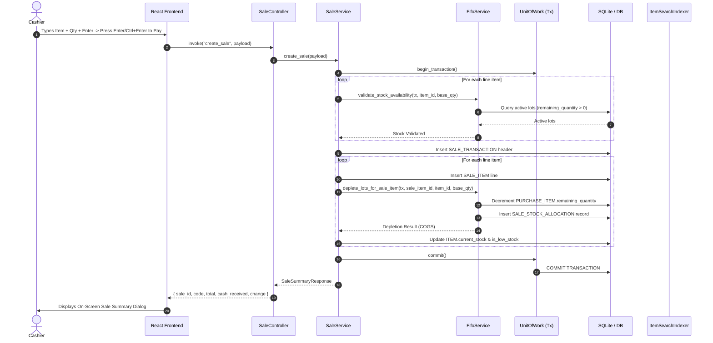
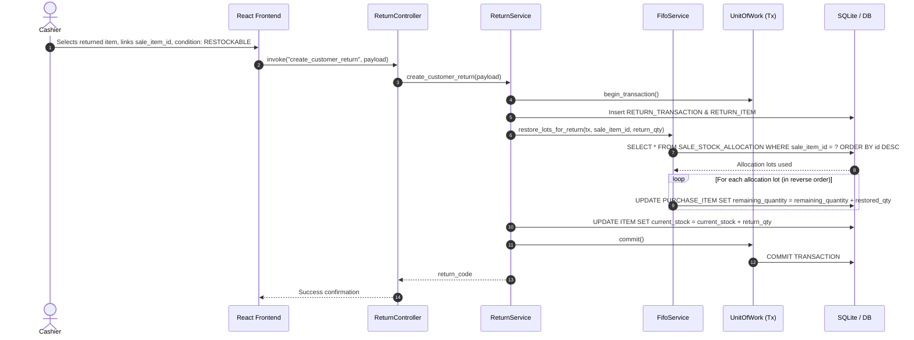
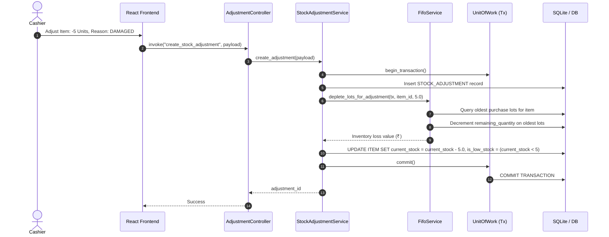
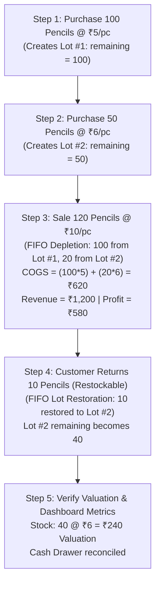

# Low-Level Design (LLD) Document: Book Keeper
**System:** Offline-First Retail Accounting & Inventory Management Desktop Application  
**Target Environment:** Windows Desktop (Tauri v2 + Rust + SQLite / Pluggable PostgreSQL + React 19)  
**Parent Document:** [High-Level Design (HLD)](file:///c:/custom_apps/book_keeper/docs/book_keeper_HLD.md)  
**UI/UX Companion Document:** [UI/UX Specification](file:///c:/custom_apps/book_keeper/docs/book_keeper_UI_UX_Specification.md)  
**Migration Specification:** [Data Import, Export & Migration](file:///c:/custom_apps/book_keeper/docs/book_keeper_data_import_export_and_migration.md)  
**Status:** Approved Architectural Low-Level Design Baseline  

---

## 1. Executive Summary & Design Objectives

This Low-Level Design (LLD) document translates the business requirements, data structures, and operational workflows specified in the HLD into concrete, modular, testable software abstractions for the backend.

### 1.1 Core Architectural Principles
1. **Model-View-Controller-Service (MVCS) Pattern**:
   * **Controllers (`api/controllers`)**: Thin Tauri IPC command handlers responsible strictly for request deserialization, input validation, delegating to domain services, and mapping results or domain errors into typed IPC responses.
   * **Services (`services`)**: Granular, single-responsibility business logic classes. Orchestrates transactions, calculations, unit conversions, and domain rules.
   * **Data Access Repositories (`repositories`)**: Dedicated data access components isolated behind strict interfaces (traits) to encapsulate SQL persistence.
   * **Models / Entities (`domain`)**: Rich domain models, value objects, and Data Transfer Objects (DTOs).
2. **Pluggable Persistence & Reverse Search Abstraction**:
   * The database access layer and the typeahead inverted index (reverse search) are hidden entirely behind interfaces (`Repository` and `SearchIndexer` traits).
   * v1 ships with **Embedded SQLite** (`rusqlite` in WAL mode) and **SQLite FTS5** for sub-millisecond offline desktop search.
   * The system can be swapped to **PostgreSQL** or **Elasticsearch / Meilisearch / Tantivy** simply by providing alternative implementations bound to the same interface contracts without modifying any service or controller code.
3. **Strict Granularity & Single Responsibility (SRP)**:
   * Rather than monolithic service objects, business logic is split into cohesive units:
     * `FifoService`: Pure lot allocation, depletion, and restoration mechanics.
     * `SaleService`: Counter checkout orchestration, pricing, and bill summaries.
     * `PurchaseService`: Inward batch generation and supplier bills.
     * `DuesSettlementService`: Receivables/payables, balance decrements, and cash logging.
     * `ReturnService`: Customer/vendor returns and defective item swaps.
     * `StockAdjustmentService`: Physical count adjustments and write-offs.
     * `ReportService`: Fast consolidated KPI aggregations and financial statements.
     * `MigrationService`: Ingestion of legacy VedBill (`.vb`) archives.
4. **Decoupled Unit of Work / Transaction Abstraction**:
   * Multi-table operations (e.g., checkout inserting sales, updating purchase lot remainders, logging allocations, and refreshing item stock cache) run inside an atomic `UnitOfWork` transaction boundary, preventing partial writes and race conditions.

---

## 2. Package & Directory Structure

```
src-tauri/src/
├── api/                           # [Controller Layer] IPC Command Entrypoints (Thin)
│   ├── mod.rs                     # Command registration & router
│   ├── sale_controller.rs         # Checkout, sale codes, sales history
│   ├── purchase_controller.rs     # Inward purchase orders, purchase history
│   ├── item_controller.rs         # Master catalog, bundles, bundle suggestions
│   ├── dues_controller.rs         # Customer/Vendor dues & payment settlements
│   ├── return_controller.rs       # Customer & vendor returns, swaps
│   ├── adjustment_controller.rs   # Physical stock adjustments & write-offs
│   ├── report_controller.rs       # Dashboard KPIs, PnL, cash flow, stock valuation
│   ├── party_controller.rs        # Customer & supplier directory
│   ├── migration_controller.rs    # VedBill (.vb) discovery and import
│   └── settings_controller.rs     # Shop settings & database backup
│
├── core/                          # [Domain & Models Layer] Pure Domain Logic & Types
│   ├── mod.rs
│   ├── error.rs                   # AppError, DomainResult, Result type
│   ├── entities/                  # Core entity structs
│   │   ├── mod.rs
│   │   ├── item.rs                # Item & ItemBundle
│   │   ├── party.rs               # Customer & Vendor profiles
│   │   ├── purchase.rs            # PurchaseTransaction & PurchaseItem (FIFO Lot)
│   │   ├── sale.rs                # SaleTransaction, SaleItem, SaleStockAllocation
│   │   ├── settlement.rs          # PaymentSettlement
│   │   ├── stock_return.rs        # ReturnTransaction & ReturnItem
│   │   ├── adjustment.rs          # StockAdjustment
│   │   └── shop_setting.rs        # Shop profile settings
│   ├── value_objects/             # Immutable value objects
│   │   ├── mod.rs
│   │   ├── transaction_code.rs    # SAL-XXXX, PUR-XXXX, RET-XXXX
│   │   ├── payment_status.rs      # PAID, PARTIAL, UNPAID
│   │   └── party_type.rs          # CUSTOMER, VENDOR
│   └── dtos/                      # Request / Response Transfer Objects
│       ├── mod.rs
│       ├── sale_dto.rs            # CreateSalePayload, SaleSummaryResponse, SalesFilter
│       ├── purchase_dto.rs        # CreatePurchasePayload, PurchaseFilter
│       ├── item_dto.rs            # CreateItemPayload, ItemSearchResult, BundleSuggestion
│       ├── dues_dto.rs            # PartyDueSummary, SettlePaymentPayload
│       ├── return_dto.rs          # CustomerReturnPayload, StockAdjustmentPayload
│       ├── report_dto.rs          # DashboardMetrics, PnLReport, CashFlowReport
│       └── migration_dto.rs       # MigrationPreview, MigrationResult
│
├── services/                      # [Service Layer] Business Rules & Orchestration
│   ├── mod.rs
│   ├── contracts/                 # Service Interfaces (Traits)
│   │   ├── fifo_service.rs
│   │   ├── sale_service.rs
│   │   ├── purchase_service.rs
│   │   ├── item_service.rs
│   │   ├── dues_service.rs
│   │   ├── return_service.rs
│   │   ├── adjustment_service.rs
│   │   ├── report_service.rs
│   │   ├── party_service.rs
│   │   ├── migration_service.rs
│   │   └── backup_service.rs
│   └── impl/                      # Concrete Service Implementations
│       ├── fifo_service_impl.rs
│       ├── sale_service_impl.rs
│       ├── purchase_service_impl.rs
│       ├── item_service_impl.rs
│       ├── dues_service_impl.rs
│       ├── return_service_impl.rs
│       ├── adjustment_service_impl.rs
│       ├── report_service_impl.rs
│       ├── party_service_impl.rs
│       ├── migration_service_impl.rs
│       └── backup_service_impl.rs
│
├── data/                          # [Data Access Layer] Storage & Reverse Index
│   ├── mod.rs
│   ├── contracts/                 # Storage & Search Interfaces (Traits)
│   │   ├── unit_of_work.rs        # Atomic transaction manager abstraction
│   │   ├── item_repository.rs
│   │   ├── bundle_repository.rs
│   │   ├── purchase_repository.rs # Inward batches & remaining quantity queries
│   │   ├── sale_repository.rs
│   │   ├── allocation_repository.rs
│   │   ├── party_repository.rs
│   │   ├── settlement_repository.rs
│   │   ├── return_repository.rs
│   │   ├── adjustment_repository.rs
│   │   ├── report_repository.rs
│   │   ├── setting_repository.rs
│   │   └── search_indexer.rs      # Reverse search trait (FTS5 / Elasticsearch)
│   │
│   └── sqlite/                    # Default Offline SQLite Implementations
│       ├── mod.rs
│       ├── connection.rs          # Pool management, WAL mode, pragmas
│       ├── migrations.rs          # Typed schema migrations (v1..vN)
│       ├── sqlite_uow.rs          # BEGIN IMMEDIATE transaction implementation
│       ├── repositories/          # SqliteItemRepo, SqliteSaleRepo, etc.
│       │   ├── item_repo.rs
│       │   ├── purchase_repo.rs
│       │   ├── sale_repo.rs
│       │   ├── settlement_repo.rs
│       │   └── ...
│       └── fts_indexer.rs         # SQLite FTS5 Inverted Index Implementation
│
└── app_state.rs                   # Dependency Injection Container (Arc<dyn Service>)
```

---

## 3. Core Domain Entities & Value Objects (`core/domain`)

### 3.1 Value Objects & Enums

```rust
// core/value_objects/payment_status.rs
#[derive(Debug, Clone, Copy, PartialEq, Eq, Serialize, Deserialize)]
pub enum PaymentStatus {
    Paid,
    Partial,
    Unpaid,
}

// core/value_objects/party_type.rs
#[derive(Debug, Clone, Copy, PartialEq, Eq, Serialize, Deserialize)]
pub enum PartyType {
    Customer,
    Vendor,
}

// core/value_objects/stock_condition.rs
#[derive(Debug, Clone, Copy, PartialEq, Eq, Serialize, Deserialize)]
pub enum StockCondition {
    Restockable,
    DamagedScrap,
}

// core/value_objects/adjustment_reason.rs
#[derive(Debug, Clone, Copy, PartialEq, Eq, Serialize, Deserialize)]
pub enum AdjustmentReason {
    Damaged,
    Expired,
    CountCorrection,
    TheftLost,
}

// core/value_objects/settlement_type.rs
#[derive(Debug, Clone, Copy, PartialEq, Eq, Serialize, Deserialize)]
pub enum SettlementType {
    CashRefund,
    ReduceDue,
    DefectiveReplacement,
}

// core/value_objects/return_type.rs
#[derive(Debug, Clone, Copy, PartialEq, Eq, Serialize, Deserialize)]
pub enum ReturnType {
    Customer,
    Vendor,
}
```

### 3.2 Core Entities

```rust
// core/entities/item.rs
#[derive(Debug, Clone, Serialize, Deserialize)]
pub struct Item {
    pub id: i64,
    pub name: String,
    pub category: Option<String>,
    pub barcode: Option<String>,
    pub base_unit: String,
    pub mrp: Option<f64>,
    pub default_sale_price: f64,
    pub current_stock: f64,       // Cached sum across active purchase lots
    pub is_low_stock: bool,       // true if current_stock < 5.0 base units
    pub is_active: bool,          // 1: Active, 0: Soft-archived
    pub created_at: String,       // ISO-8601
    pub updated_at: String,       // ISO-8601
}

#[derive(Debug, Clone, Serialize, Deserialize)]
pub struct ItemBundle {
    pub id: i64,
    pub item_id: i64,
    pub bundle_name: String,      // e.g. "Box of 10", "Dozen"
    pub units_per_bundle: f64,    // Multiplier relative to base_unit
    pub mrp: Option<f64>,
    pub default_bundle_price: Option<f64>,
    pub barcode: Option<String>,
}

// core/entities/party.rs
#[derive(Debug, Clone, Serialize, Deserialize)]
pub struct Party {
    pub id: i64,
    pub name: String,
    pub phone: Option<String>,
    pub party_type: PartyType,
    pub notes: Option<String>,
    pub is_active: bool,
    pub created_at: String,
    pub updated_at: String,
}

// core/entities/purchase.rs
#[derive(Debug, Clone, Serialize, Deserialize)]
pub struct PurchaseTransaction {
    pub id: i64,
    pub transaction_code: String, // e.g. "PUR-1001"
    pub transaction_date: String, // "YYYY-MM-DD"
    pub party_id: Option<i64>,    // Supplier
    pub payment_mode: Option<String>,
    pub payment_status: PaymentStatus,
    pub total_amount: f64,
    pub paid_amount: f64,
    pub balance_due: f64,
    pub notes: Option<String>,
    pub created_at: String,
}

#[derive(Debug, Clone, Serialize, Deserialize)]
pub struct PurchaseItem {
    pub id: i64,
    pub purchase_transaction_id: i64,
    pub item_id: i64,
    pub bundle_id: Option<i64>,
    pub bundle_quantity: f64,
    pub quantity: f64,            // Normalized base units (bundle_qty * multiplier)
    pub unit_cost: f64,           // Cost per base unit in ₹
    pub total_amount: f64,
    pub remaining_quantity: f64,  // Active lot base units available for FIFO
}

// core/entities/sale.rs
#[derive(Debug, Clone, Serialize, Deserialize)]
pub struct SaleTransaction {
    pub id: i64,
    pub transaction_code: String, // e.g. "SAL-1001"
    pub transaction_date: String, // "YYYY-MM-DD"
    pub party_id: Option<i64>,    // Customer
    pub payment_mode: Option<String>,
    pub payment_status: PaymentStatus,
    pub total_amount: f64,
    pub paid_amount: f64,
    pub balance_due: f64,
    pub notes: Option<String>,
    pub created_at: String,
}

#[derive(Debug, Clone, Serialize, Deserialize)]
pub struct SaleItem {
    pub id: i64,
    pub sale_transaction_id: i64,
    pub item_id: i64,
    pub bundle_id: Option<i64>,
    pub bundle_quantity: f64,
    pub quantity: f64,            // Normalized base units
    pub unit_price: f64,          // Effective selling rate per base unit
    pub total_amount: f64,
}

#[derive(Debug, Clone, Serialize, Deserialize)]
pub struct SaleStockAllocation {
    pub id: i64,
    pub sale_item_id: i64,
    pub purchase_item_id: i64,    // Inward batch depleted
    pub quantity_depleted: f64,   // Base units consumed from lot
    pub unit_cost: f64,           // Historical inward cost per base unit (for COGS)
}

// core/entities/settlement.rs
#[derive(Debug, Clone, Serialize, Deserialize)]
pub struct PaymentSettlement {
    pub id: i64,
    pub settlement_date: String,  // "YYYY-MM-DD"
    pub party_id: Option<i64>,
    pub transaction_type: String, // "SALE" or "PURCHASE"
    pub transaction_id: i64,
    pub amount_paid: f64,
    pub payment_mode: Option<String>,
    pub notes: Option<String>,
    pub created_at: String,
}

// core/entities/stock_return.rs
#[derive(Debug, Clone, Serialize, Deserialize)]
pub struct ReturnTransaction {
    pub id: i64,
    pub return_code: String,           // e.g. "RET-1001"
    pub return_date: String,           // "YYYY-MM-DD"
    pub return_type: ReturnType,       // Customer or Vendor
    pub party_id: Option<i64>,
    pub original_transaction_id: Option<i64>,
    pub settlement_type: SettlementType,
    pub total_amount: f64,
    pub reason: Option<String>,
    pub notes: Option<String>,
    pub created_at: String,
}

#[derive(Debug, Clone, Serialize, Deserialize)]
pub struct ReturnItem {
    pub id: i64,
    pub return_transaction_id: i64,
    pub item_id: i64,
    pub sale_item_id: Option<i64>,     // Linked sale line for FIFO lot restoration
    pub purchase_item_id: Option<i64>, // Linked purchase lot for vendor returns
    pub quantity: f64,                 // Returned base units
    pub unit_price: f64,
    pub total_amount: f64,
    pub condition: StockCondition,     // Restockable or DamagedScrap
}

// core/entities/adjustment.rs
#[derive(Debug, Clone, Serialize, Deserialize)]
pub struct StockAdjustment {
    pub id: i64,
    pub adjustment_date: String,       // "YYYY-MM-DD"
    pub item_id: i64,
    pub quantity: f64,                 // Positive (+) to add, negative (-) to write off
    pub reason: AdjustmentReason,
    pub notes: Option<String>,
    pub created_at: String,
}

/// Audit trail for negative stock adjustment FIFO lot depletions.
/// Mirrors SALE_STOCK_ALLOCATION but links to STOCK_ADJUSTMENT instead of SALE_ITEM.
#[derive(Debug, Clone, Serialize, Deserialize)]
pub struct AdjustmentStockAllocation {
    pub id: i64,
    pub stock_adjustment_id: i64,
    pub purchase_item_id: i64,         // Inward batch depleted
    pub quantity_depleted: f64,        // Base units consumed from lot
    pub unit_cost: f64,               // Historical inward cost per base unit (for loss valuation)
}

// core/entities/shop_setting.rs
#[derive(Debug, Clone, Serialize, Deserialize)]
pub struct ShopSetting {
    pub id: i64,
    pub shop_name: String,
    pub phone: Option<String>,
    pub address: Option<String>,
    pub tax_id: Option<String>,        // GSTIN / PAN
}
```

---

## 4. Reverse Search & Inverted Index Abstraction (`data/contracts/search_indexer.rs`)

To guarantee that the typeahead search can be seamlessly swapped between **SQLite FTS5**, **Elasticsearch**, **Tantivy**, or **PostgreSQL tsvector/trigram**, the search engine is isolated behind the `ItemSearchIndexer` interface.

```rust
// data/contracts/search_indexer.rs

#[derive(Debug, Clone, Serialize, Deserialize)]
pub struct ItemSearchResult {
    pub id: i64,
    pub name: String,
    pub category: Option<String>,
    pub barcode: Option<String>,
    pub base_unit: String,
    pub mrp: Option<f64>,
    pub default_sale_price: f64,
    pub current_stock: f64,
    pub is_low_stock: bool,
    pub bundles: Vec<ItemBundleSearchResult>,
}

#[derive(Debug, Clone, Serialize, Deserialize)]
pub struct ItemBundleSearchResult {
    pub id: i64,
    pub bundle_name: String,
    pub units_per_bundle: f64,
    pub mrp: Option<f64>,
    pub default_bundle_price: Option<f64>,
}

pub trait ItemSearchIndexer: Send + Sync {
    /// High-speed typeahead lookup matching prefix across name, barcode, and category (< 1ms).
    fn search(&self, query: &str, limit: usize) -> Result<Vec<ItemSearchResult>, AppError>;

    /// Indexes or updates an item and its associated packaging bundles in the search catalog.
    fn index_item(&self, item: &Item, bundles: &[ItemBundle]) -> Result<(), AppError>;

    /// Deletes an item from the search index (or marks it inactive).
    fn remove_item(&self, item_id: i64) -> Result<(), AppError>;

    /// Rebuilds the search index entirely from storage (used in migration & bulk restore).
    fn rebuild_index(&self, items_with_bundles: &[(Item, Vec<ItemBundle>)]) -> Result<(), AppError>;
}
```

### 4.1 Default v1 Implementation: `SqliteFts5SearchIndexer`
The SQLite implementation uses the virtual table `ITEM_SEARCH_FTS` defined with FTS5:
```sql
CREATE VIRTUAL TABLE IF NOT EXISTS item_search_fts USING fts5(
    item_id UNINDEXED,
    name,
    category,
    barcode,
    tokenize = 'unicode61 remove_diacritics 2'
);
```

> **Design Note — Tokenizer Selection:** The Porter stemmer is intentionally omitted. While useful for English prose, it interferes with numeric barcode lookups and short product abbreviations common in retail catalogs (e.g., "PG", "LTR"). The `unicode61` tokenizer handles multi-script text and diacritics correctly without semantic stemming artifacts.

> **Design Note — Bundle Barcode Coverage:** `ITEM_BUNDLE.barcode` values (outer box barcodes) are indexed as additional rows in the FTS5 table with the **parent item's `item_id`**. When `index_item()` is called, it inserts one FTS row for the item itself and one additional FTS row per bundle that has a non-null barcode. This ensures scanning a box barcode at the counter resolves to the correct parent item without requiring a secondary lookup query.

Query execution sanitizes input tokens and executes prefix matching (`token*`):
```sql
SELECT i.id, i.name, i.category, i.barcode, i.base_unit, i.mrp, 
       i.default_sale_price, i.current_stock, i.is_low_stock
FROM item_search_fts fts
JOIN item i ON fts.item_id = i.id
WHERE i.is_active = 1 AND item_search_fts MATCH ?
ORDER BY rank LIMIT ?;
```

---

## 5. Storage Repositories & Transaction Boundary (`data/contracts`)

### 5.1 Unit of Work & Transaction Abstraction
To execute atomic operations across multiple repositories without exposing SQLite or PostgreSQL transaction handles to the services:

```rust
// data/contracts/unit_of_work.rs

pub trait UnitOfWork: Send + Sync {
    /// Begins an immediate write transaction.
    fn begin_transaction(&self) -> Result<Box<dyn TransactionContext>, AppError>;
}

pub trait TransactionContext {
    /// Commits all staged mutations atomically.
    fn commit(self: Box<Self>) -> Result<(), AppError>;

    /// Explicitly aborts the transaction (automatic on drop if not committed).
    fn rollback(self: Box<Self>) -> Result<(), AppError>;

    // Repositories scoped to the live transaction handle:
    fn items(&mut self) -> &mut dyn ItemRepository;
    fn bundles(&mut self) -> &mut dyn BundleRepository;
    fn purchases(&mut self) -> &mut dyn PurchaseRepository;
    fn sales(&mut self) -> &mut dyn SaleRepository;
    fn allocations(&mut self) -> &mut dyn AllocationRepository;
    fn settlements(&mut self) -> &mut dyn SettlementRepository;
    fn returns(&mut self) -> &mut dyn ReturnRepository;
    fn adjustments(&mut self) -> &mut dyn AdjustmentRepository;
    fn adjustment_allocations(&mut self) -> &mut dyn AdjustmentAllocationRepository;
    fn settings(&mut self) -> &mut dyn SettingRepository;
    fn parties(&mut self) -> &mut dyn PartyRepository;
}
```

### 5.2 Granular Repository Contracts

```rust
// data/contracts/item_repository.rs
pub trait ItemRepository {
    fn find_by_id(&self, id: i64) -> Result<Option<Item>, AppError>;
    fn find_by_name(&self, name: &str) -> Result<Option<Item>, AppError>;
    fn find_by_barcode(&self, barcode: &str) -> Result<Option<Item>, AppError>;
    fn list_catalog(&self, category: Option<&str>, low_stock_only: bool, offset: usize, limit: usize) -> Result<Vec<Item>, AppError>;
    fn create(&mut self, item: &Item) -> Result<i64, AppError>;
    fn update(&mut self, item: &Item) -> Result<(), AppError>;
    fn update_stock_cache(&mut self, item_id: i64, new_stock: f64, is_low_stock: bool) -> Result<(), AppError>;
    fn archive(&mut self, item_id: i64) -> Result<(), AppError>;
}

// data/contracts/purchase_repository.rs
pub trait PurchaseRepository {
    fn create_transaction(&mut self, tx: &PurchaseTransaction) -> Result<i64, AppError>;
    fn create_purchase_item(&mut self, line: &PurchaseItem) -> Result<i64, AppError>;
    fn find_transaction_by_id(&self, id: i64) -> Result<Option<PurchaseTransaction>, AppError>;
    fn get_next_transaction_code(&self) -> Result<String, AppError>;
    
    /// Core FIFO query: returns available active purchase lots ordered chronologically by lot ID
    fn get_active_lots_for_item(&self, item_id: i64) -> Result<Vec<PurchaseItem>, AppError>;
    
    /// Decrements or increments remaining quantity on a specific inward batch
    fn update_remaining_quantity(&mut self, lot_id: i64, new_remaining_qty: f64) -> Result<(), AppError>;
    fn update_balance_due(&mut self, tx_id: i64, paid_delta: f64, new_balance: f64, status: PaymentStatus) -> Result<(), AppError>;
    fn list_purchases(&self, start_date: Option<&str>, end_date: Option<&str>, status: Option<PaymentStatus>, party_id: Option<i64>, offset: usize, limit: usize) -> Result<Vec<PurchaseTransaction>, AppError>;
}

// data/contracts/sale_repository.rs
pub trait SaleRepository {
    fn create_transaction(&mut self, tx: &SaleTransaction) -> Result<i64, AppError>;
    fn create_sale_item(&mut self, line: &SaleItem) -> Result<i64, AppError>;
    fn find_transaction_by_id(&self, id: i64) -> Result<Option<SaleTransaction>, AppError>;
    fn get_next_transaction_code(&self) -> Result<String, AppError>;
    fn update_balance_due(&mut self, tx_id: i64, paid_delta: f64, new_balance: f64, status: PaymentStatus) -> Result<(), AppError>;
    fn list_sales(&self, start_date: Option<&str>, end_date: Option<&str>, status: Option<PaymentStatus>, party_id: Option<i64>, offset: usize, limit: usize) -> Result<Vec<SaleTransaction>, AppError>;
}

// data/contracts/allocation_repository.rs
pub trait AllocationRepository {
    fn create_allocation(&mut self, allocation: &SaleStockAllocation) -> Result<i64, AppError>;
    fn find_by_sale_item_id(&self, sale_item_id: i64) -> Result<Vec<SaleStockAllocation>, AppError>;
}

// data/contracts/settlement_repository.rs
pub trait SettlementRepository {
    fn create_settlement(&mut self, settlement: &PaymentSettlement) -> Result<i64, AppError>;
    fn list_by_party(&self, party_id: i64) -> Result<Vec<PaymentSettlement>, AppError>;
    fn get_daily_settlement_total(&self, date: &str, tx_type: &str) -> Result<f64, AppError>;
}

// data/contracts/party_repository.rs
pub trait PartyRepository {
    fn find_by_id(&self, id: i64) -> Result<Option<Party>, AppError>;
    fn list(&self, party_type: Option<PartyType>, active_only: bool) -> Result<Vec<Party>, AppError>;
    fn create(&mut self, party: &Party) -> Result<i64, AppError>;
    fn update(&mut self, party: &Party) -> Result<(), AppError>;
    fn archive(&mut self, id: i64) -> Result<(), AppError>;
    fn get_party_due_summary(&self, party_type: PartyType) -> Result<Vec<PartyDueSummary>, AppError>;
}

// data/contracts/bundle_repository.rs
pub trait BundleRepository {
    fn find_by_id(&self, id: i64) -> Result<Option<ItemBundle>, AppError>;
    fn find_by_item_id(&self, item_id: i64) -> Result<Vec<ItemBundle>, AppError>;
    fn find_by_barcode(&self, barcode: &str) -> Result<Option<ItemBundle>, AppError>;
    fn create(&mut self, bundle: &ItemBundle) -> Result<i64, AppError>;
    fn update(&mut self, bundle: &ItemBundle) -> Result<(), AppError>;
    fn delete(&mut self, bundle_id: i64) -> Result<(), AppError>;
    fn get_bundle_suggestions(&self) -> Result<Vec<BundleSuggestion>, AppError>;
}

// data/contracts/return_repository.rs
pub trait ReturnRepository {
    fn create_return_transaction(&mut self, tx: &ReturnTransaction) -> Result<i64, AppError>;
    fn create_return_item(&mut self, item: &ReturnItem) -> Result<i64, AppError>;
    fn find_return_by_id(&self, id: i64) -> Result<Option<ReturnTransaction>, AppError>;
    fn get_next_return_code(&self) -> Result<String, AppError>;
    fn list_returns(&self, return_type: Option<ReturnType>, offset: usize, limit: usize) -> Result<Vec<ReturnTransaction>, AppError>;
}

// data/contracts/adjustment_repository.rs
pub trait AdjustmentRepository {
    fn create_adjustment(&mut self, adj: &StockAdjustment) -> Result<i64, AppError>;
    fn list_adjustments(&self, item_id: Option<i64>, offset: usize, limit: usize) -> Result<Vec<StockAdjustment>, AppError>;
}

// data/contracts/adjustment_allocation_repository.rs
pub trait AdjustmentAllocationRepository {
    fn create_allocation(&mut self, alloc: &AdjustmentStockAllocation) -> Result<i64, AppError>;
    fn find_by_adjustment_id(&self, adjustment_id: i64) -> Result<Vec<AdjustmentStockAllocation>, AppError>;
}

// data/contracts/setting_repository.rs
pub trait SettingRepository {
    fn get_shop_setting(&self) -> Result<ShopSetting, AppError>;
    fn upsert_shop_setting(&mut self, setting: &ShopSetting) -> Result<(), AppError>;
}

// data/contracts/report_repository.rs
pub trait ReportRepository: Send + Sync {
    fn get_dashboard_metrics(&self, today_date: &str) -> Result<DashboardMetrics, AppError>;
    fn get_low_stock_items(&self) -> Result<Vec<Item>, AppError>;
    fn get_sales_purchase_trend(&self, days: usize) -> Result<Vec<TrendDataPoint>, AppError>;
    fn get_pnl_report(&self, from_date: &str, to_date: &str) -> Result<PnLReport, AppError>;
    fn get_stock_valuation_report(&self) -> Result<StockValuationReport, AppError>;
    fn get_cash_flow_report(&self, from_date: &str, to_date: &str) -> Result<CashFlowReport, AppError>;
}
```

---

## 6. Granular Service Layer (`services/`)

Each service has a single responsibility, depends on repository traits and `UnitOfWork`, and implements a dedicated service interface.

### 6.1 FIFO Inventory Allocation Service (`FifoService`)
The mathematical core of stock depletion and lot integrity.

```rust
// services/contracts/fifo_service.rs

#[derive(Debug, Clone)]
pub struct DepletionResult {
    pub total_cogs: f64,
    pub allocations: Vec<SaleStockAllocation>,
}

#[derive(Debug, Clone)]
pub struct LotRestorationItem {
    pub purchase_item_id: i64,
    pub quantity_to_restore: f64,
}

pub trait FifoService: Send + Sync {
    /// Validates that total active stock across lots >= required_base_qty.
    /// Returns InsufficientStockError if unavailable.
    fn validate_stock_availability(
        &self, 
        uow: &mut dyn TransactionContext, 
        item_id: i64, 
        required_base_qty: f64
    ) -> Result<(), AppError>;

    /// Depletes lots in strict First-In, First-Out order.
    /// Decrements `remaining_quantity` on purchase lots and logs allocations.
    fn deplete_lots_for_sale_item(
        &self,
        uow: &mut dyn TransactionContext,
        sale_item_id: i64,
        item_id: i64,
        required_base_qty: f64,
    ) -> Result<DepletionResult, AppError>;

    /// Restores remaining_quantity in original purchase lots in reverse order for customer returns.
    fn restore_lots_for_return(
        &self,
        uow: &mut dyn TransactionContext,
        sale_item_id: i64,
        quantity_to_restore: f64,
    ) -> Result<(), AppError>;

    /// Depletes oldest lots for a negative stock adjustment (damaged/expired write-off).
    /// Creates `AdjustmentStockAllocation` records for audit trail.
    /// Returns the exact financial inventory write-off value (loss in ₹).
    fn deplete_lots_for_adjustment(
        &self,
        uow: &mut dyn TransactionContext,
        stock_adjustment_id: i64,
        item_id: i64,
        write_off_qty: f64,
    ) -> Result<f64, AppError>;
}
```

#### Detailed Depletion Algorithm
```
Input: item_id, required_base_qty
1. Fetch active purchase lots: SELECT * FROM purchase_item WHERE item_id = ? AND remaining_quantity > 0 ORDER BY id ASC.
2. Verify: SUM(lot.remaining_quantity) >= required_base_qty. Else throw InsufficientStockError.
3. remaining_needed = required_base_qty; total_cogs = 0.0
4. For each lot in active_lots:
     take_qty = MIN(lot.remaining_quantity, remaining_needed)
     new_remaining = lot.remaining_quantity - take_qty
     lot_repo.update_remaining_quantity(lot.id, new_remaining)
     allocation_repo.create_allocation(sale_item_id, lot.id, take_qty, lot.unit_cost)
     total_cogs += take_qty * lot.unit_cost
     remaining_needed -= take_qty
     If remaining_needed == 0: BREAK
5. Return DepletionResult { total_cogs, allocations }
```

---

### 6.2 Counter Billing & Sales Service (`SaleService`)

```rust
// services/contracts/sale_service.rs

pub trait SaleService: Send + Sync {
    /// Generates next sequential sale transaction code (e.g., "SAL-1043").
    fn get_next_sale_code(&self) -> Result<String, AppError>;

    /// Executes complete atomic checkout workflow.
    fn create_sale(&self, payload: CreateSalePayload) -> Result<SaleSummaryResponse, AppError>;

    /// Retrieves paginated sale history.
    fn get_sales_history(&self, filter: SalesHistoryFilter) -> Result<PaginatedList<SaleTransaction>, AppError>;

    /// Retrieves detailed breakdown of a sale including lines, bundles, and FIFO cost breakdown.
    fn get_sale_details(&self, sale_id: i64) -> Result<SaleDetailView, AppError>;
}
```

#### Sales Domain DTOs (`core/dtos/sale_dto.rs`):
```rust
#[derive(Debug, Clone, Serialize, Deserialize)]
pub struct CreateSalePayload {
    pub transaction_date: String,           // "YYYY-MM-DD"
    pub party_id: Option<i64>,              // Customer ID (required if UNPAID or PARTIAL)
    pub payment_status: PaymentStatus,      // Paid, Partial, Unpaid
    pub paid_amount: f64,                   // Upfront cash received
    pub notes: Option<String>,
    pub items: Vec<CreateSaleItemPayload>,
}

#[derive(Debug, Clone, Serialize, Deserialize)]
pub struct CreateSaleItemPayload {
    pub item_id: i64,
    pub bundle_id: Option<i64>,             // Null if sold loose in base units
    pub bundle_quantity: f64,               // Units entered in selected packaging
    pub unit_price: f64,                    // Rate charged per selected bundle/unit (₹)
}

#[derive(Debug, Clone, Serialize, Deserialize)]
pub struct SaleSummaryResponse {
    pub sale_id: i64,
    pub transaction_code: String,
    pub total_amount: f64,
    pub paid_amount: f64,
    pub balance_due: f64,
    pub change_amount: f64,                 // MAX(0, paid_amount - total_amount)
    pub payment_status: PaymentStatus,
}
```

#### Detailed Pricing, Stock Keeping & Atomic Checkout Execution:
1. `uow.begin_transaction()`
2. **Empty Cart & Basic Validation**: Reject if `payload.items` is empty. If `payment_status != PaymentStatus::Paid`, assert `party_id.is_some()` (unpaid credit balances cannot be assigned to walk-ins).
3. **Line-Item Resolution & Pre-Validation**:
   * For each line:
     * Fetch `Item` from repo. Reject if `!item.is_active` (`ValidationError("Item archived")`).
     * If `bundle_id` provided: fetch `ItemBundle` and verify `bundle.item_id == item.id`. Set `multiplier = bundle.units_per_bundle`.
     * If `bundle_id` is null: set `multiplier = 1.0`.
     * **Normalized Base Quantity**: `base_qty = line.bundle_quantity * multiplier`.
     * **Line Total Calculation**: `line_total = line.bundle_quantity * line.unit_price`.
     * **Effective Base Unit Price**: `effective_base_price = line_total / base_qty`.
     * **Stock Availability Check**: Call `fifo_service.validate_stock_availability(uow, line.item_id, base_qty)`. If available active lots have `SUM(remaining_quantity) < base_qty`, immediately abort with `AppError::InsufficientStockError`.
4. **Bill Total & Payment Resolution**:
   * `total_amount = round_to_2_decimals(SUM(line_total))`.
   * **Payment Reconciliation**:
     * If `paid_amount >= total_amount`:
       * `balance_due = 0.0`.
       * `actual_paid_for_bill = total_amount`.
       * `change_amount = paid_amount - total_amount`.
       * `resolved_status = PaymentStatus::Paid`.
     * If `paid_amount < total_amount` and `paid_amount > 0.0`:
       * `balance_due = total_amount - paid_amount`.
       * `actual_paid_for_bill = paid_amount`.
       * `change_amount = 0.0`.
       * `resolved_status = PaymentStatus::Partial`.
     * If `paid_amount == 0.0`:
       * `balance_due = total_amount`.
       * `actual_paid_for_bill = 0.0`.
       * `change_amount = 0.0`.
       * `resolved_status = PaymentStatus::Unpaid`.
5. **Persist Transaction Header**:
   * Generate `next_code = sale_repo.get_next_transaction_code()`.
   * Insert `SaleTransaction` with `total_amount`, `paid_amount = actual_paid_for_bill`, `balance_due`, `payment_status = resolved_status`.
6. **Line Insertion, FIFO Depletion & Stock Cache Update**:
   * For each line:
     * Insert `SaleItem` with `quantity = base_qty`, `unit_price = effective_base_price`, `total_amount = line_total`.
     * Call `fifo_service.deplete_lots_for_sale_item(uow, sale_item_id, item.id, base_qty)`.
       * This consumes lots in ascending chronological order (`ORDER BY id ASC`), decrements each lot's `remaining_quantity`, and creates `SaleStockAllocation` records storing `(sale_item_id, purchase_item_id, quantity_depleted, unit_cost)`.
     * **Stock Keeping Cache**:
       * `new_stock = item.current_stock - base_qty`.
       * `is_low = new_stock < 5.0`.
       * Update `ITEM` row: `current_stock = new_stock`, `is_low_stock = is_low`, `updated_at = CURRENT_TIMESTAMP`.
7. `uow.commit()`
8. Return `SaleSummaryResponse { sale_id, transaction_code, total_amount, paid_amount: actual_paid_for_bill, balance_due, change_amount, payment_status: resolved_status }`.

---

### 6.3 Inward Purchases Service (`PurchaseService`)

```rust
// services/contracts/purchase_service.rs

pub trait PurchaseService: Send + Sync {
    fn get_next_purchase_code(&self) -> Result<String, AppError>;
    fn create_purchase(&self, payload: CreatePurchasePayload) -> Result<i64, AppError>;
    fn get_purchases_history(&self, filter: PurchaseHistoryFilter) -> Result<PaginatedList<PurchaseTransaction>, AppError>;
    fn get_purchase_details(&self, purchase_id: i64) -> Result<PurchaseDetailView, AppError>;
}
```

#### Purchase Domain DTOs (`core/dtos/purchase_dto.rs`):
```rust
#[derive(Debug, Clone, Serialize, Deserialize)]
pub struct CreatePurchasePayload {
    pub transaction_date: String,           // "YYYY-MM-DD"
    pub party_id: Option<i64>,              // Vendor/Supplier (required if UNPAID or PARTIAL)
    pub supplier_invoice_ref: Option<String>,
    pub payment_status: PaymentStatus,      // Paid, Partial, Unpaid
    pub paid_amount: f64,                   // Upfront cash paid
    pub notes: Option<String>,
    pub items: Vec<CreatePurchaseItemPayload>,
}

#[derive(Debug, Clone, Serialize, Deserialize)]
pub struct CreatePurchaseItemPayload {
    pub item_id: i64,
    pub bundle_id: Option<i64>,             // Null if bought loose in base units
    pub bundle_quantity: f64,               // Inward quantity in bundle or base units
    pub unit_cost: f64,                     // Inward cost per selected unit/bundle (₹)
}
```

#### Detailed Inward Stock Ingestion, Cost Normalization & Lot Creation:
1. `uow.begin_transaction()`
2. **Validation**: Reject if `payload.items` is empty. If `payment_status != PaymentStatus::Paid`, assert `party_id.is_some()` (unpaid vendor dues require a supplier profile).
3. **Line Calculations & Cost Normalization**:
   * For each inward line:
     * If `bundle_id` provided: fetch `ItemBundle`, `multiplier = bundle.units_per_bundle`.
     * If `bundle_id` null: `multiplier = 1.0`.
     * **Normalized Base Quantity**: `base_qty = line.bundle_quantity * multiplier`.
     * **Line Total Calculation**: `line_total = line.bundle_quantity * line.unit_cost`.
     * **Effective Base Unit Cost**: `unit_cost_base = line_total / base_qty`.
4. **Header Settlement**:
   * `total_amount = round_to_2_decimals(SUM(line_total))`.
   * `balance_due = total_amount - paid_amount`.
   * `resolved_status = if balance_due == 0.0 { PaymentStatus::Paid } else if paid_amount > 0.0 { PaymentStatus::Partial } else { PaymentStatus::Unpaid }`.
   * Insert `PurchaseTransaction` header.
5. **Inward FIFO Lot Storage & Stock Cache Increment**:
   * For each line:
     * Insert `PurchaseItem` with:
       * `bundle_id = line.bundle_id`.
       * `bundle_quantity = line.bundle_quantity`.
       * `quantity = base_qty`.
       * `unit_cost = unit_cost_base` (cost per base unit stored with high precision).
       * `total_amount = line_total`.
       * `remaining_quantity = base_qty` (active FIFO lot available for sales depletion).
     * **Stock Keeping Cache**:
       * Increment `item.current_stock` by `base_qty`.
       * `new_stock = item.current_stock + base_qty`.
       * `is_low = new_stock < 5.0`.
       * Update `ITEM` row: `current_stock = new_stock`, `is_low_stock = is_low`, `updated_at = CURRENT_TIMESTAMP`.
6. `uow.commit()`
7. Return `purchase_id`.

---

### 6.4 Item Catalog & Bundles Service (`ItemService`)

```rust
// services/contracts/item_service.rs

pub trait ItemService: Send + Sync {
    fn get_catalog(&self, category: Option<String>, low_stock_only: bool, page: usize, limit: usize) -> Result<PaginatedList<Item>, AppError>;
    fn create_item(&self, payload: CreateItemPayload) -> Result<i64, AppError>;
    fn update_item(&self, item_id: i64, payload: UpdateItemPayload) -> Result<(), AppError>;
    fn archive_item(&self, item_id: i64) -> Result<(), AppError>; // Soft-deletes is_active = 0
    fn create_bundle(&self, payload: CreateBundlePayload) -> Result<i64, AppError>;
    fn get_bundle_suggestions(&self) -> Result<Vec<BundleSuggestion>, AppError>;
}
```
* **Dynamic Bundle Suggestions**: Queries distinct packaging names and multipliers ordered by historical usage frequency (`SELECT bundle_name, units_per_bundle, COUNT(*) FROM item_bundle GROUP BY bundle_name, units_per_bundle ORDER BY 3 DESC`).
* **Search Index Sync**: Automatically calls `indexer.index_item()` or `indexer.remove_item()` upon item mutations.

---

### 6.5 Symmetrical Dues & Settlement Service (`DuesSettlementService`)

```rust
// services/contracts/dues_service.rs

pub trait DuesSettlementService: Send + Sync {
    /// Aggregates all outstanding dues for customers or vendors.
    fn get_party_dues_summary(&self, party_type: PartyType) -> Result<Vec<PartyDueSummary>, AppError>;

    /// Records a cash payment clearing a specific bill or oldest unpaid bills (FIFO settlement).
    fn settle_bill_payment(&self, payload: SettlePaymentPayload) -> Result<(), AppError>;

    /// Returns transaction-level ledger history for a party.
    fn get_party_ledger(&self, party_id: i64) -> Result<PartyLedgerView, AppError>;
}
```

#### `SettlePaymentPayload` Design:
```rust
// core/dtos/dues_dto.rs

pub struct SettlePaymentPayload {
    pub party_id: i64,
    pub transaction_type: String,          // "SALE" or "PURCHASE"
    pub transaction_id: Option<i64>,       // Specific bill to settle (None = FIFO across oldest bills)
    pub settlement_date: String,           // "YYYY-MM-DD"
    pub amount_paid: f64,
    pub notes: Option<String>,
}
```

#### Settlement Execution Logic:
1. `uow.begin_transaction()`
2. **If `transaction_id` is provided (Specific Bill Settlement):**
   * Fetch target transaction and validate `balance_due >= amount_paid`.
   * Create `PaymentSettlement` record linked to the target `transaction_id`.
   * Decrement `balance_due` on the target transaction.
   * If `balance_due` reaches `0.0`: update `payment_status` to `Paid`.
   * If `balance_due > 0.0` and status was `Unpaid`: transition to `Partial`.
3. **If `transaction_id` is `None` (FIFO Bill Settlement):**
   * Fetch all open (Unpaid/Partial) transactions for the party, ordered by `transaction_date ASC, id ASC`.
   * `remaining_to_settle = amount_paid`.
   * Loop through bills oldest-first:
     * `apply = MIN(bill.balance_due, remaining_to_settle)`.
     * Create `PaymentSettlement` record for this bill.
     * Decrement `bill.balance_due` by `apply`.
     * If `bill.balance_due == 0`: set `payment_status = Paid`.
     * `remaining_to_settle -= apply`.
     * If `remaining_to_settle == 0`: BREAK.
   * If `remaining_to_settle > 0` after all bills: return `ValidationError("Settlement amount exceeds total outstanding dues")`.
4. `uow.commit()`

---

### 6.6 Returns & Replacements Service (`ReturnService`)

```rust
// services/contracts/return_service.rs

pub trait ReturnService: Send + Sync {
    fn create_customer_return(&self, payload: CustomerReturnPayload) -> Result<String, AppError>;
    fn create_vendor_return(&self, payload: VendorReturnPayload) -> Result<String, AppError>;
    fn get_return_details(&self, return_id: i64) -> Result<ReturnDetailView, AppError>;
}
```

#### `CustomerReturnPayload`:
```rust
pub struct CustomerReturnPayload {
    pub original_sale_id: Option<i64>,
    pub party_id: Option<i64>,
    pub return_date: String,
    pub settlement_type: SettlementType,  // CashRefund, ReduceDue, or DefectiveReplacement
    pub reason: Option<String>,
    pub notes: Option<String>,
    pub items: Vec<CustomerReturnItemPayload>,
}

pub struct CustomerReturnItemPayload {
    pub item_id: i64,
    pub sale_item_id: Option<i64>,        // Linked sale line for FIFO lot restoration
    pub quantity: f64,                    // Returned base units
    pub unit_price: f64,
    pub condition: StockCondition,        // Restockable or DamagedScrap
}
```

#### Customer Return Execution Workflow:
1. `uow.begin_transaction()`
2. Generate next return code (`RET-XXXX`).
3. Persist `ReturnTransaction` header with `return_type = ReturnType::Customer`.
4. For each return line item:
   * Persist `ReturnItem` record.
   * **If `condition == Restockable` and `sale_item_id` is provided:**
     * Delegate to `FifoService.restore_lots_for_return(sale_item_id, quantity)`.
     * This queries `SALE_STOCK_ALLOCATION` in reverse order and increments `PURCHASE_ITEM.remaining_quantity` on the original inward lots.
     * Increment `ITEM.current_stock` by returned quantity.
     * Recalculate `is_low_stock` flag.
   * **If `condition == DamagedScrap`:** No inventory restoration. Item is logged as scrap.
5. **Settlement Resolution:**
   * `CashRefund`: Creates a `PaymentSettlement` record logging cash outflow from the drawer.
   * `ReduceDue`: Decrements `balance_due` on the original `SaleTransaction`.
   * `DefectiveReplacement`: Triggers FIFO depletion for a fresh unit of the same item (net zero monetary movement). The fresh unit's depletion is recorded via `SaleStockAllocation` linked to the original `sale_item_id`.
6. `uow.commit()`
7. Return generated `return_code`.

#### `VendorReturnPayload`:
```rust
pub struct VendorReturnPayload {
    pub original_purchase_id: Option<i64>,
    pub party_id: Option<i64>,
    pub return_date: String,
    pub settlement_type: SettlementType,  // CashRefund or ReduceDue
    pub reason: Option<String>,
    pub notes: Option<String>,
    pub items: Vec<VendorReturnItemPayload>,
}

pub struct VendorReturnItemPayload {
    pub item_id: i64,
    pub purchase_item_id: Option<i64>,    // Specific inward lot being returned
    pub quantity: f64,                    // Returned base units
    pub unit_cost: f64,                   // Cost rate for valuation
}
```

#### Vendor Return Execution Workflow:
1. `uow.begin_transaction()`
2. Generate next return code (`RET-XXXX`).
3. Persist `ReturnTransaction` header with `return_type = ReturnType::Vendor`.
4. For each return line item:
   * Persist `ReturnItem` record.
   * **If `purchase_item_id` is provided:** Decrement `remaining_quantity` on that specific `PURCHASE_ITEM` lot.
   * **If `purchase_item_id` is null:** Trigger FIFO depletion (oldest lots first) to remove the returned quantity from active inventory.
   * Decrement `ITEM.current_stock` by returned quantity.
   * Recalculate `is_low_stock` flag.
5. **Settlement Resolution:**
   * `CashRefund`: Logs cash refund received from vendor (positive cash inflow to drawer).
   * `ReduceDue`: Decrements `balance_due` on the original `PurchaseTransaction` and transitions `payment_status` if fully settled.
6. `uow.commit()`
7. Return generated `return_code`.

---

### 6.7 Physical Stock Adjustment Service (`StockAdjustmentService`)

```rust
// services/contracts/adjustment_service.rs

pub trait StockAdjustmentService: Send + Sync {
    fn create_adjustment(&self, payload: StockAdjustmentPayload) -> Result<i64, AppError>;
    fn list_adjustments(&self, item_id: Option<i64>, page: usize, limit: usize) -> Result<PaginatedList<StockAdjustment>, AppError>;
}
```

#### Stock Adjustment Execution Logic:

**Negative Adjustment (`quantity < 0`) — Write-Off / Loss:**
1. `uow.begin_transaction()`
2. Validate available stock: `ITEM.current_stock >= abs(quantity)`. Reject with `InsufficientStockError` if not.
3. Persist `StockAdjustment` record → returns `adjustment_id`.
4. Delegate to `FifoService.deplete_lots_for_adjustment(uow, adjustment_id, item_id, abs(quantity))`:
   * Runs the standard FIFO depletion loop against oldest `PURCHASE_ITEM` lots.
   * For each lot consumed, creates an `AdjustmentStockAllocation` record (audit trail linking the adjustment to the specific lots and costs consumed).
   * Returns total loss value (₹) = `SUM(depleted_qty × unit_cost)`.
5. Decrement `ITEM.current_stock` by `abs(quantity)`.
6. Recalculate `is_low_stock` flag.
7. `uow.commit()`

**Positive Adjustment (`quantity > 0`) — Found Stock / Count Correction:**
1. `uow.begin_transaction()`
2. Persist `StockAdjustment` record → returns `adjustment_id`.
3. **Create a synthetic `PurchaseTransaction`** with:
   * `transaction_code = "ADJ-XXXX"` (auto-generated adjustment code).
   * `transaction_date = adjustment_date`.
   * `party_id = NULL`, `payment_status = Paid`, `total_amount = 0`, `paid_amount = 0`, `balance_due = 0`.
   * `notes = "Auto-generated for stock adjustment #<adjustment_id>: <reason>"`.
4. Create a `PurchaseItem` lot under this synthetic transaction:
   * `remaining_quantity = quantity` (the positive adjustment amount).
   * `unit_cost` = latest available purchase cost for this item (queried from most recent `PURCHASE_ITEM` lot with `remaining_quantity >= 0`). If no prior lots exist, uses `ITEM.default_sale_price` as fallback cost.
5. Increment `ITEM.current_stock` by `quantity`.
6. Recalculate `is_low_stock` flag.
7. `uow.commit()`

> **Design Rationale — Synthetic Purchase Transaction for Positive Adjustments:**
> A positive stock adjustment must create a valid FIFO-depletable lot. Without a `PURCHASE_ITEM` record, the FIFO engine would find fewer base units in purchase lots than `ITEM.current_stock` claims, causing data inconsistency on future sales. By wrapping the adjustment in a synthetic purchase transaction (identifiable via its `ADJ-XXXX` code prefix), we maintain full FIFO integrity while keeping the existing schema unchanged. The synthetic transaction has zero monetary value (`total_amount = 0`) so it does not affect financial reports or vendor payables.

---

### 6.8 Consolidated Reporting & Telemetry Service (`ReportService`)

```rust
// services/contracts/report_service.rs

pub trait ReportService: Send + Sync {
    /// Coordinated single-payload query returning all dashboard KPIs in < 2ms.
    fn get_dashboard_metrics(&self) -> Result<DashboardMetrics, AppError>;
    fn get_low_stock_alerts(&self) -> Result<Vec<LowStockItem>, AppError>;
    fn get_sales_purchase_trend(&self, period: &str) -> Result<Vec<TrendDataPoint>, AppError>;
    fn get_pnl_report(&self, from_date: &str, to_date: &str) -> Result<PnLReport, AppError>;
    fn get_stock_valuation_report(&self) -> Result<StockValuationReport, AppError>;
    fn get_cash_flow_report(&self, from_date: &str, to_date: &str) -> Result<CashFlowReport, AppError>;
}
```

---

### 6.9 Party Directory Service (`PartyService`)

```rust
// services/contracts/party_service.rs

pub trait PartyService: Send + Sync {
    fn create_party(&self, payload: CreatePartyPayload) -> Result<i64, AppError>;
    fn update_party(&self, id: i64, payload: UpdatePartyPayload) -> Result<(), AppError>;
    fn archive_party(&self, id: i64) -> Result<(), AppError>;
    fn get_party(&self, id: i64) -> Result<Party, AppError>;
    fn list_parties(&self, party_type: Option<PartyType>, active_only: bool) -> Result<Vec<Party>, AppError>;
    fn search_parties(&self, query: &str, party_type: Option<PartyType>) -> Result<Vec<Party>, AppError>;
}
```

* **Soft-Delete Guard**: `archive_party()` checks for linked open transactions (`balance_due > 0`). If any exist, the archive is blocked with a `ValidationError` prompting the user to settle dues first. If all transactions are settled, sets `is_active = 0`.
* **Search**: Performs prefix matching on `name` and `phone` columns for the party selector typeahead in billing and purchase screens.

---

### 6.10 Shop Settings Service (`ShopSettingService`)

```rust
// services/contracts/shop_setting_service.rs

pub trait ShopSettingService: Send + Sync {
    fn get_settings(&self) -> Result<ShopSetting, AppError>;
    fn update_settings(&self, settings: ShopSetting) -> Result<(), AppError>;
}
```

* **Single-Row Upsert**: The `SHOP_SETTING` table always contains exactly one row (seeded during schema migration with defaults). `update_settings()` performs an `UPDATE` on `id = 1`.

---

### 6.11 Database Backup Service (`BackupService`)

```rust
// services/contracts/backup_service.rs

pub trait BackupService: Send + Sync {
    /// Creates a clean online snapshot of the active database to destination path.
    /// Uses SQLite Online Backup API (sqlite3_backup_init) for zero-downtime, consistent copies.
    /// Returns the absolute path of the created backup file.
    fn backup_database(&self, destination_path: &str) -> Result<String, AppError>;

    /// Runs `PRAGMA integrity_check` and returns true if the database is healthy.
    fn verify_database_integrity(&self) -> Result<bool, AppError>;
}
```

* **File Naming**: Auto-generates timestamped filename: `book_keeper_backup_YYYYMMDD_HHMM.db`.
* **Destination Validation**: Validates that the destination path is writable and has sufficient disk space before initiating backup.

---

### 6.12 Migration & Data Portability Services

```rust
// services/contracts/migration_service.rs

pub trait MigrationService: Send + Sync {
    /// Scans default directory (Documents/VEDBIL) for available .vb backup files.
    fn scan_backup_directory(&self) -> Result<Vec<BackupFileInfo>, AppError>;

    /// Inspects a .vb archive and returns company info and table counts without importing.
    fn inspect_backup_file(&self, archive_path: &str) -> Result<MigrationPreview, AppError>;

    /// Executes the full atomic migration of items, parties, and transactions into active DB.
    fn execute_migration(&self, archive_path: &str) -> Result<MigrationResult, AppError>;
}

// services/contracts/import_export_service.rs
pub trait DataExportImportService: Send + Sync {
    fn export_items_to_excel(&self, output_path: &str) -> Result<(), AppError>;
    fn import_items_from_excel(&self, input_path: &str) -> Result<ImportSummary, AppError>;
    fn export_transactions_to_excel(&self, from_date: &str, to_date: &str, output_path: &str) -> Result<(), AppError>;
}
```

---

## 7. Controller Layer (`api/controllers`)

Controllers expose Tauri v2 IPC command functions (`#[tauri::command]`). They receive the shared application state container `tauri::State<'_, AppState>` and remain strictly stateless and thin.

### 7.1 Sale Controller Implementation Example

```rust
// api/sale_controller.rs

#[tauri::command]
pub async fn get_next_sale_code(
    state: tauri::State<'_, AppState>,
) -> Result<String, String> {
    state.sale_service
        .get_next_sale_code()
        .map_err(|e| e.to_string())
}

#[tauri::command]
pub async fn create_sale(
    state: tauri::State<'_, AppState>,
    payload: CreateSalePayload,
) -> Result<SaleSummaryResponse, String> {
    state.sale_service
        .create_sale(payload)
        .map_err(|e| e.to_string())
}

#[tauri::command]
pub async fn get_sales_history(
    state: tauri::State<'_, AppState>,
    filter: SalesHistoryFilter,
) -> Result<PaginatedList<SaleTransaction>, String> {
    state.sale_service
        .get_sales_history(filter)
        .map_err(|e| e.to_string())
}
```

### 7.2 Item Search Controller Implementation Example

```rust
// api/item_controller.rs

#[tauri::command]
pub async fn search_items_fts(
    state: tauri::State<'_, AppState>,
    query: String,
    limit: Option<usize>,
) -> Result<Vec<ItemSearchResult>, String> {
    state.search_indexer
        .search(&query, limit.unwrap_or(8))
        .map_err(|e| e.to_string())
}
```

---

## 8. Dependency Injection & State Composition (`app_state.rs`)

The `AppState` container binds trait objects (`Arc<dyn Trait>`) at application startup. This makes switching backends to PostgreSQL or Elasticsearch as simple as changing the constructor initialization in `main.rs`:

```rust
// app_state.rs

pub struct AppState {
    pub unit_of_work: Arc<dyn UnitOfWork>,
    pub search_indexer: Arc<dyn ItemSearchIndexer>,
    pub fifo_service: Arc<dyn FifoService>,
    pub sale_service: Arc<dyn SaleService>,
    pub purchase_service: Arc<dyn PurchaseService>,
    pub item_service: Arc<dyn ItemService>,
    pub dues_service: Arc<dyn DuesSettlementService>,
    pub return_service: Arc<dyn ReturnService>,
    pub adjustment_service: Arc<dyn StockAdjustmentService>,
    pub report_service: Arc<dyn ReportService>,
    pub party_service: Arc<dyn PartyService>,
    pub migration_service: Arc<dyn MigrationService>,
    pub import_export_service: Arc<dyn DataExportImportService>,
    pub backup_service: Arc<dyn BackupService>,
    pub shop_setting_service: Arc<dyn ShopSettingService>,
}
```

### 8.1 SQLite v1 Bootstrapping Wiring
```rust
pub fn build_sqlite_app_state(db_path: &Path) -> Result<AppState, AppError> {
    let pool = SqliteConnectionPool::new(db_path)?;
    run_schema_migrations(&pool)?;

    let uow: Arc<dyn UnitOfWork> = Arc::new(SqliteUnitOfWork::new(pool.clone()));
    let search_indexer: Arc<dyn ItemSearchIndexer> = Arc::new(SqliteFts5SearchIndexer::new(pool.clone()));
    
    let fifo_service: Arc<dyn FifoService> = Arc::new(FifoServiceImpl::new());
    let item_service: Arc<dyn ItemService> = Arc::new(ItemServiceImpl::new(uow.clone(), search_indexer.clone()));
    let dues_service: Arc<dyn DuesSettlementService> = Arc::new(DuesSettlementServiceImpl::new(uow.clone()));
    let return_service: Arc<dyn ReturnService> = Arc::new(ReturnServiceImpl::new(uow.clone(), fifo_service.clone()));
    let adjustment_service: Arc<dyn StockAdjustmentService> = Arc::new(StockAdjustmentServiceImpl::new(uow.clone(), fifo_service.clone()));
    let purchase_service: Arc<dyn PurchaseService> = Arc::new(PurchaseServiceImpl::new(uow.clone(), item_service.clone()));
    let sale_service: Arc<dyn SaleService> = Arc::new(SaleServiceImpl::new(uow.clone(), fifo_service.clone(), item_service.clone()));
    let report_service: Arc<dyn ReportService> = Arc::new(ReportServiceImpl::new(pool.clone()));
    let party_service: Arc<dyn PartyService> = Arc::new(PartyServiceImpl::new(uow.clone()));
    let migration_service: Arc<dyn MigrationService> = Arc::new(MigrationServiceImpl::new(uow.clone(), search_indexer.clone()));
    let import_export_service: Arc<dyn DataExportImportService> = Arc::new(DataExportImportServiceImpl::new(pool.clone()));
    let backup_service: Arc<dyn BackupService> = Arc::new(BackupServiceImpl::new(pool.clone()));
    let shop_setting_service: Arc<dyn ShopSettingService> = Arc::new(ShopSettingServiceImpl::new(uow.clone()));

    Ok(AppState {
        unit_of_work: uow,
        search_indexer,
        fifo_service,
        sale_service,
        purchase_service,
        item_service,
        dues_service,
        return_service,
        adjustment_service,
        report_service,
        party_service,
        migration_service,
        import_export_service,
        backup_service,
        shop_setting_service,
    })
}
```

---

## 9. Sequence Diagrams for Critical Workflows

### 9.1 High-Speed Sale Billing Checkout Flow



---

### 9.2 Restockable Customer Return & FIFO Lot Restoration



---

### 9.3 Negative Stock Adjustment (Damaged / Expired Write-Off)



---

## 10. Error Handling & Concurrency Matrix

### 10.1 Structured AppError Hierarchy
All service and repository methods return `Result<T, AppError>`. `AppError` implements `serde::Serialize` and `Display` to produce user-friendly error codes:

```rust
// core/error.rs

#[derive(Debug, thiserror::Error, Serialize)]
#[serde(tag = "type", content = "details")]
pub enum AppError {
    #[error("Validation Error: {message}")]
    ValidationError { field: String, message: String },

    #[error("Insufficient stock for item '{item_name}'. Required: {required}, Available: {available}")]
    InsufficientStockError { item_id: i64, item_name: String, required: f64, available: f64 },

    #[error("Entity not found: {entity} with identifier {id}")]
    NotFound { entity: &'static str, id: String },

    #[error("Database concurrency conflict: {0}")]
    ConcurrencyConflict(String),

    #[error("Database execution error: {0}")]
    DatabaseError(String),

    #[error("Search index error: {0}")]
    SearchIndexError(String),

    #[error("Migration error: {0}")]
    MigrationError(String),

    #[error("IO / File system error: {0}")]
    IoError(String),
}
```

### 10.2 Concurrency & Atomic Locking (SQLite WAL + `BEGIN IMMEDIATE`)
1. **WAL Mode**: SQLite runs with `PRAGMA journal_mode = WAL` and `PRAGMA synchronous = NORMAL`. This ensures readers never block writers and writers never block readers.
2. **Immediate Lock Escalation**: Any state-mutating service method (`create_sale`, `create_purchase`, `settle_bill_payment`, `create_customer_return`, `create_stock_adjustment`) calls `uow.begin_transaction()`, which executes:
   ```sql
   BEGIN IMMEDIATE TRANSACTION;
   ```
   This acquires an exclusive write lock immediately at the start of the transaction, completely preventing `SQLITE_BUSY` deadlocks during rapid barcode scans or parallel background migrations.


---

## 11. Comprehensive Backend Test Specifications & Test Matrix

This section establishes the authoritative test suites, test cases, inputs, and expected assertions across the entire backend. All test cases must pass in automated CI/CD (`cargo test`) before any code merge.

### 11.1 Testing Strategy & Harness Architecture
1. **Unit Testing (`core/` & `services/impl/`)**:
   * Uses mock repositories (via `mockall` or in-memory structs implementing repository traits) to test domain calculations, validation rules, and error paths in complete isolation.
2. **Integration Testing (`data/sqlite/`)**:
   * Uses fast, in-process SQLite databases (`:memory:`) to verify SQL schema migrations, trigger execution, FTS5 virtual tables, and foreign key constraints (`PRAGMA foreign_keys = ON`).
3. **End-to-End Domain Scenario Testing**:
   * Exercises multi-service workflows via the `AppState` container against temporary SQLite files.

---

### 11.2 FIFO Allocation Engine Test Suite (`fifo_service_test.rs`)

| Test ID | Test Case Name | Preconditions / Setup | Input / Action | Expected Result & Assertions |
| :--- | :--- | :--- | :--- | :--- |
| **TC-FIFO-001** | Single Lot Full Depletion | Lot #1 has `remaining_quantity = 10`, `unit_cost = 5.0` | `deplete_lots_for_sale_item(qty = 10)` | • Lot #1 `remaining_quantity` becomes `0.0`.<br>• Allocations: 1 record (`qty = 10`, `unit_cost = 5.0`).<br>• Returned COGS = `50.0`. |
| **TC-FIFO-002** | Multi-Lot Split Depletion with Differing Costs | Lot #1: `qty = 5`, `cost = 4.0`<br>Lot #2: `qty = 10`, `cost = 6.0` | `deplete_lots_for_sale_item(qty = 8)` | • Depletes 5 from Lot #1 (`remaining = 0`).<br>• Depletes 3 from Lot #2 (`remaining = 7`).<br>• Returned COGS = `(5 * 4.0) + (3 * 6.0) = 38.0`.<br>• 2 `SALE_STOCK_ALLOCATION` rows created. |
| **TC-FIFO-003** | Insufficient Stock Rejection (Negative Stock Prevention) | Lot #1 has `remaining_quantity = 4.0` | `validate_stock_availability(qty = 5.0)` | • Fails with `AppError::InsufficientStockError`.<br>• `required = 5.0`, `available = 4.0`.<br>• Zero database mutations occur (Tx rolled back). |
| **TC-FIFO-004** | Restockable Return Lot Restoration in Reverse Order | Sale depleted:<br>• 2 from Lot #1<br>• 3 from Lot #2 | `restore_lots_for_return(qty = 4)` | • Restores 3 to Lot #2 (latest depleted first).<br>• Restores 1 to Lot #1.<br>• Lot #1 and Lot #2 `remaining_quantity` updated accurately. |
| **TC-FIFO-005** | Scrap Return Zero Lot Restoration | Sale depleted 5 units | `create_customer_return(condition = DAMAGED_SCRAP)` | • Restores 0 units to purchase lots.<br>• Active inventory remains unchanged.<br>• Damaged item logged in `RETURN_ITEM`. |
| **TC-FIFO-006** | Negative Stock Adjustment FIFO Depletion | Lot #1: `qty = 10`, `cost = 12.0` | `deplete_lots_for_adjustment(qty = 3.0)` | • Lot #1 `remaining_quantity` becomes `7.0`.<br>• Computes loss value: `3.0 * 12.0 = 36.0 ₹`. |

---

### 11.3 Counter Billing & Sales Service Test Suite (`sale_service_test.rs`)

| Test ID | Test Case Name | Preconditions / Setup | Input / Action | Expected Result & Assertions |
| :--- | :--- | :--- | :--- | :--- |
| **TC-SALE-001** | Full Cash Sale (PAID) | Item has stock = 20, rate = 15.0 | `create_sale` with 2 base units, `paid_amount = 30.0` | • `payment_status` = `Paid`.<br>• `balance_due` = `0.0`.<br>• `SaleSummaryResponse` returns `total = 30.0, paid = 30.0, balance_due = 0.0`.<br>• Item `current_stock` updated to 18.0. |
| **TC-SALE-002** | Partial Payment Sale (PARTIAL) | Item has stock = 10, rate = 100.0 | `create_sale` with 1 base unit, `paid_amount = 40.0` | • `payment_status` = `Partial`.<br>• `balance_due` = `60.0`.<br>• `SaleSummaryResponse` returns `balance_due = 60.0`. |
| **TC-SALE-003** | Full Credit Sale (UNPAID) | Customer Party linked, item stock = 50 | `create_sale` with 5 units @ 20.0, `paid_amount = 0.0` | • `payment_status` = `Unpaid`.<br>• `balance_due` = `100.0`.<br>• Customer receivables increased by 100.0. |
| **TC-SALE-004** | Bundle Unit Sale Multiplier Conversion | Bundle "Box of 10", multiplier = 10.0, rate = 90.0 | `create_sale` with 2 Boxes | • Converts to 20 base units.<br>• Validates and depletes 20 base units via FIFO.<br>• Item `current_stock` decrements by 20. |
| **TC-SALE-005** | Low Stock Flag Transition (`current_stock < 5`) | Item initial stock = 6.0, `is_low_stock = false` | `create_sale` with 2 units | • New `current_stock` = 4.0.<br>• `is_low_stock` transitions to `true`.<br>• Appears immediately in Low Stock API query. |
| **TC-SALE-006** | Empty Cart Validation | No items provided | `create_sale` with empty items array | • Fails with `AppError::ValidationError("items cannot be empty")`. |
| **TC-SALE-007** | Sequential Transaction Code Generation | Latest sale code is `SAL-1005` | `get_next_sale_code()` | • Returns `SAL-1006`. |

---

### 11.4 Inward Purchase Service Test Suite (`purchase_service_test.rs`)

| Test ID | Test Case Name | Preconditions / Setup | Input / Action | Expected Result & Assertions |
| :--- | :--- | :--- | :--- | :--- |
| **TC-PUR-001** | Loose Base Unit Inward | Item current stock = 0.0, `is_low_stock = true` | `create_purchase` with 50 units @ 10.0 ₹ | • Inserts `PURCHASE_TRANSACTION`.<br>• Creates `PURCHASE_ITEM` lot with `remaining_quantity = 50.0`.<br>• Item `current_stock` becomes `50.0`.<br>• `is_low_stock` clears to `false`. |
| **TC-PUR-002** | Packaging Bundle Inward Normalization | Item base unit: PCS. Bundle: "Carton" (500 PCS) | `create_purchase` with 2 Cartons @ 4,000 ₹/carton | • Normalizes base units to `1,000.0 PCS`.<br>• Computes effective `unit_cost = 8.0 ₹/PCS`.<br>• `remaining_quantity = 1,000.0`. |
| **TC-PUR-003** | Partial Payment Supplier Purchase | Supplier party linked | `create_purchase` total = 5,000, `paid_amount = 2,000` | • `payment_status` = `Partial`.<br>• `balance_due` = `3,000.0`.<br>• Vendor payables increased by 3,000.0. |

---

### 11.5 Item Master & Reverse Search Indexer Test Suite (`search_indexer_test.rs`)

| Test ID | Test Case Name | Preconditions / Setup | Input / Action | Expected Result & Assertions |
| :--- | :--- | :--- | :--- | :--- |
| **TC-SRCH-001** | Sub-millisecond Prefix Search | Item "Apsara Platinum Pencil" exists | `search_items_fts(query = "Aps*")` | • Returns item in results list.<br>• Latency < 1ms.<br>• Includes bundle mappings. |
| **TC-SRCH-002** | Barcode Exact & Prefix Scanner Lookup | Item has barcode `"8901030381023"` | `search_items_fts(query = "8901030381023")` | • Exact match returned as first result. |
| **TC-SRCH-003** | Soft-Deleted / Archived Item Exclusion | Item archived (`is_active = 0`) | `search_items_fts(query = "<archived item name>")` | • Returns 0 results (hidden from active search). |
| **TC-SRCH-004** | Dynamic Bundle Suggestion Aggregation | 10 items have bundle "Box" (10 units), 2 have "Dozen" (12 units) | `get_bundle_suggestions()` | • Top suggestion: `("Box", 10, usage_count = 10)`.<br>• Second: `("Dozen", 12, usage_count = 2)`. |

---

### 11.6 Dues Settlement & Khata Test Suite (`dues_service_test.rs`)

| Test ID | Test Case Name | Preconditions / Setup | Input / Action | Expected Result & Assertions |
| :--- | :--- | :--- | :--- | :--- |
| **TC-DUES-001** | Full Due Settlement | Sale `SAL-1001` has `balance_due = 250.0`, `status = Partial` | `settle_bill_payment(amount = 250.0)` | • Creates `PAYMENT_SETTLEMENT` record.<br>• `SAL-1001` `balance_due` becomes `0.0`.<br>• `payment_status` transitions to `Paid`. |
| **TC-DUES-002** | Incremental Partial Settlement | Sale `SAL-1002` has `balance_due = 500.0` | `settle_bill_payment(amount = 200.0)` | • `SAL-1002` `balance_due` becomes `300.0`.<br>• `payment_status` remains `Partial`. |
| **TC-DUES-003** | Daily Cash Drawer Settlement Reconciliation | Today: upfront sales cash = 1,000, customer dues settled = 400 | `get_dashboard_metrics()` | • `live_cash_in_drawer` includes both upfront sales cash and settled dues (`1,400 ₹`). |

---

### 11.7 Financial Reporting & KPI Telemetry Test Suite (`report_service_test.rs`)

| Test ID | Test Case Name | Preconditions / Setup | Input / Action | Expected Result & Assertions |
| :--- | :--- | :--- | :--- | :--- |
| **TC-REP-001** | Consolidated Dashboard Metrics Speed & Integrity | Active sales, purchases, and active lots | `get_dashboard_metrics()` | • Returns today sales, purchases, net profit, stock valuation, dues, cash drawer in single payload.<br>• Query executes in < 2ms. |
| **TC-REP-002** | Periodic Net Profit Calculation | Period sales = 10,000 ₹.<br>Depleted allocations COGS = 7,200 ₹ | `get_pnl_report(from, to)` | • `gross_sales` = `10,000.0`.<br>• `cogs` = `7,200.0`.<br>• `net_profit` = `2,800.0`. |
| **TC-REP-003** | Stock Valuation Accuracy | Lot A: 10 @ 20 ₹ = 200<br>Lot B: 5 @ 10 ₹ = 50 | `get_stock_valuation_report()` | • `total_valuation` = `250.0 ₹`. |

---

### 11.8 Migration Engine Test Suite (`migration_service_test.rs`)

| Test ID | Test Case Name | Preconditions / Setup | Input / Action | Expected Result & Assertions |
| :--- | :--- | :--- | :--- | :--- |
| **TC-MIG-001** | VedBill ZIP Container Discovery & Validation | Valid `.vb` file with `company_manifest.json` and `company.db` | `inspect_backup_file(path)` | • Correctly returns company name, schema version, item count (166), party count (12), document count (314). |
| **TC-MIG-002** | Atomic Database Migration | Empty `shop.db` | `execute_migration(path)` | • All 166 items inserted.<br>• Unit conversions mapped to `ITEM_BUNDLE`.<br>• Opening lots and historical transactions populated.<br>• All items indexed in FTS5.<br>• Total stock and valuations match legacy database. |
| **TC-MIG-003** | Corrupt / Non-Zip File Rejection | Corrupted `.vb` file | `execute_migration(corrupt_path)` | • Returns `AppError::MigrationError("Invalid ZIP header")`.<br>• Active database remains completely untouched. |

---

### 11.9 End-to-End (E2E) Integration Lifecycle Scenario



* **Automated E2E Test Verification (`tests/e2e_lifecycle_test.rs`)**:
  * Executes the 5 steps sequentially in a clean SQLite database.
  * Asserts after Step 3: Stock = 30, Lot #1 = 0, Lot #2 = 30, Profit = ₹580.
  * Asserts after Step 4: Stock = 40, Lot #1 = 0, Lot #2 = 40.
  * Asserts Lot #1 `remaining_quantity == 0` (fully depleted, not restored — only Lot #2 receives restoration since it was depleted last in reverse FIFO order).
  * Asserts after Step 5: `total_stock_valuation == 240.0`, `is_low_stock == false`.
  * Asserts `AdjustmentStockAllocation` table is empty (no adjustments in this scenario).
  * Asserts `SALE_STOCK_ALLOCATION` has exactly 2 rows (100 from Lot #1, 20 from Lot #2).
