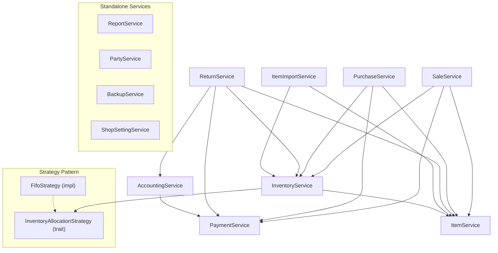
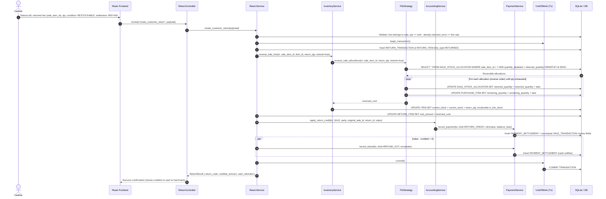
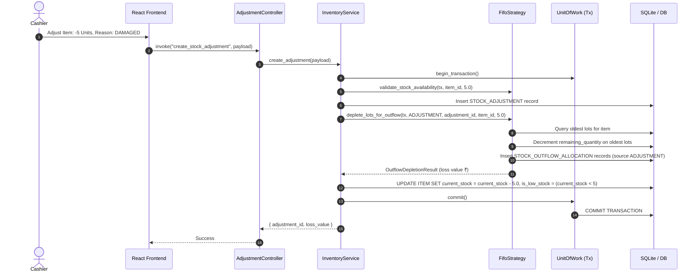
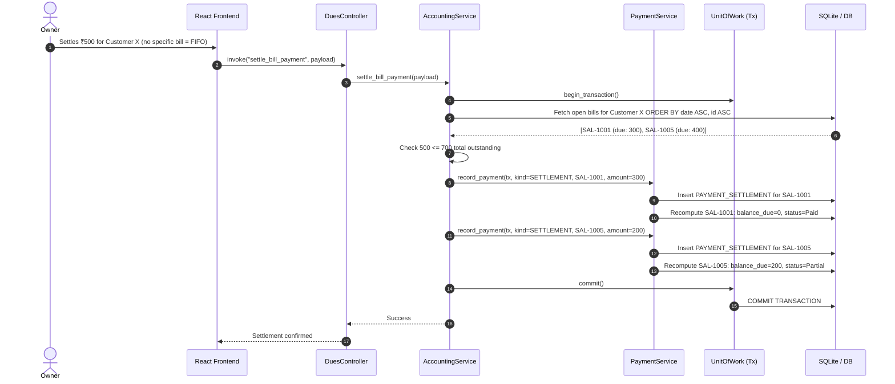
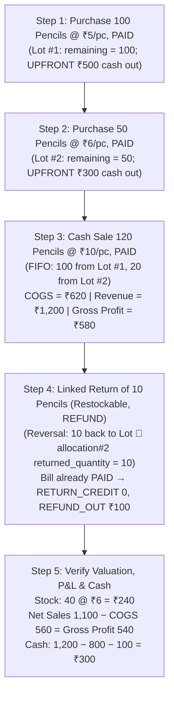

# Low-Level Design (LLD) Document: Book Keeper
**System:** Offline-First Retail Accounting & Inventory Management Desktop Application  
**Target Environment:** Windows Desktop (Tauri v2 + Rust + SQLite / Pluggable PostgreSQL + React 19)  
**Parent Document:** [High-Level Design (HLD)](file:///data/data/com.termux/files/home/book_keeper/docs/book_keeper_HLD.md)  
**UI/UX Companion Document:** [UI/UX Specification](file:///data/data/com.termux/files/home/book_keeper/docs/book_keeper_UI_UX_Specification.md)  
**Migration Specification:** [Data Import, Export & Migration](file:///data/data/com.termux/files/home/book_keeper/docs/book_keeper_data_import_export_and_migration.md)  
**Decisions Record:** [Design Decisions](DESIGN_DECISIONS.md) (authoritative where documents disagree)  
**Status:** Approved Architectural Low-Level Design Baseline (v3 — 2026-11-21 alignment: payment ledger, lot sources, return reversal, v1 scope)  

---

## 1. Executive Summary & Design Objectives

This Low-Level Design (LLD) document translates the business requirements, data structures, and operational workflows specified in the HLD into concrete, modular, testable software abstractions for the backend.

### 1.1 Core Architectural Principles
1. **Model-View-Controller-Service (MVCS) Pattern**:
   * **Controllers (`api/controllers`)**: Thin Tauri IPC command handlers responsible strictly for request deserialization, input validation, delegating to domain services, and mapping results or domain errors into typed IPC responses.
   * **Services (`services`)**: Granular, single-responsibility business logic classes. Orchestrates transactions, calculations, unit conversions, and domain rules.
   * **Data Access Repositories (`repositories`)**: Dedicated data access components isolated behind strict interfaces (traits) to encapsulate SQL persistence.
   * **Models / Entities (`domain`)**: Rich domain models, value objects, and Data Transfer Objects (DTOs).
2. **Pluggable Persistence & Reverse Search Abstraction**:
   * The database access layer and the typeahead inverted index (reverse search) are hidden entirely behind interfaces (`Repository` and `SearchIndexer` traits).
   * v1 ships with **Embedded SQLite** (`rusqlite` in WAL mode) and **SQLite FTS5** for sub-millisecond offline desktop search.
   * The system can be swapped to **PostgreSQL** or **Elasticsearch / Meilisearch / Tantivy** simply by providing alternative implementations bound to the same interface contracts without modifying any service or controller code.
3. **Strict Granularity & Single Responsibility (SRP)**:
   * Rather than monolithic service objects, business logic is split into cohesive units with decoupled concerns:
     * `InventoryAllocationStrategy` (`FifoStrategy`): Pure lot allocation, depletion, and restoration mechanics behind a strategy interface (FIFO by default, pluggable for LIFO/Weighted Average).
     * `InventoryService`: Centralized single source of truth for stock levels (`current_stock`, `is_low_stock`), lot lifecycle (all lot sources), physical adjustments, return reversals, replacement issues, vendor-return outflows, and the lot inspector.
     * `ItemService`: Item and bundle catalog master data, search index sync, and item validation (master data only, no stock mutations).
     * `PaymentService`: Sole writer of the payment ledger (`PaymentSettlement` rows of every `kind`) and of the cached bill money fields (`paid_amount`, `balance_due`, `payment_status`), which it recomputes from the ledger invariant after every write.
     * `AccountingService`: Analytical dues aggregation, bill settlement ordering (specific bill or FIFO across oldest open bills) for both cash settlements and return credits, party ledgers.
     * `SaleService`: Counter checkout orchestration, pricing, and bill summaries (delegates stock operations to `InventoryService` and payments to `PaymentService`).
     * `PurchaseService`: Inward batch generation and supplier bills (delegates stock addition to `InventoryService` and payments to `PaymentService`).
     * `ReturnService`: Customer/vendor returns and defective item swaps (delegates stock operations to `InventoryService` and refunds/adjustments to `PaymentService`).
     * `ReportService`: Fast consolidated KPI aggregations and financial statements (pure read-only).
     * `PartyService`: Customer & supplier directory master data and validation.
     * `ShopSettingService`: Single-row shop configuration and profile settings.
     * `BackupService`: Zero-downtime database snapshots via SQLite Online Backup API, integrity check.
     * `ItemImportService`: CSV/XLSX items import with dry-run validation and conflict strategy (v1 scope of FR-11).
     * *Deferred to v2 (code removed in v1): `MigrationService` (VedBill), exports, parties import, restore.*
4. **Decoupled Unit of Work / Transaction Abstraction**:
   * Multi-table operations (e.g., checkout inserting sales, updating purchase lot remainders, logging allocations, and refreshing item stock cache) run inside an atomic `UnitOfWork` transaction boundary, preventing partial writes and race conditions.

---

## 2. Package & Directory Structure

```
src-tauri/src/
├── api/                           # [Controller Layer] IPC Command Entrypoints (Thin)
│   ├── mod.rs                     # Command registration & router
│   ├── sale_controller.rs         # Checkout, sale codes, sales history
│   ├── purchase_controller.rs     # Inward purchase orders, purchase history
│   ├── item_controller.rs         # Master catalog, bundles, bundle suggestions
│   ├── dues_controller.rs         # Customer/Vendor dues & payment settlements (calls AccountingService)
│   ├── return_controller.rs       # Customer & vendor returns, swaps
│   ├── adjustment_controller.rs   # Physical stock adjustments & write-offs (calls InventoryService)
│   ├── report_controller.rs       # Dashboard KPIs, PnL, cash flow, stock valuation
│   ├── party_controller.rs        # Customer & supplier directory
│   ├── import_controller.rs       # Items import: validate (dry run) + execute
│   └── settings_controller.rs     # Shop settings, database backup, integrity check
│
├── core/                          # [Domain & Models Layer] Pure Domain Logic & Types
│   ├── mod.rs
│   ├── error.rs                   # AppError, DomainResult, Result type
│   ├── entities/                  # Core entity structs
│   │   ├── mod.rs
│   │   ├── item.rs                # Item & ItemBundle
│   │   ├── party.rs               # Customer & Vendor profiles
│   │   ├── purchase.rs            # PurchaseTransaction & PurchaseItem (FIFO Lot)
│   │   ├── sale.rs                # SaleTransaction, SaleItem, SaleStockAllocation
│   │   ├── settlement.rs          # PaymentSettlement
│   │   ├── stock_return.rs        # ReturnTransaction & ReturnItem
│   │   ├── adjustment.rs          # StockAdjustment & StockOutflowAllocation
│   │   └── shop_setting.rs        # Shop profile settings
│   ├── value_objects/             # Immutable value objects
│   │   ├── mod.rs
│   │   ├── transaction_code.rs    # SAL-XXXX, PUR-XXXX, RET-XXXX
│   │   ├── payment_status.rs      # PAID, PARTIAL, UNPAID
│   │   ├── party_type.rs          # CUSTOMER, VENDOR
│   │   ├── allocation_method.rs   # AllocationMethod enum { Fifo }
│   │   ├── payment_kind.rs        # UPFRONT, SETTLEMENT, RETURN_CREDIT, REFUND_OUT, REFUND_IN
│   │   ├── lot_source.rs          # PURCHASE, ADJUSTMENT, OPENING, RETURN
│   │   └── outflow_source.rs      # ADJUSTMENT, REPLACEMENT, VENDOR_RETURN
│   └── dtos/                      # Request / Response Transfer Objects
│       ├── mod.rs
│       ├── sale_dto.rs            # CreateSalePayload, SaleSummaryResponse, SalesFilter
│       ├── purchase_dto.rs        # CreatePurchasePayload, PurchaseFilter
│       ├── item_dto.rs            # CreateItemPayload, ItemSearchResult, BundleSuggestion
│       ├── dues_dto.rs            # PartyDueSummary, SettlePaymentPayload
│       ├── payment_dto.rs         # NEW: RecordPaymentPayload, RecordRefundPayload
│       ├── return_dto.rs          # CustomerReturnPayload, VendorReturnPayload
│       ├── adjustment_dto.rs      # StockAdjustmentPayload
│       ├── report_dto.rs          # DashboardMetrics, PnLReport, CashFlowReport, RecentTransaction
│       └── import_dto.rs          # ImportValidationReport, ImportSummary, ConflictStrategy
│
├── services/                      # [Service Layer] Business Rules & Orchestration
│   ├── mod.rs
│   ├── contracts/                 # Service Interfaces (Traits)
│   │   ├── inventory_allocation_strategy.rs # Strategy trait for lot allocation (replaces fifo_service.rs)
│   │   ├── inventory_service.rs             # Centralized stock & adjustments (replaces adjustment_service.rs)
│   │   ├── payment_service.rs               # Transactional payments & refunds (split from dues_service)
│   │   ├── accounting_service.rs            # Dues aggregation & bill settlement (replaces dues_service.rs)
│   │   ├── sale_service.rs
│   │   ├── purchase_service.rs
│   │   ├── item_service.rs                  # Master data only
│   │   ├── return_service.rs
│   │   ├── report_service.rs
│   │   ├── party_service.rs
│   │   ├── item_import_service.rs
│   │   ├── backup_service.rs
│   │   └── shop_setting_service.rs
│   └── impl/                      # Concrete Service Implementations
│       ├── fifo_strategy.rs                 # FIFO lot allocation algorithm
│       ├── inventory_service_impl.rs        # Inventory operations & stock cache
│       ├── payment_service_impl.rs          # Payment record persistence & balances
│       ├── accounting_service_impl.rs       # Dues calculation & FIFO bill settlement
│       ├── sale_service_impl.rs
│       ├── purchase_service_impl.rs
│       ├── item_service_impl.rs
│       ├── return_service_impl.rs
│       ├── report_service_impl.rs
│       ├── party_service_impl.rs
│       ├── item_import_service_impl.rs
│       ├── backup_service_impl.rs
│       └── shop_setting_service_impl.rs
│
├── data/                          # [Data Access Layer] Storage & Reverse Index (UNCHANGED)
│   ├── mod.rs
│   ├── contracts/                 # Storage & Search Interfaces (Traits)
│   │   ├── unit_of_work.rs        # Atomic transaction manager abstraction
│   │   ├── item_repository.rs
│   │   ├── bundle_repository.rs
│   │   ├── purchase_repository.rs # Inward batches & remaining quantity queries
│   │   ├── sale_repository.rs
│   │   ├── allocation_repository.rs
│   │   ├── party_repository.rs
│   │   ├── settlement_repository.rs
│   │   ├── return_repository.rs
│   │   ├── adjustment_repository.rs
│   │   ├── outflow_allocation_repository.rs # STOCK_OUTFLOW_ALLOCATION
│   │   ├── report_repository.rs
│   │   ├── setting_repository.rs
│   │   └── search_indexer.rs      # Reverse search trait (FTS5 / Elasticsearch)
│   │
│   └── sqlite/                    # Default Offline SQLite Implementations
│       ├── mod.rs
│       ├── connection.rs          # Pool management, WAL mode, pragmas (foreign_keys=ON, busy_timeout)
│       ├── migrations.rs          # Typed schema migrations (v1..vN)
│       ├── sqlite_uow.rs          # BEGIN IMMEDIATE transaction implementation
│       ├── repositories/          # SqliteItemRepo, SqliteSaleRepo, etc.
│       │   ├── item_repo.rs
│       │   ├── purchase_repo.rs
│       │   ├── sale_repo.rs
│       │   ├── settlement_repo.rs
│       │   └── ...
│       └── fts_indexer.rs         # SQLite FTS5 Inverted Index Implementation
│
└── app_state.rs                   # Dependency Injection Container (Arc<dyn Service>)
```

---

## 3. Core Domain Entities & Value Objects (`core/domain`)

### 3.1 Value Objects & Enums

```rust
// core/value_objects/allocation_method.rs
/// Enum selecting the inventory allocation strategy at DI wiring time.
#[derive(Debug, Clone, Copy, PartialEq, Eq, Serialize, Deserialize)]
pub enum AllocationMethod {
    Fifo,
    // Future: Lifo, WeightedAverage
}

// core/value_objects/payment_status.rs
#[derive(Debug, Clone, Copy, PartialEq, Eq, Serialize, Deserialize)]
pub enum PaymentStatus {
    Paid,
    Partial,
    Unpaid,
}

// core/value_objects/party_type.rs
#[derive(Debug, Clone, Copy, PartialEq, Eq, Serialize, Deserialize)]
pub enum PartyType {
    Customer,
    Vendor,
}

// core/value_objects/stock_condition.rs
#[derive(Debug, Clone, Copy, PartialEq, Eq, Serialize, Deserialize)]
pub enum StockCondition {
    Restockable,
    DamagedScrap,
}

// core/value_objects/adjustment_reason.rs
#[derive(Debug, Clone, Copy, PartialEq, Eq, Serialize, Deserialize)]
pub enum AdjustmentReason {
    Damaged,
    Expired,
    CountCorrection,
    TheftLost,
}

// core/value_objects/settlement_type.rs
/// Refund = apply value to dues first (RETURN_CREDIT), remainder as cash (REFUND_OUT / REFUND_IN).
/// Replacement = customer-only no-money swap (defective or variant, any item issued).
#[derive(Debug, Clone, Copy, PartialEq, Eq, Serialize, Deserialize)]
pub enum SettlementType {
    Refund,
    Replacement,
}

// core/value_objects/return_type.rs
#[derive(Debug, Clone, Copy, PartialEq, Eq, Serialize, Deserialize)]
pub enum ReturnType {
    Customer,
    Vendor,
}

// core/value_objects/return_line_type.rs
#[derive(Debug, Clone, Copy, PartialEq, Eq, Serialize, Deserialize)]
pub enum ReturnLineType {
    Returned,
    ReplacementIssued,
}

// core/value_objects/payment_kind.rs
/// Every PAYMENT_SETTLEMENT row has exactly one kind. Amounts are always > 0.
/// Cash direction is derived from (TransactionType, PaymentKind):
///   in : Sale·Upfront, Sale·Settlement, Purchase·RefundIn
///   out: Purchase·Upfront, Purchase·Settlement, Sale·RefundOut
///   non-cash: ReturnCredit
#[derive(Debug, Clone, Copy, PartialEq, Eq, Serialize, Deserialize)]
pub enum PaymentKind {
    Upfront,       // paid at billing time; reduces bill balance
    Settlement,    // later due payment; reduces bill balance
    ReturnCredit,  // return value offset against a bill; reduces bill balance, no cash
    RefundOut,     // cash paid back to a customer; bill balance untouched
    RefundIn,      // cash received back from a vendor; bill balance untouched
}

// core/value_objects/transaction_type.rs
#[derive(Debug, Clone, Copy, PartialEq, Eq, Serialize, Deserialize)]
pub enum TransactionType {
    Sale,
    Purchase,
}

// core/value_objects/lot_source.rs
/// Origin of a PURCHASE_TRANSACTION (and its lots). Only Purchase is a supplier bill.
/// Code prefixes: Purchase "PUR-", Adjustment "ADJ-", Opening "OPN-", Return "RTL-" (independent sequences).
#[derive(Debug, Clone, Copy, PartialEq, Eq, Serialize, Deserialize)]
pub enum LotSource {
    Purchase,
    Adjustment,
    Opening,
    Return,
}

// core/value_objects/outflow_source.rs
#[derive(Debug, Clone, Copy, PartialEq, Eq, Serialize, Deserialize)]
pub enum OutflowSourceType {
    Adjustment,    // source_id = stock_adjustment.id
    Replacement,   // source_id = return_transaction.id
    VendorReturn,  // source_id = return_transaction.id
}
```

> **Serialization:** all enums serialize as `SCREAMING_SNAKE_CASE` strings (`"RETURN_CREDIT"`, `"DAMAGED_SCRAP"`, …) both over IPC and as `TEXT` in SQLite.

### 3.2 Core Entities

```rust
// core/entities/item.rs
#[derive(Debug, Clone, Serialize, Deserialize)]
pub struct Item {
    pub id: i64,
    pub name: String,
    pub category: Option<String>,
    pub barcode: Option<String>,
    pub base_unit: String,
    pub mrp: Option<f64>,
    pub default_sale_price: f64,
    pub current_stock: f64,       // Cached sum across active purchase lots
    pub is_low_stock: bool,       // true if current_stock < 5.0 base units
    pub is_active: bool,          // 1: Active, 0: Soft-archived
    pub created_at: String,       // ISO-8601
    pub updated_at: String,       // ISO-8601
}

#[derive(Debug, Clone, Serialize, Deserialize)]
pub struct ItemBundle {
    pub id: i64,
    pub item_id: i64,
    pub bundle_name: String,      // e.g. "Box of 10", "Dozen"
    pub units_per_bundle: f64,    // Multiplier relative to base_unit
    pub mrp: Option<f64>,
    pub default_bundle_price: Option<f64>,
    pub barcode: Option<String>,
}

// core/entities/party.rs
#[derive(Debug, Clone, Serialize, Deserialize)]
pub struct Party {
    pub id: i64,
    pub name: String,
    pub phone: Option<String>,
    pub party_type: PartyType,
    pub notes: Option<String>,
    pub is_active: bool,
    pub created_at: String,
    pub updated_at: String,
}

// core/entities/purchase.rs
#[derive(Debug, Clone, Serialize, Deserialize)]
pub struct PurchaseTransaction {
    pub id: i64,
    pub transaction_code: String, // "PUR-1001" / "ADJ-0001" / "OPN-0001" / "RTL-0001"
    pub source: LotSource,        // Non-Purchase: total 0, party None, status Paid
    pub transaction_date: String, // "YYYY-MM-DD"
    pub party_id: Option<i64>,    // Supplier
    pub party_name: Option<String>, // Snapshot at write time (DD-30)
    pub payment_mode: Option<String>,
    pub payment_status: PaymentStatus,
    pub total_amount: f64,
    pub paid_amount: f64,
    pub balance_due: f64,
    pub notes: Option<String>,
    pub created_at: String,
}

#[derive(Debug, Clone, Serialize, Deserialize)]
pub struct PurchaseItem {
    pub id: i64,
    pub purchase_transaction_id: i64,
    pub item_id: i64,
    pub item_name: String,          // Name snapshot at write time (DD-30)
    pub pack_label: Option<String>, // Display snapshot ("Box of 10"); None = base units. No bundle FK (DD-28)
    pub pack_quantity: f64,         // Display snapshot: qty in that pack
    pub quantity: f64,              // Base units (pack_quantity × multiplier at entry)
    pub unit_cost: f64,             // Cost per base unit in ₹
    pub total_amount: f64,
    pub remaining_quantity: f64,  // Active lot base units available for FIFO
}

// core/entities/sale.rs
#[derive(Debug, Clone, Serialize, Deserialize)]
pub struct SaleTransaction {
    pub id: i64,
    pub transaction_code: String, // e.g. "SAL-1001"
    pub transaction_date: String, // "YYYY-MM-DD"
    pub party_id: Option<i64>,    // Customer
    pub party_name: Option<String>, // Snapshot at write time (DD-30)
    pub payment_mode: Option<String>,
    pub payment_status: PaymentStatus,
    pub total_amount: f64,
    pub paid_amount: f64,
    pub balance_due: f64,
    pub notes: Option<String>,
    pub created_at: String,
}

#[derive(Debug, Clone, Serialize, Deserialize)]
pub struct SaleItem {
    pub id: i64,
    pub sale_transaction_id: i64,
    pub item_id: i64,
    pub item_name: String,          // Name snapshot at write time (DD-30)
    pub pack_label: Option<String>, // Display snapshot ("Box of 10"); None = base units. No bundle FK (DD-28)
    pub pack_quantity: f64,         // Display snapshot: qty in that pack
    pub quantity: f64,              // Base units
    pub unit_price: f64,            // Effective selling rate per base unit
    pub total_amount: f64,
}

#[derive(Debug, Clone, Serialize, Deserialize)]
pub struct SaleStockAllocation {
    pub id: i64,
    pub sale_item_id: i64,
    pub purchase_item_id: i64,    // Inward batch depleted
    pub quantity_depleted: f64,   // Base units consumed from lot
    pub returned_quantity: f64,   // Base units later reversed by customer returns (0..=quantity_depleted)
    pub unit_cost: f64,           // Historical inward cost per base unit (for COGS)
}

// core/entities/settlement.rs  — the payment ledger
#[derive(Debug, Clone, Serialize, Deserialize)]
pub struct PaymentSettlement {
    pub id: i64,
    pub settlement_date: String,  // "YYYY-MM-DD"
    pub party_id: Option<i64>,
    pub kind: PaymentKind,
    pub transaction_type: TransactionType,
    pub transaction_id: Option<i64>, // Required for Upfront/Settlement/ReturnCredit
    pub return_id: Option<i64>,      // Set for ReturnCredit/RefundOut/RefundIn
    pub amount_paid: f64,            // > 0
    pub payment_mode: Option<String>,
    pub notes: Option<String>,
    pub created_at: String,
}

// core/entities/stock_return.rs
#[derive(Debug, Clone, Serialize, Deserialize)]
pub struct ReturnTransaction {
    pub id: i64,
    pub return_code: String,           // e.g. "RET-1001"
    pub return_date: String,           // "YYYY-MM-DD"
    pub return_type: ReturnType,       // Customer or Vendor
    pub party_id: Option<i64>,
    pub original_transaction_id: Option<i64>, // Sale id (Customer) / Purchase id (Vendor)
    pub settlement_type: SettlementType,      // Vendor: always Refund
    pub total_amount: f64,                    // Σ Returned lines' total_amount
    pub reason: Option<String>,
    pub notes: Option<String>,
    pub created_at: String,
}

#[derive(Debug, Clone, Serialize, Deserialize)]
pub struct ReturnItem {
    pub id: i64,
    pub return_transaction_id: i64,
    pub line_type: ReturnLineType,     // Returned or ReplacementIssued
    pub item_id: i64,
    pub item_name: String,             // Name snapshot at write time (DD-30)
    pub sale_item_id: Option<i64>,     // Customer: linked sale line (None = unlinked return)
    pub purchase_item_id: Option<i64>, // Vendor: named lot (None = FIFO)
    pub quantity: f64,                 // Base units
    pub unit_price: f64,               // Per base unit (Vendor: lot unit_cost; ReplacementIssued: 0)
    pub total_amount: f64,
    pub cost_amount: f64,              // FIFO cost of reversed (Returned) or issued (ReplacementIssued) units
    pub condition: Option<StockCondition>, // Customer Returned lines only
}

// core/entities/adjustment.rs
#[derive(Debug, Clone, Serialize, Deserialize)]
pub struct StockAdjustment {
    pub id: i64,
    pub adjustment_date: String,       // "YYYY-MM-DD"
    pub item_id: i64,
    pub quantity: f64,                 // Non-zero. Positive (+) to add, negative (-) to write off
    pub unit_cost: Option<f64>,        // Positive only: lot cost actually used
    pub reason: AdjustmentReason,
    pub notes: Option<String>,
    pub created_at: String,
}

/// FIFO audit trail for every non-sale stock outflow (negative adjustments, replacement issues,
/// vendor returns). Mirrors SALE_STOCK_ALLOCATION.
#[derive(Debug, Clone, Serialize, Deserialize)]
pub struct StockOutflowAllocation {
    pub id: i64,
    pub source_type: OutflowSourceType,
    pub source_id: i64,                // stock_adjustment.id or return_transaction.id
    pub purchase_item_id: i64,         // Lot depleted
    pub quantity_depleted: f64,        // Base units consumed from lot
    pub unit_cost: f64,                // Lot cost per base unit (for loss valuation)
}

// core/entities/shop_setting.rs
#[derive(Debug, Clone, Serialize, Deserialize)]
pub struct ShopSetting {
    pub id: i64,
    pub shop_name: String,
    pub phone: Option<String>,
    pub address: Option<String>,
    pub tax_id: Option<String>,        // GSTIN / PAN
}
```

### 3.3 Payment Transfer Objects (`core/dtos/payment_dto.rs`)

```rust
// core/dtos/payment_dto.rs

/// Balance-reducing ledger entry: kind ∈ {Upfront, Settlement, ReturnCredit}.
pub struct RecordPaymentPayload {
    pub kind: PaymentKind,
    pub party_id: Option<i64>,
    pub transaction_type: TransactionType,
    pub transaction_id: i64,         // Required
    pub return_id: Option<i64>,      // Required iff kind == ReturnCredit
    pub settlement_date: String,     // "YYYY-MM-DD"
    pub amount_paid: f64,            // > 0 and <= bill balance_due (after rounding)
    pub payment_mode: Option<String>,
    pub notes: Option<String>,
}

/// Cash refund ledger entry: kind ∈ {RefundOut (Sale), RefundIn (Purchase)}. Never touches bill balances.
pub struct RecordRefundPayload {
    pub kind: PaymentKind,
    pub party_id: Option<i64>,
    pub transaction_type: TransactionType,
    pub transaction_id: Option<i64>, // Linked bill, if any (informational)
    pub return_id: i64,              // Required
    pub refund_date: String,
    pub amount: f64,                 // > 0
    pub payment_mode: Option<String>,
    pub notes: Option<String>,
}
```

---

## 4. Reverse Search & Inverted Index Abstraction (`data/contracts/search_indexer.rs`)

To guarantee that the typeahead search can be seamlessly swapped between **SQLite FTS5**, **Elasticsearch**, **Tantivy**, or **PostgreSQL tsvector/trigram**, the search engine is isolated behind the `ItemSearchIndexer` interface.

```rust
// data/contracts/search_indexer.rs

#[derive(Debug, Clone, Serialize, Deserialize)]
pub struct ItemSearchResult {
    pub id: i64,
    pub name: String,
    pub category: Option<String>,
    pub barcode: Option<String>,
    pub base_unit: String,
    pub mrp: Option<f64>,
    pub default_sale_price: f64,
    pub current_stock: f64,
    pub is_low_stock: bool,
    pub bundles: Vec<ItemBundleSearchResult>,
}

#[derive(Debug, Clone, Serialize, Deserialize)]
pub struct ItemBundleSearchResult {
    pub id: i64,
    pub bundle_name: String,
    pub units_per_bundle: f64,
    pub mrp: Option<f64>,
    pub default_bundle_price: Option<f64>,
}

pub trait ItemSearchIndexer: Send + Sync {
    /// High-speed typeahead lookup matching prefix across name, barcode, and category (< 1ms).
    fn search(&self, query: &str, limit: usize) -> Result<Vec<ItemSearchResult>, AppError>;

    /// Indexes or updates an item and its associated packaging bundles in the search catalog.
    fn index_item(&self, item: &Item, bundles: &[ItemBundle]) -> Result<(), AppError>;

    /// Deletes an item from the search index (or marks it inactive).
    fn remove_item(&self, item_id: i64) -> Result<(), AppError>;

    /// Rebuilds the search index entirely from storage (used in migration & bulk restore).
    fn rebuild_index(&self, items_with_bundles: &[(Item, Vec<ItemBundle>)]) -> Result<(), AppError>;
}
```

### 4.1 Default v1 Implementation: `SqliteFts5SearchIndexer`
The SQLite implementation uses the virtual table `ITEM_SEARCH_FTS` defined with FTS5:
```sql
CREATE VIRTUAL TABLE IF NOT EXISTS item_search_fts USING fts5(
    item_id UNINDEXED,
    name,
    category,
    barcode,
    tokenize = 'unicode61 remove_diacritics 2'
);
```

> **Design Note — Tokenizer Selection:** The Porter stemmer is intentionally omitted. While useful for English prose, it interferes with numeric barcode lookups and short product abbreviations common in retail catalogs (e.g., "PG", "LTR"). The `unicode61` tokenizer handles multi-script text and diacritics correctly without semantic stemming artifacts.

> **Design Note — Bundle Barcode Coverage:** `ITEM_BUNDLE.barcode` values (outer box barcodes) are indexed as additional rows in the FTS5 table with the **parent item's `item_id`**. When `index_item()` is called, it inserts one FTS row for the item itself and one additional FTS row per bundle that has a non-null barcode. This ensures scanning a box barcode at the counter resolves to the correct parent item without requiring a secondary lookup query.

Query execution sanitizes input tokens and executes prefix matching (`token*`):
```sql
SELECT i.id, i.name, i.category, i.barcode, i.base_unit, i.mrp, 
       i.default_sale_price, i.current_stock, i.is_low_stock
FROM item_search_fts fts
JOIN item i ON fts.item_id = i.id
WHERE i.is_active = 1 AND item_search_fts MATCH ?
ORDER BY rank LIMIT ?;
```

---

## 5. Storage Repositories & Transaction Boundary (`data/contracts`)

### 5.1 Unit of Work & Transaction Abstraction
To execute atomic operations across multiple repositories without exposing SQLite or PostgreSQL transaction handles to the services:

```rust
// data/contracts/unit_of_work.rs

pub trait UnitOfWork: Send + Sync {
    /// Begins an immediate write transaction.
    fn begin_transaction(&self) -> Result<Box<dyn TransactionContext>, AppError>;
}

pub trait TransactionContext {
    /// Commits all staged mutations atomically.
    fn commit(self: Box<Self>) -> Result<(), AppError>;

    /// Explicitly aborts the transaction (automatic on drop if not committed).
    fn rollback(self: Box<Self>) -> Result<(), AppError>;

    // Repositories scoped to the live transaction handle:
    fn items(&mut self) -> &mut dyn ItemRepository;
    fn bundles(&mut self) -> &mut dyn BundleRepository;
    fn purchases(&mut self) -> &mut dyn PurchaseRepository;
    fn sales(&mut self) -> &mut dyn SaleRepository;
    fn allocations(&mut self) -> &mut dyn AllocationRepository;
    fn settlements(&mut self) -> &mut dyn SettlementRepository;
    fn returns(&mut self) -> &mut dyn ReturnRepository;
    fn adjustments(&mut self) -> &mut dyn AdjustmentRepository;
    fn outflow_allocations(&mut self) -> &mut dyn OutflowAllocationRepository;
    fn settings(&mut self) -> &mut dyn SettingRepository;
    fn parties(&mut self) -> &mut dyn PartyRepository;
}
```

### 5.2 Granular Repository Contracts

```rust
// data/contracts/item_repository.rs
pub trait ItemRepository {
    fn find_by_id(&self, id: i64) -> Result<Option<Item>, AppError>;
    fn find_by_name(&self, name: &str) -> Result<Option<Item>, AppError>;
    fn find_by_barcode(&self, barcode: &str) -> Result<Option<Item>, AppError>;
    fn list_catalog(&self, category: Option<&str>, low_stock_only: bool, offset: usize, limit: usize) -> Result<Vec<Item>, AppError>;
    fn create(&mut self, item: &Item) -> Result<i64, AppError>;
    fn update(&mut self, item: &Item) -> Result<(), AppError>;
    fn update_stock_cache(&mut self, item_id: i64, new_stock: f64, is_low_stock: bool) -> Result<(), AppError>;
    // archive(): deferred to v2 (FR-17)
}

// data/contracts/purchase_repository.rs
pub trait PurchaseRepository {
    fn create_transaction(&mut self, tx: &PurchaseTransaction) -> Result<i64, AppError>;
    fn create_purchase_item(&mut self, line: &PurchaseItem) -> Result<i64, AppError>;
    fn find_transaction_by_id(&self, id: i64) -> Result<Option<PurchaseTransaction>, AppError>;
    fn find_purchase_item_by_id(&self, id: i64) -> Result<Option<PurchaseItem>, AppError>;
    /// Next code for the given source's own prefix/sequence (PUR-/ADJ-/OPN-/RTL-).
    fn get_next_transaction_code(&self, source: LotSource) -> Result<String, AppError>;

    /// Core FIFO query: lots of any source with remaining_quantity > 0, ORDER BY id ASC.
    fn get_active_lots_for_item(&self, item_id: i64) -> Result<Vec<PurchaseItem>, AppError>;
    /// unit_cost of the item's most recent lot (highest id, any source, any remaining); None if never stocked.
    fn get_latest_lot_cost(&self, item_id: i64) -> Result<Option<f64>, AppError>;
    /// Lot inspector rows (joins header for code/source/date/vendor name).
    fn list_lots_for_item(&self, item_id: i64) -> Result<Vec<ItemLot>, AppError>;

    /// Sets remaining quantity on a lot; implementations must reject values < 0 or > lot.quantity.
    fn update_remaining_quantity(&mut self, lot_id: i64, new_remaining_qty: f64) -> Result<(), AppError>;
    /// Writes cached money fields only; called exclusively by PaymentService.
    fn update_money_fields(&mut self, tx_id: i64, paid_amount: f64, balance_due: f64, status: PaymentStatus) -> Result<(), AppError>;
    /// Open bills for FIFO settlement / credit: source = Purchase, balance_due > 0, ORDER BY transaction_date, id.
    fn list_open_for_party(&self, party_id: i64) -> Result<Vec<PurchaseTransaction>, AppError>;
    /// History list: source = Purchase only; filter incl. search_query on code / party name.
    fn list_purchases(&self, filter: &PurchaseHistoryFilter, offset: usize, limit: usize) -> Result<(Vec<PurchaseHistoryRow>, usize), AppError>;
    /// Σ quantity on vendor RETURN_ITEMs referencing this lot.
    fn get_returned_quantity_for_lot(&self, purchase_item_id: i64) -> Result<f64, AppError>;
}

// data/contracts/sale_repository.rs
pub trait SaleRepository {
    fn create_transaction(&mut self, tx: &SaleTransaction) -> Result<i64, AppError>;
    fn create_sale_item(&mut self, line: &SaleItem) -> Result<i64, AppError>;
    fn find_transaction_by_id(&self, id: i64) -> Result<Option<SaleTransaction>, AppError>;
    fn find_sale_item_by_id(&self, id: i64) -> Result<Option<SaleItem>, AppError>;
    fn get_next_transaction_code(&self) -> Result<String, AppError>;
    /// Writes cached money fields only; called exclusively by PaymentService.
    fn update_money_fields(&mut self, tx_id: i64, paid_amount: f64, balance_due: f64, status: PaymentStatus) -> Result<(), AppError>;
    /// Open bills for FIFO settlement / credit: balance_due > 0, ORDER BY transaction_date, id.
    fn list_open_for_party(&self, party_id: i64) -> Result<Vec<SaleTransaction>, AppError>;
    fn list_sales(&self, filter: &SalesHistoryFilter, offset: usize, limit: usize) -> Result<(Vec<SaleHistoryRow>, usize), AppError>;
    /// Σ quantity of customer Returned RETURN_ITEMs referencing this sale line.
    fn get_returned_quantity_for_line(&self, sale_item_id: i64) -> Result<f64, AppError>;
}

// data/contracts/allocation_repository.rs  (SALE_STOCK_ALLOCATION)
pub trait AllocationRepository {
    fn create_allocation(&mut self, allocation: &SaleStockAllocation) -> Result<i64, AppError>;
    fn find_by_sale_item_id(&self, sale_item_id: i64) -> Result<Vec<SaleStockAllocation>, AppError>;
    /// Allocations with quantity_depleted > returned_quantity, ORDER BY id DESC (reversal order).
    fn find_reversible_by_sale_item_id(&self, sale_item_id: i64) -> Result<Vec<SaleStockAllocation>, AppError>;
    fn update_returned_quantity(&mut self, allocation_id: i64, new_returned_qty: f64) -> Result<(), AppError>;
}

// data/contracts/settlement_repository.rs  (PAYMENT_SETTLEMENT ledger)
pub trait SettlementRepository {
    fn create_settlement(&mut self, settlement: &PaymentSettlement) -> Result<i64, AppError>;
    fn list_by_party(&self, party_id: i64) -> Result<Vec<PaymentSettlement>, AppError>;
    fn list_by_transaction(&self, tx_type: TransactionType, tx_id: i64) -> Result<Vec<PaymentSettlement>, AppError>;
    /// Σ amount_paid for a bill grouped by kind (used to recompute the cached header invariant).
    fn sum_by_kind_for_transaction(&self, tx_type: TransactionType, tx_id: i64) -> Result<LedgerTotals, AppError>;
}

// data/contracts/party_repository.rs
pub trait PartyRepository {
    fn find_by_id(&self, id: i64) -> Result<Option<Party>, AppError>;
    fn list(&self, party_type: Option<PartyType>, active_only: bool) -> Result<Vec<Party>, AppError>;
    fn search(&self, query: &str, party_type: Option<PartyType>) -> Result<Vec<Party>, AppError>;
    fn create(&mut self, party: &Party) -> Result<i64, AppError>;
    fn update(&mut self, party: &Party) -> Result<(), AppError>;
    // archive(): deferred to v2 (FR-17)
    /// Purchase side counts source = Purchase only.
    fn get_party_due_summary(&self, party_type: PartyType) -> Result<Vec<PartyDueSummary>, AppError>;
}

// data/contracts/bundle_repository.rs
pub trait BundleRepository {
    fn find_by_id(&self, id: i64) -> Result<Option<ItemBundle>, AppError>;
    fn find_by_item_id(&self, item_id: i64) -> Result<Vec<ItemBundle>, AppError>;
    fn find_by_barcode(&self, barcode: &str) -> Result<Option<ItemBundle>, AppError>;
    fn create(&mut self, bundle: &ItemBundle) -> Result<i64, AppError>;
    fn update(&mut self, bundle: &ItemBundle) -> Result<(), AppError>;
    fn delete(&mut self, bundle_id: i64) -> Result<(), AppError>; // hard delete; bill lines don't reference bundles
    fn get_bundle_suggestions(&self) -> Result<Vec<BundleSuggestion>, AppError>;
}

// data/contracts/return_repository.rs
pub trait ReturnRepository {
    fn create_return_transaction(&mut self, tx: &ReturnTransaction) -> Result<i64, AppError>;
    fn create_return_item(&mut self, item: &ReturnItem) -> Result<i64, AppError>;
    fn update_return_item_cost(&mut self, return_item_id: i64, cost_amount: f64) -> Result<(), AppError>;
    fn find_return_by_id(&self, id: i64) -> Result<Option<ReturnTransaction>, AppError>;
    fn find_items_by_return_id(&self, id: i64) -> Result<Vec<ReturnItem>, AppError>;
    fn get_next_return_code(&self) -> Result<String, AppError>;
    fn list_returns(&self, filter: &ReturnsFilter, offset: usize, limit: usize) -> Result<(Vec<ReturnTransaction>, usize), AppError>;
}

// data/contracts/adjustment_repository.rs
pub trait AdjustmentRepository {
    fn create_adjustment(&mut self, adj: &StockAdjustment) -> Result<i64, AppError>;
    fn list_adjustments(&self, item_id: Option<i64>, offset: usize, limit: usize) -> Result<(Vec<StockAdjustment>, usize), AppError>;
}

// data/contracts/outflow_allocation_repository.rs  (STOCK_OUTFLOW_ALLOCATION)
pub trait OutflowAllocationRepository {
    fn create_allocation(&mut self, alloc: &StockOutflowAllocation) -> Result<i64, AppError>;
    fn find_by_source(&self, source_type: OutflowSourceType, source_id: i64) -> Result<Vec<StockOutflowAllocation>, AppError>;
}

// data/contracts/setting_repository.rs
pub trait SettingRepository {
    fn get_shop_setting(&self) -> Result<ShopSetting, AppError>;
    fn upsert_shop_setting(&mut self, setting: &ShopSetting) -> Result<(), AppError>;
}

// data/contracts/report_repository.rs
pub trait ReportRepository: Send + Sync {
    fn get_dashboard_metrics(&self, today_date: &str) -> Result<DashboardMetrics, AppError>;
    fn get_low_stock_items(&self) -> Result<Vec<Item>, AppError>;
    fn get_sales_purchase_trend(&self, days: usize) -> Result<Vec<TrendDataPoint>, AppError>;
    fn get_pnl_report(&self, from_date: &str, to_date: &str) -> Result<PnLReport, AppError>;
    fn get_stock_valuation_report(&self) -> Result<StockValuationReport, AppError>;
    fn get_cash_flow_report(&self, from_date: &str, to_date: &str) -> Result<CashFlowReport, AppError>;
    fn get_recent_transactions(&self, limit: usize) -> Result<Vec<RecentTransaction>, AppError>;
}
```

### 5.3 Schema Rules (`data/sqlite/migrations.rs`)
* `PRAGMA foreign_keys = ON`, `journal_mode = WAL`, `synchronous = NORMAL`, `busy_timeout = 5000` on every connection.
* Enum columns are `TEXT` with `CHECK (... IN (...))` constraints matching §3.1.
* `PAYMENT_SETTLEMENT`: `CHECK (amount_paid > 0)`, `CHECK (kind IN ('REFUND_OUT','REFUND_IN') OR transaction_id IS NOT NULL)`.
* `PURCHASE_ITEM`: `CHECK (remaining_quantity >= 0 AND remaining_quantity <= quantity)`.
* `SALE_STOCK_ALLOCATION`: `CHECK (returned_quantity >= 0 AND returned_quantity <= quantity_depleted)`.
* `ITEM_BUNDLE`: `CHECK (units_per_bundle > 1)`.
* `STOCK_ADJUSTMENT`: `CHECK (quantity <> 0)`.
* Indexes: `purchase_item(item_id, remaining_quantity)`, `sale_stock_allocation(sale_item_id)`, `stock_outflow_allocation(source_type, source_id)`, `payment_settlement(settlement_date)`, `payment_settlement(transaction_type, transaction_id)`, `sale_transaction(transaction_date)`, `purchase_transaction(source, transaction_date)`, `item(barcode)`, `item_bundle(barcode)`, `return_item(sale_item_id)`, `return_item(purchase_item_id)`.
* Name snapshots (DD-30): `party_name` on sale/purchase/return headers, `item_name` on sale/purchase/return lines, written by the creating service; history/detail queries read snapshots.
* Schema strategy (DD-29): v1 is the aligned schema itself (pre-release rewrite); a legacy pre-alignment DB is detected and rejected.
* Migrations are numbered, forward-only, recorded in a `schema_version` table, each applied in one transaction; `ALTER TABLE ADD COLUMN` / new tables only (NFR-04). No JSON blob columns.

---

## 6. Granular Service Layer (`services/`)

### 6.1 Architecture Overview & Service Responsibility Matrix

The service layer is structured to guarantee clean separation of concerns, single-responsibility compliance, and pluggable algorithm extensibility:

| Service | Owns | Does NOT do |
|---|---|---|
| **`InventoryAllocationStrategy`** (`FifoStrategy`) | Lot depletion/restoration algorithms, allocation record creation | Stock cache updates, business validation, transaction orchestration |
| **`InventoryService`** | Stock levels (`current_stock`, `is_low_stock`), lot lifecycle, physical adjustments, synthetic lot creation | Item master data, payment recording, dues logic |
| **`ItemService`** | Item + Bundle CRUD, search index sync, item validation | Stock mutations, payment logic |
| **`PaymentService`** | All `PaymentSettlement` ledger rows (every kind); sole writer of `paid_amount`/`balance_due`/`payment_status`, recomputed from the ledger invariant | Deciding *which* bills to pay, dues aggregation, stock |
| **`AccountingService`** | Dues aggregation, FIFO bill ordering for settlements **and** return credits, party ledgers | Executing payment records (delegates to `PaymentService`) |
| **`SaleService`** | Checkout orchestration, pricing, bill summary generation | Stock mutations (delegates to `InventoryService`), payment recording (delegates to `PaymentService`) |
| **`PurchaseService`** | Inward batch orchestration, cost normalization, lot creation | Stock cache updates (delegates to `InventoryService`), payment recording (delegates to `PaymentService`) |
| **`ReturnService`** | Return orchestration, condition assessment, replacement logic | Stock mutations (delegates to `InventoryService`), payment/refund recording (delegates to `PaymentService`) |
| **`ReportService`** | Read-only KPI aggregations, P&L, cash flow, stock valuation | Everything — pure reads |
| **`PartyService`** | Customer/vendor master data CRUD, search | Everything else |



---

### 6.2 Inventory Allocation Strategy (`InventoryAllocationStrategy` Trait & `FifoStrategy`)

The mathematical core of stock lot depletion and restoration is isolated behind the Strategy pattern (`InventoryAllocationStrategy`). Implementations contain zero business orchestration; they operate strictly on lots via the `TransactionContext` repositories. This allows future allocation methods (LIFO, Weighted Average) to be plugged in seamlessly.

```rust
// services/contracts/inventory_allocation_strategy.rs

#[derive(Debug, Clone)]
pub struct DepletionResult {
    pub total_cogs: f64,
    pub allocations: Vec<SaleStockAllocation>,
}

#[derive(Debug, Clone)]
pub struct OutflowDepletionResult {
    pub total_cost: f64,                       // Σ qty × lot cost (loss value / return value)
    pub allocations: Vec<StockOutflowAllocation>,
}

#[derive(Debug, Clone)]
pub struct ReversalResult {
    pub reversed_cost: f64,                    // Σ reversed qty × allocation unit_cost
}

/// Strategy interface for inventory lot allocation algorithms.
/// Implementations are pure algorithmic — they operate on lots via the
/// TransactionContext repositories and contain zero business orchestration.
pub trait InventoryAllocationStrategy: Send + Sync {
    /// Validates that total active stock across lots >= required_base_qty.
    /// Returns InsufficientStockError if unavailable.
    fn validate_stock_availability(
        &self,
        uow: &mut dyn TransactionContext,
        item_id: i64,
        required_base_qty: f64,
    ) -> Result<(), AppError>;

    /// Depletes lots in strategy-defined order (FIFO = oldest first).
    /// Decrements `remaining_quantity` on purchase lots and logs sale allocations.
    fn deplete_lots_for_sale(
        &self,
        uow: &mut dyn TransactionContext,
        sale_item_id: i64,
        item_id: i64,
        required_base_qty: f64,
    ) -> Result<DepletionResult, AppError>;

    /// Reverses `quantity` units of a sale line for a customer return.
    /// Walks reversible allocations (quantity_depleted > returned_quantity) in reverse
    /// depletion order, increments returned_quantity; if `restock`, also adds the units back to
    /// each allocation's lot remaining_quantity. Fails if quantity exceeds total reversible.
    fn reverse_sale_allocations(
        &self,
        uow: &mut dyn TransactionContext,
        sale_item_id: i64,
        quantity: f64,
        restock: bool,
    ) -> Result<ReversalResult, AppError>;

    /// Depletes lots for a non-sale outflow (negative adjustment, replacement issue, vendor return
    /// in FIFO mode) and writes StockOutflowAllocation rows tagged with (source_type, source_id).
    fn deplete_lots_for_outflow(
        &self,
        uow: &mut dyn TransactionContext,
        source_type: OutflowSourceType,
        source_id: i64,
        item_id: i64,
        quantity: f64,
    ) -> Result<OutflowDepletionResult, AppError>;
}
```

```rust
// services/impl/fifo_strategy.rs

/// FIFO (First-In, First-Out) implementation of InventoryAllocationStrategy.
/// Depletes oldest lots first (ORDER BY id ASC — entry order, any lot source).
/// Reverses latest-depleted first (allocations ORDER BY id DESC).
pub struct FifoStrategy;
```

> **Strategy boundary (NFR-05):** the ordering of lots and of reversals lives only inside the strategy. Services never query lots in a particular order themselves. Named-lot vendor returns are not a strategy concern (the lot is chosen by the user) and are handled by `InventoryService` directly.

#### Detailed FIFO Depletion Algorithm (sale and outflow share it)
```
Input: item_id, required_base_qty (> 0)          EPS = 1e-9
1. Fetch active lots: SELECT * FROM purchase_item WHERE item_id = ? AND remaining_quantity > 0 ORDER BY id ASC.
2. Verify: SUM(lot.remaining_quantity) + EPS >= required_base_qty. Else InsufficientStockError { required, available }.
3. remaining_needed = required_base_qty; total_cost = 0.0
4. For each lot in active_lots:
     take_qty = MIN(lot.remaining_quantity, remaining_needed)
     lot_repo.update_remaining_quantity(lot.id, lot.remaining_quantity - take_qty)
     write allocation row (sale: SALE_STOCK_ALLOCATION; outflow: STOCK_OUTFLOW_ALLOCATION with source)
     total_cost += take_qty * lot.unit_cost
     remaining_needed -= take_qty
     If remaining_needed <= EPS: BREAK
5. Return result { total_cost, allocations }
```

#### Reversal Algorithm (customer returns)
```
Input: sale_item_id, qty (> 0), restock: bool
1. allocs = SELECT * FROM sale_stock_allocation WHERE sale_item_id = ? AND quantity_depleted > returned_quantity ORDER BY id DESC
2. Verify SUM(quantity_depleted - returned_quantity) + EPS >= qty, else ValidationError("return exceeds sold quantity")
3. For each a in allocs while qty > EPS:
     take = MIN(a.quantity_depleted - a.returned_quantity, qty)
     allocation_repo.update_returned_quantity(a.id, a.returned_quantity + take)
     if restock: lot.remaining_quantity += take   (repo rejects > lot.quantity)
     reversed_cost += take * a.unit_cost; qty -= take
4. Return ReversalResult { reversed_cost }
```

---

### 6.3 Centralized Inventory Service (`InventoryService`)

`InventoryService` is the centralized, authoritative single source of truth for all inventory mutations. No other service modifies `ITEM.current_stock`, `ITEM.is_low_stock`, or `PURCHASE_ITEM.remaining_quantity` directly. It absorbs physical stock adjustments and coordinates lot allocation through the pluggable strategy.

```rust
// services/contracts/inventory_service.rs

pub trait InventoryService: Send + Sync {
    /// Validates that sufficient stock exists for every item. `requirements` holds the
    /// required base qty per item ALREADY SUMMED across all lines of the operation.
    fn validate_stock_availability(
        &self,
        uow: &mut dyn TransactionContext,
        requirements: &[(i64 /*item_id*/, f64 /*total_base_qty*/)],
    ) -> Result<(), AppError>;

    /// Depletes lots via the allocation strategy and updates ITEM.current_stock.
    /// Called by SaleService during checkout for each sale line.
    fn deplete_stock_for_sale(
        &self,
        uow: &mut dyn TransactionContext,
        sale_item_id: i64,
        item_id: i64,
        required_base_qty: f64,
    ) -> Result<DepletionResult, AppError>;

    /// Creates a new purchase lot and increments ITEM.current_stock.
    /// Called by PurchaseService for each inward line.
    fn add_stock_for_purchase(
        &self,
        uow: &mut dyn TransactionContext,
        purchase_item: &PurchaseItem,
    ) -> Result<(), AppError>;

    /// Linked customer return: reverses sale allocations via the strategy (restock = RESTOCKABLE)
    /// and, if restocking, increments ITEM.current_stock. Returns the reversed FIFO cost.
    fn reverse_sale_line(
        &self,
        uow: &mut dyn TransactionContext,
        sale_item_id: i64,
        item_id: i64,
        quantity: f64,
        restock: bool,
    ) -> Result<f64, AppError>;

    /// Creates a non-purchase lot (source Adjustment / Opening / Return): inserts a zero-value
    /// header with its own code sequence (party None, status Paid), one PurchaseItem lot,
    /// increments ITEM.current_stock. Cost = explicit cost if given, else latest lot cost,
    /// else ValidationError("unit cost required"). Returns the lot id.
    fn create_source_lot(
        &self,
        uow: &mut dyn TransactionContext,
        source: LotSource,
        date: &str,
        item_id: i64,
        quantity: f64,
        unit_cost: Option<f64>,
        notes: Option<String>,
    ) -> Result<i64, AppError>;

    /// FIFO outflow for replacement issues and negative adjustments: strategy depletion +
    /// StockOutflowAllocation rows + ITEM.current_stock decrement. Returns total cost.
    fn issue_stock_outflow(
        &self,
        uow: &mut dyn TransactionContext,
        source_type: OutflowSourceType,
        source_id: i64,
        item_id: i64,
        quantity: f64,
    ) -> Result<f64, AppError>;

    /// Vendor return: named lot (must be Purchase-source, same item, qty <= remaining) is depleted
    /// directly; None -> FIFO via issue_stock_outflow(VendorReturn). Both log StockOutflowAllocation
    /// and decrement ITEM.current_stock. Returns Σ qty × lot unit_cost (the return value).
    fn remove_stock_for_vendor_return(
        &self,
        uow: &mut dyn TransactionContext,
        return_id: i64,
        item_id: i64,
        purchase_item_id: Option<i64>,
        quantity: f64,
    ) -> Result<f64, AppError>;

    /// Executes a physical stock adjustment in its own BEGIN IMMEDIATE transaction.
    /// Negative: issue_stock_outflow(Adjustment). Positive: create_source_lot(Adjustment).
    fn create_adjustment(
        &self,
        payload: StockAdjustmentPayload,
    ) -> Result<StockAdjustmentResult /* { adjustment_id, loss_value } */, AppError>;

    /// Lot inspector (all sources).
    fn get_item_lots(&self, item_id: i64) -> Result<Vec<ItemLot>, AppError>;

    /// Lists historical stock adjustments.
    fn list_adjustments(
        &self,
        item_id: Option<i64>,
        page: usize,
        limit: usize,
    ) -> Result<PaginatedList<StockAdjustment>, AppError>;
}
```

#### Stock Cache Update Logic (Owned Exclusively by `InventoryService`):
```
After any stock mutation (inside the same transaction):
  new_stock = item.current_stock + delta          (delta signed)
  is_low = new_stock < 5.0
  item_repo.update_stock_cache(item_id, new_stock, is_low)
Invariant (checked in tests): ITEM.current_stock == Σ PURCHASE_ITEM.remaining_quantity for the item (± EPS).
```

#### Physical Stock Adjustment Execution Logic:
0. Validate: item exists and is active; `quantity != 0`; `adjustment_date` is a valid date.

**Negative Adjustment (`quantity < 0`) — Write-Off / Loss:**
1. `uow.begin_transaction()`
2. `validate_stock_availability(uow, [(item_id, abs(quantity))])` → `InsufficientStockError` if short.
3. Persist `StockAdjustment` (`unit_cost = None`) → `adjustment_id`.
4. `issue_stock_outflow(uow, Adjustment, adjustment_id, item_id, abs(quantity))` → `loss_value`.
5. `uow.commit()`; return `{ adjustment_id, loss_value }`.

**Positive Adjustment (`quantity > 0`) — Found Stock / Count Correction:**
1. `uow.begin_transaction()`
2. Resolve cost: `payload.unit_cost` if given, else `purchase_repo.get_latest_lot_cost(item_id)`, else `ValidationError { field: "unit_cost", message: "unit cost required: item has no prior lot" }`.
3. Persist `StockAdjustment` (with resolved `unit_cost`) → `adjustment_id`.
4. `create_source_lot(uow, Adjustment, adjustment_date, item_id, quantity, Some(cost), notes = "Stock adjustment #<id>: <reason>")` (code `ADJ-XXXX`).
5. `uow.commit()`; return `{ adjustment_id, loss_value: 0 }`.

> **Design Rationale — Source-tagged lots:** every unit of stock must live in a depletable `PURCHASE_ITEM` lot so `current_stock` always equals Σ lot remainders. Non-purchase lots hang off a zero-value `PURCHASE_TRANSACTION` whose `source` ≠ `PURCHASE`; every purchase-facing query filters `source = 'PURCHASE'`, so these never appear as supplier bills, in purchase totals/counts, payables, or vendor-return lot pickers.

---

### 6.4 Payment Service (`PaymentService`)

`PaymentService` is the **only** writer of the payment ledger and of the cached bill money fields. It is called during checkout/inward (UPFRONT), dues settlements (SETTLEMENT), and returns (RETURN_CREDIT, REFUND_OUT, REFUND_IN).

```rust
// services/contracts/payment_service.rs

pub trait PaymentService: Send + Sync {
    /// Balance-reducing entry (kind ∈ Upfront | Settlement | ReturnCredit) against one bill.
    /// 1. Load bill; amount = round2(payload.amount_paid); reject amount <= 0 or amount > balance_due + EPS
    ///    (ValidationError "Payment exceeds outstanding balance").
    /// 2. Insert PaymentSettlement row.
    /// 3. recompute_bill(tx_type, tx_id).
    /// Returns the settlement id.
    fn record_payment(
        &self,
        uow: &mut dyn TransactionContext,
        payload: RecordPaymentPayload,
    ) -> Result<i64, AppError>;

    /// Cash refund (RefundOut for customers, RefundIn from vendors). Inserts a ledger row only;
    /// never changes any bill balance.
    fn record_refund(
        &self,
        uow: &mut dyn TransactionContext,
        payload: RecordRefundPayload,
    ) -> Result<i64, AppError>;
}

/// Internal helper used after every balance-reducing insert:
///   totals = settlement_repo.sum_by_kind_for_transaction(tx_type, tx_id)
///   paid   = round2(totals.upfront + totals.settlement)
///   credit = round2(totals.return_credit)
///   balance = round2(total_amount - paid - credit)            (must be >= 0)
///   status = Paid if balance == 0 else Partial if paid + credit > 0 else Unpaid
///   repo.update_money_fields(tx_id, paid, balance, status)
fn recompute_bill(uow, tx_type, tx_id) -> Result<(), AppError>;
```

> `reduce_transaction_balance` is removed: due reductions from returns are `RETURN_CREDIT` ledger rows so they are auditable and survive a recompute.

---

### 6.5 Accounting & Dues Service (`AccountingService`)

`AccountingService` owns the analytical and bookkeeping concern of party ledgers and dues. It determines *what* to pay (which bills, in what order) and delegates the actual *execution* of payments to `PaymentService`.

```rust
// services/contracts/accounting_service.rs

pub trait AccountingService: Send + Sync {
    /// Aggregates all outstanding dues for customers or vendors.
    fn get_party_dues_summary(
        &self,
        party_type: PartyType,
    ) -> Result<Vec<PartyDueSummary>, AppError>;

    /// Cash settlement (kind Settlement) in its own BEGIN IMMEDIATE transaction:
    /// specific bill or FIFO across the party's oldest open bills.
    fn settle_bill_payment(
        &self,
        payload: SettlePaymentPayload,
    ) -> Result<SettlementResult /* { settlement_ids, bills_touched } */, AppError>;

    /// Applies a return's value as RETURN_CREDIT inside the caller's transaction.
    /// target: Some(bill_id) -> that bill only; None -> party's oldest open bills (FIFO).
    /// Returns the amount actually credited (<= value); caller pays the remainder as cash.
    fn apply_return_credit(
        &self,
        uow: &mut dyn TransactionContext,
        tx_type: TransactionType,
        party_id: Option<i64>,
        target_bill: Option<i64>,
        return_id: i64,
        date: &str,
        value: f64,
    ) -> Result<f64, AppError>;

    /// Returns transaction-level ledger history for a party (bills, ledger rows, returns).
    fn get_party_ledger(
        &self,
        party_id: i64,
    ) -> Result<PartyLedgerView, AppError>;
}
```

#### Settlement Execution Logic:
0. Validate: `amount_paid > 0` (round2); party exists and matches `transaction_type` (SALE ⇒ CUSTOMER, PURCHASE ⇒ VENDOR).
1. `uow.begin_transaction()`
2. **If `transaction_id` is provided (Specific Bill Settlement):**
   * Fetch target bill; it must belong to `party_id` (and be `source = PURCHASE` for purchases).
   * Delegate to `PaymentService.record_payment(uow, kind = Settlement, ...)` (rejects amount > balance_due).
3. **If `transaction_id` is `None` (FIFO Bill Settlement):**
   * `bills = repo.list_open_for_party(party_id)` (ordered `transaction_date ASC, id ASC`).
   * If `amount_paid > Σ bills.balance_due + EPS`: `ValidationError("Settlement amount exceeds total outstanding dues")` **before** writing anything.
   * Loop oldest-first: `apply = MIN(bill.balance_due, remaining)`; `record_payment(kind = Settlement, amount = apply)`; `remaining -= apply`; stop at `remaining <= EPS`.
4. `uow.commit()`

#### Return Credit Logic (`apply_return_credit`):
1. `target_bill = Some(id)`: `credit = MIN(value, bill.balance_due)`; if `credit > 0`: `record_payment(kind = ReturnCredit, return_id, amount = credit)`.
2. `target_bill = None, party_id = Some(p)`: same FIFO loop as settlement over `list_open_for_party(p)` with `kind = ReturnCredit`, stopping when the value is exhausted or bills run out (no error when value exceeds dues).
3. `party_id = None`: credit = 0.
4. Return total credited.

---

### 6.6 Item Catalog & Bundles Master Data Service (`ItemService`)

`ItemService` is strictly a **master data management service**. It owns item and bundle definitions, catalog search indexing, and validation. It does **not** perform any stock mutations — that is `InventoryService`'s exclusive domain.

```rust
// services/contracts/item_service.rs

pub trait ItemService: Send + Sync {
    fn get_catalog(&self, category: Option<String>, low_stock_only: bool, page: usize, limit: usize) -> Result<PaginatedList<ItemSearchResult>, AppError>;
    fn create_item(&self, payload: CreateItemPayload) -> Result<i64, AppError>;
    fn update_item(&self, item_id: i64, payload: UpdateItemPayload) -> Result<(), AppError>; // master fields only
    // archive_item: deferred to v2 (FR-17)
    fn create_bundle(&self, payload: CreateBundlePayload) -> Result<i64, AppError>;
    fn update_bundle(&self, bundle_id: i64, payload: UpdateBundlePayload) -> Result<(), AppError>;
    fn delete_bundle(&self, bundle_id: i64) -> Result<(), AppError>;
    fn get_bundle_suggestions(&self) -> Result<Vec<BundleSuggestion>, AppError>;
}
```

* **Validation**: item `name` non-empty, trimmed, unique (case-insensitive); `barcode` unique across items and bundles when present; `default_sale_price >= 0`; `mrp` null or `> 0`. Bundle: `bundle_name` non-empty, `units_per_bundle > 1`, prices null or `>= 0`, unique `(item_id, bundle_name)`.
* **Bundles are freely editable (DD-28)**: any field, including `units_per_bundle`, may change and bundles may be deleted at any time. Bill lines store base `quantity` plus a display snapshot (`pack_label`, `pack_quantity`) and never reference `ITEM_BUNDLE`. Reindex the item after bundle changes (bundle barcodes are FTS rows).

* **Used by**:
  * `InventoryService` — to validate items are active and resolve bundle multipliers.
  * `SaleService` — to validate items and resolve bundle multipliers during checkout line processing.
  * `PurchaseService` — to validate items and resolve bundle multipliers during inward line processing.
* **Dynamic Bundle Suggestions**: Queries distinct packaging names and multipliers ordered by historical usage frequency (`SELECT bundle_name, units_per_bundle, COUNT(*) FROM item_bundle GROUP BY bundle_name, units_per_bundle ORDER BY 3 DESC`).
* **Search Index Sync**: Calls `indexer.index_item()` **after** the item/bundle transaction commits (the indexer uses its own connection). A failed reindex is logged and surfaced as `SearchIndexError` but never rolls back the committed master data; `rebuild_index` runs at startup if the FTS row count disagrees with active items.

---

### 6.7 Counter Billing & Sales Service (`SaleService`)

`SaleService` orchestrates the checkout counter flow. It validates cart lines, calculates pricing and totals, persists sale transactions, delegates stock depletion to `InventoryService`, and delegates payment recording to `PaymentService`.

```rust
// services/contracts/sale_service.rs

pub trait SaleService: Send + Sync {
    /// Generates next sequential sale transaction code (e.g., "SAL-1043").
    fn get_next_sale_code(&self) -> Result<String, AppError>;

    /// Executes complete atomic checkout workflow.
    fn create_sale(&self, payload: CreateSalePayload) -> Result<SaleSummaryResponse, AppError>;

    /// Retrieves paginated sale history.
    fn get_sales_history(&self, filter: SalesHistoryFilter) -> Result<PaginatedList<SaleTransaction>, AppError>;

    /// Retrieves detailed breakdown of a sale including lines, bundles, and FIFO cost breakdown.
    fn get_sale_details(&self, sale_id: i64) -> Result<SaleDetailView, AppError>;
}
```

#### Sales Domain DTOs (`core/dtos/sale_dto.rs`):
```rust
#[derive(Debug, Clone, Serialize, Deserialize)]
pub struct CreateSalePayload {
    pub transaction_date: String,           // "YYYY-MM-DD"
    pub party_id: Option<i64>,              // Customer ID (required if UNPAID or PARTIAL)
    pub payment_status: PaymentStatus,      // Paid, Partial, Unpaid — cross-checked against paid_amount
    pub paid_amount: f64,                   // Cash received (Paid: may exceed total; excess = change)
    pub notes: Option<String>,
    pub items: Vec<CreateSaleItemPayload>,
}

#[derive(Debug, Clone, Serialize, Deserialize)]
pub struct CreateSaleItemPayload {
    pub item_id: i64,
    pub bundle_id: Option<i64>,             // Write-time helper only: resolves multiplier + label; not stored
    pub bundle_quantity: f64,               // Units entered in selected packaging (stored as pack_quantity)
    pub unit_price: f64,                    // Rate charged per selected bundle/unit (₹)
}

#[derive(Debug, Clone, Serialize, Deserialize)]
pub struct SaleSummaryResponse {
    pub sale_id: i64,
    pub transaction_code: String,
    pub total_amount: f64,
    pub paid_amount: f64,
    pub balance_due: f64,
    pub change_amount: f64,                 // MAX(0, paid_amount - total_amount)
    pub payment_status: PaymentStatus,
}
```

#### Detailed Atomic Checkout Execution Workflow:
1. `uow.begin_transaction()`
2. **Basic Validation**: Reject if `payload.items` is empty, `transaction_date` invalid, any `bundle_quantity <= 0`, or any `unit_price < 0`. If `party_id` is given it must be an active `CUSTOMER`.
3. **Line-Item Resolution**:
   * For each line:
     * Fetch `Item` via `ItemService`. Reject if missing or `!item.is_active`.
     * Resolve bundle multiplier (if `bundle_id` provided: verify `bundle.item_id == item.id`, `multiplier = bundle.units_per_bundle`; else `multiplier = 1.0`).
     * `base_qty = line.bundle_quantity * multiplier`.
     * `line_total = round2(line.bundle_quantity * line.unit_price)`.
     * `effective_base_price = line_total / base_qty`.
   * **Stock Availability Check (aggregated)**: build `required[item_id] = Σ base_qty` across all lines, then `inventory_service.validate_stock_availability(uow, &required)` → `InsufficientStockError` on any shortfall.
4. **Total & Payment Cross-Check** (`total_amount = round2(Σ line_total)`, `paid = round2(paid_amount)`):
   * `Paid`: require `paid >= total` → `upfront = total`, `change = paid − total`.
   * `Partial`: require `0 < paid < total` → `upfront = paid`, `change = 0`.
   * `Unpaid`: require `paid == 0` → `upfront = 0`, `change = 0`.
   * Any mismatch → `ValidationError { field: "paid_amount" }`. If status ≠ `Paid` and `party_id` is `None` → `ValidationError { field: "party_id", message: "customer required for credit" }`.
   * Edge: `total == 0` is only valid with `Paid` and `paid == 0`.
5. **Persist Transaction Header**: `next_code = sale_repo.get_next_transaction_code()`; insert `SaleTransaction` with `total_amount`, `paid_amount = 0`, `balance_due = total_amount`, `payment_status = Unpaid` (placeholder; fixed by step 7 or left Unpaid).
6. **Line Insertion & Stock Depletion**: for each line insert `SaleItem` (`quantity = base_qty`, `unit_price = effective_base_price`, `total_amount = line_total`, `pack_label = bundle.bundle_name` or `None`, `pack_quantity = line.bundle_quantity`; no bundle id stored), then `inventory_service.deplete_stock_for_sale(uow, sale_item_id, item.id, base_qty)` (strategy depletion + allocations + stock cache).
7. **Upfront Payment**: if `upfront > 0`: `payment_service.record_payment(uow, { kind: Upfront, transaction_type: Sale, transaction_id: sale_id, settlement_date: transaction_date, amount_paid: upfront, .. })` — this is the only place the header money fields are set.
8. `uow.commit()`
9. Return `SaleSummaryResponse { sale_id, transaction_code, total_amount, paid_amount: upfront, balance_due: total − upfront, change_amount: change, payment_status }` (values re-read from the header after commit).

---

### 6.8 Inward Purchases Service (`PurchaseService`)

`PurchaseService` coordinates inward stock receipt from suppliers. It normalizes unit costs, persists purchase transactions and inward lots, delegates stock cache increments to `InventoryService`, and delegates supplier payments to `PaymentService`.

```rust
// services/contracts/purchase_service.rs

pub trait PurchaseService: Send + Sync {
    fn get_next_purchase_code(&self) -> Result<String, AppError>;
    fn create_purchase(&self, payload: CreatePurchasePayload) -> Result<i64, AppError>;
    fn get_purchases_history(&self, filter: PurchaseHistoryFilter) -> Result<PaginatedList<PurchaseTransaction>, AppError>;
    fn get_purchase_details(&self, purchase_id: i64) -> Result<PurchaseDetailView, AppError>;
}
```

#### Purchase Domain DTOs (`core/dtos/purchase_dto.rs`):
```rust
#[derive(Debug, Clone, Serialize, Deserialize)]
pub struct CreatePurchasePayload {
    pub transaction_date: String,           // "YYYY-MM-DD"
    pub party_id: Option<i64>,              // Vendor/Supplier (required if UNPAID or PARTIAL)
    pub supplier_invoice_ref: Option<String>,  // persisted in PURCHASE_TRANSACTION.supplier_invoice_ref
    pub payment_status: PaymentStatus,      // Paid, Partial, Unpaid — cross-checked
    pub paid_amount: f64,                   // Upfront cash paid (never > total)
    pub notes: Option<String>,
    pub items: Vec<CreatePurchaseItemPayload>,
}

#[derive(Debug, Clone, Serialize, Deserialize)]
pub struct CreatePurchaseItemPayload {
    pub item_id: i64,
    pub bundle_id: Option<i64>,             // Write-time helper only; not stored (DD-28)
    pub bundle_quantity: f64,               // Inward quantity in bundle or base units (stored as pack_quantity)
    pub unit_cost: f64,                     // Inward cost per selected unit/bundle (₹)
}
```

#### Detailed Inward Stock Ingestion Execution Workflow:
1. `uow.begin_transaction()`
2. **Validation**: Reject if `payload.items` is empty, date invalid, any `bundle_quantity <= 0`, or any `unit_cost < 0`. Items must exist and be active; bundles must belong to the item. If `party_id` is given it must be an active `VENDOR`.
3. **Line Calculations & Cost Normalization**:
   * For each inward line:
     * `multiplier = bundle.units_per_bundle` if bundle specified, else `1.0`.
     * `base_qty = line.bundle_quantity * multiplier`.
     * `line_total = round2(line.bundle_quantity * line.unit_cost)`.
     * `unit_cost_base = line_total / base_qty`.
4. **Total & Payment Cross-Check** (`total_amount = round2(Σ line_total)`, `paid = round2(paid_amount)`):
   * `paid > total` → always rejected.
   * `Paid` ⇒ `paid == total`; `Partial` ⇒ `0 < paid < total`; `Unpaid` ⇒ `paid == 0`; mismatch → `ValidationError`.
   * Status ≠ `Paid` requires `party_id`.
5. **Header**: insert `PurchaseTransaction { source: Purchase, transaction_code: get_next_transaction_code(Purchase), paid_amount: 0, balance_due: total_amount, payment_status: Unpaid, notes: supplier_invoice_ref + notes }`. (`supplier_invoice_ref` is stored in its own column.)
6. **Inward Lot Storage & Stock Cache**: for each line insert `PurchaseItem` with `quantity = remaining_quantity = base_qty`, `unit_cost = unit_cost_base`, `pack_label`/`pack_quantity` snapshot (no bundle id), then `inventory_service.add_stock_for_purchase(uow, &purchase_item)`.
7. **Upfront Payment**: if `paid > 0`: `payment_service.record_payment(uow, { kind: Upfront, transaction_type: Purchase, transaction_id: purchase_id, settlement_date: transaction_date, amount_paid: paid, .. })`.
8. `uow.commit()`
9. Return `{ purchase_id, transaction_code }`.

---

### 6.9 Returns & Replacements Service (`ReturnService`)

`ReturnService` handles customer returns (linked or unlinked), defective replacements, and vendor returns. It delegates inventory movements to `InventoryService`, due offsets to `AccountingService.apply_return_credit`, and cash refunds to `PaymentService.record_refund`.

```rust
// services/contracts/return_service.rs

pub trait ReturnService: Send + Sync {
    fn create_customer_return(&self, payload: CustomerReturnPayload) -> Result<ReturnResult, AppError>;
    fn create_vendor_return(&self, payload: VendorReturnPayload) -> Result<ReturnResult, AppError>;
    fn get_next_return_code(&self) -> Result<String, AppError>;
    fn list_returns(&self, filter: ReturnsFilter) -> Result<PaginatedList<ReturnTransaction>, AppError>;
    fn get_return_details(&self, return_id: i64) -> Result<ReturnDetailView, AppError>;
}

pub struct ReturnResult {
    pub return_id: i64,
    pub return_code: String,
    pub credited_amount: f64,   // applied to dues as RETURN_CREDIT
    pub cash_refunded: f64,     // REFUND_OUT (customer) / REFUND_IN (vendor)
}
```

#### Customer Return Execution Workflow:
1. **Validate (before any write)**:
   * `items` non-empty; every `quantity > 0`; `unit_price >= 0`; `return_date` valid.
   * If `original_sale_id` is set: the sale exists; `party_id` defaults to the sale's party and must match if given.
   * For each **linked** line (`sale_item_id` set): the sale line exists, belongs to `original_sale_id` (which is then required), `line.item_id == sale_item.item_id`, and `quantity <= sale_item.quantity − sale_repo.get_returned_quantity_for_line(sale_item_id)` — summing duplicates of the same `sale_item_id` within the payload; `unit_price <= sale_item.unit_price + EPS`.
   * **Unlinked** line (`sale_item_id` None): only allowed with `settlement_type = Refund`; item must exist and be active.
   * `Replacement`: `original_sale_id` required; every returned line linked; `replacement_items` non-empty, each an active item (any item — same or different, e.g. colour swap) with `quantity > 0`; aggregated stock check for replacement items (`validate_stock_availability`). No value-equality check (UI warns on difference).
   * `Refund`: `replacement_items` must be empty.
2. `uow.begin_transaction()`
3. Insert `ReturnTransaction { return_code: RET-XXXX, return_type: Customer, settlement_type, total_amount: round2(Σ quantity × unit_price), .. }` (for `Replacement`, `total_amount` is still the returned value, but it is excluded from Sales Returns).
4. For each returned line: insert `ReturnItem { line_type: Returned, condition, .. }`, then:
   * **Linked (Refund or Replacement alike):** `cost = inventory_service.reverse_sale_line(uow, sale_item_id, item_id, qty, restock = condition == Restockable)`.
   * **Unlinked + Restockable:** `inventory_service.create_source_lot(uow, Return, return_date, item_id, qty, unit_cost_override, notes = "Return RET-XXXX")`; `cost = qty × lot cost`.
   * **Unlinked + DamagedScrap:** no stock change, `cost = 0`.
   * `return_repo.update_return_item_cost(id, round2(cost))`.
5. **Settlement**:
   * `Refund`: `value = total_amount`; `credited = accounting_service.apply_return_credit(uow, Sale, party_id, original_sale_id, return_id, return_date, value)`; `cash = round2(value − credited)`; if `cash > 0`: `payment_service.record_refund(uow, { kind: RefundOut, transaction_type: Sale, transaction_id: original_sale_id, return_id, amount: cash, .. })`.
   * `Replacement`: for each replacement item insert `ReturnItem { line_type: ReplacementIssued, unit_price: 0, total_amount: 0 }`, then `cost = inventory_service.issue_stock_outflow(uow, Replacement, return_id, item_id, qty)` and store it in `cost_amount` (reported as replacement COGS). No ledger rows.
   * Settlement scope: a linked return credits **only** `original_sale_id`; the party-wide FIFO credit (`target_bill = None`) is used only for unlinked returns.
6. `uow.commit()`
7. Return `ReturnResult`.

#### Vendor Return Execution Workflow:
1. **Validate**: `items` non-empty, `quantity > 0`. If `original_purchase_id` is set: must be `source = Purchase`; party defaults to its vendor. A named `purchase_item_id` must be a `Purchase`-source lot of the same item (and of `original_purchase_id` when that is given) with `quantity <= remaining_quantity` (summing duplicates). Aggregated stock check for FIFO lines.
2. `uow.begin_transaction()`
3. Insert `ReturnTransaction { return_type: Vendor, settlement_type: Refund, total_amount: 0 (set after step 4) }`.
4. For each line: `value = inventory_service.remove_stock_for_vendor_return(uow, return_id, item_id, purchase_item_id, qty)`; insert `ReturnItem { line_type: Returned, unit_price: value / qty, total_amount: round2(value), cost_amount: round2(value), condition: None }`. Then update the header `total_amount = round2(Σ value)`.
5. **Settlement**: `credited = accounting_service.apply_return_credit(uow, Purchase, party_id, original_purchase_id, return_id, return_date, total)`; `cash = round2(total − credited)`; if `cash > 0`: `record_refund(uow, { kind: RefundIn, transaction_type: Purchase, .. })`.
6. `uow.commit()`
7. Return `ReturnResult`.

---

### 6.10 Consolidated Reporting & Telemetry Service (`ReportService`)

```rust
// services/contracts/report_service.rs

pub trait ReportService: Send + Sync {
    /// Coordinated single-payload query returning all dashboard KPIs in < 2ms.
    fn get_dashboard_metrics(&self) -> Result<DashboardMetrics, AppError>;
    fn get_low_stock_alerts(&self) -> Result<Vec<LowStockItem>, AppError>;
    fn get_sales_purchase_trend(&self, period: &str) -> Result<Vec<TrendDataPoint>, AppError>;
    fn get_pnl_report(&self, from_date: &str, to_date: &str) -> Result<PnLReport, AppError>;
    fn get_stock_valuation_report(&self) -> Result<StockValuationReport, AppError>;
    fn get_cash_flow_report(&self, from_date: &str, to_date: &str) -> Result<CashFlowReport, AppError>;
    fn get_recent_transactions(&self, limit: usize) -> Result<Vec<RecentTransaction>, AppError>;
}
```

#### Metric Definitions (single source; dashboard "today" = report with from = to = today)
Dates are inclusive `YYYY-MM-DD` strings compared lexically. All sums `COALESCE(..., 0)` and rounded to 2 decimals on output.

| Metric | Definition |
|---|---|
| `gross_sales` | Σ `sale_transaction.total_amount` where `transaction_date` in range |
| `sales_returns` | Σ `return_transaction.total_amount` where `return_type = CUSTOMER AND settlement_type = REFUND` and `return_date` in range |
| `net_sales` | `gross_sales − sales_returns` |
| `cogs` | Σ `(a.quantity_depleted − a.returned_quantity) × a.unit_cost` over `sale_stock_allocation` of sales dated in range **+** Σ `REPLACEMENT` outflow allocations `quantity_depleted × unit_cost` for returns dated in range |
| `gross_profit` | `net_sales − cogs` |
| `inventory_losses` | Σ `ADJUSTMENT` outflow allocations `quantity_depleted × unit_cost` (by adjustment date) + Σ `return_item.cost_amount` (customer returns of either settlement type, `line_type = RETURNED`, `condition = DAMAGED_SCRAP`, by return date) |
| `net_profit` | `gross_profit − inventory_losses` |
| `total_purchases` | Σ `purchase_transaction.total_amount` (`source = PURCHASE`, in range) − Σ vendor `return_transaction.total_amount` (in range) |
| `today_sales_count` / `today_purchase_count` | Count of sale bills / `PURCHASE`-source purchase bills dated today |
| `total_stock_valuation` | Σ `remaining_quantity × unit_cost` over all lots with `remaining_quantity > 0` (any source) |
| `customer_receivables` / `vendor_payables` | Σ `balance_due` over sale bills / `PURCHASE`-source purchase bills with `balance_due > 0` |
| Cash flow buckets | Ledger sums by `(transaction_type, kind)` with `settlement_date` in range (see HLD §9.3 `CashFlowReport`); `net_cash_balance = inflows − outflows`; `live_cash_in_drawer` = today's `net_cash_balance` |
| Trend | One point per day (`7d`, `30d`) or per month (`1y`) with `sales_amount` = gross sales and `purchase_amount` = `PURCHASE`-source purchases; missing days are zero-filled |
| Stock valuation categories | Group by `COALESCE(item.category, 'Uncategorized')` |

---

### 6.11 Party Directory Service (`PartyService`)

```rust
// services/contracts/party_service.rs

pub trait PartyService: Send + Sync {
    fn create_party(&self, payload: CreatePartyPayload) -> Result<i64, AppError>;
    fn update_party(&self, id: i64, payload: UpdatePartyPayload) -> Result<(), AppError>;
    // archive_party: deferred to v2 (FR-17)
    fn get_party(&self, id: i64) -> Result<Party, AppError>;
    fn list_parties(&self, party_type: Option<PartyType>, active_only: bool) -> Result<Vec<PartyListRow /* Party + outstanding_balance + transaction_count */>, AppError>;
    fn search_parties(&self, query: &str, party_type: Option<PartyType>) -> Result<Vec<PartyListRow>, AppError>;
}
```

* **Validation**: `name` non-empty (trimmed); `party_type` cannot change once the party has any transaction; phone free text.
* **Search**: Performs prefix matching on `name` and `phone` columns for the party selector typeahead in billing and purchase screens; results carry `outstanding_balance` for the selector's balance pill.

---

### 6.12 Shop Settings Service (`ShopSettingService`)

```rust
// services/contracts/shop_setting_service.rs

pub trait ShopSettingService: Send + Sync {
    fn get_settings(&self) -> Result<ShopSetting, AppError>;
    fn update_settings(&self, settings: ShopSetting) -> Result<(), AppError>;
}
```

* **Single-Row Upsert**: The `SHOP_SETTING` table always contains exactly one row (seeded during schema migration with defaults). `update_settings()` performs an `UPDATE` on `id = 1`.

---

### 6.13 Database Backup Service (`BackupService`)

```rust
// services/contracts/backup_service.rs

pub trait BackupService: Send + Sync {
    /// Creates a clean online snapshot of the active database to destination path.
    /// Uses SQLite Online Backup API (sqlite3_backup_init) for zero-downtime, consistent copies.
    /// Returns the absolute path of the created backup file.
    fn backup_database(&self, destination_path: &str) -> Result<String, AppError>;

    /// Runs `PRAGMA integrity_check` and returns true if the database is healthy.
    fn verify_database_integrity(&self) -> Result<bool, AppError>;
}
```

* **File Naming**: Auto-generates timestamped filename: `book_keeper_backup_YYYYMMDD_HHMM.db` (suffix `_2`, `_3` … if it exists; never overwrites).
* **Destination Validation**: Validates that the destination is an existing writable directory before initiating backup; returns `IoError` otherwise.
* **Database Location**: `shop.db` in the Tauri app-data directory; `BOOK_KEEPER_DB_PATH` (full file path) overrides it. Resolved once in `main.rs` and passed to `build_sqlite_app_state`.

---

### 6.14 Items Import Service (`ItemImportService`) — FR-11 v1

```rust
// services/contracts/item_import_service.rs
pub trait ItemImportService: Send + Sync {
    /// Dry run: parse .csv / .xlsx (by extension), validate every row, detect duplicates. No writes.
    fn validate_items_import(&self, file_path: &str) -> Result<ImportValidationReport, AppError>;
    /// Re-parses and re-validates, then imports all-or-nothing in one BEGIN IMMEDIATE transaction.
    fn execute_items_import(&self, file_path: &str, strategy: ConflictStrategy) -> Result<ImportSummary, AppError>;
}

pub enum ConflictStrategy { Skip, Overwrite, AddStock }
```

* **Columns** (Template A, header match case-insensitive, trimmed): `Item Name`*, `Category`, `Barcode`, `Base Unit`*, `MRP`, `Sale Price`*, `Purchase Cost`*, `Opening Stock` (default 0), `Packaging Bundle`, `Units Per Bundle`.
* **Row validation**: required fields present; numbers parse and are `>= 0` (`Units Per Bundle > 1` when a bundle name is given, and both or neither given); duplicate names *within the file* are errors; barcode uniqueness against DB and file.
* **Duplicates vs DB** (matched by case-insensitive name) are reported, not errors; the strategy decides:
  * `Skip`: leave the existing item untouched.
  * `Overwrite`: update category/barcode/MRP/sale price (never stock, never base unit).
  * `AddStock`: leave the master data and add `Opening Stock` as a new lot.
* **Execution**: new items are created through `ItemService` logic (same validation). All opening stock goes into **one** `OPENING`-source header (`OPN-XXXX`, dated today) with one lot per item at `Purchase Cost`, created via `InventoryService.create_source_lot`. Any error rolls back the entire import. The FTS index is rebuilt for touched items after commit.
* `ImportSummary { created, updated, skipped, stock_lots_created }`.

> *Deferred to v2 (removed from v1 code):* VedBill `.vb` migration, parties import / opening dues, all exports, restore from backup.

---

## 7. Controller Layer (`api/controllers`)

Controllers expose Tauri v2 IPC command functions (`#[tauri::command]`). They receive the shared application state container `tauri::State<'_, AppState>` and remain strictly stateless and thin.

> **Controller Mapping Notes**:
> - `dues_controller.rs` retains its existing IPC endpoint signatures for frontend compatibility, but internally delegates to `AccountingService`.
> - `adjustment_controller.rs` retains its existing IPC endpoint signatures for frontend compatibility, but internally delegates to `InventoryService`.

### 7.1 Sale Controller Implementation Example

```rust
// api/sale_controller.rs

#[tauri::command]
pub async fn get_next_sale_code(
    state: tauri::State<'_, AppState>,
) -> Result<String, String> {
    state.sale_service
        .get_next_sale_code()
        .map_err(|e| e.to_string())
}

#[tauri::command]
pub async fn create_sale(
    state: tauri::State<'_, AppState>,
    payload: CreateSalePayload,
) -> Result<SaleSummaryResponse, String> {
    state.sale_service
        .create_sale(payload)
        .map_err(|e| e.to_string())
}

#[tauri::command]
pub async fn get_sales_history(
    state: tauri::State<'_, AppState>,
    filter: SalesHistoryFilter,
) -> Result<PaginatedList<SaleTransaction>, String> {
    state.sale_service
        .get_sales_history(filter)
        .map_err(|e| e.to_string())
}
```

### 7.2 Item Search Controller Implementation Example

```rust
// api/item_controller.rs

#[tauri::command]
pub async fn search_items_fts(
    state: tauri::State<'_, AppState>,
    query: String,
    limit: Option<usize>,
) -> Result<Vec<ItemSearchResult>, String> {
    state.search_indexer
        .search(&query, limit.unwrap_or(8))
        .map_err(|e| e.to_string())
}
```

---

## 8. Dependency Injection & State Composition (`app_state.rs`)

The `AppState` container binds trait objects (`Arc<dyn Trait>`) at application startup. This makes switching backends to PostgreSQL or Elasticsearch as simple as changing the constructor initialization in `main.rs`:

```rust
// app_state.rs

pub struct AppState {
    pub unit_of_work: Arc<dyn UnitOfWork>,
    pub search_indexer: Arc<dyn ItemSearchIndexer>,
    pub inventory_allocation_strategy: Arc<dyn InventoryAllocationStrategy>,
    pub inventory_service: Arc<dyn InventoryService>,
    pub item_service: Arc<dyn ItemService>,
    pub sale_service: Arc<dyn SaleService>,
    pub purchase_service: Arc<dyn PurchaseService>,
    pub payment_service: Arc<dyn PaymentService>,
    pub accounting_service: Arc<dyn AccountingService>,
    pub return_service: Arc<dyn ReturnService>,
    pub report_service: Arc<dyn ReportService>,
    pub party_service: Arc<dyn PartyService>,
    pub item_import_service: Arc<dyn ItemImportService>,
    pub backup_service: Arc<dyn BackupService>,
    pub shop_setting_service: Arc<dyn ShopSettingService>,
}
```

### 8.1 SQLite v1 Bootstrapping Wiring

```rust
pub fn build_sqlite_app_state(db_path: &Path) -> Result<AppState, AppError> {
    let pool = SqliteConnectionPool::new(db_path)?;
    run_schema_migrations(&pool)?;

    let uow: Arc<dyn UnitOfWork> = Arc::new(SqliteUnitOfWork::new(pool.clone()));
    let search_indexer: Arc<dyn ItemSearchIndexer> = Arc::new(SqliteFts5SearchIndexer::new(pool.clone()));

    // Strategy: FIFO allocation (swap this line for LIFO/WeightedAverage in the future)
    let allocation_strategy: Arc<dyn InventoryAllocationStrategy> = Arc::new(FifoStrategy);

    // Core services
    let item_service: Arc<dyn ItemService> = Arc::new(ItemServiceImpl::new(uow.clone(), search_indexer.clone()));
    let inventory_service: Arc<dyn InventoryService> = Arc::new(InventoryServiceImpl::new(
        uow.clone(), allocation_strategy.clone(), item_service.clone()
    ));
    let payment_service: Arc<dyn PaymentService> = Arc::new(PaymentServiceImpl::new(uow.clone()));
    let accounting_service: Arc<dyn AccountingService> = Arc::new(AccountingServiceImpl::new(
        uow.clone(), payment_service.clone()
    ));
    // NOTE: ReturnServiceImpl additionally receives accounting_service.clone() (apply_return_credit).

    // Orchestration services
    let sale_service: Arc<dyn SaleService> = Arc::new(SaleServiceImpl::new(
        uow.clone(), inventory_service.clone(), payment_service.clone(), item_service.clone()
    ));
    let purchase_service: Arc<dyn PurchaseService> = Arc::new(PurchaseServiceImpl::new(
        uow.clone(), inventory_service.clone(), payment_service.clone(), item_service.clone()
    ));
    let return_service: Arc<dyn ReturnService> = Arc::new(ReturnServiceImpl::new(
        uow.clone(), inventory_service.clone(), payment_service.clone(), item_service.clone()
    ));

    // Standalone services
    let report_service: Arc<dyn ReportService> = Arc::new(ReportServiceImpl::new(pool.clone()));
    let party_service: Arc<dyn PartyService> = Arc::new(PartyServiceImpl::new(uow.clone()));
    let item_import_service: Arc<dyn ItemImportService> = Arc::new(ItemImportServiceImpl::new(
        uow.clone(), item_service.clone(), inventory_service.clone(), search_indexer.clone()
    ));
    let backup_service: Arc<dyn BackupService> = Arc::new(BackupServiceImpl::new(pool.clone()));
    let shop_setting_service: Arc<dyn ShopSettingService> = Arc::new(ShopSettingServiceImpl::new(uow.clone()));

    Ok(AppState {
        unit_of_work: uow,
        search_indexer,
        inventory_allocation_strategy: allocation_strategy,
        inventory_service,
        item_service,
        sale_service,
        purchase_service,
        payment_service,
        accounting_service,
        return_service,
        report_service,
        party_service,
        item_import_service,
        backup_service,
        shop_setting_service,
    })
}
```

---

## 9. Sequence Diagrams for Critical Workflows

### 9.1 High-Speed Sale Billing Checkout Flow (Revised)

```mermaid
sequenceDiagram
    autonumber
    actor Cashier
    participant UI as React Frontend
    participant SC as SaleController
    participant SS as SaleService
    participant IS as InventoryService
    participant FS as FifoStrategy
    participant PS as PaymentService
    participant UOW as UnitOfWork (Tx)
    participant DB as SQLite / DB

    Cashier->>UI: Types Item + Qty + Enter -> Press Enter/Ctrl+Enter to Pay
    UI->>SC: invoke("create_sale", payload)
    SC->>SS: create_sale(payload)
    SS->>UOW: begin_transaction()

    SS->>SS: Cross-check payment_status vs paid_amount; sum base qty per item
    SS->>IS: validate_stock_availability(tx, [(item_id, Σ base_qty)])
    loop For each distinct item
        IS->>FS: validate_stock_availability(tx, item_id, total_qty)
        FS->>DB: Query active lots (remaining_quantity > 0)
        DB-->>FS: Active lots
    end
    IS-->>SS: Stock Validated

    SS->>DB: Insert SALE_TRANSACTION header (paid 0, balance = total)

    loop For each line item
        SS->>DB: Insert SALE_ITEM line
        SS->>IS: deplete_stock_for_sale(tx, sale_item_id, item_id, base_qty)
        IS->>FS: deplete_lots_for_sale(tx, sale_item_id, item_id, base_qty)
        FS->>DB: Decrement PURCHASE_ITEM.remaining_quantity
        FS->>DB: Insert SALE_STOCK_ALLOCATION record
        FS-->>IS: DepletionResult (COGS)
        IS->>DB: Update ITEM.current_stock & is_low_stock
        IS-->>SS: DepletionResult
    end

    opt upfront > 0
        SS->>PS: record_payment(tx, kind=UPFRONT, sale_id, upfront)
        PS->>DB: Insert PAYMENT_SETTLEMENT (kind UPFRONT)
        PS->>DB: Recompute SALE_TRANSACTION paid_amount, balance_due & payment_status from ledger
    end

    SS->>UOW: commit()
    UOW->>DB: COMMIT TRANSACTION
    SS-->>SC: SaleSummaryResponse
    SC-->>UI: { sale_id, code, total, paid, balance_due, change, status }
    UI->>Cashier: Payment dialog switches to result view (Enter = new bill)
```

---

### 9.2 Restockable Customer Return & FIFO Lot Restoration (Revised)



---

### 9.3 Negative Stock Adjustment — Damaged / Expired Write-Off (Revised)



---

### 9.4 Dues Settlement Flow (New)



---

## 10. Error Handling & Concurrency Matrix

### 10.1 Structured AppError Hierarchy
All service and repository methods return `Result<T, AppError>`. `AppError` implements `serde::Serialize` and `Display` to produce user-friendly error codes:

```rust
// core/error.rs

#[derive(Debug, thiserror::Error, Serialize)]
#[serde(tag = "type", content = "details")]
pub enum AppError {
    #[error("Validation Error: {message}")]
    ValidationError { field: String, message: String },

    #[error("Insufficient stock for item '{item_name}'. Required: {required}, Available: {available}")]
    InsufficientStockError { item_id: i64, item_name: String, required: f64, available: f64 },

    #[error("Entity not found: {entity} with identifier {id}")]
    NotFound { entity: &'static str, id: String },

    #[error("Database concurrency conflict: {0}")]
    ConcurrencyConflict(String),

    #[error("Database execution error: {0}")]
    DatabaseError(String),

    #[error("Search index error: {0}")]
    SearchIndexError(String),

    #[error("Migration error: {0}")]
    MigrationError(String),

    #[error("IO / File system error: {0}")]
    IoError(String),
}
```

### 10.2 Concurrency & Atomic Locking (SQLite WAL + `BEGIN IMMEDIATE`)
1. **WAL Mode**: SQLite runs with `PRAGMA journal_mode = WAL` and `PRAGMA synchronous = NORMAL`. This ensures readers never block writers and writers never block readers.
2. **Immediate Lock Escalation**: Every state-mutating service method (`create_sale`, `create_purchase`, `settle_bill_payment`, `create_customer_return`, `create_vendor_return`, `create_adjustment`, item/bundle/party/settings writes, `execute_items_import`) calls `uow.begin_transaction()` exactly once, at the top, and passes the open context down (never nested), which executes:
   ```sql
   BEGIN IMMEDIATE TRANSACTION;
   ```
   This acquires an exclusive write lock immediately at the start of the transaction, completely preventing `SQLITE_BUSY` deadlocks during rapid barcode scans or parallel background migrations.

---

## 11. Comprehensive Backend Test Specifications & Test Matrix

This section establishes the authoritative test suites, test cases, inputs, and expected assertions across the entire backend. All test cases must pass in automated CI/CD (`cargo test`) before any code merge.

### 11.1 Testing Strategy & Harness Architecture
1. **Unit Testing (`core/` & `services/impl/`)**:
   * Uses mock repositories (via `mockall` or in-memory structs implementing repository traits) to test domain calculations, validation rules, and error paths in complete isolation.
1a. **Mock client (DD-27)**: the frontend mock is a thin fixture provider; no business-rule tests run against it.
2. **Integration Testing (`data/sqlite/`)**:
   * Uses fast, in-process SQLite databases (`:memory:`) to verify SQL schema migrations, trigger execution, FTS5 virtual tables, and foreign key constraints (`PRAGMA foreign_keys = ON`).
3. **End-to-End Domain Scenario Testing**:
   * Exercises multi-service workflows via the `AppState` container against temporary SQLite files.

---

### 11.2 Inventory Allocation Strategy Test Suite (`fifo_strategy_test.rs`)

| Test ID | Test Case Name | Preconditions / Setup | Input / Action | Expected Result & Assertions |
| :--- | :--- | :--- | :--- | :--- |
| **TC-FIFO-001** | Single Lot Full Depletion | Lot #1 has `remaining_quantity = 10`, `unit_cost = 5.0` | `deplete_lots_for_sale(qty = 10)` | • Lot #1 `remaining_quantity` becomes `0.0`.<br>• Allocations: 1 record (`qty = 10`, `unit_cost = 5.0`).<br>• Returned COGS = `50.0`. |
| **TC-FIFO-002** | Multi-Lot Split Depletion with Differing Costs | Lot #1: `qty = 5`, `cost = 4.0`<br>Lot #2: `qty = 10`, `cost = 6.0` | `deplete_lots_for_sale(qty = 8)` | • Depletes 5 from Lot #1 (`remaining = 0`).<br>• Depletes 3 from Lot #2 (`remaining = 7`).<br>• Returned COGS = `(5 * 4.0) + (3 * 6.0) = 38.0`.<br>• 2 `SALE_STOCK_ALLOCATION` rows created. |
| **TC-FIFO-003** | Insufficient Stock Rejection (Negative Stock Prevention) | Lot #1 has `remaining_quantity = 4.0` | `validate_stock_availability(qty = 5.0)` | • Fails with `AppError::InsufficientStockError`.<br>• `required = 5.0`, `available = 4.0`.<br>• Zero database mutations occur (Tx rolled back). |
| **TC-FIFO-004** | Restockable Return Reversal in Reverse Order | Sale depleted:<br>• 2 from Lot #1<br>• 3 from Lot #2 | `reverse_sale_allocations(qty = 4, restock = true)` | • Restores 3 to Lot #2 (latest depleted first), 1 to Lot #1.<br>• Allocation `returned_quantity`: Lot #2 row = 3, Lot #1 row = 1.<br>• Returned cost = 3×cost₂ + 1×cost₁. |
| **TC-FIFO-005** | Scrap Return Reversal Without Restock | Sale depleted 5 units | `reverse_sale_allocations(qty = 5, restock = false)` | • Lots unchanged.<br>• `returned_quantity` = 5 across allocations (COGS reversed).<br>• Reversed cost returned for `cost_amount`. |
| **TC-FIFO-006** | Negative Outflow FIFO Depletion | Lot #1: `qty = 10`, `cost = 12.0` | `deplete_lots_for_outflow(ADJUSTMENT, adj_id, qty = 3.0)` | • Lot #1 `remaining_quantity` becomes `7.0`.<br>• `total_cost = 36.0 ₹`.<br>• One `StockOutflowAllocation(source_type = ADJUSTMENT, source_id = adj_id)`. |
| **TC-FIFO-007** | Repeated Partial Returns Never Over-Restore | Sale of 5 from Lot #1 (lot qty 5) | Reverse 3, then 2, then 1 | • First two succeed; lot back to 5, `returned_quantity = 5`.<br>• Third fails with `ValidationError`; nothing changes. |
| **TC-FIFO-008** | Fractional Quantities Within Tolerance | Lots 0.1 + 0.2 | Deplete 0.3 | • Succeeds (EPS); both lots reach 0. |

---

### 11.3 Payment Service Test Suite (`payment_service_test.rs`)

| Test ID | Test Case Name | Preconditions / Setup | Input / Action | Expected Result & Assertions |
| :--- | :--- | :--- | :--- | :--- |
| **TC-PAY-001** | Record full payment clears balance | Bill with `balance_due = 250.0` | `record_payment(sale_id, amount = 250.0)` | • `PaymentSettlement` created.<br>• `balance_due` → `0.0`.<br>• `payment_status` → `Paid`. |
| **TC-PAY-002** | Record partial payment updates status | Bill with `balance_due = 500.0` | `record_payment(sale_id, amount = 100.0)` | • `PaymentSettlement` created.<br>• `balance_due` → `400.0`.<br>• `payment_status` → `Partial`. |
| **TC-PAY-003** | Overpayment rejected | Bill with `balance_due = 500.0` | `record_payment(sale_id, amount = 600.0)` | • `ValidationError("Payment exceeds outstanding balance")`.<br>• No DB mutations. |
| **TC-PAY-004** | Refund is a ledger row that leaves balances alone | Paid bill, return id R | `record_refund(kind = REFUND_OUT, return_id = R, amount = 50.0)` | • One `PaymentSettlement(kind = REFUND_OUT, amount 50)`.<br>• Bill `paid_amount`/`balance_due`/`status` unchanged. |
| **TC-PAY-005** | Upfront counted exactly once | `create_sale` total 100, PARTIAL paid 40 | — | • Header `paid = 40, balance = 60, PARTIAL`.<br>• Exactly one `UPFRONT` row of 40.<br>• Cash flow today: sales inflow = 40 (not 80). |
| **TC-PAY-006** | Return credit reduces balance, not paid | Bill total 100, paid 40 | `record_payment(kind = RETURN_CREDIT, 30)` | • `paid = 40`, `balance = 30`, `PARTIAL`.<br>• Not counted in cash flow. |
| **TC-PAY-007** | Recompute is idempotent | Any bill with mixed ledger rows | Recompute twice | • Same header values; `balance = total − paid − credits`. |

---

### 11.4 Inventory Service Test Suite (`inventory_service_test.rs`)

| Test ID | Test Case Name | Preconditions / Setup | Input / Action | Expected Result & Assertions |
| :--- | :--- | :--- | :--- | :--- |
| **TC-INV-001** | Deplete stock updates cache atomically | Item with `current_stock = 25.0` | `deplete_stock_for_sale(item_id, qty = 10)` | • FIFO lots depleted.<br>• `current_stock` → `15.0`.<br>• `is_low_stock` → `false`. |
| **TC-INV-002** | Add stock increments cache | Item with `current_stock = 0.0` | `add_stock_for_purchase(purchase_item)` with `base_qty = 100` | • Lot created with `remaining_quantity = 100`.<br>• `current_stock` → `100.0`.<br>• `is_low_stock` → `false`. |
| **TC-INV-003** | Reverse sale line (restock) increments cache | Item with `current_stock = 20.0` | `reverse_sale_line(sale_item_id, item_id, qty = 5, restock = true)` | • Lots restored via strategy.<br>• `current_stock` → `25.0`. |
| **TC-INV-004** | Negative adjustment creates audit trail | Item with active lots | `create_adjustment(item_id, qty = -3, reason = Damaged)` | • `StockAdjustment` + `StockOutflowAllocation(ADJUSTMENT)` rows created.<br>• `current_stock` decremented.<br>• `loss_value` returned. |
| **TC-INV-005** | Positive adjustment creates ADJUSTMENT-source lot | Item whose latest lot cost = 7.5 | `create_adjustment(item_id, qty = +10, reason = CountCorrection)` | • Header `source = ADJUSTMENT`, code `ADJ-0001`, total 0, PAID; lot `unit_cost = 7.5`.<br>• `current_stock` incremented.<br>• Not in `get_purchases_history`, purchase counts, or payables; `PUR-` sequence unaffected. |
| **TC-INV-007** | Positive adjustment without prior lot needs cost | Item never stocked | `create_adjustment(+5, unit_cost = None)` then with `unit_cost = 4.0` | • First: `ValidationError(field = unit_cost)`.<br>• Second: lot at 4.0. |
| **TC-INV-008** | Stock cache invariant | After any mix of sale, purchase, return, adjustment, replacement, vendor return | Compare | • `ITEM.current_stock == Σ lot.remaining_quantity` for every item. |
| **TC-INV-009** | Vendor return named lot | Lot L of 10 remaining | `remove_stock_for_vendor_return(lot = L, qty = 4)`; then qty = 7 | • First: L = 6, outflow row `VENDOR_RETURN`, value = 4 × cost.<br>• Second: rejected (> remaining). |
| **TC-INV-006** | Low stock flag transition | Item `current_stock = 6.0` | `deplete_stock_for_sale` depletes 2 units | • `current_stock` transitions `6.0` → `4.0`.<br>• `is_low_stock` transitions `false` → `true`. |

---

### 11.5 Counter Billing & Sales Service Test Suite (`sale_service_test.rs`)

*(Note: Internal implementation delegates stock operations to `InventoryService` and payments to `PaymentService`)*

| Test ID | Test Case Name | Preconditions / Setup | Input / Action | Expected Result & Assertions |
| :--- | :--- | :--- | :--- | :--- |
| **TC-SALE-001** | Full Cash Sale (PAID) | Item has stock = 20, rate = 15.0 | `create_sale` with 2 base units, `paid_amount = 30.0` | • `payment_status` = `Paid`.<br>• `balance_due` = `0.0`.<br>• `SaleSummaryResponse` returns `total = 30.0, paid = 30.0, balance_due = 0.0`.<br>• Item `current_stock` updated to 18.0 via `InventoryService`. |
| **TC-SALE-002** | Partial Payment Sale (PARTIAL) | Item has stock = 10, rate = 100.0 | `create_sale` with 1 base unit, `paid_amount = 40.0` | • `payment_status` = `Partial`.<br>• `balance_due` = `60.0`.<br>• `SaleSummaryResponse` returns `balance_due = 60.0`. |
| **TC-SALE-003** | Full Credit Sale (UNPAID) | Customer Party linked, item stock = 50 | `create_sale` with 5 units @ 20.0, `paid_amount = 0.0` | • `payment_status` = `Unpaid`.<br>• `balance_due` = `100.0`.<br>• Customer receivables increased by 100.0. |
| **TC-SALE-004** | Bundle Unit Sale Multiplier Conversion | Bundle "Box of 10", multiplier = 10.0, rate = 90.0 | `create_sale` with 2 Boxes | • Converts to 20 base units.<br>• Validates and depletes 20 base units via `InventoryService`.<br>• Item `current_stock` decrements by 20. |
| **TC-SALE-005** | Low Stock Flag Transition (`current_stock < 5`) | Item initial stock = 6.0, `is_low_stock = false` | `create_sale` with 2 units | • New `current_stock` = 4.0.<br>• `is_low_stock` transitions to `true`.<br>• Appears immediately in Low Stock API query. |
| **TC-SALE-006** | Empty Cart Validation | No items provided | `create_sale` with empty items array | • Fails with `AppError::ValidationError("items cannot be empty")`. |
| **TC-SALE-007** | Sequential Transaction Code Generation | Latest sale code is `SAL-1005` | `get_next_sale_code()` | • Returns `SAL-1006`. |
| **TC-SALE-008** | Status / paid mismatch rejected | — | PAID with paid < total; PARTIAL with paid = 0; UNPAID with paid > 0 | • Each fails `ValidationError(field = paid_amount)`; no rows written. |
| **TC-SALE-009** | Aggregate stock check across lines | Stock 5 | Two lines of the same item, 3 + 3 | • `InsufficientStockError(required 6, available 5)`; nothing written. |
| **TC-SALE-010** | Credit requires customer | — | PARTIAL/UNPAID with `party_id = None` | • `ValidationError(field = party_id)`. |
| **TC-SALE-011** | Change on overpaid cash sale | Total 95 | PAID, `paid_amount = 100` | • Stored `paid = 95`, one UPFRONT row of 95, `change_amount = 5`. |

---

### 11.6 Inward Purchase Service Test Suite (`purchase_service_test.rs`)

*(Note: Internal implementation delegates stock lot addition to `InventoryService` and payments to `PaymentService`)*

| Test ID | Test Case Name | Preconditions / Setup | Input / Action | Expected Result & Assertions |
| :--- | :--- | :--- | :--- | :--- |
| **TC-PUR-001** | Loose Base Unit Inward | Item current stock = 0.0, `is_low_stock = true` | `create_purchase` with 50 units @ 10.0 ₹ | • Inserts `PURCHASE_TRANSACTION`.<br>• Creates `PURCHASE_ITEM` lot with `remaining_quantity = 50.0`.<br>• Item `current_stock` becomes `50.0`.<br>• `is_low_stock` clears to `false`. |
| **TC-PUR-002** | Packaging Bundle Inward Normalization | Item base unit: PCS. Bundle: "Carton" (500 PCS) | `create_purchase` with 2 Cartons @ 4,000 ₹/carton | • Normalizes base units to `1,000.0 PCS`.<br>• Computes effective `unit_cost = 8.0 ₹/PCS`.<br>• `remaining_quantity = 1,000.0`. |
| **TC-PUR-003** | Partial Payment Supplier Purchase | Supplier party linked | `create_purchase` total = 5,000, PARTIAL, `paid_amount = 2,000` | • `payment_status` = `Partial`.<br>• `balance_due` = `3,000.0`.<br>• One UPFRONT ledger row of 2,000.<br>• Vendor payables increased by 3,000.0. |
| **TC-PUR-004** | Purchase overpayment rejected | — | total 1,000, PAID, `paid_amount = 1,200` | • `ValidationError`; nothing written. |
| **TC-PUR-005** | Supplier invoice ref persisted | — | `supplier_invoice_ref = "INV-77"` | • Stored on header; returned in history row and details. |

---

### 11.7 Item Master & Reverse Search Indexer Test Suite (`search_indexer_test.rs`)

| Test ID | Test Case Name | Preconditions / Setup | Input / Action | Expected Result & Assertions |
| :--- | :--- | :--- | :--- | :--- |
| **TC-SRCH-001** | Sub-millisecond Prefix Search | Item "Apsara Platinum Pencil" exists | `search_items_fts(query = "Aps*")` | • Returns item in results list.<br>• Latency < 1ms.<br>• Includes bundle mappings. |
| **TC-SRCH-002** | Barcode Exact & Prefix Scanner Lookup | Item has barcode `"8901030381023"` | `search_items_fts(query = "8901030381023")` | • Exact match returned as first result. |
| **TC-SRCH-003** | Soft-Deleted / Archived Item Exclusion | Item archived (`is_active = 0`) | `search_items_fts(query = "<archived item name>")` | • Returns 0 results (hidden from active search). |
| **TC-SRCH-004** | Dynamic Bundle Suggestion Aggregation | 10 items have bundle "Box" (10 units), 2 have "Dozen" (12 units) | `get_bundle_suggestions()` | • Top suggestion: `("Box", 10, usage_count = 10)`.<br>• Second: `("Dozen", 12, usage_count = 2)`. |

---

### 11.8 Accounting & Dues Settlement Test Suite (`accounting_service_test.rs`)

*(Note: Settlement internally delegates payment execution to `PaymentService`)*

| Test ID | Test Case Name | Preconditions / Setup | Input / Action | Expected Result & Assertions |
| :--- | :--- | :--- | :--- | :--- |
| **TC-DUES-001** | Full Due Settlement | Sale `SAL-1001` has `balance_due = 250.0`, `status = Partial` | `settle_bill_payment(amount = 250.0)` | • Creates `PAYMENT_SETTLEMENT` record via `PaymentService`.<br>• `SAL-1001` `balance_due` becomes `0.0`.<br>• `payment_status` transitions to `Paid`. |
| **TC-DUES-002** | Incremental Partial Settlement | Sale `SAL-1002` has `balance_due = 500.0` | `settle_bill_payment(amount = 200.0)` | • `SAL-1002` `balance_due` becomes `300.0`.<br>• `payment_status` remains `Partial`. |
| **TC-DUES-003** | Daily Cash Drawer Settlement Reconciliation | Today: upfront sales cash = 1,000, customer dues settled = 400 | `get_dashboard_metrics()` | • `live_cash_in_drawer` includes both upfront sales cash and settled dues (`1,400 ₹`), each counted once. |
| **TC-DUES-004** | FIFO settlement across bills | SAL-A due 300 (older), SAL-B due 400 | `settle_bill_payment(transaction_id = None, 500)` | • A → 0 PAID, B → 200 PARTIAL; two SETTLEMENT rows. |
| **TC-DUES-005** | FIFO over-settlement rejected up front | Total outstanding 700 | settle 800 | • `ValidationError`; no rows written. |
| **TC-DUES-006** | Specific bill over-settlement rejected | Bill due 100 | settle 150 with `transaction_id` | • `ValidationError`; no rows written. |
| **TC-DUES-007** | Party / type mismatch | Vendor party | settle `transaction_type = SALE` | • `ValidationError`. |

---

### 11.9 Financial Reporting & KPI Telemetry Test Suite (`report_service_test.rs`)

| Test ID | Test Case Name | Preconditions / Setup | Input / Action | Expected Result & Assertions |
| :--- | :--- | :--- | :--- | :--- |
| **TC-REP-001** | Consolidated Dashboard Metrics Speed & Integrity | Active sales, purchases, and active lots | `get_dashboard_metrics()` | • Returns today sales, purchases, net profit, stock valuation, dues, cash drawer in single payload.<br>• Query executes in < 2ms. |
| **TC-REP-002** | Periodic Net Profit Calculation | Period sales = 10,000 ₹.<br>Depleted allocations COGS = 7,200 ₹ | `get_pnl_report(from, to)` | • `gross_sales` = `10,000.0`.<br>• `cogs` = `7,200.0`.<br>• `net_profit` = `2,800.0`. |
| **TC-REP-003** | Stock Valuation Accuracy | Lot A: 10 @ 20 ₹ = 200<br>Lot B: 5 @ 10 ₹ = 50 | `get_stock_valuation_report()` | • `total_valuation` = `250.0 ₹`. |
| **TC-REP-004** | Full P&L statement | Sales 1,000 (COGS 600); restockable REFUND return of value 100 (cost 60); scrap REFUND return value 50 (cost 30); write-off cost 20; REPLACEMENT returning 1 restockable unit (cost 10) and issuing 1 unit of another item (cost 12) | `get_pnl_report` | • `gross_sales 1000`, `sales_returns 150`, `net_sales 850`, `cogs 600 − 60 − 30 − 10 + 12 = 512`, `gross_profit 338`, `inventory_losses 20 + 30 = 50`, `net_profit 288`. |
| **TC-REP-005** | Cash flow buckets from ledger | Sale UPFRONT 500, SETTLEMENT 200, REFUND_OUT 50; purchase UPFRONT 300, SETTLEMENT 100, REFUND_IN 40; RETURN_CREDIT 70 | `get_cash_flow_report` | • In = 740, out = 450, net = 290; RETURN_CREDIT excluded. |
| **TC-REP-006** | Non-purchase lots excluded | ADJ and OPN lots exist | dashboard + purchases + payables | • Not counted; valuation includes them. |

---

### 11.10 Returns Test Suite (`return_service_test.rs`)

| Test ID | Test Case Name | Preconditions / Setup | Input / Action | Expected Result & Assertions |
| :--- | :--- | :--- | :--- | :--- |
| **TC-RET-001** | Linked refund on unpaid bill → credit only | Sale 100 UNPAID (customer C) | Return value 30 REFUND | • One RETURN_CREDIT 30; balance 70; no REFUND_OUT. |
| **TC-RET-002** | Linked refund on partly paid bill → credit then cash | Sale 100, paid 80 (balance 20) | Return value 50 | • RETURN_CREDIT 20 (bill PAID) + REFUND_OUT 30. |
| **TC-RET-003** | Return qty cap | Line sold 5, already returned 3 | Return 3 | • `ValidationError`; nothing written. |
| **TC-RET-004** | Item / line mismatch & price cap | Line item A @ 10/unit | Return item B on that line; or A @ 12 | • Both rejected. |
| **TC-RET-005** | Unlinked restockable return | Item with latest lot cost 6; walk-in | Unlinked RESTOCKABLE 2 @ 10 | • `RETURN`-source lot (RTL-) of 2 @ 6; REFUND_OUT 20; stock +2. |
| **TC-RET-006** | Unlinked return for known customer | Customer has open bills 15 (older) and 40 | Unlinked value 30 | • RETURN_CREDIT 15 + 15 (FIFO); no cash. |
| **TC-RET-007** | Defective replacement (same item) | Sale line 2 units @ cost 8; stock available | REPLACEMENT: 1 returned DAMAGED_SCRAP, 1 of same item issued (cost 9) | • Allocation `returned_quantity` 1; `cost_amount` 8 → inventory loss; outflow row REPLACEMENT cost 9 → COGS; no ledger rows; not in sales returns. |
| **TC-RET-008** | Colour swap (different item, resellable) | Sold "Pen Blue" (cost 5); "Pen Red" in stock (cost 5.5) | REPLACEMENT: 1 Blue RESTOCKABLE returned, 1 Red issued | • Blue lot +1; Blue allocation `returned_quantity` 1 (COGS −5); Red lot −1 (COGS +5.5); stock caches correct; no money; no loss. |
| **TC-RET-011** | Replacement validation | — | Unlinked returned line, empty issue list, issued item out of stock | • Each rejected; nothing written. |
| **TC-RET-012** | Linked return never touches other bills | Customer has SAL-A (due 50) and SAL-B (paid) | Linked return on SAL-B value 30 | • No RETURN_CREDIT on SAL-A; REFUND_OUT 30. |
| **TC-RET-009** | Vendor return on open purchase | Purchase 1,000, balance 300 | Return lots worth 500 | • RETURN_CREDIT 300 + REFUND_IN 200; purchases report net −500. |
| **TC-RET-010** | Vendor return lot must be PURCHASE-source | ADJ lot | Named-lot vendor return on it | • Rejected. |

---

### 11.11 Items Import Test Suite (`item_import_service_test.rs`)

| Test ID | Test Case Name | Preconditions / Setup | Input / Action | Expected Result & Assertions |
| :--- | :--- | :--- | :--- | :--- |
| **TC-IMP-001** | Dry run reports row errors | CSV with missing name, bad number, dup name in file | `validate_items_import` | • Errors with row numbers and fields; DB unchanged. |
| **TC-IMP-002** | Execute creates items, bundles, OPENING lots | Valid XLSX, 3 items, 2 with opening stock | `execute_items_import(SKIP)` | • 3 items, one `OPN-` header, 2 lots at Purchase Cost, stock cache correct, FTS finds them. |
| **TC-IMP-003** | Conflict strategies | Existing item "Pen" | SKIP / OVERWRITE / ADD_STOCK | • Unchanged / master fields updated (stock untouched) / new OPENING lot added. |
| **TC-IMP-004** | All-or-nothing | One invalid row among valid | `execute_items_import` | • Error; nothing written. |

---

### 11.12 End-to-End (E2E) Integration Lifecycle Scenario



* **Automated E2E Test Verification (`tests/e2e_lifecycle_test.rs`)**:
  * Executes the 5 steps sequentially in a clean SQLite database.
  * After Step 3: Stock = 30, Lot #1 = 0, Lot #2 = 30, `cogs = 620`, `gross_profit = 580`; `SALE_STOCK_ALLOCATION` has exactly 2 rows (100 from Lot #1, 20 from Lot #2); exactly 3 UPFRONT ledger rows.
  * After Step 4: Stock = 40, Lot #1 = 0, Lot #2 = 40; allocation (Lot #2) `returned_quantity = 10`, allocation (Lot #1) `returned_quantity = 0`; `RETURN_ITEM.cost_amount = 60`; one `REFUND_OUT` of 100 and no `RETURN_CREDIT`.
  * After Step 5: `total_stock_valuation == 240.0`, `is_low_stock == false`; P&L for the day: `gross_sales 1200`, `sales_returns 100`, `net_sales 1100`, `cogs 560`, `gross_profit 540`, `inventory_losses 0`, `net_profit 540`; `live_cash_in_drawer == 300`; `STOCK_OUTFLOW_ALLOCATION` empty.
