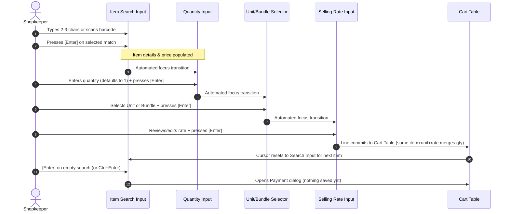

# UI Low-Level Design (LLD): Book Keeper
**System:** Offline-First Retail Accounting & Inventory Management Desktop Application  
**Target Environment:** Windows Desktop (Tauri v2 + React 19 + TypeScript + Tailwind CSS)  
**Parent Documents:** [High-Level Design (HLD)](book_keeper_HLD.md) | [UI/UX Specification](book_keeper_UI_UX_Specification.md) | [Backend LLD](book_keeper_LLD.md) | [Design Decisions](DESIGN_DECISIONS.md)  
**Status:** Approved Low-Level Design Baseline (rev. 2026-11-21 alignment)  

---

## 1. Executive Summary & Architectural Decisions

This document details the Low-Level Design (LLD) for the Book Keeper user interface. In accordance with architectural decisions:
1. **Component-First Methodology:** All reusable base primitives (atoms), retail molecules, and domain organisms are engineered and styled prior to page assembly.
2. **Custom Lightweight Components:** Zero reliance on heavy third-party UI component libraries; all primitives are custom-built with React, TypeScript, Tailwind CSS, and Lucide Icons for high rendering velocity and tight keyboard ergonomics.
3. **Dual Theme Architecture (Light & Dark Modes from Day 1):** Built on Tailwind's `class` dark mode strategy with high-contrast slate/zinc neutrals, maintaining crisp legibility in both bright shop environments and low-light evening counters.
4. **Mock Data Abstraction Layer:** Complete decoupling of the UI from Tauri IPC via a typed `ApiClient` interface, enabling immediate in-browser development (`npm run dev`) and UI testing against seeded retail stationery datasets.
5. **Strict Keyboard Ergonomics:** Global hotkey management (`F1`–`F6`, `Ctrl+F`, `Alt+B`, `Alt+C`, `Alt+V`, `Ctrl+B`, `Ctrl+Enter`, `Esc`) and automated sequential focus looping for rapid counter billing.
6. **Single IPC Boundary:** Frontend types are camelCase; `src/api/ipc.ts` (`invokeCmd`) is the only place that converts to/from the backend's snake_case. The mock client implements the same business rules as the backend (status cross-check, aggregate stock check, ledger, return guards) so UI behaviour is identical in both modes.

---

## 2. Directory & Modular Code Structure

```text
src/
├── api/                             # Abstract API Layer & IPC Bridge
│   ├── client.ts                    # Unified ApiClient interface
│   ├── index.ts                     # Runtime factory (returns Mock or Tauri client)
│   ├── mock/                        # Mock API Implementation & Seed Datasets
│   │   ├── seedData.ts              # 160+ stationery items, parties, lots, bills
│   │   └── mockClient.ts            # In-memory reactive state implementation
│   └── tauri/                       # Native Tauri v2 IPC Implementation
│       └── tauriClient.ts           # invoke() wrappers matching Rust commands
│
├── types/                           # Shared Domain & API TypeScript Contracts
│   ├── domain.ts                    # Item, Bundle, Party, Transaction models
│   ├── api.ts                       # Payloads, Filter query DTOs, Responses
│   └── theme.ts                     # Theme and layout types
│
├── styles/                          # Global Styles & Design Tokens
│   ├── index.css                    # Tailwind directives & CSS custom variables
│   └── tokens.ts                    # Semantic constants (colors, hotkey codes)
│
├── hooks/                           # Custom React Hooks
│   ├── useGlobalHotkeys.ts          # Desktop-wide shortcut listener
│   ├── useSequentialFocus.ts        # Focus-ring engine for billing row
│   ├── useTheme.ts                  # Light/Dark mode state & persistence
│   └── useDebounce.ts               # Search typeahead debounce helper
│
├── store/                           # Global Client State (Zustand)
│   ├── useThemeStore.ts             # Theme mode ('light' | 'dark')
│   ├── useAppStore.ts               # Shop profile, live drawer, active route
│   └── useCartStore.ts              # Active sale/purchase bill drafts
│
├── components/
│   ├── ui/                          # Tier 1: Base UI Primitives (Atoms)
│   │   ├── Button.tsx               # Primary, secondary, ghost, hotkey pill
│   │   ├── TextInput.tsx            # Clearable, autoSelectOnFocus, error state
│   │   ├── NumericInput.tsx         # Precision digits, min/max limits
│   │   ├── Select.tsx               # Accessible keyboard dropdown
│   │   ├── Combobox.tsx             # Filterable typeahead combobox
│   │   ├── Badge.tsx                # Semantic status badges
│   │   ├── Modal.tsx                # Accessible dialog with backdrop & trap
│   │   ├── Drawer.tsx               # Slide-over inspector panel
│   │   ├── Table.tsx                # Dense desktop table primitives
│   │   ├── Card.tsx                 # Bordered desktop surface container
│   │   ├── Tabs.tsx                 # Tab list & panels
│   │   └── Tooltip.tsx              # Lightweight hover tooltip
│   │
│   ├── common/                      # Tier 2: Business & Retail Molecules
│   │   ├── CurrencyDisplay.tsx      # ₹ format (en-IN), tabular-nums, color modes
│   │   ├── QuantityInput.tsx        # Base unit badge & bundle multiplier preview
│   │   ├── StockStatusBadge.tsx     # Healthy, Low (< 5), Out of stock
│   │   ├── PaymentStatusBadge.tsx   # PAID, PARTIAL, UNPAID badges
│   │   ├── HotkeyBadge.tsx          # Key styling ([Enter], [F2], [Alt+B])
│   │   ├── DateRangePicker.tsx      # Quick presets (Today, 7D, Month, Year)
│   │   └── ConfirmDialog.tsx        # Standard confirmation modal
│   │
│   ├── domain/                      # Tier 3: Complex Organisms & Engines
│   │   ├── RapidBillingRow.tsx      # Sequential focus counter billing row
│   │   ├── CartTable.tsx            # Bill line-items table with delete shortcut
│   │   ├── SaleSummaryModal.tsx     # Pre-commit payment dialog + post-commit result view
│   │   ├── BundleCreationModal.tsx  # Dynamic packaging suggestions & multiplier
│   │   ├── ItemSearchTypeahead.tsx  # FTS5 instant search dropdown
│   │   ├── PartySelector.tsx        # Customer/Vendor select with balance pill
│   │   ├── SettlementModal.tsx      # FIFO bill payment clearing modal
│   │   ├── StockAdjustmentModal.tsx # Damaged/expired stock write-off modal
│   │   └── DataTable.tsx            # Generic table with search, filter & pagination
│   │
│   └── layout/                      # Global Desktop Shell
│       ├── AppShell.tsx             # Master desktop container
│       ├── Header.tsx               # Shop title, Date, Live Drawer, DB state
│       ├── Sidebar.tsx              # Navigation with F1-F6 key badges
│       └── HotkeyBar.tsx            # Contextual bottom shortcut legend
│
└── pages/                           # Tier 4: Page Views
    ├── DashboardPage.tsx            # F1: KPI Ribbon, Trend Graph, Low Stock Pane
    ├── NewSalePage.tsx              # F2: Rapid Counter Billing & Cart
    ├── NewPurchasePage.tsx          # F3: Inward Stock Batch Entry
    ├── InventoryPage.tsx            # F6: Item Master, Lot Inspector & Bundles
    ├── CreditDuesPage.tsx           # Khata Ledger (Customer & Vendor Dues)
    ├── SalesHistoryPage.tsx         # Invoice Audit Log & Returns
    ├── PurchaseHistoryPage.tsx      # Inward Lots Audit Log
    ├── ReturnsAdjustmentsPage.tsx   # Customer/Vendor Returns & Corrections
    ├── ReportsPage.tsx              # P&L, Inventory Valuation, Cash Flow
    ├── PartiesPage.tsx              # Customer & Supplier Directory
    └── SettingsPage.tsx             # Shop Profile, Backup to USB, Integrity
    # (Items import dialog lives on InventoryPage; MigrationPage / VedBill deferred to v2 and removed)
```

---

## 3. Design System & Styling Architecture (Light & Dark Mode)

### 3.1 Design Principles for Retail Desktop
1. **Compact Retail Density:** Default padding of `py-1.5 px-3`, compact font sizing (`text-sm`, `text-xs`), and tight margins to maximize on-screen transaction visibility.
2. **Tabular Numerics:** All currency, quantities, and timestamps enforce `tabular-nums font-mono` to prevent jitter during real-time updates and maintain vertical alignment in tables.
3. **High-Contrast Dark Mode:** Avoiding pitch-black backgrounds; using rich slate/zinc layers (`slate-950` shell, `slate-900` surfaces, `slate-800` borders) for eye comfort during long shifts.

### 3.2 Semantic Color Tokens Across Themes

| Semantic Token | Light Mode | Dark Mode | Retail Meaning |
| :--- | :--- | :--- | :--- |
| **Shell Background** | `bg-slate-100` | `bg-slate-950` | Desktop canvas background |
| **Surface / Card** | `bg-white` | `bg-slate-900` | Panels, tables, modal bodies |
| **Border / Divider** | `border-slate-200` | `border-slate-800` | Crisp container dividers |
| **Primary Text** | `text-slate-900` | `text-slate-100` | Product names, headings |
| **Muted Text** | `text-slate-500` | `text-slate-400` | Labels, categories, units |
| **Accent / Focus** | `blue-600 / ring-blue-500`| `blue-500 / ring-blue-400`| Active input focus & primary CTA |
| **Status: Success** | `bg-emerald-50 text-emerald-700 border-emerald-200` | `bg-emerald-950/60 text-emerald-300 border-emerald-800` | `PAID`, healthy stock, cash inflow |
| **Status: Warning** | `bg-amber-50 text-amber-700 border-amber-200` | `bg-amber-950/60 text-amber-300 border-amber-800` | `PARTIAL`, low stock (`< 5`), due alerts |
| **Status: Danger** | `bg-rose-50 text-rose-700 border-rose-200` | `bg-rose-950/60 text-rose-300 border-rose-800` | `UNPAID`, out of stock, cash outflow |

---

## 4. Keyboard Navigation & Sequential Focus Engine

### 4.1 Global Hotkey Engine (`useGlobalHotkeys`)
* Intercepts `keydown` events at the `window` level.
* Prevents collision when focused inside inputs, unless the shortcut uses `Alt`, `Ctrl`, or is an explicit function key (`F1`–`F6`).
* Global registry mapping:
  - `F1`: Navigate to Dashboard
  - `F2`: Navigate to New Sale (auto-focuses Item Search)
  - `F3`: Navigate to New Purchase
  - `F4` / `Ctrl + F`: Open Global Item Stock & Rate Lookup popover
  - `F5`: Navigate to Credit & Dues (Khata Ledger & Settle Modal)
  - `F6`: Navigate to Inventory Master
  - `Ctrl + B`: Open Backup utility in Settings
  - `Alt + B`: New bundle (billing/purchase unit selector context)
  - `Alt + C` / `Alt + V`: Inline new Customer / Vendor (sale / purchase screens)
  - `Ctrl + Enter`: Complete bill (opens payment dialog on sale; records purchase on purchase screen)
  - `Esc`: Close any active modal dialog or dismiss popovers; on the payment dialog, back to the cart without saving
* No other global shortcuts exist; `HotkeyBar` and `Sidebar` badges render from this single registry.

### 4.2 Counter Billing Sequential Focus Engine (`useSequentialFocus`)
The rapid counter billing workflow operates via an explicit ref cycle:



* **Inline Packaging Shortcut (`Alt + B`):** While focused on the Bundle selector, pressing `Alt + B` immediately opens `BundleCreationModal` without abandoning the current transaction; the new bundle is auto-selected and its price pre-fills Rate.
* **Complete Bill (`Enter` on empty search or `Ctrl + Enter`):** opens `SaleSummaryModal` in **payment** mode. Only on `Enter` inside that dialog is `createSale` invoked. Disabled when the cart is empty.
* **Unit default:** base unit, or the unit last used for that item in the current session.

---

## 5. Component Taxonomy & TypeScript Interface Specifications

### 5.1 Tier 1: Base UI Primitives (`src/components/ui/`)

#### 1. `Button`
```typescript
interface ButtonProps extends React.ButtonHTMLAttributes<HTMLButtonElement> {
  variant?: 'primary' | 'secondary' | 'outline' | 'ghost' | 'danger';
  size?: 'xs' | 'sm' | 'md' | 'lg';
  hotkey?: string;                     // e.g. "F2", "Ctrl+Enter", "Esc"
  isLoading?: boolean;
  leftIcon?: React.ReactNode;
  rightIcon?: React.ReactNode;
}
```
* **Behaviors:** Accessible focus ring, dark mode variants, automatically renders `<HotkeyBadge>` in the button's right accessory slot when `hotkey` is provided.

#### 2. `TextInput` & `NumericInput`
```typescript
interface TextInputProps extends React.InputHTMLAttributes<HTMLInputElement> {
  label?: string;
  error?: string;
  autoSelectOnFocus?: boolean;         // When true, select() on focus for fast replacement
  prefixIcon?: React.ReactNode;
  suffixAction?: React.ReactNode;      // Clear button or hotkey badge
}

interface NumericInputProps extends Omit<TextInputProps, 'onChange'> {
  value: number;
  onChange: (val: number) => void;
  allowDecimals?: boolean;
  min?: number;
  max?: number;
}
```

#### 3. `Select` & `Combobox`
```typescript
interface ComboboxOption<T = string | number> {
  value: T;
  label: string;
  sublabel?: string;
  badge?: React.ReactNode;
}

interface ComboboxProps<T> {
  options: ComboboxOption<T>[];
  value: T | null;
  onChange: (value: T) => void;
  placeholder?: string;
  onSearchChange?: (query: string) => void;
  renderOption?: (option: ComboboxOption<T>) => React.ReactNode;
}
```

#### 4. `Modal` & `Drawer`
```typescript
interface ModalProps {
  isOpen: boolean;
  onClose: () => void;
  title: string;
  description?: string;
  children: React.ReactNode;
  footer?: React.ReactNode;
  size?: 'sm' | 'md' | 'lg' | 'xl' | 'full';
  defaultConfirmAction?: () => void;   // Triggered on Enter if focused outside inputs
}
```
* **Behaviors:** Built-in portal rendering, `Escape` key listener, focus trap returning to previous active element on close.

#### 5. `Table`
```typescript
// Compound desktop table components:
// <Table dense>
//   <TableHeader><TableRow><TableHead align="left">Name</TableHead></TableRow></TableHeader>
//   <TableBody><TableRow><TableCell align="right font-mono">₹120.00</TableCell></TableRow></TableBody>
// </Table>
```

---

### 5.2 Tier 2: Specialized Retail Molecules (`src/components/common/`)

#### 1. `CurrencyDisplay`
```typescript
interface CurrencyDisplayProps {
  amount: number;
  currencySymbol?: string;             // Defaults to '₹'
  size?: 'sm' | 'md' | 'lg' | 'xl' | 'hero';
  colored?: boolean;                   // Green for positive, Red for negative
  showSign?: boolean;
  className?: string;
}
```
* **Formatting:** Uses `Intl.NumberFormat('en-IN', { minimumFractionDigits: 2 })` combined with `tabular-nums font-mono`.

#### 2. `QuantityInput`
```typescript
interface QuantityInputProps {
  quantity: number;
  onChange: (qty: number) => void;
  baseUnit: string;                    // e.g. "PCS"
  unitsPerBundle?: number;             // e.g. 10 (multiplier)
  bundleName?: string;                 // e.g. "Box"
  maxStock?: number;                   // Available stock for validation
}
```
* Displays live multiplier hint: `E.g., 2 Boxes × 10 = 20 PCS`.

#### 3. `StockStatusBadge`
```typescript
interface StockStatusBadgeProps {
  currentStock: number;
  isLowStock: boolean;                 // strictly < 5 base units
  baseUnit: string;
}
```
* Status:
  - `currentStock === 0`: Danger badge (`Out of Stock`)
  - `isLowStock === true`: Warning badge (`Low Stock: {currentStock} {unit}`)
  - Normal: Emerald badge (`{currentStock} {unit}`)

#### 4. `PaymentStatusBadge`
```typescript
interface PaymentStatusBadgeProps {
  status: 'PAID' | 'PARTIAL' | 'UNPAID';
  balanceDue?: number;
}
```

---

### 5.3 Tier 3: Domain Organisms (`src/components/domain/`)

#### 1. `RapidBillingRow`
* Sequential focus container holding:
  1. `ItemSearchTypeahead` (input ref #1)
  2. `StockIndicatorPill` (visual readout of selected item)
  3. `NumericInput` for Quantity (input ref #2, default `1`)
  4. `Select` for Unit/Bundle (input ref #3, `Alt+B` listener)
  5. `NumericInput` for Rate (input ref #4)
  6. `Button` for Add Item (`Enter` trigger)
* Validates stock before appending: `existing cart base qty for this item + new base qty <= available` (aggregate across lines, base units, EPS 1e-9). Shows the inline Negative Stock Alert and keeps focus on Qty when it fails. Purchase screen skips this check.
* Rejects qty ≤ 0 and rate < 0.

#### 2. `SaleSummaryModal` (Payment dialog → Result view)
* **Payment mode** (opened before anything is saved):
  - Prominent **Grand Total (₹)** in hero typography (`text-3xl font-bold font-mono`).
  - Status selector `PAID` (default) / `PARTIAL` / `UNPAID`; `PARTIAL`/`UNPAID` require a selected customer (inline `Alt + C` to create one).
  - Auto-focused **Cash Received (₹)** numeric input (prefilled with total for PAID; disabled and 0 for UNPAID).
  - Live calculation: $\text{Change} = \max(0, \text{Cash} - \text{Total})$ for PAID; $\text{Balance Due} = \text{Total} - \text{Cash}$ for PARTIAL.
  - Validation mirrors the backend cross-check (PAID ⇒ cash ≥ total; PARTIAL ⇒ 0 < cash < total). Color-coded: Emerald when valid, Rose otherwise.
  - `Enter` invokes `createSale({ paymentStatus, paidAmount: cash, … })`; errors (e.g. stock changed) are shown inline and the dialog stays in payment mode. `Esc` returns to the cart with nothing saved.
* **Result mode** (after success): bill code, customer, total, paid, balance due, change (from `SaleSummaryResponse`). `Enter` or `Space` closes, resets the bill, refreshes the next sale code, and focuses Item Search.

#### 3. `BundleCreationModal`
* Triggered from billing unit selector via `Alt + B` or from Item Master.
* Features **dynamic self-learning packaging suggestions** querying historical `(bundle_name, units_per_bundle)` pairs:
  - As the user types `B...`, suggestions appear: `Box (10 units)`, `Box (20 units)`, `Box (50 units)`.
  - Selecting an option auto-fills both name and multiplier.
  - Validates name non-empty, multiplier > 1, prices ≥ 0.
  - Commits to SQLite `ITEM_BUNDLE` via API and auto-selects in the calling line item.
  - In Item Master the same modal edits an existing bundle (`updateBundle`); delete calls `deleteBundle` and shows the backend's rejection if the bundle is referenced by any bill.

#### 4. `SettlementModal`
* Two entry modes: **party FIFO** (from Credit & Dues; lists the party's open bills oldest first and previews how the amount will be split) and **single bill** (from Sales/Purchase History `[Record Settlement]`; `transactionId` set).
* Amount must be > 0 and ≤ outstanding (party total or bill balance); date defaults to today.

#### 5. `StockAdjustmentModal`
* Fields: item search, Adjustment Date (default today), Quantity (± base units, non-zero), Reason (`DAMAGED`, `EXPIRED`, `THEFT_LOST`, `COUNT_CORRECTION`), Unit Cost (shown only for positive quantity; required when the item has no lot history — detected via `getItemLots`), Notes.
* Negative quantity validated against current stock before submit.

#### 6. Returns forms (`ReturnsAdjustmentsPage`)
* **Customer tab:** pick a bill (search by code / customer) or choose "No receipt". Linked mode lists the bill's lines with `sold`, `already returned`, `returnable` and pre-filled rate (editable down only). Per line: qty, condition. Settlement: `REFUND` (shows the preview "₹X credited to dues, ₹Y cash to hand back") or `REPLACEMENT` (linked only; pick replacement qty per returned item, ≤ returned, stock-checked). Unlinked mode: item search, qty, rate, condition, unit cost when the item has no lot history; party optional.
* **Vendor tab:** pick a purchase bill or vendor; lines show `PURCHASE`-source lots (`getItemLots`) with remaining qty; per line qty ≤ remaining, or "FIFO" when no lot chosen. Preview of credit vs cash received.
* Result toast shows `returnCode`, `creditedAmount`, `cashRefunded`.

---

## 6. Mock API & Data Abstraction Layer

To enable rapid UI development and visual verification without compiling Rust during front-end styling:

### 6.1 Unified `ApiClient` Interface
```typescript
export interface ApiClient {
  // Dashboard
  getDashboardMetrics(): Promise<DashboardMetrics>;
  getLowStockAlerts(): Promise<LowStockItem[]>;
  getSalesPurchaseTrend(period: '7d' | '30d' | '1y'): Promise<TrendDataPoint[]>;
  getRecentTransactions(limit: number): Promise<RecentTransaction[]>;

  // Sales
  getNextSaleCode(): Promise<string>;
  createSale(payload: CreateSalePayload): Promise<SaleSummaryResponse>;
  getSalesHistory(filter: SalesHistoryFilter): Promise<PaginatedResponse<SaleHistoryRow>>;
  getSaleDetails(saleId: number): Promise<SaleDetailResponse>;

  // Purchases
  getNextPurchaseCode(): Promise<string>;
  createPurchase(payload: CreatePurchasePayload): Promise<{ purchaseId: number; transactionCode: string }>;
  getPurchasesHistory(filter: PurchaseHistoryFilter): Promise<PaginatedResponse<PurchaseHistoryRow>>;
  getPurchaseDetails(purchaseId: number): Promise<PurchaseDetailResponse>;

  // Inventory & Typeahead
  searchItemsFts(query: string, limit?: number): Promise<ItemSearchResult[]>;
  getItemsCatalog(filter: ItemCatalogFilter): Promise<PaginatedResponse<ItemSearchResult>>;
  createItem(payload: CreateItemPayload): Promise<number>;            // item id
  updateItem(itemId: number, payload: UpdateItemPayload): Promise<void>;
  getItemLots(itemId: number): Promise<ItemLot[]>;
  getBundleSuggestions(): Promise<BundleSuggestion[]>;
  createBundle(payload: CreateBundlePayload): Promise<number>;        // bundle id
  updateBundle(bundleId: number, payload: UpdateBundlePayload): Promise<void>;
  deleteBundle(bundleId: number): Promise<void>;
  validateItemsImport(filePath: string): Promise<ImportValidationReport>;
  executeItemsImport(filePath: string, strategy: 'SKIP' | 'OVERWRITE' | 'ADD_STOCK'): Promise<ImportSummary>;

  // Credit & Dues
  getPartyDuesSummary(partyType: 'CUSTOMER' | 'VENDOR'): Promise<PartyDueSummary[]>;
  settleBillPayment(payload: SettlePaymentPayload): Promise<SettlementResult>;
  getPartyLedger(partyId: number): Promise<PartyLedgerView>;

  // Parties & Directory
  createParty(payload: CreatePartyPayload): Promise<number>;          // party id
  updateParty(partyId: number, payload: UpdatePartyPayload): Promise<void>;
  getParty(partyId: number): Promise<Party>;
  listParties(partyType?: 'CUSTOMER' | 'VENDOR', activeOnly?: boolean): Promise<PartyListRow[]>;
  searchParties(query: string, partyType?: 'CUSTOMER' | 'VENDOR'): Promise<PartyListRow[]>;

  // Returns & Adjustments
  getNextReturnCode(): Promise<string>;
  createCustomerReturn(payload: CustomerReturnPayload): Promise<ReturnResult>;
  createVendorReturn(payload: VendorReturnPayload): Promise<ReturnResult>;
  listReturns(filter: ReturnsFilter): Promise<PaginatedResponse<ReturnTransaction>>;
  getReturnDetails(returnId: number): Promise<ReturnDetailResponse>;
  createStockAdjustment(payload: StockAdjustmentPayload): Promise<{ adjustmentId: number; lossValue: number }>;
  listStockAdjustments(itemId?: number, page?: number, limit?: number): Promise<PaginatedResponse<StockAdjustment>>;

  // Reports & Settings
  getPnLReport(fromDate: string, toDate: string): Promise<PnLReport>;
  getStockValuationReport(): Promise<StockValuationReport>;
  getCashFlowReport(fromDate: string, toDate: string): Promise<CashFlowReport>;
  backupDatabase(destinationPath: string): Promise<string>;
  verifyDatabaseIntegrity(): Promise<boolean>;
  getShopSettings(): Promise<ShopSettings>;
  updateShopSettings(settings: ShopSettings): Promise<void>;
}
```
* Method names map 1:1 to the HLD §9.3 command catalog (camelCase ↔ snake_case). Shapes follow the HLD/LLD DTOs with camelCase keys. No method exists for deferred features (archive, exports, VedBill, parties import, restore).
* Errors: `invokeCmd` rejects with a typed `AppError` (`{ type, details }` per LLD §10.1); pages show `details.message` inline (validation) or as a toast.

### 6.2 Seed Dataset Profile
The `MockApiClient` provides realistic stationery shop data matching forensic findings from actual retail databases:
* 160+ items across categories (Notebooks, Pens, Adhesives, Files, Geometry, Paper).
* Items seeded with low stock (`< 5`) to test the Dashboard widget.
* Items with pre-configured packaging bundles (e.g., *Classmate Notebook: Pack of 6*, *Apsara Pencils: Box of 10*).
* Customer credit accounts with active dues for Khata settlement testing.
* Simulates network latency (30ms–50ms) to verify loading states.

---

## 7. Data Fetching & Async State Management

### 7.1 Strategy
All IPC calls are asynchronous. The UI uses a lightweight custom hook pattern for data fetching to manage loading, error, and success states consistently across all pages:

```typescript
// hooks/useAsync.ts
interface AsyncState<T> {
  data: T | null;
  isLoading: boolean;
  error: string | null;
  refetch: () => void;
}

function useAsync<T>(fetcher: () => Promise<T>, deps?: any[]): AsyncState<T>;
```

### 7.2 Conventions
1. **Loading States:** Every data-dependent component shows a compact inline skeleton or spinner during initial load. No full-page loading screens — the shell and navigation remain interactive.
2. **Error Boundaries:** A global `ErrorBoundary` component wraps the main workspace area. Unrecoverable render errors display a recoverable error card with a retry button. API errors are caught per-call and displayed as inline error messages or toast notifications.
3. **Optimistic Updates:** For high-frequency actions (adding items to cart, adjusting quantities), state is updated optimistically in the local Zustand store and reconciled after the IPC call resolves.
4. **Stale-While-Revalidate:** Dashboard KPIs and low-stock alerts use a SWR pattern — cached data is displayed immediately while a background refetch runs. This ensures the dashboard loads in < 50ms on subsequent visits.
5. **Debounced Search:** The `useDebounce` hook (50ms default) prevents excessive FTS5 IPC calls during rapid typing in the item search typeahead.

---

## 8. UI Implementation Roadmap (Execution Sequence)

```mermaid
gantt
    title Book Keeper UI Implementation Phases
    dateFormat  X
    axisFormat  Phase %s

    section Phase 1
    Setup, Tailwind Config, Tokens, Dark Mode Store :0, 1
    section Phase 2
    Domain Types, Mock Seed Data & MockApiClient :1, 2
    section Phase 3
    Tier 1 Base Primitives (Button, Input, Modal, Table) :2, 3
    section Phase 4
    Tier 2 Retail Molecules & Keyboard Hooks :3, 4
    section Phase 5
    Tier 3 Organisms (Shell, BillingRow, SummaryModal) :4, 5
    section Phase 6
    Tier 4 Page Assembly (12 Pages) :5, 6
    section Phase 7
    Tauri IPC Integration & Final Polish :6, 7
```



* **Step 1:** Initialize repository structure (`src/`, `components/`, `styles/`, `types/`, `api/`).
* **Step 2:** Configure Tailwind CSS with dual-theme (`class` mode), color tokens, and font settings.
* **Step 3:** Implement mock data provider and TypeScript contracts.
* **Step 4:** Build Tier 1 base primitives (`Button`, `TextInput`, `Select`, `Badge`, `Modal`, `Table`).
* **Step 5:** Build Tier 2 molecules (`CurrencyDisplay`, `QuantityInput`, `StockStatusBadge`, `PaymentStatusBadge`, hotkey hooks).
* **Step 6:** Build Tier 3 organisms (`AppShell`, `RapidBillingRow`, `CartTable`, `SaleSummaryModal`, `BundleCreationModal`, `SettlementModal`).
* **Step 7:** Assemble the 12 pages in priority order:
  1. `NewSalePage` (High-speed counter billing)
  2. `DashboardPage` (Command cockpit & low-stock widget)
  3. `NewPurchasePage` (Inward FIFO batch entry)
  4. `InventoryPage` (Catalog & lot inspector)
  5. `CreditDuesPage` (Khata ledger & settlements)
  6. `SalesHistoryPage` & `PurchaseHistoryPage`
  7. `ReturnsAdjustmentsPage`
  8. `ReportsPage` & `PartiesPage`
  9. `SettingsPage` (+ items import dialog on `InventoryPage`)
* **Step 8:** Connect Tauri v2 `invoke()` commands and verify production builds.
