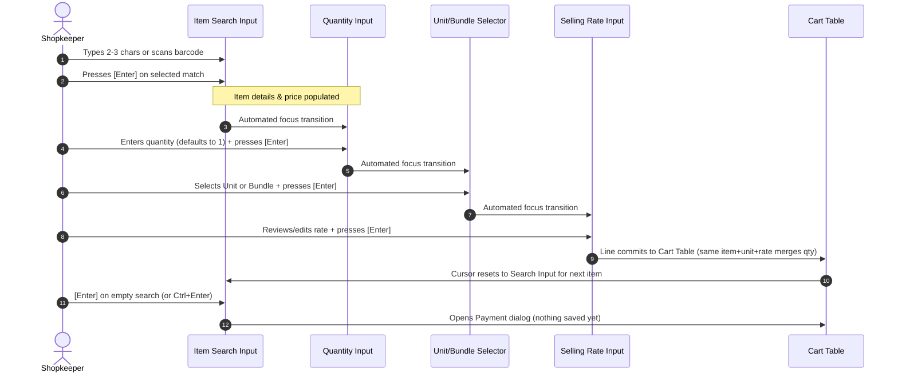

# UI Low-Level Design (LLD): Book Keeper
**System:** Offline-First Retail Accounting & Inventory Management Desktop Application  
**Target Environment:** Windows Desktop (Tauri v2 + React 19 + TypeScript + Tailwind CSS)  
**Parent Documents:** [High-Level Design (HLD)](book_keeper_HLD.md) | [UI/UX Specification](book_keeper_UI_UX_Specification.md) | [Backend LLD](book_keeper_LLD.md) | [Design Decisions](DESIGN_DECISIONS.md)  
**Status:** Approved Low-Level Design Baseline (rev. 2026-11-21 alignment)  

---

## 1. Executive Summary & Architectural Decisions

This document details the Low-Level Design (LLD) for the Book Keeper user interface. In accordance with architectural decisions:
1. **Component-First Methodology:** All reusable base primitives (atoms), retail molecules, and domain organisms are engineered and styled prior to page assembly.
2. **Custom Lightweight Components:** Zero reliance on heavy third-party UI component libraries; all primitives are custom-built with React, TypeScript, Tailwind CSS, and Lucide Icons for high rendering velocity and tight keyboard ergonomics.
3. **Dual Theme Architecture (Light & Dark Modes from Day 1):** Built on Tailwind's `class` dark mode strategy with high-contrast slate/zinc neutrals, maintaining crisp legibility in both bright shop environments and low-light evening counters.
4. **Mock Data Abstraction Layer (thin fixtures, DD-27):** Complete decoupling of the UI from Tauri IPC via a typed `ApiClient` interface, enabling immediate in-browser development (`npm run dev`) and UI testing against seeded retail stationery datasets.
5. **Strict Keyboard Ergonomics:** Global hotkey management (`F1`–`F6`, `Ctrl+F`, `Alt+B`, `Alt+C`, `Alt+V`, `Ctrl+B`, `Ctrl+Enter`, `Esc`) and automated sequential focus looping for rapid counter billing.
6. **Single IPC Boundary:** Frontend types are camelCase; `src/api/ipc.ts` (`invokeCmd`) is the only place that converts to/from the backend's snake_case. The mock client is a thin fixture provider for UI work (DD-27): it serves seed data and matches the IPC contract shapes, but does not re-implement business rules; behaviour is verified against the Rust backend.

---

## 2. Directory & Modular Code Structure

```text
src/
├── api/                             # Abstract API Layer & IPC Bridge
│   ├── client.ts                    # Unified ApiClient interface
│   ├── index.ts                     # Runtime factory (returns Mock or Tauri client)
│   ├── mock/                        # Mock API Implementation & Seed Datasets
│   │   ├── seedData.ts              # 160+ stationery items, parties, lots, bills
│   │   └── mockClient.ts            # In-memory reactive state implementation
│   └── tauri/                       # Native Tauri v2 IPC Implementation
│       └── tauriClient.ts           # invoke() wrappers matching Rust commands
│
├── types/                           # Shared Domain & API TypeScript Contracts
│   ├── domain.ts                    # Item, Bundle, Party, Transaction models
│   ├── api.ts                       # Payloads, Filter query DTOs, Responses
│   └── theme.ts                     # Theme and layout types
│
├── styles/                          # Global Styles & Design Tokens
│   ├── index.css                    # Tailwind directives & CSS custom variables
│   └── tokens.ts                    # Semantic constants (colors, hotkey codes)
│
├── hooks/                           # Custom React Hooks
│   ├── useGlobalHotkeys.ts          # Desktop-wide shortcut listener
│   ├── useSequentialFocus.ts        # Focus-ring engine for billing row
│   ├── useTheme.ts                  # Light/Dark mode state & persistence
│   └── useDebounce.ts               # Search typeahead debounce helper
│
├── store/                           # Global Client State (Zustand)
│   ├── useThemeStore.ts             # Theme mode ('light' | 'dark')
│   ├── useAppStore.ts               # Shop profile, live drawer, active route
│   └── useCartStore.ts              # Active sale/purchase bill drafts
│
├── components/
│   ├── ui/                          # Tier 1: Base UI Primitives (Atoms)
│   │   ├── Button.tsx               # Primary, secondary, ghost, hotkey pill
│   │   ├── TextInput.tsx            # Clearable, autoSelectOnFocus, error state
│   │   ├── NumericInput.tsx         # Precision digits, min/max limits
│   │   ├── Select.tsx               # Accessible keyboard dropdown
│   │   ├── Combobox.tsx             # Filterable typeahead combobox
│   │   ├── Badge.tsx                # Semantic status badges
│   │   ├── Modal.tsx                # Accessible dialog with backdrop & trap
│   │   ├── Drawer.tsx               # Slide-over inspector panel
│   │   ├── Table.tsx                # Dense desktop table primitives (sticky header, scroll modes)
│   │   ├── Card.tsx                 # Bordered desktop surface container
│   │   ├── Tabs.tsx                 # Tab list & panels
│   │   └── Tooltip.tsx              # Lightweight hover tooltip
│   │
│   ├── common/                      # Tier 2: Business & Retail Molecules
│   │   ├── CurrencyDisplay.tsx      # ₹ format (en-IN), tabular-nums, color modes
│   │   ├── QuantityInput.tsx        # Base unit badge & bundle multiplier preview
│   │   ├── StockStatusBadge.tsx     # Healthy, Low (< 5), Out of stock
│   │   ├── PaymentStatusBadge.tsx   # PAID, PARTIAL, UNPAID badges
│   │   ├── HotkeyBadge.tsx          # Key styling ([Enter], [F2], [Alt+B])
│   │   ├── DateRangePicker.tsx      # Quick presets (Today, 7D, Month, Year)
│   │   └── ConfirmDialog.tsx        # Standard confirmation modal
│   │
│   ├── domain/                      # Tier 3: Complex Organisms & Engines
│   │   ├── RapidBillingRow.tsx      # Sequential focus counter billing row
│   │   ├── CartTable.tsx            # Bill line-items table with delete shortcut
│   │   ├── SaleSummaryModal.tsx     # Pre-commit payment dialog + post-commit result view
│   │   ├── BundleCreationModal.tsx  # Dynamic packaging suggestions & multiplier
│   │   ├── ItemSearchTypeahead.tsx  # FTS5 instant search dropdown
│   │   ├── PartySelector.tsx        # Customer/Vendor select with balance pill
│   │   ├── SettlementModal.tsx      # FIFO bill payment clearing modal
│   │   ├── StockAdjustmentModal.tsx # Damaged/expired stock write-off modal
│   │   ├── SetStockDialog.tsx       # Set stock on hand / add unrecorded stock
│   │   ├── lotCost.ts               # latestLotCost, estimateFifoCost helpers
│   │   └── DataTable.tsx            # Generic table with search, filter & pagination
│   │
│   └── layout/                      # Global Desktop Shell
│       ├── AppShell.tsx             # Master desktop container
│       ├── Header.tsx               # Shop title, Date, Live Drawer, DB state
│       ├── Sidebar.tsx              # Navigation with F1-F6 key badges
│       └── HotkeyBar.tsx            # Contextual bottom shortcut legend
│
└── pages/                           # Tier 4: Page Views
    ├── DashboardPage.tsx            # F1: KPI cards, Recent Transactions, Low Stock Pane
    ├── NewSalePage.tsx              # F2: Rapid Counter Billing & Cart
    ├── NewPurchasePage.tsx          # F3: Inward Stock Batch Entry
    ├── InventoryPage.tsx            # F6: Item Master, Lot Inspector & Bundles
    ├── CreditDuesPage.tsx           # Khata Ledger (Customer & Vendor Dues)
    ├── SalesHistoryPage.tsx         # Invoice Audit Log & Returns
    ├── PurchaseHistoryPage.tsx      # Inward Lots Audit Log
    ├── ReturnsAdjustmentsPage.tsx   # Customer/Vendor Returns & Corrections
    ├── ReportsPage.tsx              # P&L, Inventory Valuation, Cash Flow
    ├── PartiesPage.tsx              # Customer & Supplier Directory
    └── SettingsPage.tsx             # Shop Profile, Backup to USB, Integrity
    # (Items import dialog lives on InventoryPage; MigrationPage / VedBill deferred to v2 and removed)
```

---

## 3. Design System & Styling Architecture (Light & Dark Mode)

### 3.1 Design Principles for Retail Desktop
1. **Compact Retail Density:** Default padding of `py-1.5 px-3`, compact font sizing (`text-sm`, `text-xs`), and tight margins to maximize on-screen transaction visibility.
2. **Tabular Numerics:** All currency, quantities, and timestamps enforce `tabular-nums font-mono` to prevent jitter during real-time updates and maintain vertical alignment in tables.
3. **High-Contrast Dark Mode:** Avoiding pitch-black backgrounds; using rich slate/zinc layers (`slate-950` shell, `slate-900` surfaces, `slate-800` borders) for eye comfort during long shifts.
4. **Sticky table headers (FR-10 rev., DD-43)** come from the shared `Table`; screens do not implement their own.

### 3.2 Semantic Color Tokens Across Themes

| Semantic Token | Light Mode | Dark Mode | Retail Meaning |
| :--- | :--- | :--- | :--- |
| **Shell Background** | `bg-slate-100` | `bg-slate-950` | Desktop canvas background |
| **Surface / Card** | `bg-white` | `bg-slate-900` | Panels, tables, modal bodies |
| **Border / Divider** | `border-slate-200` | `border-slate-800` | Crisp container dividers |
| **Primary Text** | `text-slate-900` | `text-slate-100` | Product names, headings |
| **Muted Text** | `text-slate-500` | `text-slate-400` | Labels, categories, units |
| **Accent / Focus** | `blue-600 / ring-blue-500`| `blue-500 / ring-blue-400`| Active input focus & primary CTA |
| **Status: Success** | `bg-emerald-50 text-emerald-700 border-emerald-200` | `bg-emerald-950/60 text-emerald-300 border-emerald-800` | `PAID`, healthy stock, cash inflow |
| **Status: Warning** | `bg-amber-50 text-amber-700 border-amber-200` | `bg-amber-950/60 text-amber-300 border-amber-800` | `PARTIAL`, low stock (`< 5`), due alerts |
| **Status: Danger** | `bg-rose-50 text-rose-700 border-rose-200` | `bg-rose-950/60 text-rose-300 border-rose-800` | `UNPAID`, out of stock, cash outflow |

---

## 4. Keyboard Navigation & Sequential Focus Engine

### 4.1 Global Hotkey Engine (`useGlobalHotkeys`)
* Intercepts `keydown` events at the `window` level.
* Prevents collision when focused inside inputs, unless the shortcut uses `Alt`, `Ctrl`, or is an explicit function key (`F1`–`F6`).
* Global registry mapping:
  - `F1`: Navigate to Dashboard
  - `F2`: Navigate to New Sale (auto-focuses Item Search)
  - `F3`: Navigate to New Purchase
  - `F4` / `Ctrl + F`: Open Global Item Stock & Rate Lookup popover
  - `F5`: Navigate to Credit & Dues (Khata Ledger & Settle Modal)
  - `F6`: Navigate to Inventory Master
  - `Ctrl + B`: Open Backup utility in Settings
  - `Alt + B`: New bundle (billing/purchase unit selector context)
  - `Alt + C` / `Alt + V`: Inline new Customer / Vendor (sale / purchase screens; the inline form also shows Save / Cancel buttons, FR-22)
  - `Ctrl + Enter`: Complete bill (opens payment dialog on sale; records purchase on purchase screen)
  - `Esc`: Close any active modal dialog or dismiss popovers; on the payment dialog, back to the cart without saving
* No other global shortcuts exist; `HotkeyBar` and `Sidebar` badges render from this single registry.

### 4.2 Counter Billing Sequential Focus Engine (`useSequentialFocus`)
The rapid counter billing workflow operates via an explicit ref cycle:



* **Inline Packaging Shortcut (`Alt + B`):** While focused on the Bundle selector, pressing `Alt + B` immediately opens `BundleCreationModal` without abandoning the current transaction; the new bundle is auto-selected and its price pre-fills Rate.
* **Complete Bill (`Enter` on empty search or `Ctrl + Enter`):** opens `SaleSummaryModal` in **payment** mode. Only on `Enter` inside that dialog is `createSale` invoked. Disabled when the cart is empty.
* **Unit default:** base unit, or the unit last used for that item in the current session.

---

## 5. Component Taxonomy & TypeScript Interface Specifications

### 5.1 Tier 1: Base UI Primitives (`src/components/ui/`)

#### 1. `Button`
```typescript
interface ButtonProps extends React.ButtonHTMLAttributes<HTMLButtonElement> {
  variant?: 'primary' | 'secondary' | 'outline' | 'ghost' | 'danger';
  size?: 'xs' | 'sm' | 'md' | 'lg';
  hotkey?: string;                     // e.g. "F2", "Ctrl+Enter", "Esc"
  isLoading?: boolean;
  leftIcon?: React.ReactNode;
  rightIcon?: React.ReactNode;
}
```
* **Behaviors:** Accessible focus ring, dark mode variants, automatically renders `<HotkeyBadge>` in the button's right accessory slot when `hotkey` is provided.

#### 2. `TextInput` & `NumericInput`
```typescript
interface TextInputProps extends React.InputHTMLAttributes<HTMLInputElement> {
  label?: string;
  error?: string;
  autoSelectOnFocus?: boolean;         // When true, select() on focus for fast replacement
  prefixIcon?: React.ReactNode;
  suffixAction?: React.ReactNode;      // Clear button or hotkey badge
}

interface NumericInputProps extends Omit<TextInputProps, 'onChange'> {
  value: number;
  onChange: (val: number) => void;
  allowDecimals?: boolean;
  min?: number;
  max?: number;
}
```

#### 3. `Select` & `Combobox`
```typescript
interface ComboboxOption<T = string | number> {
  value: T;
  label: string;
  sublabel?: string;
  badge?: React.ReactNode;
}

interface ComboboxProps<T> {
  options: ComboboxOption<T>[];
  value: T | null;
  onChange: (value: T) => void;
  placeholder?: string;
  onSearchChange?: (query: string) => void;
  renderOption?: (option: ComboboxOption<T>) => React.ReactNode;
}
```

#### 4. `Modal` & `Drawer`
```typescript
interface ModalProps {
  isOpen: boolean;
  onClose: () => void;
  title: string;
  description?: string;
  children: React.ReactNode;
  footer?: React.ReactNode;
  size?: 'sm' | 'md' | 'lg' | 'xl' | 'full';
  defaultConfirmAction?: () => void;   // Triggered on Enter if focused outside inputs
}
```
* **Behaviors:** Built-in portal rendering, `Escape` key listener, focus trap returning to previous active element on close.

#### 5. `Table`
```typescript
// Compound desktop table components:
// <Table dense scroll="fill">
//   <TableHeader><TableRow><TableHead align="left">Name</TableHead></TableRow></TableHeader>
//   <TableBody><TableRow><TableCell align="right font-mono">₹120.00</TableCell></TableRow></TableBody>
// </Table>
type TableScroll = 'bounded' | 'fill' | 'page' | 'none';
interface TableProps extends React.TableHTMLAttributes<HTMLTableElement> {
  dense?: boolean;
  scroll?: TableScroll;          // default 'bounded'
  containerClassName?: string;   // extra classes on <div data-table-scroll>
}
```
* The header cells are sticky (`position: sticky; top: 0; z-index: 10`) with an opaque background (`bg-slate-50` / `dark:bg-slate-800`) and a 1px bottom line drawn as an inset box-shadow, because `border-collapse` borders do not travel with sticky cells. (Shipped: `border-collapse` + sticky `th`; row lines stay on `tr`.)
* The four modes:
  * `'bounded'`: the container is `overflow-auto max-h-[60vh]` and scrolls by itself.
  * `'fill'`: `overflow-auto flex-1 min-h-0`; fills a flex-column parent of bounded height. Used by full-page lists.
  * `'page'`: no own scroll box (`overflow-visible`); the header sticks to the nearest scrolling ancestor (drawer or modal body). No horizontal scroll.
  * `'none'`: `overflow-x-auto`, header **not** sticky. Used for tables nested in an expanded row of another table.
* Never put `overflow-*` on an element between `<th>` and `[data-table-scroll]`.
* A full-page list needs the chain: page root `h-full min-h-0 flex flex-col` -> card `flex-1 min-h-[240px] flex flex-col overflow-hidden` -> `Table scroll="fill"`.
* `DataTable` passes `scroll` through and adds no scroll container of its own.
* `ImportItemsDialog` tables keep their own `max-h-44 overflow-auto` box with `sticky top-0` opaque headers (already compliant).

#### 6. `FormActions` (FR-22, DD-44)
```typescript
interface FormActionsProps {
  onSave: () => void;            // click on Save
  onCancel: () => void;          // click on Cancel
  saveLabel?: string;            // default 'Save'
  cancelLabel?: string;          // default 'Cancel'
  isSubmitting?: boolean;        // Save shows spinner + disabled; Cancel disabled
  canSave?: boolean;             // default true; false => Save disabled (required fields empty)
  saveHotkey?: string;           // badge, default 'Enter'
  cancelHotkey?: string;         // badge, default 'Esc'
  size?: 'xs' | 'sm' | 'md';     // default 'sm'
  className?: string;
}
function enterToSubmit(submit: () => void): (e: React.KeyboardEvent) => void;
```
* Renders `<div data-form-actions class="flex items-center justify-end gap-2">` containing Cancel (`variant="outline"`, `type="button"`) and then Save (`variant="primary"`, `type="button"`).
* `enterToSubmit` is attached to the `onKeyDown` of the wrapper around the form fields. Plain Enter or Ctrl+Enter submits.
* It ignores keys when `defaultPrevented`, `repeat`, Shift, or Alt is set, and when the target is a TEXTAREA, SELECT or BUTTON.
* A field marked `data-enter-submit="off"` swallows Enter without submitting. Use this for scanner barcode fields.
* All quick-create forms (new customer/vendor, new bundle, and later new expense type and new charge type) use it.

---

### 5.2 Tier 2: Specialized Retail Molecules (`src/components/common/`)

#### 1. `CurrencyDisplay`
```typescript
interface CurrencyDisplayProps {
  amount: number;
  currencySymbol?: string;             // Defaults to '₹'
  size?: 'sm' | 'md' | 'lg' | 'xl' | 'hero';
  colored?: boolean;                   // Green for positive, Red for negative
  showSign?: boolean;
  className?: string;
}
```
* **Formatting:** Uses `Intl.NumberFormat('en-IN', { minimumFractionDigits: 2 })` combined with `tabular-nums font-mono`.

#### 2. `QuantityInput`
```typescript
interface QuantityInputProps {
  quantity: number;
  onChange: (qty: number) => void;
  baseUnit: string;                    // e.g. "PCS"
  unitsPerBundle?: number;             // e.g. 10 (multiplier)
  bundleName?: string;                 // e.g. "Box"
  maxStock?: number;                   // Available stock for validation
}
```
* Displays live multiplier hint: `E.g., 2 Boxes × 10 = 20 PCS`.

#### 3. `StockStatusBadge`
```typescript
interface StockStatusBadgeProps {
  currentStock: number;
  isLowStock: boolean;                 // strictly < 5 base units
  baseUnit: string;
}
```
* Status:
  - `currentStock === 0`: Danger badge (`Out of Stock`)
  - `isLowStock === true`: Warning badge (`Low Stock: {currentStock} {unit}`)
  - Normal: Emerald badge (`{currentStock} {unit}`)

#### 4. `PaymentStatusBadge`
```typescript
interface PaymentStatusBadgeProps {
  status: 'PAID' | 'PARTIAL' | 'UNPAID';
  balanceDue?: number;
}
```

---

### 5.3 Tier 3: Domain Organisms (`src/components/domain/`)

#### 1. `RapidBillingRow`
* Sequential focus container holding:
  1. `ItemSearchTypeahead` (input ref #1)
  2. `StockIndicatorPill` (visual readout of selected item)
  3. `NumericInput` for Quantity (input ref #2, default `1`)
  4. `Select` for Unit/Bundle (input ref #3, `Alt+B` listener)
  5. `NumericInput` for Rate (input ref #4)
  6. `Button` for Add Item (`Enter` trigger)
* Validates stock before appending: `existing cart base qty for this item + new base qty <= available` (aggregate across lines, base units, EPS 1e-9). Shows the inline Negative Stock Alert and keeps focus on Qty when it fails. Purchase screen skips this check.
* Rejects qty ≤ 0 and rate < 0.

#### 2. `SaleSummaryModal` (Payment dialog → Result view)
* **Payment mode** (opened before anything is saved):
  - Prominent **Grand Total (₹)** in hero typography (`text-3xl font-bold font-mono`).
  - Status selector `PAID` (default) / `PARTIAL` / `UNPAID`; `PARTIAL`/`UNPAID` require a selected customer (inline `Alt + C` to create one).
  - Auto-focused **Cash Received (₹)** numeric input (prefilled with total for PAID; disabled and 0 for UNPAID).
  - Live calculation: $\text{Change} = \max(0, \text{Cash} - \text{Total})$ for PAID; $\text{Balance Due} = \text{Total} - \text{Cash}$ for PARTIAL.
  - Validation mirrors the backend cross-check (PAID ⇒ cash ≥ total; PARTIAL ⇒ 0 < cash < total). Color-coded: Emerald when valid, Rose otherwise.
  - `Enter` invokes `createSale({ paymentStatus, paidAmount: cash, … })`; errors (e.g. stock changed) are shown inline and the dialog stays in payment mode. `Esc` returns to the cart with nothing saved.
* **Result mode** (after success): bill code, customer, total, paid, balance due, change (from `SaleSummaryResponse`). `Enter` or `Space` closes, resets the bill, refreshes the next sale code, and focuses Item Search.

#### 3. `BundleCreationModal`
* Triggered from billing unit selector via `Alt + B` or from Item Master.
* Features **dynamic self-learning packaging suggestions** querying historical `(bundle_name, units_per_bundle)` pairs:
  - As the user types `B...`, suggestions appear: `Box (10 units)`, `Box (20 units)`, `Box (50 units)`.
  - Selecting an option auto-fills both name and multiplier.
  - Validates name non-empty, multiplier > 1, prices ≥ 0.
  - Commits to SQLite `ITEM_BUNDLE` via API and auto-selects in the calling line item.
  - In Item Master the same modal edits an existing bundle (`updateBundle`, any field incl. multiplier); delete calls `deleteBundle` (always allowed). Bills keep their own pack snapshot, so neither affects history.
  - Cart and bill views display lines as `pack_quantity × pack_label = quantity base_unit` when a pack was used (e.g. `2 × Box of 10 = 20 PCS`), else `quantity base_unit`.
* Footer uses `FormActions` (Cancel / Create Bundle). Enter in any field saves, except in Bundle Name while suggestions are open (Enter applies the suggestion) and in Outer Barcode (scanner Enter is ignored). Ctrl+Enter saves anywhere. Esc cancels.

#### 4. `SettlementModal`
* Two entry modes:
  - **Single bill** (`transactionId` set): the `[Settle]` button on every open bill — Sales/Purchase History rows and the party's bill list on Credit & Dues.
  - **On account / lump sum** (`transactionId` null): `[Receive on account]` (customer) / `[Pay on account]` (vendor) on Credit & Dues; lists the party's open bills oldest first and previews how the amount will be split.
* Amount must be > 0 and ≤ outstanding (party total or bill balance); date defaults to today.

#### 5. `StockAdjustmentModal`
* Fields: item search, Adjustment Date (default today), Quantity (± base units, non-zero), Reason (`DAMAGED`, `EXPIRED`, `THEFT_LOST`, `COUNT_CORRECTION`, `UNRECORDED_STOCK` "Unrecorded stock (no purchase)"), Unit Cost (shown only for positive quantity; required when the item has no lot history — detected via `getItemLots`), Notes.
* Negative quantity validated against current stock before submit.
* Picking `UNRECORDED_STOCK` forces the Increase direction; the Decrease direction hides it. An Increase shows the valuation effect `qty x unit cost` (`data-testid="valuation-effect"`). The unit cost prefill is the cost of the lot with the highest `purchaseItemId` (`latestLotCost`, matches the backend).

#### 6. Returns forms (`ReturnsAdjustmentsPage`)
* **Customer tab:** pick a bill (search by code / customer) or choose "No receipt". Linked mode lists the bill's lines with `sold`, `already returned`, `returnable` and pre-filled rate (editable down only). Per line: qty, condition. Settlement: `REFUND` (preview "₹X credited to this bill, ₹Y cash to hand back" — a linked return only credits its own bill) or `REPLACEMENT` (linked only; returned lines keep their condition — Restockable for a colour/size swap, Damaged/Scrap for a defective unit — then an "Issue" list where any item can be searched and added with a qty, stock-checked; a non-blocking warning shows the value difference at default prices; no money step). Unlinked mode: item search, qty, rate, condition, unit cost when the item has no lot history; party optional.
* **Vendor tab:** pick a purchase bill or vendor; lines show `PURCHASE`-source lots (`getItemLots`) with remaining qty; per line qty ≤ remaining, or "FIFO" when no lot chosen. Preview of credit vs cash received.
* Result toast shows `returnCode`, `creditedAmount`, `cashRefunded`.

#### 8. `SetStockDialog`
* Props: `{ isOpen, onClose, item: { itemId, name, currentStock, baseUnit }, onDone(result) }`. Modes: "Set counted stock" (default) and "Add quantity".
* Fields: counted qty (default = current) or add qty; Date (today, max today); Unit cost (shown only when delta > 0; prefilled; "required (no lots yet)" when there are no lots); Notes.
* Preview `data-testid="set-stock-preview"`: delta > 0 "+N unit, Unrecorded stock, Adds X to stock value" (X = N x cost); delta < 0 "-N unit, Count correction, Estimated write-off about Y (oldest lots first)"; delta = 0 "No change".
* Footer: `FormActions` `[Cancel]` and `[Save stock]` (FR-22); Ctrl+Enter saves; Esc cancels; Save disabled when delta = 0.
* Set mode calls `setItemStock`; Add mode calls `createStockAdjustment({reason:'UNRECORDED_STOCK'})`. Result view (`data-testid="set-stock-result"`) shows new stock and value change, with Close.
* Entry points: Item List row action "Set stock" (PHYSICAL items only); Item edit drawer line "Stock on hand: N unit - [Set stock...]".
* ApiClient gains `setItemStock(payload: SetItemStockPayload): Promise<SetItemStockResult>`; the mock is a typed stub with no rules (DD-27).

#### 7. `PartySelector` inline create
* Name + Phone + `FormActions size="xs"` (Cancel / Save). Save is disabled while Name is empty or a create is in flight. Enter saves, Esc and Cancel close and refocus the trigger.

---

## 6. Mock API & Data Abstraction Layer

To enable rapid UI development and visual verification without compiling Rust during front-end styling:

### 6.1 Unified `ApiClient` Interface
```typescript
export interface ApiClient {
  // Dashboard
  getDashboardMetrics(): Promise<DashboardMetrics>;
  getLowStockAlerts(): Promise<LowStockItem[]>;
  getSalesPurchaseTrend(period: '7d' | '30d' | '1y'): Promise<TrendDataPoint[]>;
  getRecentTransactions(limit: number): Promise<RecentTransaction[]>;

  // Sales
  getNextSaleCode(): Promise<string>;
  createSale(payload: CreateSalePayload): Promise<SaleSummaryResponse>;
  getSalesHistory(filter: SalesHistoryFilter): Promise<PaginatedResponse<SaleHistoryRow>>;
  getSaleDetails(saleId: number): Promise<SaleDetailResponse>;

  // Purchases
  getNextPurchaseCode(): Promise<string>;
  createPurchase(payload: CreatePurchasePayload): Promise<{ purchaseId: number; transactionCode: string }>;
  getPurchasesHistory(filter: PurchaseHistoryFilter): Promise<PaginatedResponse<PurchaseHistoryRow>>;
  getPurchaseDetails(purchaseId: number): Promise<PurchaseDetailResponse>;

  // Inventory & Typeahead
  // ItemSearchResult.itemType: 'PHYSICAL' | 'SERVICE'; CreateItemPayload/UpdateItemPayload.itemType?: optional (omitted => PHYSICAL)
  searchItemsFts(query: string, limit?: number): Promise<ItemSearchResult[]>;
  getItemsCatalog(filter: ItemCatalogFilter): Promise<PaginatedResponse<ItemSearchResult>>;
  createItem(payload: CreateItemPayload): Promise<number>;            // item id
  updateItem(itemId: number, payload: UpdateItemPayload): Promise<void>;
  getItemLots(itemId: number): Promise<ItemLot[]>;
  getBundleSuggestions(): Promise<BundleSuggestion[]>;
  createBundle(payload: CreateBundlePayload): Promise<number>;        // bundle id
  updateBundle(bundleId: number, payload: UpdateBundlePayload): Promise<void>;
  deleteBundle(bundleId: number): Promise<void>;
  validateItemsImport(filePath: string): Promise<ImportValidationReport>;
  executeItemsImport(filePath: string, strategy: 'SKIP' | 'OVERWRITE' | 'ADD_STOCK'): Promise<ImportSummary>;

  // Credit & Dues
  getPartyDuesSummary(partyType: 'CUSTOMER' | 'VENDOR'): Promise<PartyDueSummary[]>;
  settleBillPayment(payload: SettlePaymentPayload): Promise<SettlementResult>;
  getPartyLedger(partyId: number): Promise<PartyLedgerView>;

  // Parties & Directory
  createParty(payload: CreatePartyPayload): Promise<number>;          // party id
  updateParty(partyId: number, payload: UpdatePartyPayload): Promise<void>;
  getParty(partyId: number): Promise<Party>;
  listParties(partyType?: 'CUSTOMER' | 'VENDOR', activeOnly?: boolean): Promise<PartyListRow[]>;
  searchParties(query: string, partyType?: 'CUSTOMER' | 'VENDOR'): Promise<PartyListRow[]>;

  // Returns & Adjustments
  getNextReturnCode(): Promise<string>;
  createCustomerReturn(payload: CustomerReturnPayload): Promise<ReturnResult>;
  createVendorReturn(payload: VendorReturnPayload): Promise<ReturnResult>;
  listReturns(filter: ReturnsFilter): Promise<PaginatedResponse<ReturnTransaction>>;
  getReturnDetails(returnId: number): Promise<ReturnDetailResponse>;
  createStockAdjustment(payload: StockAdjustmentPayload): Promise<{ adjustmentId: number; lossValue: number }>;
  setItemStock(payload: SetItemStockPayload): Promise<SetItemStockResult>;
  listStockAdjustments(itemId?: number, page?: number, limit?: number): Promise<PaginatedResponse<StockAdjustment>>;

  // Reports & Settings
  getPnLReport(fromDate: string, toDate: string): Promise<PnLReport>;
  getStockValuationReport(): Promise<StockValuationReport>;
  getCashFlowReport(fromDate: string, toDate: string): Promise<CashFlowReport>;
  backupDatabase(destinationPath: string): Promise<string>;
  verifyDatabaseIntegrity(): Promise<boolean>;
  getShopSettings(): Promise<ShopSettings>;
  updateShopSettings(settings: ShopSettings): Promise<void>;
}
```
* Method names map 1:1 to the HLD §9.3 command catalog (camelCase ↔ snake_case). Shapes follow the HLD/LLD DTOs with camelCase keys. No method exists for deferred features (archive, exports, VedBill, parties import, restore).
* Errors: `invokeCmd` rejects with a typed `AppError` (`{ type, details }` per LLD §10.1); pages show `details.message` inline (validation) or as a toast.

### 6.2 Seed Dataset Profile
The `MockApiClient` provides realistic stationery shop data matching forensic findings from actual retail databases:
* 160+ items across categories (Notebooks, Pens, Adhesives, Files, Geometry, Paper).
* Items seeded with low stock (`< 5`) to test the Dashboard widget.
* Items with pre-configured packaging bundles (e.g., *Classmate Notebook: Pack of 6*, *Apsara Pencils: Box of 10*).
* Customer credit accounts with active dues for Khata settlement testing.
* Simulates network latency (30ms–50ms) to verify loading states.
* All seed items are `PHYSICAL`. The mock does not validate `itemType` (DD-27).

---

## 7. Data Fetching & Async State Management

### 7.1 Strategy
All IPC calls are asynchronous. The UI uses a lightweight custom hook pattern for data fetching to manage loading, error, and success states consistently across all pages:

```typescript
// hooks/useAsync.ts
interface AsyncState<T> {
  data: T | null;
  isLoading: boolean;
  error: string | null;
  refetch: () => void;
}

function useAsync<T>(fetcher: () => Promise<T>, deps?: any[]): AsyncState<T>;
```

### 7.2 Conventions
1. **Loading States:** Every data-dependent component shows a compact inline skeleton or spinner during initial load. No full-page loading screens — the shell and navigation remain interactive.
2. **Error Boundaries:** A global `ErrorBoundary` component wraps the main workspace area. Unrecoverable render errors display a recoverable error card with a retry button. API errors are caught per-call and displayed as inline error messages or toast notifications.
3. **Optimistic Updates:** For high-frequency actions (adding items to cart, adjusting quantities), state is updated optimistically in the local Zustand store and reconciled after the IPC call resolves.
4. **Stale-While-Revalidate:** Dashboard KPIs and low-stock alerts use a SWR pattern — cached data is displayed immediately while a background refetch runs. This ensures the dashboard loads in < 50ms on subsequent visits.
5. **Debounced Search:** The `useDebounce` hook (50ms default) prevents excessive FTS5 IPC calls during rapid typing in the item search typeahead.

---

## 8. UI Implementation Roadmap (Execution Sequence)

```mermaid
gantt
    title Book Keeper UI Implementation Phases
    dateFormat  X
    axisFormat  Phase %s

    section Phase 1
    Setup, Tailwind Config, Tokens, Dark Mode Store :0, 1
    section Phase 2
    Domain Types, Mock Seed Data & MockApiClient :1, 2
    section Phase 3
    Tier 1 Base Primitives (Button, Input, Modal, Table) :2, 3
    section Phase 4
    Tier 2 Retail Molecules & Keyboard Hooks :3, 4
    section Phase 5
    Tier 3 Organisms (Shell, BillingRow, SummaryModal) :4, 5
    section Phase 6
    Tier 4 Page Assembly (12 Pages) :5, 6
    section Phase 7
    Tauri IPC Integration & Final Polish :6, 7
```



* **Step 1:** Initialize repository structure (`src/`, `components/`, `styles/`, `types/`, `api/`).
* **Step 2:** Configure Tailwind CSS with dual-theme (`class` mode), color tokens, and font settings.
* **Step 3:** Implement mock data provider and TypeScript contracts.
* **Step 4:** Build Tier 1 base primitives (`Button`, `TextInput`, `Select`, `Badge`, `Modal`, `Table`).
* **Step 5:** Build Tier 2 molecules (`CurrencyDisplay`, `QuantityInput`, `StockStatusBadge`, `PaymentStatusBadge`, hotkey hooks).
* **Step 6:** Build Tier 3 organisms (`AppShell`, `RapidBillingRow`, `CartTable`, `SaleSummaryModal`, `BundleCreationModal`, `SettlementModal`).
* **Step 7:** Assemble the 12 pages in priority order:
  1. `NewSalePage` (High-speed counter billing)
  2. `DashboardPage` (Command cockpit & low-stock widget)
  3. `NewPurchasePage` (Inward FIFO batch entry)
  4. `InventoryPage` (Catalog & lot inspector)
  5. `CreditDuesPage` (Khata ledger & settlements)
  6. `SalesHistoryPage` & `PurchaseHistoryPage`
  7. `ReturnsAdjustmentsPage`
  8. `ReportsPage` & `PartiesPage`
  9. `SettingsPage` (+ items import dialog on `InventoryPage`)
* **Step 8:** Connect Tauri v2 `invoke()` commands and verify production builds.

### v1.1 live search (feat/live-search-low-stock, v4)
* New shared pieces: `useLiveSearch` (`src/hooks/useLiveSearch.ts`), `LiveSearchTypeahead` (`src/components/common/LiveSearchTypeahead.tsx`, optional `onCreate`), `LowStockLevelCell` (`src/components/domain/LowStockLevelCell.tsx`). `ItemSearchTypeahead` wraps `LiveSearchTypeahead`. `StockStatusBadge` takes optional `lowStockThreshold` (tooltip/aria); the flag is the server flag.
* ApiClient: `updateItemLowStockThreshold(itemId, threshold)`; `lowStockThreshold` on `ItemSearchResult`, `LowStockItem`, create/update payloads.
* Convention: every search field uses `useLiveSearch`; debounce 50 ms for typeaheads (`TYPEAHEAD_DEBOUNCE_MS`), 150 ms for lists (`LIST_SEARCH_DEBOUNCE_MS`); the hook owns the stale-response guard; pages never hand-roll `setTimeout`; Enter = `flush()`.


---

## 9. Store Expenses UI (FR-18, `feat/expenses`)
* **Hotkey:** `F7` navigates to Expenses and focuses the Type field (`HOTKEYS.expenses`).
* **`ExpenseTypeField`** (`components/domain`): built on `LiveSearchTypeahead` (v4) with `onCreate`/`createLabel`; props `{ value, onChange, autoFocus?, inputRef? }`. Inline create panel (name prefilled/editable) uses `FormActions` + `enterToSubmit` (primary Save, outline Cancel); Save calls `createExpenseType`, selects the result and moves focus to Amount. test-ids: `expense-type-input`, `expense-type-option`, `expense-type-create`, `expense-type-save`, `expense-type-cancel`.
* **`ExpenseForm`:** Date (default today), Type, Amount (> 0), Notes; code preview from `getNextExpenseCode`; edit mode "Edit EXP-xxxx".
* **`ExpenseList`:** `DateRangePicker` (month default), type `Select`, `useLiveSearch` list search at 150 ms, shared `DataTable` with `scroll="fill"`, footer `expense-period-total`, delete via danger `ConfirmDialog`.
* **ApiClient:** `searchExpenseTypes`, `listExpenseTypes`, `createExpenseType`, `updateExpenseType`, `getNextExpenseCode`, `createExpense`, `updateExpense`, `deleteExpense`, `listExpenses`. Mock seed: 3 types, 5 expenses.

## Bill charges (FR-19, `feat/bill-charges`)
* **Hotkey:** `Alt+X` (`addCharge`, sale and purchase screens) opens the charge row and focuses Charge Type; Enter selects the top match, prefills Amount with the default and focuses it; Enter on Amount adds the line and returns focus to item search; Esc/empty Enter closes the row.
* **Components:** `ChargeTypeTypeahead` (on `LiveSearchTypeahead`, `onCreate`), `ChargeTypeQuickCreateModal` (`FormActions` + `enterToSubmit`, R6), `BillChargesPanel`, `BillTotalsSummary`; `lib/billMath.ts`. `SaleSummaryModal` shows the breakdown above Grand Total. Cart store holds `charges`, `chargesTotal`, `discountsTotal`, `grandTotal`.
* **Bills:** drawer "Charges & discounts" table + totals block; history column "Chg / Disc"; customer-return default rate = `netUnitPrice`; P&L lines for sales discounts, other income and purchase charges.
* **ApiClient:** `searchChargeTypes`, `createChargeType`; payloads gain `charges`. Mock seeds 4 types.


## Bill correction (FR-20, `feat/bill-edit-delete`)
* **New files:** `src/lib/billEditDraft.ts` (pure: `saleLineToCart`, `purchaseLineToDraft`, `editStockCredit`), `src/components/domain/ReturnDetailDrawer.tsx`.
* **`ConfirmDialog`** (§5.2) gains `requireText?: string` and `children?: ReactNode`. With `requireText` a text input is shown; Confirm stays disabled and Enter is a no-op until the trimmed input equals `requireText` exactly.
* **`BillDetailDrawer`** (§5.3) gains `onChanged?: () => void` and a guard-driven actions bar: it calls `getBillEditGuard(kind, id)` on open; `[Edit]`/`[Delete]` are disabled with the blocking reasons listed under them. Edit switches the drawer to an in-place edit form (see "In-drawer edit" below); there is no page hand-off. Delete opens a danger `ConfirmDialog` with `requireText = code`; on success it calls `onChanged` and closes. Header shows "Edited <date>" when `updatedAt` is set. Callers pass `onChanged`: `BillHistoryView` (reload), `DashboardPage` (refresh recent transactions and metrics).
* **`ReturnDetailDrawer`**: `getReturnDetails` + guard (`RETURN`), `[Delete return]` with typed confirmation of the return code, showing the cash and credit that will be removed; wired into `ReturnsHistoryList` (row click) with `onChanged` reload.
* **`PartyLedgerDrawer`**: rows of type SALE/PURCHASE open `BillDetailDrawer` (id found via `bills[].transactionCode`), `onChanged` reloads the ledger.
* **Page edit mode removed (C1, DD-57):** `NewSalePage` / `NewPurchasePage`, `SaleSummaryModal` and the cart store have no edit state (`editing`, `loadForEdit`, "Update bill" mode); `billEditHandoff.ts` is deleted. Edit lives in the bill drawer (below).
* **ApiClient (§6.1):** `updateSale`, `deleteSale`, `updatePurchase`, `deletePurchase`, `deleteReturn`, `getBillEditGuard(target, id)`; `errors.ts` gains the `BillLocked` variant. Mock client stays thin (DD-27): updates replace date/party/total of the history row, deletes remove it and return `{removedCashAmount: paidAmount}`, the guard returns "everything allowed".

### In-drawer edit (v1.2 C1, DD-57)
* **Why:** the page hand-off (`queueBillEdit` / `takeBillEdit`) was consumed in a mount effect, so React StrictMode's second effect run found nothing and showed a blank new bill. The hand-off is gone.
* **`BillDetailDrawer`** has `mode: 'view' | 'edit'` (reset to `view` when `billId` changes). `Edit` (enabled by `guard.canEdit`) switches the body to `PurchaseEditForm` / `SaleEditForm` (`src/components/domain/billEdit/`). The drawer widens in edit mode. Closing or Cancel while the draft is dirty asks "Discard changes?".
* **Drafts:** `usePurchaseEditDraft` / `useSaleEditDraft` load details, guard and item bundles (`searchItemsFts(name, 8)` matched on `itemId`, mapped by `purchaseLineToDraft` / `saleLineToCart`) into local state (never the cart store, so a sale in progress is untouched). Every effect run owns its `live` flag; no module-level one-shot state. `toPayload()` builds the same payload the pages built (purchase lines keep `purchaseItemId`).
* **Form:** header (date, party, supplier ref / notes), lines table (unit select, quantity with "Used: N" hint, Purchase Price / Sale Price, line total, remove), add-line typeahead, `BillChargesPanel`, Paid / Partial / Unpaid control with the paid amount, totals block. Lines can be added and removed; a referenced lot cannot be removed and a vendor-returned lot's price is read-only (guard `lotLimits`).
* **DD-56:** every line total, subtotal, charge / discount total, total, open / balance and stock or quantity error comes from `usePreview` over `previewPurchase(payload, billId)` / `previewSale(payload, billId)`. Save is disabled while loading or when errors exist; Ctrl+S saves.
* **Save:** `updatePurchase` / `updateSale`, then back to view mode, reload, `onChanged()`, toast "Bill updated". A failure keeps edit mode and shows the message above Save.

## Item quick create (FR-24, `feat/item-quick-create`, v1.2)
* **Component:** `ItemQuickCreateModal` (`src/components/domain/`), modeled on `ChargeTypeQuickCreateModal` (re-seeded on open, `submitting` ref guard, `FormActions` + `enterToSubmit`). Props `{isOpen, initialName, withStock, onClose, onCreated(item)}`. Fields: Name, Base Unit, MRP (optional), Sale Price*. With `withStock` (New Sale): Stock on hand* (> 0) and Purchase Price / base unit* (> 0), saved as an opening-stock lot via `createItem.initialStock/initialCost`. Without it (New Purchase) the stock fields are hidden. No category or barcode (both sent as null on create). After `createItem` the new item is fetched through `searchItemsFts(name, 8)` matched on `itemId`.
* **Entry points:** the typeahead's `+ Create "q"` row, Enter on no match (`LiveSearchTypeahead.onCreate`, passed through `ItemSearchTypeahead`), and `Alt+N` (`newItem` in `HOTKEYS`, page scope) on New Sale and New Purchase. Enter inside the modal submits the modal only and never completes the bill (the modal layer blocks page hotkeys).
* **After save:** sale: `handleSelectItem` (focus Qty); purchase: `chooseItem` (focus Purchase Price).
* **Category / barcode removal (D5):** Inventory loses the Category column and filter; `ItemEditDrawer` loses both fields but an edit re-sends the stored `category` / `barcode` unchanged (never null). Item validation and the backend `field` to input map live in `itemForm.ts` and are shared by the drawer and the modal.
* **Labels (V3):** lot `unit_cost` is "Purchase Price"; item `default_sale_price` is "Sale Price"; sale screen rates stay "Rate".

## Bill printing (FR-27, DD-53, `feat/bill-print`, v1.2)
* **No Rust, no schema.** A4 print of sale and purchase bills through the webview: render a print view into `#print-root`, call `window.print()` (system dialog: printer or Save as PDF), unmount on `afterprint`.
* **`BillPrintDocument`** (`src/components/print/`): pure `{kind, shop, detail}`. Header from the existing Shop Profile only (name, address, phone, GSTIN/Tax ID; empty fields omitted). Meta: code, date, party (sale: "Walk-in" when empty; purchase: vendor plus `supplierInvoiceRef`). Lines: `# | Item | Qty (pack) | Rate | Amount`, Rate per pack = `total / packQuantity` (per base unit for loose lines). Totals: Items subtotal, each charge (+) and discount (-) by name, Grand Total, Paid, Balance due (only if > 0), status, notes.
* **`usePrintBill`**: mounts a `createRoot` into a `div#print-root` appended to `body`, waits two `requestAnimationFrame`s, calls `window.print()`, and unmounts on `afterprint` (a 60 s timeout is the fallback). `printBillById(kind, id)` loads the bill and the shop profile (`loadShopSettings` when not yet loaded).
* **CSS** (`src/index.css`): screen `#print-root{display:none}`. Print: `@page{size:A4;margin:12mm}`, `body > *:not(#print-root){display:none}`, light colours forced (white background, black text) even in the dark theme, `thead{display:table-header-group}` so the header repeats, `tr{break-inside:avoid}`.
* **Entry points:** `BillDetailDrawer` footer **Print** (Ctrl+P while the drawer is open, `preventDefault`) for both kinds; `SaleSummaryModal` result step **Print bill (P)**. Settings Shop Profile card help text: "Printed at the top of bills".
* **Out of scope:** thermal receipts, logos/footers/templates, direct PDF export, printing returns.


## Previews (DD-56, `refactor/backend-previews`)
* **No business rule in the UI.** Money, payment status, settlement split, refund split, FIFO and stock all come from `preview_*` commands (LLD 17). The UI keeps format checks (empty, not a number), formatting and the mapping of stored rows to form rows.
* **`usePreview<TIn, TOut>({ input, fetcher, debounceMs = 80, enabled })`** returns `{ data, errors, isLoading }`. Only the latest request applies (same guard as `useLiveSearch`), it survives a StrictMode remount, and a thrown `AppError` becomes `errors`. No ad-hoc `setTimeout` for previews.
* **Screens:** New Sale / cart / `SaleSummaryModal` and sale edit (`preview_sale`, `sale_id` in edit); New Purchase and purchase edit (`preview_purchase`); `LotPriceEditModal` (`preview_lot_purchase_price`); `BatchSettlementForm` and `SettlementModal` lump sum (`preview_settlement_allocation`); `ReturnFormCustomer` / `ReturnFormVendor` (`preview_*_return`); `SetStockDialog` / `StockAdjustmentForm` (`preview_set_item_stock` / `preview_stock_adjustment`).
* **Payment dialog:** shows `errors`; Enter is blocked while errors exist or a preview is pending.
* **Removed TS rule copies:** `billTotals`, `purchaseMath` rules, `lotPriceEffect.ts`, `allocateFifo`, `creditSplit`, `lotCost.ts`.

## Entry layout and inline bundle create (FR-29, FR-30, DD-59, `feat/entry-layout`, v1.3 C2)
* **Frontend only.** No schema, no IPC, no rule in TS (DD-56). The "+ New bundle..." option only opens an existing modal.
* **Unit sentinel.** `src/lib/bundleSentinel.ts` exports `NEW_BUNDLE = '__new_bundle__'` and `NEW_BUNDLE_LABEL = '+ New bundle...'`. It is the last `<option>` of the Unit select, rendered only when an item is selected.
  * `RapidBillingRow` (sale): selecting it calls `onOpenBundleModal(item)` and leaves `unit` unchanged; ArrowUp/Down skip it (`options` excludes the sentinel); Enter on the unit select advances to Rate as before. The Bundle button is removed. `Alt+B` (`newBundle` hotkey) and the `newBundle` effect (select the created bundle, refill the rate, refocus the unit select) are unchanged.
  * `NewPurchasePage`: `unitOptions` ends with `{ value: NEW_BUNDLE, label }`; choosing it runs `setIsBundleModalOpen(true)` and keeps `unitChoice`. The New Bundle button and the "Alt+B new" label are removed. `handleBundleCreated` selects the new bundle.
  * Cancel / Esc in `BundleCreationModal` leaves the unit as it was; focus returns to the unit select (the modal restores focus to the previously focused element).
  * Bill edit drawer line forms get the sentinel in C8 (below).
* **Inventory.** Each PHYSICAL row gets a `PackagePlus` icon button (`aria-label="Add bundle for {name}"`, `title="Add packaging bundle"`) that opens `BundleCreationModal` with `initialItemId` / `baseUnit`; on create the catalog refreshes (`refreshAll`).
* **`EntryField`** (`src/components/ui/EntryField.tsx`): `{ label, required?, htmlFor?, helper?, className?, children }`. A label slot of fixed height (`h-4 leading-4 truncate`, `title={label}`), the control, and a helper slot with `min-h-[14px] text-[10px]`, so a row never changes height. Controls inside it are passed no `label` of their own. `QuantityInput` takes `hideConversion` and the page renders the "2 Box x 10 = 20 PCS" line in the helper slot.
* **Purchase row** (one line, `items-start`): Item (helper: "Selected: X"), Unit, Quantity (helper: conversion), "Purchase Price / {pack} *" (wider), and the Add Line button under an empty label. Placeholder "Search item by name or barcode...".
* **Sale header / footer.** Header: `PartySelector` left (`w-80`, `flex-1 max-w-md`), invoice pill and date right. Footer: left = Items / Total Units + Notes; right = a right-aligned stack (`cart-subtotal`; with charges `cart-charges-total`, `cart-discounts-total`, `cart-grand-total`), then Clear and Complete Sale. The payable figure is the largest.
* **New Purchase mirrors New Sale (2026-11-25, `fix/purchase-symmetry`).** Header: `PartySelector` (VENDOR) left (`data-testid="purchase-vendor"`); supplier invoice #, `Next Inward` pill (`code-preview`) and `#purchase-date` right. Entry row: Item, Quantity, Unit, Purchase Price, Add Line; `chooseItem` focuses `#purchase-qty`. Lines table uses the cart's column order (Quantity, Price / base unit in the MRP slot, Purchase Price in the Rate slot). Footer: left = Lines / Total Base Units + Notes; right (`purchase-footer-actions`) = `BillFooterTotals` (`src/components/domain/BillFooterTotals.tsx`, shared with New Sale; test ids `<prefix>-subtotal`, `-charges-total`, `-discounts-total`, `-grand-total`), payment row, messages, then `[Clear (Esc)]` (ConfirmDialog, `clearDraft()`) and `[Record Inward Stock]` (`record-purchase-btn`). Both pages render their errors / hints in the footer above the buttons. `pending` is only an in-flight preview: a rejected preview fetch reports "Could not check the payment…" instead of leaving Save a silent no-op.
* **Tests (Vitest):** sentinel opens the modal and keeps the unit (sale, purchase); arrows skip it; no Bundle / New Bundle button; purchase placeholder; Inventory Add bundle; sale header DOM order; subtotal in the same footer block as `complete-sale-btn`.


## No future dates (FR-28, DD-58, `feat/no-future-dates`, v1.3 C3)
* Every entry `<input type="date">` has `max={todayLocal()}` (input help only; the rule lives in the backend, DD-56): NewSalePage, NewPurchasePage, bill edit forms, ExpenseForm, SettlementModal, SettlementEditModal, BatchSettlementForm, ReturnFormCustomer / Vendor, StockAdjustmentForm, SetStockDialog. `DateRangePicker` (reports) is excluded.
* A hand-typed future date shows the backend message ("Date cannot be in the future") next to the date, via the preview `errors[]` field or the command error.
* Tests (Vitest): date inputs carry `max`; a date preview error renders.

## Sale-row lot prices (FR-31, DD-60, `feat/sale-lot-prices`, v1.3 C4)
* `RapidBillingRow` info line (`data-testid="stock-indicator"`): item name | Available | `LotDrawLine` | MRP. The old `Rate:` echo is removed.
* `LotDrawLine` (`src/components/domain/LotDrawLine.tsx`) shows "Purchase price:" then the open lots as `₹40.00 × 5`. Adjacent lots with an equal `unit_cost` merge (summed quantities, joined with `·`) followed by the base unit. Groups with `draw_quantity > 0` are bold with a blue tint, then `→ cost ₹x for this qty` (`draw_cost`). `shortfall > 0` shows `short by N` in rose. More than 4 groups: show 4 and `+N more` with a `title` listing all. Display formatting only (DD-56).
* Data: `previewLotDraw(itemId, quantity, priorQuantity)` through `usePreview` (debounced), keyed on (item, base quantity, prior). `quantity` = qty x unitsPerBundle of the chosen unit; `prior` = Σ base units of cart lines with the same `itemId`, passed by `NewSalePage` as the `priorQuantity(itemId)` prop (row mapping only).
* In-drawer sale edit form: sentinel added in C8 (below).

### "+ New bundle..." in the bill edit drawer (FR-29, DD-59, `feat/drawer-new-bundle`, v1.3 C8)
* Frontend only. `PurchaseEditForm` and `SaleEditForm`: every line's Unit select ends with `NEW_BUNDLE` (label `NEW_BUNDLE_LABEL`), shown only when that select is enabled. The add-line row is an item search only (no unit select), so it has none.
* One `BundleCreationModal` per form. State `bundleTarget: { lineKey, itemId, baseUnit } | null`. Choosing the sentinel sets the target and leaves the line's unit unchanged; Cancel / Esc clears the target and the modal restores focus to the select.
* `onBundleCreated(saved)` calls the draft hook's `addBundle(itemId, bundle)` (appends the bundle to every line of that item, no change to the dirty snapshot) and then `setUnit(lineKey, saved.id)` on the target line only. The sale form's `setUnit` refills the rate from the bundle's backend `defaultRate`; the purchase form keeps its Purchase Price, as on a normal unit change.
* `savedBundleToSearchResult` (`src/lib/billEditDraft.ts`) is row mapping only. All figures still come from `previewPurchase` / `previewSale` (DD-56).
* Tests (Vitest, per form): sentinel opens the modal for the line's item; Cancel keeps the unit; Save selects the bundle on that line only (other lines of the same item gain it as an option); the sale form refills the rate.
* Tests (Vitest): merged prices and highlight from a stubbed `previewLotDraw`; no `Rate:` in the indicator; prior quantity is sent.

## Dashboard cards and cash in hand (FR-32, FR-33, DD-61, DD-62, `feat/dashboard-cash`, v1.3 C5)
* `DashboardSummaryCards` (`src/components/domain/DashboardSummaryCards.tsx`) replaces the eight `Kpi` tiles. Grid `grid-cols-1 md:grid-cols-3 gap-3`; each card is a surface with a header strip (icon chip + uppercase 11px title) and a divided list of rows. A row is a `<button>`: label (13px, medium) with a caption (11px, muted) on the left, the amount (`CurrencyDisplay`, tabular, right-aligned) on the right, hover background, `focus-visible` ring, a chevron that appears on hover. Loading shows "-"; the metrics error banner with Retry stays above the grid.
* Cards: **Today** (Sales "n bills" -> sales-history, Purchases "n batches" -> purchase-history), **Dues** (Receivables "customers owe you", Payables "you owe vendors" -> dues), **Cash & Stock** (Cash in hand = hero row, larger and coloured; Today's expenses -> expenses; Inventory valuation -> reports). The history pages have no date hand-off param, so the rows only navigate.
* Test ids kept: `kpi-sales`, `kpi-purchases`, `kpi-valuation`, `kpi-receivables`, `kpi-payables`, `kpi-expenses`, `kpi-cash` (on the row button). `kpi-profit` is gone.
* Store: `liveCashInDrawer` -> `cashInHand`; unused `salesCash`, `purchaseCash`, `resetCashDrawer` removed. The header pill reads "Cash in hand".
* Settings: an "Opening cash (₹)" numeric field in the Shop Profile card (below a divider), help "Cash already in the drawer when you started using Book Keeper", saved by "Save Profile" with the shop settings, then `refreshMetrics()`. The backend validates and its message is shown on failure.
* Tests (Vitest): three cards with grouped rows; no profit tile; row clicks navigate; header "Cash in hand"; Settings saves opening cash.

## History compaction, icon actions and profit (FR-34, DD-63, `feat/history-profit`, v1.3 C6)
* `DataTable` columns accept `className` (cell) / `headerClassName` and `width`; `BillHistoryView` (shared by sale and purchase history) uses them: code + date narrow and adjacent, Items `w-14 text-center`, Chg/Disc as up to two `whitespace-nowrap` lines (`+Rx` and `-Ry`, only non-zero ones), Paid / Balance tight, `PaymentStatusBadge size="sm"`, Actions header centred.
* Actions are icon buttons (Inventory row-action pattern, `aria-label` + `title`): View (Eye), Edit (Pencil, opens `BillDetailDrawer initialMode="edit"`: edit mode if `guard.canEdit`, else view mode with the guard reasons shown), Settle (HandCoins, only with balance > 0 and a party), Return (Undo2).
* Profit (sale history only): a small column-menu button (`SlidersHorizontal`) in the table toolbar with a "Show profit" checkbox. State `showProfit` lives in the zustand app store, session only (not persisted, default false). On: `getSalesHistory({..., includeProfit: true})` and a right-aligned Profit column (`CurrencyDisplay colored`, `null` shows "-"). Off: the request omits the flag. Purchase history renders no menu.
* `BillDetailDrawer` (sale, view mode) reads `showProfit`: the lines table adds Cost and Profit columns, and a footer lists Lines profit, + Charges, - Returns / replacements, = Bill profit from `profitSummary`. No profit arithmetic in TS (DD-56); the values are displayed as received.
* Tests (Vitest): icon actions have accessible names; Edit opens edit mode; Profit hidden by default; toggle shows the column and sends `includeProfit`; drawer shows line profit only when on; Chg/Disc renders two lines; purchase history has no toggle.

## Party opening balance (FR-35, DD-64, `feat/party-opening-balance`, v1.3 C7)
* `PartiesPage` Add / Edit Party dialog gains an "Opening balance" section (below Notes): an amount field labelled by the party type (Customer: "Customer owes you (₹)"; Vendor: "You owe this vendor (₹)") and an "As of" date (`max=today`, default today). The label switches when the type select changes. The payload sends `openingBalance: { amount, asOfDate }` only when the amount field is non-empty; on edit, emptying the field of an existing opening bill sends amount 0 (the backend removes the bill when nothing is settled). On edit with an opening bill the section is prefilled from `party.openingBalance` and shows "₹X already settled" when `settledAmount > 0`. Backend errors (`opening_balance.amount`, `opening_balance.as_of_date`, `party_type`) appear inside the dialog (existing error pattern). The type select is disabled while an opening bill exists. No amount rule in TS (DD-56): format checks only.
* The inline quick-create in `PartySelector` stays name / phone only.
* The flag `isOpeningBalance` (on `PartyLedgerBill` and the bill header of `SaleDetailView` / `PurchaseDetailView`) drives the labels: the party ledger and Credit & Dues show the bill as "Opening balance" (code `OB-nnnn` kept as secondary text). `BillDetailDrawer` for an opening bill is read-only: "Opening balance" and the "As of" date, no lines, no Edit / Delete / Print / Return; Settle stays (balance > 0).
* Tests (Vitest): the dialog sends `openingBalance`; the label switches with the type; the settled hint shows; the opening-bill drawer hides Edit / Delete / Print and keeps Settle.
