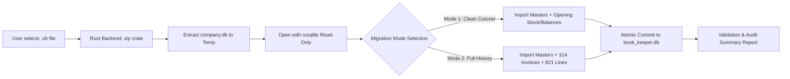
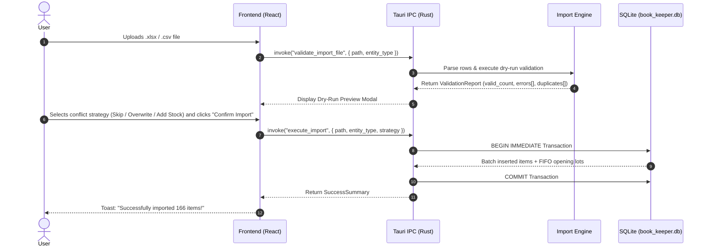

# BookKeeper - Data Import, Export & VedBill Migration Study
**Document Version:** 1.1.0  
**Status:** Reference study. **v1 scope (2026-11-21, [DD-16](DESIGN_DECISIONS.md)):** only §4 *Template A items import* (dry-run + Skip/Overwrite/Add-stock, CSV + XLSX, opening stock as `OPENING`-source lots) is in v1, implemented per Backend LLD §6.14 (`validate_items_import`, `execute_items_import`). **Amended 2026-11-22:** the *inventory-only* VedBill migration (items + open stock lots; LLD §6.14a) is also in v1. Everything else here — the rest of VedBill migration (§2–3: parties, documents, payments), parties import / opening dues (Template B), all exports (§5), restore, and the §7 IPC names — is **deferred to v2**. Where this document and the LLD differ, the LLD wins.  
**Target Architecture:** Desktop (Windows 10/11 x64) | Tauri v2 + Rust (rusqlite) + React 19 / TypeScript  

---

## 1. Executive Summary & Objective

This document captures the findings, architecture, and design specifications for **Data Portability, Bulk Import/Export (CSV & Native Excel .xlsx)**, and a **Dedicated Migration Facility for Legacy VedBill Backups (`.vb` files)**.

These specifications were formulated following a forensic analysis of real-world VedBill backup files located on the host system (`Documents/VEDBIL`). This document serves as the authoritative blueprint when implementing the Low-Level Design (LLD) and writing backend Rust IPC commands and frontend UI modules.

---

## 2. VedBill Backup Forensic Study & Data Discovery

### 2.1 File Location & Archive Architecture
* **Path on Host:** `C:\Users\bhupk\Documents\VEDBIL\` *(Note: directory name is `VEDBIL` on disk with a single 'L')*.
* **File Format:** Files carry the `.vb` extension with timestamps (e.g., `YOUR COMPANY NAME HERE-backup-2026-11-14-2041.vb`).
* **Container Type:** Standard **PKZip (ZIP)** archive format (magic header: `50 4B 03 04`).

### 2.2 Archive Contents
When unzipped, each `.vb` file contains:
1. **`company_manifest.json`**:
   ```json
   {
     "companyId": "38561618-bd52-4e58-b203-ba470fff9d23",
     "companyName": "YOUR COMPANY NAME HERE",
     "schemaVersion": 8,
     "folderVersion": 1,
     "appVersion": "1.0.0",
     "createdAt": "2026-11-03T15:50:08.550Z",
     "updatedAt": "2026-11-14T15:11:38.884Z"
   }
   ```
2. **`company.db`**: A clean, fully relational **SQLite 3 database** (approx. 2.58 MB uncompressed).
3. **Media Folders:** `product-images/`, `attachments/`, `purchase-bills/`, `signatures/`, `exports/`.

### 2.3 Discovered Tables & Actual Record Counts
Analysis of the latest database (`YOUR COMPANY NAME HERE-backup-2026-11-14-2041.vb`) revealed:

| Table Name | Row Count | Contents / Description |
| :--- | :--- | :--- |
| `items` | **166** | Master catalog items (Stationery/Books: e.g. "LONG SUCC. 160PG R/P MRP 80") |
| `parties` | **12** | Customer and supplier profiles (e.g. "MAHESH STATIONERS", "G.M", "RAJAN") |
| `documents` | **314** | Transaction headers: **300 Sales Invoices**, **13 Purchase Invoices**, **1 Expense** |
| `document_items` | **821** | Transaction line items linking items, quantities, rates, and amounts |
| `units` | **11** | Unit definitions (PCS, BOX, DOZEN, etc.) |
| `unit_conversions` | **147** | Multiplier mappings between primary and secondary units |
| `categories` | **6** | Product classifications |
| `payments` | **2** | Historical cash payment settlements linked to invoices |
| `firm_profile` | **1** | Business details, print configuration, and feature flags |
| `godowns` | **1** | Default warehouse/godown |
| `stock_lots` | **215** | Historical inward purchase lots |
| `fifo_consumption` | **771** | Historical FIFO cost allocation mapping |

### 2.4 Key Field Mappings Discovered in VedBill Schema

#### `items` Table
* `id` (TEXT UUID): Primary key.
* `name` (TEXT): Item description/name.
* `salePrice` (REAL): Default selling rate.
* `purchasePrice` (REAL): Cost rate.
* `mrp` (REAL): Printed retail price.
* `primaryQuantity` (REAL): Current on-hand inventory stock.
* `unit_conversionId` (TEXT): Link to packaging conversion.
* `accountType` (TEXT): Typically `"inventory"`.

#### `parties` Table
* `id` (TEXT UUID): Primary key.
* `name` (TEXT): Party / Business name.
* `phone` (TEXT): Contact number.
* `type` (TEXT): `"customer"` or `"supplier"`.
* `openingBalance` (REAL): Initial balance.
* `openingBalanceType` (TEXT): `"to_pay"` (Vendor credit) or `"to_receive"` (Customer debit).
* `currentBalance` (REAL): Current outstanding balance.
* `billingAddress` (TEXT): Address string.

#### `documents` Table
* `id` (TEXT UUID): Primary key.
* `documentType` (TEXT): `"sale_invoice"`, `"purchase_invoice"`, `"expense"`.
* `documentNumber` (TEXT): Bill/Invoice numbering (e.g., `"4985"`).
* `documentDate` (TEXT): `"YYYY-MM-DD"`.
* `partyId` (TEXT): Link to `parties.id`.
* `total` (REAL): Grand total after discounts/rounding.
* `subtotal` (REAL): Raw line items sum.
* `balanceAmount` (REAL): Unpaid balance.
* `paidAmount` (REAL): Paid cash/bank amount.

---

## 3. VedBill Migration Engine Architecture

### 3.1 Migration Strategy & Ingestion Pipeline
Because the `.vb` file wraps an SQLite database, migration does not require fragile text scraping. The Rust backend can:
1. Open the `.vb` archive using the `zip` crate.
2. Extract `company.db` to an in-memory database or a temporary SQLite file (`std::env::temp_dir()`).
3. Connect via `rusqlite` with read-only flags.
4. Execute an atomic transaction against the active `book_keeper.db` to import data.



### 3.2 Dual Migration Modes

#### Mode 1: Masters & Current Balances Only (Clean Cutover - Recommended)
Best for shop owners who want a clean start in BookKeeper without carrying over obsolete transactions, but need all products, prices, current stock, and customer dues ready instantly:
* **Item Catalog:** Migrates all 166 items (`name`, `mrp`, `sale_price`, `purchase_cost`, `base_unit`).
* **Opening Stock:** For each item with `primaryQuantity > 0`, automatically inserts an opening `PURCHASE_ITEM` lot with `remaining_quantity = primaryQuantity` and `unit_cost = purchasePrice`. This properly seeds the FIFO engine.
* **Parties:** Migrates all 12 parties. Sets `currentBalance` from VedBill as the `balance_due` in BookKeeper.
* **Bundles / Units:** Reads `unit_conversions` to generate `ITEM_BUNDLE` presets (e.g., Box of 10).

#### Mode 2: Full Historical Migration
For users requiring exact past audit continuity:
* Migrates all historical `documents` into `SALE_TRANSACTION` and `PURCHASE_TRANSACTION`.
* Migrates all `document_items` into `SALE_ITEM` and `PURCHASE_ITEM`.
* Reconstructs historical payments and dues balances.

---

## 4. Generic CSV & Native Excel (.xlsx) Import Architecture

### 4.1 Backend Engine (Rust Crates)
To ensure zero dependency on Microsoft Office or external runtimes:
* **`calamine` (v0.24+)**: Pure-Rust reader for `.xlsx`, `.xls`, `.ods`. Memory-efficient, fast parsing.
* **`rust_xlsxwriter` (v0.64+)**: High-performance `.xlsx` writer for styled tables, headers, currency formulas, and column auto-sizing.
* **`csv` (v1.3+)**: Streaming CSV reader/writer for fallback and lightweight imports.

### 4.2 Standard Template Schemas

#### Template A: Item Master & Opening Stock (`items_template.xlsx` / `.csv`)
| Column Header | Data Type | Required? | Example Value | Description |
| :--- | :--- | :--- | :--- | :--- |
| `Item Name` | Text | **Yes** | Long Notebook 160pg | Unique product name |
| `Category` | Text | No | Stationery | Grouping category |
| `Barcode` | Text | No | 8901234567890 | EAN/UPC or internal SKU |
| `Base Unit` | Text | **Yes** | PCS | Smallest unit (PCS, BOX, PKT) |
| `MRP` | Decimal | No | 80.00 | Printed maximum retail price |
| `Sale Price` | Decimal | **Yes** | 60.00 | Default selling price per base unit |
| `Purchase Cost` | Decimal | **Yes** | 36.00 | Inward unit cost (used for FIFO lot) |
| `Opening Stock` | Decimal | No (Def: 0) | 150 | Starting inventory quantity |
| `Packaging Bundle`| Text | No | Box of 10 | Optional bundle name |
| `Units Per Bundle`| Decimal | No | 10 | Bundle multiplier |

#### Template B: Parties & Opening Dues (`parties_template.xlsx` / `.csv`)
| Column Header | Data Type | Required? | Example Value | Description |
| :--- | :--- | :--- | :--- | :--- |
| `Party Name` | Text | **Yes** | Mahesh Stationers | Customer or Vendor name |
| `Party Type` | Text | **Yes** | CUSTOMER | `CUSTOMER` or `VENDOR` |
| `Phone` | Text | No | 9876543210 | 10-digit mobile number |
| `Opening Balance` | Decimal | No (Def: 0) | 12500.00 | Outstanding opening balance |
| `Balance Type` | Text | No (Def: DUE) | DUE | `DUE` (they owe us) / `ADVANCE` (we owe them) |
| `Notes` | Text | No | Wholesale buyer | Notes / remarks |

### 4.3 Four-Phase Import Lifecycle



1. **Phase 1: Template Download**: User can download pre-formatted `.xlsx` or `.csv` with embedded instructions and example rows.
2. **Phase 2: Validation & Dry Run**:
   * Scans rows without writing to DB.
   * Validates mandatory fields, numeric formats, and duplicates against existing database records.
   * Returns a detailed list of invalid rows with exact row numbers and human-readable error reasons.
3. **Phase 3: Conflict Resolution**:
   * **Skip Existing:** Keeps current record, ignores duplicate row.
   * **Overwrite Details:** Updates price, MRP, category, but leaves existing transactions intact.
   * **Accumulate Stock:** Adds opening stock to existing inventory and creates a supplementary FIFO lot.
4. **Phase 4: Atomic Execution**:
   * Executed inside SQLite `BEGIN IMMEDIATE` transaction.
   * Guarantees all-or-nothing consistency. If any unrecoverable error occurs, the entire batch is rolled back.

---

## 5. Generic Export Facilities Architecture

### 5.1 Export Scopes & File Formats
All export operations must offer both **Native Excel (`.xlsx`)** (with formatted currency, bold headers, and styled summary rows) and **Plain CSV (`.csv`)**.

| Export Module | Content & Columns Included | Primary Purpose |
| :--- | :--- | :--- |
| **Catalog & Stock Valuation** | Item Name, Category, Barcode, Base Unit, Current Stock, Purchase Cost, Sale Price, MRP, Total Valuation (`stock * cost`), Stock Status (`OK` / `LOW STOCK`). | Balance sheet asset audit, annual stock-taking |
| **Parties & Dues Ledger** | Party Name, Type, Phone, Total Billed, Total Paid, Balance Due, Last Transaction Date. | Customer credit collection, supplier payment planning |
| **Sales Register** | Date, Invoice No, Customer, Item Name, Quantity, Unit, Unit Price, Line Total, Payment Status. | GST filing preparation, sales audit |
| **Purchase Register** | Date, Bill No, Vendor, Item Name, Quantity, Unit, Unit Cost, Line Total, Payment Status. | Purchase cost auditing, supplier reconciliation |
| **Daybook Register** | Date/Time, Transaction Code, Type (Sale/Purchase/Return/Payment), Party, Cash Inflow, Cash Outflow, Net Balance. | Daily cash drawer closing & management |
| **Profit & Loss (P&L)** | Date Range, Gross Sales, FIFO Cost of Goods Sold (COGS), Gross Profit, Margin %. | Business profitability analysis |

### 5.2 Excel Styling Rules (`rust_xlsxwriter`)
* Header row formatted with light slate background (`#F1F5F9`), bold dark text (`#0F172A`), and bottom border.
* Numeric columns (Quantities) aligned right with `0.00` format.
* Financial amounts (Rates, Totals, Valuations) formatted with Indian Rupee / standard currency formatting (`#,##0.00`).
* Dates formatted as `YYYY-MM-DD`.
* Column widths auto-fitted based on maximum text length + 3 padding characters.
* Top row (headers) frozen (`freeze_panes(1, 0)`) for smooth scrolling.

---

## 6. UI / UX Design & Button Placements for LLD

### 6.1 Page 4: Inventory & Master Catalog
* **Action Header Buttons:**
  * `[+ Add Item]` (Primary action)
  * `[Import Items ▾]` (Dropdown menu):
    * *Download Excel Template (.xlsx)*
    * *Download CSV Template (.csv)*
    * *Import from Excel / CSV...*
    * *Import from VedBill Backup (.vb)...*
  * `[Export Catalog ▾]` (Dropdown menu):
    * *Export to Excel (.xlsx)*
    * *Export to CSV*

### 6.2 Page 5: Parties & Dues Ledger
* **Action Header Buttons:**
  * `[+ Add Party]`
  * `[Import Parties (Excel/CSV)]`
  * `[Export Dues Ledger (Excel/CSV)]`

### 6.3 Page 11: Reports & Registers
* On every sub-tab (Sales Register, Purchase Register, Daybook, Stock Valuation, P&L):
  * Top-right toolbar: `[Export to Excel (.xlsx)]` | `[Export to CSV]`.

### 6.4 Page 12: Settings & Migration
A dedicated section titled **"Data Portability & Legacy Migration"** containing three distinct cards:
1. **Card 1: VedBill Migration Wizard:**
   * File selector button: `[Select VedBill Backup (.vb)]` (defaults to `Documents/VEDBIL`).
   * Backup metadata inspector showing: Company Name, Schema Version, Items count (166), Parties count (12), Invoices count (314).
   * Radio selection:
     * `(•) Clean Cutover: Import Masters, Stock & Dues Only (Recommended)`
     * `( ) Full Historical Import: Import Masters + All Past Invoices & Line Items`
   * Action button: `[Start Migration]` with real-time progress bar.
2. **Card 2: Bulk CSV / Excel Management:**
   * Template download buttons.
   * Manual bulk import buttons for Items and Parties.
   * Full database master export button.
3. **Card 3: Local SQLite Snapshot & USB Backup:**
   * One-click backup of active `book_keeper.db` with auto-naming: `book_keeper_backup_YYYYMMDD_HHMM.db`.
   * Restore from snapshot button with destructive override confirmation.

---

## 7. Tauri IPC API Specification (To be implemented in LLD)

```rust
// ==========================================
// 1. GENERIC IMPORT / EXPORT IPC COMMANDS
// ==========================================

#[tauri::command]
pub async fn generate_import_template(
    entity_type: String,       // "ITEMS" | "PARTIES"
    format: String,            // "XLSX" | "CSV"
    save_path: String,
) -> Result<String, String>;

#[tauri::command]
pub async fn validate_import_file(
    file_path: String,
    entity_type: String,       // "ITEMS" | "PARTIES"
) -> Result<ImportValidationReport, String>;

#[tauri::command]
pub async fn execute_import(
    file_path: String,
    entity_type: String,
    conflict_strategy: String, // "SKIP" | "OVERWRITE" | "ADD_STOCK"
) -> Result<ImportSuccessSummary, String>;

#[tauri::command]
pub async fn export_data(
    export_type: String,       // "CATALOG" | "PARTIES" | "SALES" | "PURCHASES" | "DAYBOOK" | "VALUATION"
    format: String,            // "XLSX" | "CSV"
    destination_path: String,
    date_filter: Option<DateRangeFilter>,
) -> Result<String, String>;

// ==========================================
// 2. VEDBILL MIGRATION IPC COMMANDS
// ==========================================

#[tauri::command]
pub async fn inspect_vedbill_backup(
    file_path: String,
) -> Result<VedBillInspectionReport, String>;

#[tauri::command]
pub async fn execute_vedbill_migration(
    file_path: String,
    migration_mode: String,    // "MASTERS_ONLY" | "FULL_HISTORY"
) -> Result<VedBillMigrationResult, String>;
```

---

## 8. LLD Readiness Checklist

When beginning the Low-Level Design (LLD) and implementation:
- [ ] Add `calamine = "0.24"`, `rust_xlsxwriter = "0.64"`, `csv = "1.3"`, and `zip = "2.1"` to `src-tauri/Cargo.toml`.
- [ ] Implement `import_engine` module in Rust with streaming row readers and validation logic.
- [ ] Implement `export_engine` module with Excel header styling and currency formatters.
- [ ] Implement `vedbill_migrator` module to read `company.db` from `.vb` archives and translate into `book_keeper` schema.
- [ ] Build React UI components:
  - `<ImportDialog />` with dry-run preview table and conflict selectors.
  - `<ExportButton />` dropdown component with format selection.
  - `<VedBillMigrationCard />` in the Settings page with step-by-step progress indicator.
